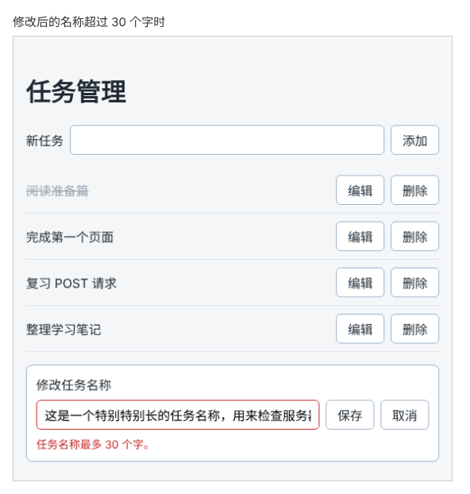

# 第 93 章：【组合】如何从列表打开编辑，并在保存后显示最新结果？

前置：[第 92A 章：任务页的请求代码越来越多，如何集中到一个文件中？](第092A章-任务页的请求代码越来越多，如何集中到一个文件中.md)

## 一、本章要解决的问题

任务管理页的“添加”已经很完善：保存期间按钮禁用，名称不符合要求时原因显示在输入框下方，成功后直接用服务器返回的任务更新列表。“编辑”还差两步：保存期间仍然可以重复点击“保存”；错误提示显示在编辑框的外面，和输入框没有关联，输入框也不会标红。

本章不引入新技术，把第 89—92A 章的做法用到编辑流程上，走通一条完整的路线：从列表点击“编辑”，打开编辑框；保存期间按钮禁用；服务器拒绝时，原因显示在编辑框的输入框下方，输入的内容保留；保存成功后关闭编辑框，列表中显示服务器保存的最新名称。



## 二、必要原理

### 要组合的几项做法

| 要解决的问题 | 用到的做法 | 来自 |
| --- | --- | --- |
| 保存期间不能重复点击 | 用 state 记住正在保存，禁用按钮；`try...finally` 保证结束后恢复 | 第 89 章 |
| 名称不符合要求时，原因显示在输入框下方 | 用 `aria-invalid`、`aria-describedby` 把错误关联到输入框 | 第 90 章 |
| 保存失败时保留输入的内容 | 成功后才关闭编辑框 | 第 91 章 |
| 成功后显示最新结果 | 用服务器返回的任务和更新函数替换列表中的这一条 | 第 92 章 |
| 读取服务器给出的原因 | `updateTaskTitle` 返回 `{ status: 'invalid', titleError }` | 第 92A 章 |
| 编辑框显示新的状态 | 给组件增加可选的属性，并设置默认值 | 第 10 章 |

第 91、92、92A 章的三项已经做好，本章补上第 89、90 章的两项。

### 保存中和错误交给 TaskEditor 显示

“正在保存”和错误提示由任务管理页掌握，但按钮和输入框在 `TaskEditor` 里面。所以给 `TaskEditor` 增加两个属性，由任务管理页传进去：

- `saving`：是否正在保存。为 `true` 时禁用“保存”和“取消”，“保存”的文字变成“正在保存……”。
- `error`：错误提示。不为空时显示在输入框下方，并把输入框标为无效。

这两个属性写成可选的，并设置默认值 `false` 和 `''`，写法和第 10 章（如何用 TypeScript 检查组件收到的数据是否正确）中资料卡片的 `note` 相同。待办事项页 `TaskPage` 也在使用 `TaskEditor`，它不传这两个属性，编辑框的表现和原来完全一样。

### 保存期间也禁用“编辑”按钮

编辑框保存期间，如果用户点击另一条任务的“编辑”，编辑框会换成那一条任务。等前一个请求成功，`handleSaveEdit` 把 `editingId` 设为 `null`，关掉的却是刚打开的新编辑框。为了避免这种混乱，保存期间把列表中的“编辑”按钮也禁用，等保存结束再允许切换。

### 编辑的错误都显示在编辑框中

第 91 章在编辑框外面显示 `editError`。现在 `editError` 通过 `error` 属性传给 `TaskEditor`，原来那行提示就可以删除了。第 92A 章以后，名称不符合要求时 `editError` 中已经是服务器给出的具体原因。连接失败、服务器出错（500）和名称不符合要求（422），都显示在编辑框的输入框下方：编辑框只有一个输入框，用户一眼就能看到这次修改为什么没有成功。

## 三、动手实现

### 第 1 步：加入编辑框的错误样式

在 `src/components/TaskEditor.module.css` 的末尾加入：

```css
.editor [aria-invalid='true'] {
  border-color: #c62828;
}

.error {
  flex-basis: 100%;
  margin: 0;
  color: #c62828;
  font-size: 14px;
}
```

编辑框的表单是一行可以换行的 flex 布局。`flex-basis: 100%` 让错误提示单独占一整行，显示在输入框和按钮的下方。

### 第 2 步：给 TaskEditor 增加 saving 和 error

修改 `src/components/TaskEditor.tsx`。在属性类型中加入两个可选属性：

```tsx
type TaskEditorProps = {
  task: Task;
  onSave: (title: string) => void;
  onCancel: () => void;
  saving?: boolean;
  error?: string;
};
```

函数的参数中加上它们和默认值。参数变多，一行写不下，按每个属性一行排列：

```tsx
export default function TaskEditor({
  task,
  onSave,
  onCancel,
  saving = false,
  error = '',
}: TaskEditorProps) {
```

把 `return` 中的输入框和两个按钮改为下面的样子，并在 `</form>` 前面加上错误提示：

```tsx
      <input
        id="edit-task"
        value={draft}
        onChange={handleDraftChange}
        aria-invalid={error !== ''}
        aria-describedby={error ? 'edit-task-error' : undefined}
      />
      <button type="submit" disabled={saving || draft.trim() === ''}>
        {saving ? '正在保存……' : '保存'}
      </button>
      <button type="button" onClick={onCancel} disabled={saving}>
        取消
      </button>
      {error && (
        <p id="edit-task-error" className={styles.error}>
          {error}
        </p>
      )}
    </form>
```

“保存”按钮在两种情况下禁用：正在保存，或者名称为空。`||` 表示“或者”，两个条件有一个成立就禁用。

以下各步修改 `src/pages/TaskServerPage.tsx`。

### 第 3 步：增加 isSavingEdit

在 `editError` 的下面加入：

```tsx
  const [editError, setEditError] = useState('');
  const [isSavingEdit, setIsSavingEdit] = useState(false);
```

把 `handleSaveEdit` 改为下面的样子：开头设为正在保存，`catch` 后面加上 `finally`，在其中恢复。

```tsx
  async function handleSaveEdit(id: string, title: string) {
    setEditError('');
    setIsSavingEdit(true);
    try {
      const result = await updateTaskTitle(id, title);
      if (result.status === 'invalid') {
        setEditError(result.titleError);
        return;
      }
      setEditingId(null);
      setLoadState((current) => ({
        ...current,
        tasks: current.tasks.map((task) => (task.id === id ? result.task : task)),
      }));
    } catch (error) {
      setEditError(getErrorMessage(error));
    } finally {
      setIsSavingEdit(false);
    }
  }
```

和第 89 章的 `handleAdd` 一样，无论保存成功、名称不符合要求还是失败，`finally` 都会执行，按钮一定会恢复。

### 第 4 步：保存期间禁用“编辑”按钮

把列表中的“编辑”按钮改为：

```tsx
              <button
                type="button"
                onClick={() => handleStartEdit(task.id)}
                disabled={isSavingEdit}
              >
                编辑
              </button>
```

### 第 5 步：把状态传给编辑框

给 `TaskEditor` 加上两个属性，并删除它下面那行 `{editingTask && editError && …}`：

```tsx
      {editingTask && (
        <TaskEditor
          key={editingTask.id}
          task={editingTask}
          onSave={(title) => handleSaveEdit(editingTask.id, title)}
          onCancel={() => setEditingId(null)}
          saving={isSavingEdit}
          error={editError}
        />
      )}
    </main>
```

## 四、运行与检查

保持开发服务器和练习服务都在运行（准备篇二）。按下面的顺序把整条路线走一遍。

1. 点击“完成第一个页面”的“编辑”，列表下方出现编辑框，里面是这条任务的名称。
2. 输入超过 30 个字的名称，点击“保存”。半秒内按钮变成“正在保存……”，“保存”“取消”和列表中的“编辑”都不能点。
3. 半秒后按钮恢复，输入框变成红色边框，下方显示“任务名称最多 30 个字。”，输入的内容仍在。
4. 把名称改为“  组合完成  ”（首尾带空格），点击“保存”。编辑框关闭，列表中这一条显示“组合完成”。Network（网络）中只有一个 PATCH 请求。
5. 停止练习服务，再编辑一条任务并保存。编辑框保留，输入框下方显示“修改失败：服务器返回了状态 500。”。重新启动练习服务，直接点击“保存”，保存成功。
6. 打开待办事项页确认 `TaskEditor` 的改动没有影响它：临时把 `App.tsx` 改为显示 `TaskPage`，点击“编辑”并修改名称，编辑框和原来一样可以保存和取消。确认后把 `App.tsx` 改回 `TaskServerPage`。
7. 刷新页面，所有改动都还在。

最后运行检查，应没有错误：

```powershell
npm.cmd run check
```

### 阶段练习：自己做一个任务进度页

学到这里，你已经能做出读写服务器数据的页面。下面的练习请**不看教程代码**，独立完成。参考答案见[附录 A](附录A-阶段练习参考答案.md)，完成后再对照。

**需求**：新建一个“任务进度”页，在 `App` 中切换为显示它。它和任务管理页使用同一个任务接口，但只负责切换完成状态，不需要添加、修改名称和删除。

- 打开页面时从练习服务读取任务。读取期间显示提示，读取失败时显示原因。
- 每条任务前有一个复选框，勾选表示已完成，已完成的任务显示删除线。
- 勾选或取消勾选时，把新的完成状态保存到服务器：发送 `PATCH /api/tasks/任务编号`，正文为 `{ "completed": true }` 或 `{ "completed": false }`，成功时服务器返回修改后的任务。
- 页面上方有一个“只看未完成”复选框，勾选后列表中只显示未完成的任务。

**验收标准**：

1. 勾选一条任务后刷新页面，这条任务仍然是已完成；取消勾选后刷新，仍然是未完成。
2. 某条任务保存期间，它的复选框不能再点击。
3. 停止练习服务后勾选一条任务，页面显示失败提示，复选框保持原来的状态。
4. 勾选“只看未完成”后，再把一条任务勾选为已完成，它从列表中消失。
5. 列表用服务器返回的任务更新，不重新读取整个列表；更新时使用更新函数。
6. `npm.cmd run check` 没有错误。

练习完成后，把 `App` 换回 `TaskServerPage`，后面的章节从本章的完整代码继续。

## 五、常见错误

| 现象 | 原因 | 怎么改 |
| --- | --- | --- |
| 待办事项页的编辑框一打开，输入框就是红色边框 | `error` 没有写默认值，`TaskPage` 不传时它是 `undefined`，`undefined !== ''` 成立 | 写成 `saving = false`、`error = ''` |
| 编辑框下面出现两条一样的错误提示 | 第 91 章的 `{editingTask && editError && …}` 没有删除 | 错误已经由 `TaskEditor` 显示，删除页面上的那一行 |
| 错误提示挤在“取消”按钮的右边 | 漏写了 `.error` 的 `flex-basis: 100%` | 按第 1 步补上样式 |
| 保存失败后，按钮一直是“正在保存……” | `setIsSavingEdit(false)` 没有写在 `finally` 中 | 按第 3 步用 `try...finally` |

## 六、本章完整代码

### `src/components/TaskEditor.module.css`

```css
.editor {
  display: flex;
  flex-wrap: wrap;
  align-items: center;
  gap: 8px;
  margin-top: 16px;
  padding: 12px;
  border: 1px solid #9fb3c8;
  border-radius: 8px;
  background: #ffffff;
}

.editor label {
  flex-basis: 100%;
}

.editor input {
  flex: 1;
  min-width: 0;
  padding: 8px 10px;
  border: 1px solid #9fb3c8;
  border-radius: 6px;
  font: inherit;
}

.editor [aria-invalid='true'] {
  border-color: #c62828;
}

.error {
  flex-basis: 100%;
  margin: 0;
  color: #c62828;
  font-size: 14px;
}
```

### `src/components/TaskEditor.tsx`

```tsx
import { useState } from 'react';
import type { ChangeEvent, SubmitEvent } from 'react';
import type { Task } from '../data/tasks';
import styles from './TaskEditor.module.css';

type TaskEditorProps = {
  task: Task;
  onSave: (title: string) => void;
  onCancel: () => void;
  saving?: boolean;
  error?: string;
};

export default function TaskEditor({
  task,
  onSave,
  onCancel,
  saving = false,
  error = '',
}: TaskEditorProps) {
  const [draft, setDraft] = useState(task.title);

  function handleDraftChange(event: ChangeEvent<HTMLInputElement>) {
    setDraft(event.target.value);
  }

  function handleSubmit(event: SubmitEvent<HTMLFormElement>) {
    event.preventDefault();
    const title = draft.trim();
    if (title === '') {
      return;
    }
    onSave(title);
  }

  return (
    <form className={styles.editor} onSubmit={handleSubmit}>
      <label htmlFor="edit-task">修改任务名称</label>
      <input
        id="edit-task"
        value={draft}
        onChange={handleDraftChange}
        aria-invalid={error !== ''}
        aria-describedby={error ? 'edit-task-error' : undefined}
      />
      <button type="submit" disabled={saving || draft.trim() === ''}>
        {saving ? '正在保存……' : '保存'}
      </button>
      <button type="button" onClick={onCancel} disabled={saving}>
        取消
      </button>
      {error && (
        <p id="edit-task-error" className={styles.error}>
          {error}
        </p>
      )}
    </form>
  );
}
```

### `src/pages/TaskServerPage.tsx`

```tsx
import { useEffect, useState } from 'react';
import type { SubmitEvent } from 'react';
import TaskEditor from '../components/TaskEditor';
import { createTask, deleteTask, fetchTasks, updateTaskTitle } from '../lib/taskApi';
import type { Task } from '../types/task';
import styles from './TaskPage.module.css';

type LoadState =
  | { status: 'loading'; tasks: Task[] }
  | { status: 'success'; tasks: Task[] }
  | { status: 'error'; message: string; tasks: Task[] };

function getErrorMessage(error: unknown) {
  return error instanceof Error ? error.message : '操作失败，请稍后重试。';
}

export default function TaskServerPage() {
  const [loadState, setLoadState] = useState<LoadState>({ status: 'loading', tasks: [] });
  const [draft, setDraft] = useState('');
  const [titleError, setTitleError] = useState('');
  const [saveError, setSaveError] = useState('');
  const [isAdding, setIsAdding] = useState(false);
  const [editingId, setEditingId] = useState<string | null>(null);
  const [editError, setEditError] = useState('');
  const [isSavingEdit, setIsSavingEdit] = useState(false);
  const tasks = loadState.tasks;
  const editingTask = tasks.find((task) => task.id === editingId);

  useEffect(() => {
    let ignore = false;

    async function loadOnOpen() {
      try {
        const data = await fetchTasks();
        if (!ignore) {
          setLoadState({ status: 'success', tasks: data });
        }
      } catch (error) {
        if (!ignore) {
          setLoadState({ status: 'error', message: getErrorMessage(error), tasks: [] });
        }
      }
    }

    loadOnOpen();
    return () => {
      ignore = true;
    };
  }, []);

  async function handleRetry() {
    setLoadState({ status: 'loading', tasks: [] });
    try {
      const data = await fetchTasks();
      setLoadState({ status: 'success', tasks: data });
    } catch (error) {
      setLoadState({ status: 'error', message: getErrorMessage(error), tasks: [] });
    }
  }

  async function handleAdd(event: SubmitEvent<HTMLFormElement>) {
    event.preventDefault();
    const title = draft.trim();
    if (title === '') {
      setTitleError('请填写任务名称。');
      return;
    }
    setTitleError('');
    setSaveError('');
    setIsAdding(true);
    try {
      const result = await createTask(title);
      if (result.status === 'invalid') {
        setTitleError(result.titleError);
        return;
      }
      setDraft('');
      setLoadState((current) => ({ ...current, tasks: [...current.tasks, result.task] }));
    } catch (error) {
      setSaveError(getErrorMessage(error) + '输入的内容已保留。');
    } finally {
      setIsAdding(false);
    }
  }

  function handleStartEdit(id: string) {
    setEditingId(id);
    setEditError('');
  }

  async function handleSaveEdit(id: string, title: string) {
    setEditError('');
    setIsSavingEdit(true);
    try {
      const result = await updateTaskTitle(id, title);
      if (result.status === 'invalid') {
        setEditError(result.titleError);
        return;
      }
      setEditingId(null);
      setLoadState((current) => ({
        ...current,
        tasks: current.tasks.map((task) => (task.id === id ? result.task : task)),
      }));
    } catch (error) {
      setEditError(getErrorMessage(error));
    } finally {
      setIsSavingEdit(false);
    }
  }

  async function handleDelete(id: string) {
    if (id === editingId) {
      setEditingId(null);
    }
    setSaveError('');
    try {
      await deleteTask(id);
      setLoadState((current) => ({
        ...current,
        tasks: current.tasks.filter((task) => task.id !== id),
      }));
    } catch (error) {
      setSaveError(getErrorMessage(error));
    }
  }

  return (
    <main className="page">
      <h1>任务管理</h1>
      <form className={styles.addForm} onSubmit={handleAdd}>
        <label htmlFor="new-task">新任务</label>
        <input
          id="new-task"
          value={draft}
          onChange={(event) => setDraft(event.target.value)}
          aria-invalid={titleError !== ''}
          aria-describedby={titleError ? 'new-task-error' : undefined}
        />
        <button type="submit" disabled={isAdding}>
          {isAdding ? '正在添加……' : '添加'}
        </button>
      </form>
      {titleError && (
        <p id="new-task-error" className={styles.error}>
          {titleError}
        </p>
      )}
      {saveError && <p role="alert">{saveError}</p>}
      {loadState.status === 'loading' && <p role="status">正在读取任务……</p>}
      {loadState.status === 'error' && (
        <div>
          <p role="alert">{loadState.message}</p>
          <button type="button" onClick={handleRetry}>
            重试
          </button>
        </div>
      )}
      {loadState.status === 'success' && tasks.length === 0 && (
        <p className={styles.empty}>还没有任务。</p>
      )}
      {tasks.length > 0 && (
        <ul className={styles.list}>
          {tasks.map((task) => (
            <li key={task.id} className={styles.item}>
              <span className={task.completed ? styles.title + ' ' + styles.done : styles.title}>
                {task.title}
              </span>
              <button
                type="button"
                onClick={() => handleStartEdit(task.id)}
                disabled={isSavingEdit}
              >
                编辑
              </button>
              <button
                type="button"
                aria-label={'删除：' + task.title}
                onClick={() => handleDelete(task.id)}
              >
                删除
              </button>
            </li>
          ))}
        </ul>
      )}
      {editingTask && (
        <TaskEditor
          key={editingTask.id}
          task={editingTask}
          onSave={(title) => handleSaveEdit(editingTask.id, title)}
          onCancel={() => setEditingId(null)}
          saving={isSavingEdit}
          error={editError}
        />
      )}
    </main>
  );
}
```

## 七、本章改动小结

修改 `src/components/TaskEditor.module.css`：加入错误样式；修改 `src/components/TaskEditor.tsx`：新增可选属性 `saving` 和 `error`；修改 `src/pages/TaskServerPage.tsx`：新增 `isSavingEdit`，保存期间禁用相关按钮，错误改由编辑框显示。

---

下一章：[第 93A 章：新增和修改只需要部分字段时，如何写它们的类型？](第093A章-新增和修改只需要部分字段时，如何写它们的类型.md)
