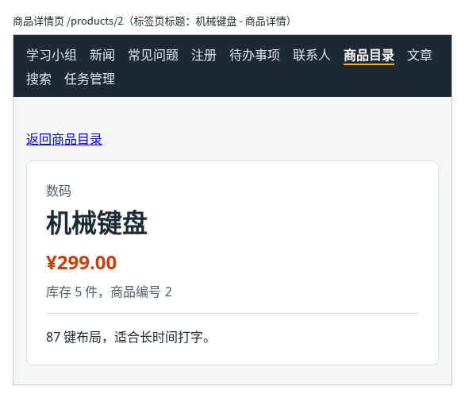

# 第 94 章：如何通过链接切换页面，而不刷新整个应用？

前置：[第 93B 章：删除任务之前，如何让用户确认？](第093B章-删除任务之前，如何让用户确认.md)

## 一、本章要解决的问题

到现在为止，项目里已经有十个练习页：学习小组、新闻、常见问题、注册、待办事项、联系人、商品目录、文章、搜索和任务管理。可是每次想看另一个页面，都要打开 `App.tsx` 改导入和返回的组件。真正的网站应该在页面顶部有一排导航，点一下就换到对应的页面，地址栏也跟着变成 `/news`、`/products` 这样的地址。

本章安装 React Router，把十个页面都接入路由。完成后：页面顶部有一条深色导航栏；点击“新闻”，地址变成 `/news`，下方显示新闻页，整个过程不会重新加载网页；浏览器的“后退”按钮可以回到上一个页面；直接在地址栏输入 `http://127.0.0.1:5173/products` 也能打开商品目录。

本章是第 11 部分的起点。学完第 11 部分（第 94—101 章）时，商品详情页的效果如下图：顶部导航栏中当前所在的“商品目录”高亮显示；详情页从网址中读出商品编号，从练习服务读取这件商品并显示出来；浏览器标签页的标题是商品的名称。



## 二、必要原理

### 单页应用：页面切换由 JavaScript 完成

普通网站的每个页面是一个单独的 HTML 文件。点击链接时，浏览器丢掉当前页面，向服务器请求新的 HTML，从头加载。

React 项目只有一个 `index.html`，所有页面都是 JavaScript 画出来的，这种应用叫**单页应用**（Single Page Application，SPA）。在单页应用中换页面，只需要做两件事：把地址栏改成新地址，再按新地址显示另一个组件。网页本身不重新加载，已经下载的代码、正在运行的状态都保留着，所以换页面很快。

### 路由：根据地址决定显示哪个组件

“这个地址显示哪个组件”的对应关系叫**路由**（route）。React 本身不处理地址，最常用的路由库是 **React Router**，本教程使用 8.5.1 版，包名是 `react-router`。

用到它的三样东西：

| 名称 | 作用 | 放在哪里 |
| --- | --- | --- |
| `BrowserRouter` | 让应用能读取和修改地址栏 | 包住整个 `App`，只写一次 |
| `Routes` 和 `Route` | 路由表：`path` 写地址，`element` 写这个地址显示的组件 | `App` 中 |
| `Link` | 链接：点击后只改地址、换组件，不重新加载网页 | 需要跳转的地方 |

路由表的写法：

```tsx
<Routes>
  <Route path="/" element={<GroupPage />} />
  <Route path="/news" element={<NewsPage />} />
</Routes>
```

`Routes` 会拿当前地址和每个 `Route` 的 `path` 比较，只显示匹配的那一个。`element` 中写的是 JSX，所以要写成 `<NewsPage />`，不是 `NewsPage`。

### 为什么用 Link 而不是 a

`Link` 在页面上生成的仍然是一个 `<a>` 标签，外观和普通链接一样。区别在点击时：

- 普通的 `<a href="/news">`：浏览器按 HTML 的规则跳转，重新请求并加载整个网页。所有 state 都会丢失，代码也要重新下载执行。
- `<Link to="/news">`：React Router 拦下这次点击，只修改地址栏，再让 `Routes` 换一个组件显示。

所以在应用内部跳转时一律用 `Link`，属性名是 `to`，不是 `href`。跳到别的网站时，仍然用普通的 `<a href>`。

### 刷新和直接输入地址

在 `/news` 页面按 F5 刷新，浏览器会向开发服务器请求 `/news`。项目中并没有 `news.html` 这个文件，但 Vite 开发服务器遇到这类地址时，会返回 `index.html`。React 启动后读到地址是 `/news`，就显示新闻页。

正式部署后，服务器也要这样设置，否则刷新会出现 404。第 140 章会处理这个问题。

### 原来的练习页不需要修改

每个练习页都是一个独立的组件，接入路由时只需要在路由表中写上它的地址，页面文件一行都不用改。商品目录用 `/products`，本地的待办事项用 `/todos`，连接服务器的任务管理用 `/tasks`，学习小组作为首页用 `/`。

## 三、动手实现

### 第 1 步：安装 React Router

在项目根目录的终端中运行：

```powershell
npm.cmd install --save-exact react-router@8.5.1
```

页面运行时要用到它，所以不加 `--save-dev`，写入 `dependencies`。安装完成后，`package.json` 的 `dependencies` 中多了一行 `"react-router": "8.5.1"`。

安装了新依赖，在运行开发服务器的终端按 Ctrl+C 停止它，再运行一次 `npm.cmd run dev`。

### 第 2 步：用 BrowserRouter 包住 App

打开 `src/main.tsx`，在导入中加入一行：

```tsx
import { BrowserRouter } from 'react-router';
```

把 `render` 中的 `<App />` 改为：

```tsx
    <BrowserRouter>
      <App />
    </BrowserRouter>
```

`App` 和它里面的所有组件，都能使用路由功能了。

### 第 3 步：在 App 中写导航和路由表

把 `src/App.tsx` 改为：

```tsx
import { Link, Route, Routes } from 'react-router';
import './App.css';
import ArticlePage from './pages/ArticlePage';
import ContactsPage from './pages/ContactsPage';
import FaqPage from './pages/FaqPage';
import GroupPage from './pages/GroupPage';
import NewsPage from './pages/NewsPage';
import ProductPage from './pages/ProductPage';
import RegisterPage from './pages/RegisterPage';
import SearchPage from './pages/SearchPage';
import TaskPage from './pages/TaskPage';
import TaskServerPage from './pages/TaskServerPage';

export default function App() {
  return (
    <div>
      <nav className="site-nav" aria-label="主导航">
        <Link to="/">学习小组</Link>
        <Link to="/news">新闻</Link>
        <Link to="/faq">常见问题</Link>
        <Link to="/register">注册</Link>
        <Link to="/todos">待办事项</Link>
        <Link to="/contacts">联系人</Link>
        <Link to="/products">商品目录</Link>
        <Link to="/articles">文章</Link>
        <Link to="/search">搜索</Link>
        <Link to="/tasks">任务管理</Link>
      </nav>
      <Routes>
        <Route path="/" element={<GroupPage />} />
        <Route path="/news" element={<NewsPage />} />
        <Route path="/faq" element={<FaqPage />} />
        <Route path="/register" element={<RegisterPage />} />
        <Route path="/todos" element={<TaskPage />} />
        <Route path="/contacts" element={<ContactsPage />} />
        <Route path="/products" element={<ProductPage />} />
        <Route path="/articles" element={<ArticlePage />} />
        <Route path="/search" element={<SearchPage />} />
        <Route path="/tasks" element={<TaskServerPage />} />
      </Routes>
    </div>
  );
}
```

- 导航栏写在 `Routes` 外面，所以不管显示哪个页面，导航栏都在。
- `aria-label="主导航"` 告诉读屏软件这一组链接是网站的主导航。
- 以前 `App` 只导入当前练习的页面，现在十个页面都导入了。导入按文件名排列，方便查找。

### 第 4 步：导航栏的样式

打开 `src/App.css`，在文件最后加入：

```css

.site-nav {
  display: flex;
  flex-wrap: wrap;
  gap: 4px 16px;
  padding: 12px 16px;
  background: #1f2933;
}

.site-nav a {
  color: #d9e2ec;
  text-decoration: none;
}

.site-nav a:hover {
  color: #ffffff;
  text-decoration: underline;
}
```

`flex-wrap: wrap` 让链接在窄屏上自动换行（第 13 章）；`gap: 4px 16px` 分别是行与行、链接与链接之间的距离。

## 四、运行与检查

保持开发服务器和练习服务都在运行（准备篇二），文章、搜索和任务管理页需要练习服务。

1. 打开 `http://127.0.0.1:5173/`，页面顶部是深色导航栏，下方是学习小组页。
2. 点击“新闻”，地址栏变成 `http://127.0.0.1:5173/news`，下方换成新闻页，导航栏不变。
3. 打开开发者工具的 Network（网络）面板，在筛选栏中选“Doc”（文档）。依次点击几个导航链接，列表中没有出现新的文档请求，说明网页没有重新加载。
4. 点击浏览器的“后退”按钮，回到上一个页面；再点“前进”，又回来了。
5. 在地址栏输入 `http://127.0.0.1:5173/products` 并回车，直接打开商品目录。在这个页面按 F5 刷新，仍是商品目录。
6. 打开“待办事项”，添加一条任务，切换到“新闻”再切回来，刚添加的任务不见了。离开页面时组件被移除，它的 state 也随之清除，这和第 81 章用复选框移除文章页时一样。
7. 在地址栏输入一个不存在的地址，例如 `http://127.0.0.1:5173/abc`，导航栏下方什么也没有，控制台有一条警告 `No routes matched location "/abc"`。第 99 章会给这种地址显示提示页面。

最后运行检查，应没有错误：

```powershell
npm.cmd run check
```

**小练习**：把导航中的“新闻”临时改成普通链接 `<a href="/news">新闻</a>`，按第 3 步的方法在 Network 中观察：点击“新闻”时出现了一个新的文档请求，页面闪了一下。练习后恢复本章代码。

## 五、常见错误

| 现象 | 原因 | 怎么改 |
| --- | --- | --- |
| 页面一片空白，控制台显示 `Cannot destructure property 'basename' of ... as it is null` | `Link` 或 `Routes` 用在了 `BrowserRouter` 外面，例如 `main.tsx` 中忘了包上 `BrowserRouter` | 在 `main.tsx` 中用 `<BrowserRouter>` 包住 `<App />` |
| 检查命令报 `Property 'href' does not exist on type ... LinkProps` | 照抄 `<a>` 的写法，给 `Link` 写了 `href` | `Link` 的地址写在 `to` 中：`<Link to="/news">` |
| 检查命令报 `Cannot find module 'react-router-dom'` | 照抄了旧资料，从 `react-router-dom` 导入。React Router 7 起，网页项目也直接使用 `react-router` 这一个包 | 改为 `from 'react-router'` |
| 点击导航后页面闪一下，之前输入的内容全没了 | 用了普通的 `<a href>`，整个网页重新加载 | 应用内部的跳转改用 `Link` |
| 导航栏只在首页显示，换页后不见了 | 把导航栏写进了某个 `Route` 的 `element` 中 | 导航栏写在 `Routes` 外面 |

## 六、本章完整代码

### `package.json`

```json
{
  "name": "react-daily-practice",
  "private": true,
  "version": "0.0.0",
  "type": "module",
  "scripts": {
    "dev": "vite --host 127.0.0.1",
    "typecheck": "tsc --noEmit",
    "lint": "oxlint src",
    "check": "npm run typecheck && npm run lint",
    "build": "npm run typecheck && vite build",
    "preview": "vite preview --host 127.0.0.1",
    "api": "node server/practice-server.mjs",
    "reset-data": "node server/practice-server.mjs --reset"
  },
  "dependencies": {
    "react": "19.3.1",
    "react-dom": "19.3.1",
    "react-router": "8.5.1"
  },
  "devDependencies": {
    "@types/react": "19.3.0",
    "@types/react-dom": "19.3.0",
    "@vitejs/plugin-react": "6.2.1",
    "oxlint": "1.89.0",
    "typescript": "7.0.2",
    "vite": "8.3.5"
  }
}
```

### `src/main.tsx`

```tsx
import { StrictMode } from 'react';
import { createRoot } from 'react-dom/client';
import { BrowserRouter } from 'react-router';
import App from './App';

const container = document.getElementById('root');

if (!container) {
  throw new Error('找不到 id 为 root 的页面容器');
}

createRoot(container).render(
  <StrictMode>
    <BrowserRouter>
      <App />
    </BrowserRouter>
  </StrictMode>,
);
```

### `src/App.tsx`

同第三节第 3 步。

### `src/App.css`

```css
body {
  margin: 0;
  font-family: system-ui, sans-serif;
  background: #f4f6f8;
  color: #1f2933;
}

.page {
  max-width: 960px;
  margin: 0 auto;
  padding: 24px 16px;
}

.page-header p {
  color: #52606d;
}

.page-footer {
  margin-top: 24px;
  padding-top: 16px;
  border-top: 1px solid #d9e2ec;
  color: #52606d;
}

.card-list {
  display: flex;
  flex-wrap: wrap;
  gap: 16px;
  margin-top: 16px;
}

.card-list > * {
  flex: 1 1 200px;
}

button {
  padding: 6px 14px;
  border: 1px solid #9fb3c8;
  border-radius: 6px;
  background: #ffffff;
  color: #1f2933;
  font: inherit;
  cursor: pointer;
}

button:hover {
  background: #f0f4f8;
}

button:disabled {
  cursor: not-allowed;
  opacity: 0.5;
}

.site-nav {
  display: flex;
  flex-wrap: wrap;
  gap: 4px 16px;
  padding: 12px 16px;
  background: #1f2933;
}

.site-nav a {
  color: #d9e2ec;
  text-decoration: none;
}

.site-nav a:hover {
  color: #ffffff;
  text-decoration: underline;
}
```

## 七、本章改动小结

安装 `react-router@8.5.1`（修改 `package.json`）；修改 `src/main.tsx`：用 `BrowserRouter` 包住 `App`；修改 `src/App.tsx`：加入导航栏和十个页面的路由表；修改 `src/App.css`：新增导航栏样式。

---

下一章：[第 95 章：如何从网址中读取商品编号？](第095章-如何从网址中读取商品编号.md)
