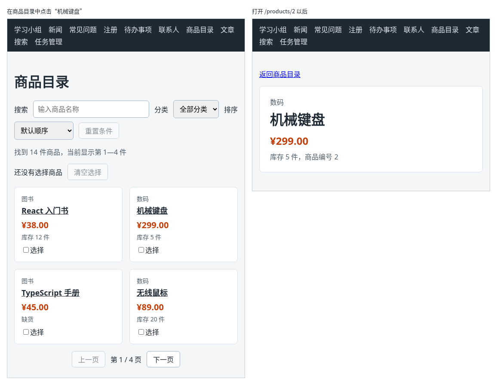

# 第 95 章：如何从网址中读取商品编号？

前置：[第 94 章：如何通过链接切换页面，而不刷新整个应用？](第094章-如何通过链接切换页面，而不刷新整个应用.md)

## 一、本章要解决的问题

商品目录中有 14 件商品，每件都要有自己的详情页，而且详情页的地址要能单独打开、能发给别人，例如 `/products/2` 就是“机械键盘”的详情页。总不能给每件商品写一个页面、在路由表中写 14 行。

本章只写一个商品详情页组件，让它从网址中读出商品编号，再找到对应的商品显示出来。完成后：在商品目录中点击商品名称，打开这件商品的详情页，地址栏是 `/products/2` 这样的地址；直接在地址栏中把 2 改成 8，显示的商品跟着变成“降噪耳机”；改成一个不存在的编号，显示“没有找到编号为 99 的商品。”。

下图左边是商品目录，商品名称变成了链接；右边是点击“机械键盘”以后打开的详情页：



## 二、必要原理

### 路由中的参数：:id

路由的 `path` 中，以冒号开头的部分叫**路由参数**，它可以匹配任意一段文字：

```tsx
<Route path="/products/:id" element={<ProductDetailPage />} />
```

这一行可以匹配 `/products/2`、`/products/8`、`/products/abc`，都显示 `ProductDetailPage`。冒号后面的 `id` 是参数的名字，名字可以自己取，读取时要用同样的名字。

`/products` 和 `/products/:id` 是两条不同的路由，互不影响：只有 `/products` 显示商品目录，后面多一段的显示详情页。

### useParams：读取路由参数

在详情页组件中，用 React Router 提供的 `useParams` 读出参数的值：

```tsx
const { id } = useParams();
```

`useParams()` 返回一个对象，例如地址是 `/products/2` 时，返回 `{ id: '2' }`。这里用花括号一次取出 `id` 属性，就是第 10 章在组件参数中写 `{ profile, note }` 的解构写法，只是这次用在普通变量上。

要注意两点：

- 参数的值永远是字符串。地址中的 `2` 读出来是 `'2'`，和商品数据中的数字 `2` 比较前，要先用 `Number` 转成数字（第 44 章）。
- 参数的类型是 `string | undefined`。TypeScript 不知道这个组件只会在 `/products/:id` 下显示，所以要求你考虑参数不存在的情况。本章用 `Number(id)` 转换：`id` 是 `undefined` 或 `'abc'` 时得到 `NaN`，找不到任何商品，自然走到“没有找到”的分支。

### 找不到商品时提前返回

`find` 找不到时返回 `undefined`。组件中先判断这种情况，返回一段提示并结束：

```tsx
if (!product) {
  return （没有找到的提示）;
}
```

`if` 后面的代码中，TypeScript 知道 `product` 一定存在，可以直接使用 `product.name`。这和第 20 章处理缺少的字段思路相同，只是这里整页都换成提示。

### 价格格式化移到公共文件

详情页也要显示价格，而且要和商品目录的格式一样。第 61A 章的格式化器写在 `ProductPage.tsx` 中，详情页用不到。把它移到 `src/lib/format.ts`，导出一个函数 `formatPrice`，两个页面都导入它。这和第 92A 章把请求代码集中到 `taskApi.ts` 是一样的做法。

### 链接地址用字符串拼接

商品目录中，每件商品的名称都要链接到自己的详情页。`to` 可以写成花括号中的表达式：

```tsx
<Link to={'/products/' + product.id}>{product.name}</Link>
```

数字和字符串相加时，数字会自动转成文字，得到 `'/products/2'`。

## 三、动手实现

### 第 1 步：新建价格格式化文件

新建 `src/lib/format.ts`：

```ts
// 商品目录和商品详情要用同一种格式显示价格，格式化器放在这里共用
const priceFormatter = new Intl.NumberFormat('zh-CN', { style: 'currency', currency: 'CNY' });

export function formatPrice(price: number) {
  return priceFormatter.format(price);
}
```

### 第 2 步：新建商品详情页的样式

新建 `src/pages/ProductDetailPage.module.css`：

```css
.card {
  max-width: 480px;
  padding: 24px;
  border: 1px solid #d9e2ec;
  border-radius: 8px;
  background: #ffffff;
}

.category {
  margin: 0;
  color: #52606d;
}

.name {
  margin: 4px 0 12px;
}

.price {
  margin: 0 0 8px;
  color: #c2410c;
  font-size: 24px;
  font-weight: bold;
}

.meta {
  margin: 0;
  color: #52606d;
}
```

### 第 3 步：新建商品详情页

新建 `src/pages/ProductDetailPage.tsx`：

```tsx
import { Link, useParams } from 'react-router';
import { products } from '../data/products';
import { formatPrice } from '../lib/format';
import styles from './ProductDetailPage.module.css';

export default function ProductDetailPage() {
  const { id } = useParams();
  const product = products.find((item) => item.id === Number(id));

  if (!product) {
    return (
      <main className="page">
        <h1>商品详情</h1>
        <p>没有找到编号为 {id} 的商品。</p>
        <Link to="/products">返回商品目录</Link>
      </main>
    );
  }

  return (
    <main className="page">
      <p>
        <Link to="/products">返回商品目录</Link>
      </p>
      <div className={styles.card}>
        <p className={styles.category}>{product.category}</p>
        <h1 className={styles.name}>{product.name}</h1>
        <p className={styles.price}>{formatPrice(product.price)}</p>
        <p className={styles.meta}>
          {product.stock === 0 ? '缺货' : '库存 ' + product.stock + ' 件'}，商品编号 {product.id}
        </p>
      </div>
    </main>
  );
}
```

数据仍然来自 `src/data/products.ts`。第 101 章会改成从练习服务读取。

### 第 4 步：在路由表中加入详情页

打开 `src/App.tsx`，在导入 `ProductPage` 的上一行加入：

```tsx
import ProductDetailPage from './pages/ProductDetailPage';
```

在 `/products` 那条路由的下面加入：

```tsx
        <Route path="/products/:id" element={<ProductDetailPage />} />
```

### 第 5 步：商品目录改用公共格式化函数，名称变成链接

打开 `src/pages/ProductPage.tsx`。在 `import type { ChangeEvent } from 'react';` 的下面加入：

```tsx
import { Link } from 'react-router';
```

在导入商品数据的一行下面加入：

```tsx
import { formatPrice } from '../lib/format';
```

删掉文件中原来的这两行，格式化器已经移到 `format.ts` 中了：

```tsx
// 格式化器只需要创建一次，放在组件外面，每次渲染直接使用
const priceFormatter = new Intl.NumberFormat('zh-CN', { style: 'currency', currency: 'CNY' });
```

把显示价格的 `{priceFormatter.format(product.price)}` 改为 `{formatPrice(product.price)}`。

把商品名称的一行：

```tsx
              <h2 className={styles.name}>{product.name}</h2>
```

改为：

```tsx
              <h2 className={styles.name}>
                <Link to={'/products/' + product.id}>{product.name}</Link>
              </h2>
```

### 第 6 步：链接文字使用标题的颜色

打开 `src/pages/ProductPage.module.css`，在 `.name` 规则的后面加入：

```css

.name a {
  color: inherit;
}
```

`inherit` 表示沿用外层的颜色。链接默认是蓝色，这样改完后商品名称仍是深色，只保留下划线，看得出可以点击。

## 四、运行与检查

保持开发服务器运行（`npm.cmd run dev`），保存文件后在浏览器中查看。

1. 打开商品目录，每件商品的名称下面有一条下划线，价格仍显示“¥38.00”这样的格式。
2. 点击“机械键盘”，地址栏变成 `/products/2`，页面显示数码、机械键盘、¥299.00、“库存 5 件，商品编号 2”。
3. 点击“返回商品目录”，回到目录。翻到第 2 页，点击另一件商品，详情页显示的是这件商品。
4. 在地址栏把编号改成 `8`，回车，显示降噪耳机，价格“¥1,299.00”。
5. 把编号改成 `99`，显示“没有找到编号为 99 的商品。”；改成 `abc`，显示“没有找到编号为 abc 的商品。”。点击“返回商品目录”可以回去。
6. 在详情页按 F5 刷新，仍是同一件商品的详情页。

最后运行检查，应没有错误：

```powershell
npm.cmd run check
```

**小练习**：在详情页的卡片下方，显示同一分类的其他商品名称，例如机械键盘的详情页下方显示“同类商品：无线鼠标、降噪耳机、显示器支架、移动硬盘”，每个名称都链接到它的详情页。提示：用 `filter` 选出分类相同、编号不同的商品。练习后恢复本章代码。

## 五、常见错误

| 现象 | 原因 | 怎么改 |
| --- | --- | --- |
| 检查命令报 `This comparison appears to be unintentional because the types 'number' and 'string \| undefined' have no overlap.` | 直接拿 `item.id === id` 比较，一边是数字，一边是字符串 | 先转换：`item.id === Number(id)` |
| 每个编号都显示“没有找到编号为 的商品。”，编号是空的 | 路由中参数名和读取时不一致，例如路由写 `:productId`，组件中读 `id` | 两处用同一个名字 |
| 打开 `/products/2`，导航栏下方什么也没有，控制台警告 `No routes matched location` | 路由的 `path` 中少写了冒号，写成了 `/products/id`，只能匹配地址 `/products/id` 本身 | 写成 `/products/:id` |
| 点击商品名称，地址变成 `/products2`，页面空白 | 拼接地址时少写了斜杠：`'/products' + product.id` | 写成 `'/products/' + product.id` |

## 六、本章完整代码

### `src/lib/format.ts`

同第三节第 1 步。

### `src/pages/ProductDetailPage.module.css`

同第三节第 2 步。

### `src/pages/ProductDetailPage.tsx`

同第三节第 3 步。

### `src/App.tsx`

```tsx
import { Link, Route, Routes } from 'react-router';
import './App.css';
import ArticlePage from './pages/ArticlePage';
import ContactsPage from './pages/ContactsPage';
import FaqPage from './pages/FaqPage';
import GroupPage from './pages/GroupPage';
import NewsPage from './pages/NewsPage';
import ProductDetailPage from './pages/ProductDetailPage';
import ProductPage from './pages/ProductPage';
import RegisterPage from './pages/RegisterPage';
import SearchPage from './pages/SearchPage';
import TaskPage from './pages/TaskPage';
import TaskServerPage from './pages/TaskServerPage';

export default function App() {
  return (
    <div>
      <nav className="site-nav" aria-label="主导航">
        <Link to="/">学习小组</Link>
        <Link to="/news">新闻</Link>
        <Link to="/faq">常见问题</Link>
        <Link to="/register">注册</Link>
        <Link to="/todos">待办事项</Link>
        <Link to="/contacts">联系人</Link>
        <Link to="/products">商品目录</Link>
        <Link to="/articles">文章</Link>
        <Link to="/search">搜索</Link>
        <Link to="/tasks">任务管理</Link>
      </nav>
      <Routes>
        <Route path="/" element={<GroupPage />} />
        <Route path="/news" element={<NewsPage />} />
        <Route path="/faq" element={<FaqPage />} />
        <Route path="/register" element={<RegisterPage />} />
        <Route path="/todos" element={<TaskPage />} />
        <Route path="/contacts" element={<ContactsPage />} />
        <Route path="/products" element={<ProductPage />} />
        <Route path="/products/:id" element={<ProductDetailPage />} />
        <Route path="/articles" element={<ArticlePage />} />
        <Route path="/search" element={<SearchPage />} />
        <Route path="/tasks" element={<TaskServerPage />} />
      </Routes>
    </div>
  );
}
```

### `src/pages/ProductPage.tsx`

```tsx
import { useState } from 'react';
import type { ChangeEvent } from 'react';
import { Link } from 'react-router';
import { categories, products } from '../data/products';
import { formatPrice } from '../lib/format';
import styles from './ProductPage.module.css';

const PAGE_SIZE = 4;

export default function ProductPage() {
  const [keyword, setKeyword] = useState('');
  const [category, setCategory] = useState('all');
  const [sortOrder, setSortOrder] = useState('default');
  const [page, setPage] = useState(1);
  const [selectedIds, setSelectedIds] = useState<number[]>([]);
  const normalizedKeyword = keyword.trim().toLowerCase();
  const filteredProducts = products.filter((product) => {
    const matchesKeyword = product.name.toLowerCase().includes(normalizedKeyword);
    const matchesCategory = category === 'all' || product.category === category;
    return matchesKeyword && matchesCategory;
  });
  const visibleProducts = [...filteredProducts];
  if (sortOrder === 'price-asc') {
    visibleProducts.sort((a, b) => a.price - b.price);
  } else if (sortOrder === 'price-desc') {
    visibleProducts.sort((a, b) => b.price - a.price);
  }
  const pageCount = Math.max(1, Math.ceil(visibleProducts.length / PAGE_SIZE));
  const startIndex = (page - 1) * PAGE_SIZE;
  const pageProducts = visibleProducts.slice(startIndex, startIndex + PAGE_SIZE);
  const hasConditions = keyword !== '' || category !== 'all' || sortOrder !== 'default';
  const selectedNames = products
    .filter((product) => selectedIds.includes(product.id))
    .map((product) => product.name);

  function handleKeywordChange(event: ChangeEvent<HTMLInputElement>) {
    setKeyword(event.target.value);
    setPage(1);
  }

  function handleCategoryChange(event: ChangeEvent<HTMLSelectElement>) {
    setCategory(event.target.value);
    setPage(1);
  }

  function handleSortChange(event: ChangeEvent<HTMLSelectElement>) {
    setSortOrder(event.target.value);
    setPage(1);
  }

  function isSelected(id: number) {
    return selectedIds.includes(id);
  }

  function handleReset() {
    setKeyword('');
    setCategory('all');
    setSortOrder('default');
    setPage(1);
  }

  function handleSelectChange(id: number) {
    if (isSelected(id)) {
      setSelectedIds(selectedIds.filter((selectedId) => selectedId !== id));
    } else {
      setSelectedIds([...selectedIds, id]);
    }
  }

  return (
    <main className="page">
      <h1>商品目录</h1>
      <div className={styles.filters}>
        <label htmlFor="keyword">搜索</label>
        <input
          id="keyword"
          type="search"
          placeholder="输入商品名称"
          value={keyword}
          onChange={handleKeywordChange}
        />
        <label htmlFor="category">分类</label>
        <select id="category" value={category} onChange={handleCategoryChange}>
          <option value="all">全部分类</option>
          {categories.map((item) => (
            <option key={item} value={item}>
              {item}
            </option>
          ))}
        </select>
        <label htmlFor="sort">排序</label>
        <select id="sort" value={sortOrder} onChange={handleSortChange}>
          <option value="default">默认顺序</option>
          <option value="price-asc">价格从低到高</option>
          <option value="price-desc">价格从高到低</option>
        </select>
        <button type="button" disabled={!hasConditions} onClick={handleReset}>
          重置条件
        </button>
      </div>
      <p className={styles.summary}>
        找到 {visibleProducts.length} 件商品
        {visibleProducts.length > 0 && (
          <span>
            ，当前显示第 {startIndex + 1}—{startIndex + pageProducts.length} 件
          </span>
        )}
      </p>
      <div className={styles.selection}>
        <span>
          {selectedIds.length === 0
            ? '还没有选择商品'
            : '已选 ' + selectedIds.length + ' 件：' + selectedNames.join('、')}
        </span>
        <button
          type="button"
          disabled={selectedIds.length === 0}
          onClick={() => setSelectedIds([])}
        >
          清空选择
        </button>
      </div>
      {visibleProducts.length === 0 ? (
        <p className={styles.empty}>没有找到符合条件的商品。</p>
      ) : (
        <ul className={styles.list}>
          {pageProducts.map((product) => (
            <li
              key={product.id}
              className={isSelected(product.id) ? styles.item + ' ' + styles.selected : styles.item}
            >
              <p className={styles.category}>{product.category}</p>
              <h2 className={styles.name}>
                <Link to={'/products/' + product.id}>{product.name}</Link>
              </h2>
              <p className={styles.price}>{formatPrice(product.price)}</p>
              <p className={styles.stock}>
                {product.stock === 0 ? '缺货' : '库存 ' + product.stock + ' 件'}
              </p>
              <label className={styles.select}>
                <input
                  type="checkbox"
                  aria-label={'选择：' + product.name}
                  checked={isSelected(product.id)}
                  onChange={() => handleSelectChange(product.id)}
                />
                选择
              </label>
            </li>
          ))}
        </ul>
      )}
      <nav className={styles.pagination} aria-label="分页">
        <button type="button" disabled={page === 1} onClick={() => setPage(page - 1)}>
          上一页
        </button>
        <span>
          第 {page} / {pageCount} 页
        </span>
        <button type="button" disabled={page === pageCount} onClick={() => setPage(page + 1)}>
          下一页
        </button>
      </nav>
    </main>
  );
}
```

### `src/pages/ProductPage.module.css`

```css
.filters {
  display: flex;
  flex-wrap: wrap;
  align-items: center;
  gap: 8px 12px;
}

.filters input,
.filters select {
  padding: 8px 10px;
  border: 1px solid #9fb3c8;
  border-radius: 6px;
  font: inherit;
}

.filters input {
  flex: 1;
  min-width: 160px;
}

.summary,
.empty {
  color: #52606d;
}

.list {
  display: flex;
  flex-wrap: wrap;
  gap: 16px;
  margin: 0;
  padding: 0;
  list-style: none;
}

.item {
  flex: 1 1 160px;
  padding: 16px;
  border: 1px solid #d9e2ec;
  border-radius: 8px;
  background: #ffffff;
}

.selected {
  border-color: #2563eb;
  box-shadow: 0 0 0 1px #2563eb;
}

.select {
  display: block;
  margin-top: 8px;
}

.selection {
  display: flex;
  align-items: center;
  gap: 12px;
  margin-bottom: 16px;
}

.category,
.stock {
  margin: 0;
  color: #52606d;
  font-size: 14px;
}

.name {
  margin: 4px 0 8px;
  font-size: 18px;
}

.name a {
  color: inherit;
}

.price {
  margin: 0 0 4px;
  color: #c2410c;
  font-size: 20px;
  font-weight: bold;
}

.pagination {
  display: flex;
  align-items: center;
  justify-content: center;
  gap: 12px;
  margin-top: 16px;
}
```

## 七、本章改动小结

新增 `src/lib/format.ts`、`src/pages/ProductDetailPage.tsx` 和 `src/pages/ProductDetailPage.module.css`；修改 `src/App.tsx`：加入 `/products/:id` 路由；修改 `src/pages/ProductPage.tsx`：改用 `formatPrice`，商品名称链接到详情页；修改 `src/pages/ProductPage.module.css`：链接文字沿用标题颜色。

---

下一章：[第 96 章：如何把搜索条件保存在网址中？](第096章-如何把搜索条件保存在网址中.md)
