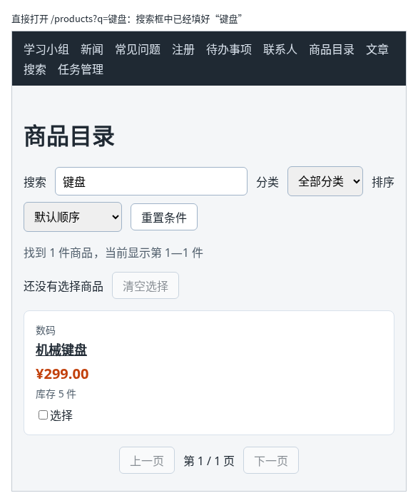

# 第 96 章：如何把搜索条件保存在网址中？

前置：[第 95 章：如何从网址中读取商品编号？](第095章-如何从网址中读取商品编号.md)

## 一、本章要解决的问题

在商品目录中搜索“键盘”，点进机械键盘的详情页，再按浏览器的“后退”回到目录，搜索框又空了，刚才的搜索结果也没了。刷新页面也一样。想把搜索结果发给同事，复制地址栏也只能得到 `/products`。

原因是搜索词只保存在组件的 state 中：离开页面时组件被移除，state 也就没了（第 94 章）。本章把搜索词放进网址，地址栏中写成 `/products?q=键盘`。完成后：在搜索框中输入，地址栏随之变化；从详情页后退、刷新页面、直接打开这个地址，搜索框中都是“键盘”，列表也是搜索后的结果。

下图是直接打开 `/products?q=键盘` 的样子：



## 二、必要原理

### 网址中的查询参数

网址中问号后面的部分叫**查询参数**（query string），格式是 `名字=值`，多个参数用 `&` 连接：

```text
/products?q=键盘&category=数码
```

第 8 部分调用接口时已经用过，例如 `/api/articles?delay=3000`。这一次是给页面自己的地址加上参数。路由只按问号前面的路径匹配，所以 `/products?q=键盘` 仍然显示商品目录，不需要改路由表。

### useSearchParams：像 state 一样读写查询参数

React Router 提供 `useSearchParams`，写法和 `useState` 很像，也返回两个值：

```tsx
const [searchParams, setSearchParams] = useSearchParams();
```

- `searchParams.get('q')` 读出参数 `q` 的值。地址中没有这个参数时，返回 `null`。
- `setSearchParams({ q: '键盘' })` 把地址中的查询参数改成 `?q=键盘`；`setSearchParams({})` 清空所有查询参数。

地址变化后，组件会重新渲染，`searchParams` 拿到的是新地址中的值。所以它的用法和 state 一样：读的时候从 `searchParams` 中取，改的时候调用 `setSearchParams`，不要再另外用一个 state 保存同样的内容。

### null 要换成空字符串

搜索框是受控输入框（第 35 章），`value` 不能是 `null`。用 `??` 给它一个默认值：

```tsx
const keyword = searchParams.get('q') ?? '';
```

这是第 20 章学过的 `??`：左边是 `null` 或 `undefined` 时，用右边的值。地址中没有 `q` 时，`keyword` 是空字符串。

`keyword` 现在是从地址中算出来的值，不再是 state。后面所有用到 `keyword` 的地方，例如筛选和“重置条件”按钮是否可用，都不需要修改。

### 替换历史记录，而不是新增

浏览器为每次地址变化保存一条**历史记录**，“后退”就是回到上一条。`setSearchParams` 默认也会新增一条。搜索框中每输入一个字就改一次地址，输入“机械键盘”会留下四条记录，想回到上一个页面要按四次“后退”。

第二个参数写 `{ replace: true }`，表示用新地址**替换**当前这条历史记录：

```tsx
setSearchParams({ q: value }, { replace: true });
```

这样无论输入多少字，历史中都只有一条商品目录的记录。

### 空的搜索词不写进地址

搜索框清空时，地址最好回到 `/products`，而不是 `/products?q=`。所以清空时传 `{}`：

```tsx
setSearchParams(value === '' ? {} : { q: value }, { replace: true });
```

这里用到第 19 章学过的 `? :`。

### 地址中的中文

地址栏中显示的是“键盘”，但复制出来的是 `?q=%E9%94%AE%E7%9B%98`。网址中的中文要转换成这种以 `%` 开头的编码才能传输，浏览器和 React Router 会自动完成转换，`get('q')` 读到的仍然是“键盘”。

## 三、动手实现

### 第 1 步：导入 useSearchParams

打开 `src/pages/ProductPage.tsx`，把导入 `Link` 的一行改为：

```tsx
import { Link, useSearchParams } from 'react-router';
```

### 第 2 步：搜索词改从地址中读取

把 `keyword` 的 state：

```tsx
  const [keyword, setKeyword] = useState('');
```

替换为：

```tsx
  const [searchParams, setSearchParams] = useSearchParams();
  const keyword = searchParams.get('q') ?? '';
```

`category`、`sortOrder`、`page` 和 `selectedIds` 仍然是 state，本章不改。

### 第 3 步：输入时修改地址

把 `handleKeywordChange` 改为：

```tsx
  function handleKeywordChange(event: ChangeEvent<HTMLInputElement>) {
    const value = event.target.value;
    // 每输入一个字都新增一条历史记录，“后退”就要按很多次，所以替换当前这一条
    setSearchParams(value === '' ? {} : { q: value }, { replace: true });
    setPage(1);
  }
```

改变搜索词后仍然回到第 1 页，原因见第 59 章。

### 第 4 步：重置时清空地址中的参数

在 `handleReset` 中，把第一行 `setKeyword('');` 改为：

```tsx
    setSearchParams({});
```

## 四、运行与检查

保持开发服务器运行（`npm.cmd run dev`），保存文件后在浏览器中查看。

1. 打开商品目录，地址是 `/products`。在搜索框中输入“键盘”，地址栏变成 `/products?q=键盘`，列表中只剩机械键盘。
2. 点击“机械键盘”进入详情页，再按浏览器的“后退”。回到商品目录，搜索框中仍是“键盘”，列表也是搜索后的结果。
3. 按 F5 刷新，搜索框和列表都不变。
4. 删光搜索框中的文字，地址回到 `/products`，14 件商品都回来了。
5. 在搜索框中输入“机械键盘”，然后点导航中的“新闻”，再按一次“后退”，回到商品目录，搜索框中是“机械键盘”；再按一次“后退”，回到进入商品目录之前的页面。输入的四个字没有留下四条历史记录。
6. 在地址栏输入 `http://127.0.0.1:5173/products?q=书` 并回车，搜索框中是“书”，列表中只有“React 入门书”。点击“重置条件”，地址回到 `/products`，搜索框清空。
7. 详情页中的“返回商品目录”是一个固定地址 `/products` 的链接，点它回到目录时搜索词不会保留；用浏览器的“后退”才会回到带搜索词的地址。

最后运行检查，应没有错误：

```powershell
npm.cmd run check
```

**小练习**：把“分类”也放进地址，例如选择“数码”后地址变成 `/products?q=键盘&category=数码`。提示：`setSearchParams` 时要同时写上两个参数，不然改分类会把搜索词弄丢；参数为默认值时不写进地址。练习后恢复本章代码。

## 五、常见错误

| 现象 | 原因 | 怎么改 |
| --- | --- | --- |
| 检查命令报 `Type 'string \| null' is not assignable to type 'string \| number \| readonly string[] \| undefined'` | 直接把 `searchParams.get('q')` 用作输入框的 `value`，地址中没有参数时它是 `null` | 写成 `searchParams.get('q') ?? ''` |
| 输入了几个字之后，要按好几次“后退”才能离开商品目录 | `setSearchParams` 没有写 `{ replace: true }`，每输入一个字新增一条历史记录 | 第二个参数写 `{ replace: true }` |
| 搜索框能输入，但后退和刷新后搜索词仍然丢失 | 保留了原来的 `keyword` state，输入框改的还是 state，地址没有变 | 删掉 `keyword` 的 state，只从 `searchParams` 中读取 |
| 搜索框清空后，地址仍是 `/products?q=` | 清空时也传了 `{ q: value }` | 值为空字符串时传 `{}` |

## 六、本章完整代码

### `src/pages/ProductPage.tsx`

```tsx
import { useState } from 'react';
import type { ChangeEvent } from 'react';
import { Link, useSearchParams } from 'react-router';
import { categories, products } from '../data/products';
import { formatPrice } from '../lib/format';
import styles from './ProductPage.module.css';

const PAGE_SIZE = 4;

export default function ProductPage() {
  const [searchParams, setSearchParams] = useSearchParams();
  const keyword = searchParams.get('q') ?? '';
  const [category, setCategory] = useState('all');
  const [sortOrder, setSortOrder] = useState('default');
  const [page, setPage] = useState(1);
  const [selectedIds, setSelectedIds] = useState<number[]>([]);
  const normalizedKeyword = keyword.trim().toLowerCase();
  const filteredProducts = products.filter((product) => {
    const matchesKeyword = product.name.toLowerCase().includes(normalizedKeyword);
    const matchesCategory = category === 'all' || product.category === category;
    return matchesKeyword && matchesCategory;
  });
  const visibleProducts = [...filteredProducts];
  if (sortOrder === 'price-asc') {
    visibleProducts.sort((a, b) => a.price - b.price);
  } else if (sortOrder === 'price-desc') {
    visibleProducts.sort((a, b) => b.price - a.price);
  }
  const pageCount = Math.max(1, Math.ceil(visibleProducts.length / PAGE_SIZE));
  const startIndex = (page - 1) * PAGE_SIZE;
  const pageProducts = visibleProducts.slice(startIndex, startIndex + PAGE_SIZE);
  const hasConditions = keyword !== '' || category !== 'all' || sortOrder !== 'default';
  const selectedNames = products
    .filter((product) => selectedIds.includes(product.id))
    .map((product) => product.name);

  function handleKeywordChange(event: ChangeEvent<HTMLInputElement>) {
    const value = event.target.value;
    // 每输入一个字都新增一条历史记录，“后退”就要按很多次，所以替换当前这一条
    setSearchParams(value === '' ? {} : { q: value }, { replace: true });
    setPage(1);
  }

  function handleCategoryChange(event: ChangeEvent<HTMLSelectElement>) {
    setCategory(event.target.value);
    setPage(1);
  }

  function handleSortChange(event: ChangeEvent<HTMLSelectElement>) {
    setSortOrder(event.target.value);
    setPage(1);
  }

  function isSelected(id: number) {
    return selectedIds.includes(id);
  }

  function handleReset() {
    setSearchParams({});
    setCategory('all');
    setSortOrder('default');
    setPage(1);
  }

  function handleSelectChange(id: number) {
    if (isSelected(id)) {
      setSelectedIds(selectedIds.filter((selectedId) => selectedId !== id));
    } else {
      setSelectedIds([...selectedIds, id]);
    }
  }

  return (
    <main className="page">
      <h1>商品目录</h1>
      <div className={styles.filters}>
        <label htmlFor="keyword">搜索</label>
        <input
          id="keyword"
          type="search"
          placeholder="输入商品名称"
          value={keyword}
          onChange={handleKeywordChange}
        />
        <label htmlFor="category">分类</label>
        <select id="category" value={category} onChange={handleCategoryChange}>
          <option value="all">全部分类</option>
          {categories.map((item) => (
            <option key={item} value={item}>
              {item}
            </option>
          ))}
        </select>
        <label htmlFor="sort">排序</label>
        <select id="sort" value={sortOrder} onChange={handleSortChange}>
          <option value="default">默认顺序</option>
          <option value="price-asc">价格从低到高</option>
          <option value="price-desc">价格从高到低</option>
        </select>
        <button type="button" disabled={!hasConditions} onClick={handleReset}>
          重置条件
        </button>
      </div>
      <p className={styles.summary}>
        找到 {visibleProducts.length} 件商品
        {visibleProducts.length > 0 && (
          <span>
            ，当前显示第 {startIndex + 1}—{startIndex + pageProducts.length} 件
          </span>
        )}
      </p>
      <div className={styles.selection}>
        <span>
          {selectedIds.length === 0
            ? '还没有选择商品'
            : '已选 ' + selectedIds.length + ' 件：' + selectedNames.join('、')}
        </span>
        <button
          type="button"
          disabled={selectedIds.length === 0}
          onClick={() => setSelectedIds([])}
        >
          清空选择
        </button>
      </div>
      {visibleProducts.length === 0 ? (
        <p className={styles.empty}>没有找到符合条件的商品。</p>
      ) : (
        <ul className={styles.list}>
          {pageProducts.map((product) => (
            <li
              key={product.id}
              className={isSelected(product.id) ? styles.item + ' ' + styles.selected : styles.item}
            >
              <p className={styles.category}>{product.category}</p>
              <h2 className={styles.name}>
                <Link to={'/products/' + product.id}>{product.name}</Link>
              </h2>
              <p className={styles.price}>{formatPrice(product.price)}</p>
              <p className={styles.stock}>
                {product.stock === 0 ? '缺货' : '库存 ' + product.stock + ' 件'}
              </p>
              <label className={styles.select}>
                <input
                  type="checkbox"
                  aria-label={'选择：' + product.name}
                  checked={isSelected(product.id)}
                  onChange={() => handleSelectChange(product.id)}
                />
                选择
              </label>
            </li>
          ))}
        </ul>
      )}
      <nav className={styles.pagination} aria-label="分页">
        <button type="button" disabled={page === 1} onClick={() => setPage(page - 1)}>
          上一页
        </button>
        <span>
          第 {page} / {pageCount} 页
        </span>
        <button type="button" disabled={page === pageCount} onClick={() => setPage(page + 1)}>
          下一页
        </button>
      </nav>
    </main>
  );
}
```

## 七、本章改动小结

修改 `src/pages/ProductPage.tsx`：搜索词改为从地址的查询参数 `q` 中读取，输入时用 `setSearchParams` 替换当前历史记录，重置时清空查询参数。

---

下一章：[第 97 章：如何突出显示当前所在的导航项？](第097章-如何突出显示当前所在的导航项.md)
