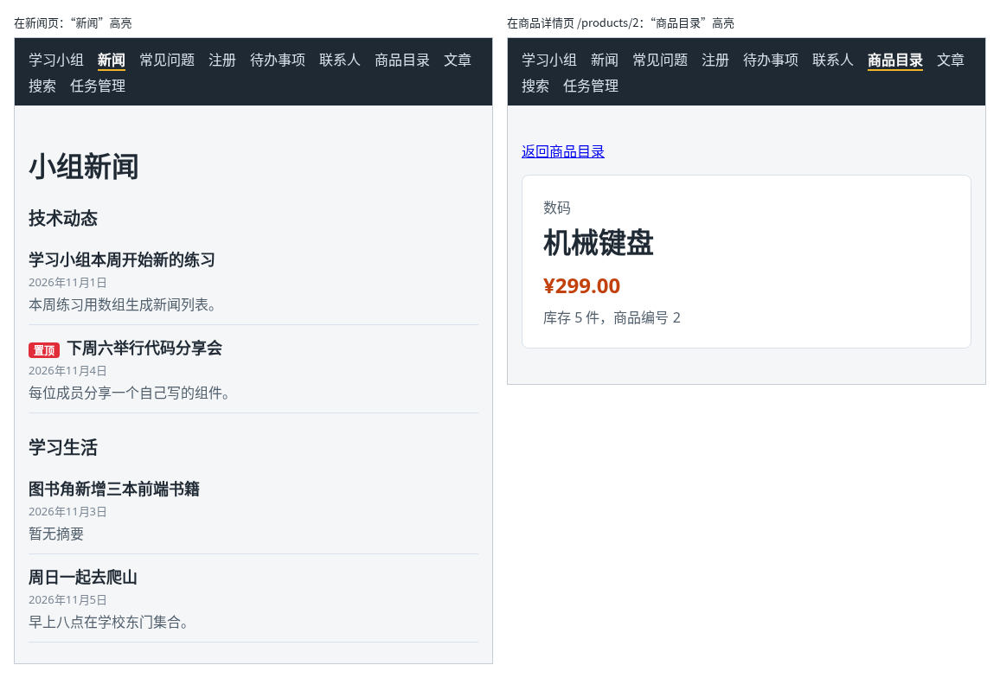

# 第 97 章：如何突出显示当前所在的导航项？

前置：[第 96 章：如何把搜索条件保存在网址中？](第096章-如何把搜索条件保存在网址中.md)

## 一、本章要解决的问题

导航栏中有十个链接，看起来都一样。打开某个页面后，用户要看标题才知道自己在哪里。一般的网站会把当前页面对应的导航项突出显示，例如字体加粗、下面加一条线。

本章把导航中的 `Link` 换成 React Router 的 `NavLink`。完成后：打开新闻页，导航中的“新闻”变成白色粗体，下方有一条黄线；打开商品目录或任意一件商品的详情页，突出显示的都是“商品目录”；打开首页时只有“学习小组”突出显示。

下图左边是新闻页，右边是商品详情页：



## 二、必要原理

### NavLink：知道自己是不是当前页面的链接

`NavLink` 的用法和 `Link` 完全一样，只是多做了一件事：它会把自己的 `to` 和当前地址比较，如果当前地址属于这个链接，就给生成的 `<a>` 标签加上两样东西：

- `class="active"`：用来写样式；
- `aria-current="page"`：告诉读屏软件“这是当前页面的链接”。

所以只要把 `Link` 换成 `NavLink`，再写一条 `.active` 的样式，不需要自己写任何判断。

### 什么地址算“属于”这个链接

`NavLink` 默认的规则是：当前地址等于 `to`，或者以 `to` 再加一个斜杠开头，都算属于它。

| 当前地址 | `to="/products"` | `to="/"` |
| --- | --- | --- |
| `/products` | 是 | 否 |
| `/products/2` | 是 | 否 |
| `/products?q=书` | 是，问号后面的部分不参与比较 | 否 |
| `/` | 否 | 是 |

所以打开详情页时，“商品目录”也会突出显示，这正是我们想要的：详情页属于商品目录这一栏。

`to="/"` 是一个例外。所有地址都以 `/` 开头，如果按上面的规则，“学习小组”会一直突出显示。React Router 对 `/` 做了特殊处理，只有地址正好是 `/` 时才算。

如果某个链接只想在地址完全相同时突出显示，可以给它加上 `end` 属性，例如 `<NavLink to="/products" end>`，这时打开详情页，“商品目录”就不再突出显示了。

### 样式写在 .site-nav a.active 上

第 94 章已经写了 `.site-nav a` 的颜色。新的样式写成 `.site-nav a.active`，表示“导航栏中带 `active` 类名的链接”：

```css
.site-nav a.active {
  color: #ffffff;
  font-weight: bold;
  border-bottom: 2px solid #f0b429;
}
```

不能只写 `.active`。两条规则同时设置颜色时，浏览器按选择器的**具体程度**决定用哪一条：`.site-nav a.active` 有两个类名和一个标签名，比 `.site-nav a` 更具体，会覆盖它的颜色；只写 `.active` 只有一个类名，不如 `.site-nav a` 具体，颜色改不过来。

这里的 `active` 是全局类名，写在 `App.css` 中。CSS Modules 文件中的类名会被改名（第 15 章），`NavLink` 加上的 `active` 对不上，所以这条样式不放进模块文件。

## 三、动手实现

### 第 1 步：Link 换成 NavLink

打开 `src/App.tsx`，把第一行的导入改为：

```tsx
import { NavLink, Route, Routes } from 'react-router';
```

把导航中的十个 `Link` 都换成 `NavLink`，`to` 和文字不变：

```tsx
      <nav className="site-nav" aria-label="主导航">
        <NavLink to="/">学习小组</NavLink>
        <NavLink to="/news">新闻</NavLink>
        <NavLink to="/faq">常见问题</NavLink>
        <NavLink to="/register">注册</NavLink>
        <NavLink to="/todos">待办事项</NavLink>
        <NavLink to="/contacts">联系人</NavLink>
        <NavLink to="/products">商品目录</NavLink>
        <NavLink to="/articles">文章</NavLink>
        <NavLink to="/search">搜索</NavLink>
        <NavLink to="/tasks">任务管理</NavLink>
      </nav>
```

在 VS Code 中可以用“查找和替换”（Ctrl+H）把 `<Link to=` 替换为 `<NavLink to=`，把 `</Link>` 替换为 `</NavLink>`。

### 第 2 步：当前导航项的样式

打开 `src/App.css`，在 `.site-nav a:hover` 规则的后面加入：

```css

.site-nav a.active {
  color: #ffffff;
  font-weight: bold;
  border-bottom: 2px solid #f0b429;
}
```

## 四、运行与检查

保持开发服务器运行（`npm.cmd run dev`），保存文件后在浏览器中查看。

1. 打开首页，只有“学习小组”是白色粗体，下方有黄线。
2. 依次点击导航中的链接，突出显示的始终是当前页面对应的那一项。
3. 打开商品目录，点进任意一件商品，突出显示的仍是“商品目录”。
4. 在商品目录中搜索“书”，地址变成 `/products?q=书`，“商品目录”仍然突出显示。
5. 打开一个不存在的地址，例如 `/abc`，没有任何导航项突出显示。
6. 按 F12，在 Elements（元素）面板中找到导航栏，当前页面的链接带有 `class="active"` 和 `aria-current="page"` 两个属性，其他链接没有。

最后运行检查，应没有错误：

```powershell
npm.cmd run check
```

**小练习**：给“商品目录”加上 `end` 属性，打开商品详情页，看看导航中还有没有突出显示的项。想一想：对这个网站来说，加不加 `end` 哪种更合理？练习后恢复本章代码。

## 五、常见错误

| 现象 | 原因 | 怎么改 |
| --- | --- | --- |
| 当前页面的链接变成了粗体，但颜色没变 | 样式只写了 `.active`，不如 `.site-nav a` 具体，颜色被覆盖 | 写成 `.site-nav a.active` |
| 链接没有任何变化，Elements 中也没有 `class="active"` | 还在用 `Link`，`Link` 不会加 `active` | 换成 `NavLink` |
| 样式写了，但始终不生效 | 把 `.active` 写进了 CSS Modules 文件，类名被改名后对不上 | 写在全局的 `App.css` 中 |
| 打开商品详情页时，导航中没有突出显示的项 | 给“商品目录”加了 `end` | 去掉 `end`，详情页也算属于商品目录 |

## 六、本章完整代码

### `src/App.tsx`

```tsx
import { NavLink, Route, Routes } from 'react-router';
import './App.css';
import ArticlePage from './pages/ArticlePage';
import ContactsPage from './pages/ContactsPage';
import FaqPage from './pages/FaqPage';
import GroupPage from './pages/GroupPage';
import NewsPage from './pages/NewsPage';
import ProductDetailPage from './pages/ProductDetailPage';
import ProductPage from './pages/ProductPage';
import RegisterPage from './pages/RegisterPage';
import SearchPage from './pages/SearchPage';
import TaskPage from './pages/TaskPage';
import TaskServerPage from './pages/TaskServerPage';

export default function App() {
  return (
    <div>
      <nav className="site-nav" aria-label="主导航">
        <NavLink to="/">学习小组</NavLink>
        <NavLink to="/news">新闻</NavLink>
        <NavLink to="/faq">常见问题</NavLink>
        <NavLink to="/register">注册</NavLink>
        <NavLink to="/todos">待办事项</NavLink>
        <NavLink to="/contacts">联系人</NavLink>
        <NavLink to="/products">商品目录</NavLink>
        <NavLink to="/articles">文章</NavLink>
        <NavLink to="/search">搜索</NavLink>
        <NavLink to="/tasks">任务管理</NavLink>
      </nav>
      <Routes>
        <Route path="/" element={<GroupPage />} />
        <Route path="/news" element={<NewsPage />} />
        <Route path="/faq" element={<FaqPage />} />
        <Route path="/register" element={<RegisterPage />} />
        <Route path="/todos" element={<TaskPage />} />
        <Route path="/contacts" element={<ContactsPage />} />
        <Route path="/products" element={<ProductPage />} />
        <Route path="/products/:id" element={<ProductDetailPage />} />
        <Route path="/articles" element={<ArticlePage />} />
        <Route path="/search" element={<SearchPage />} />
        <Route path="/tasks" element={<TaskServerPage />} />
      </Routes>
    </div>
  );
}
```

### `src/App.css`

```css
body {
  margin: 0;
  font-family: system-ui, sans-serif;
  background: #f4f6f8;
  color: #1f2933;
}

.page {
  max-width: 960px;
  margin: 0 auto;
  padding: 24px 16px;
}

.page-header p {
  color: #52606d;
}

.page-footer {
  margin-top: 24px;
  padding-top: 16px;
  border-top: 1px solid #d9e2ec;
  color: #52606d;
}

.card-list {
  display: flex;
  flex-wrap: wrap;
  gap: 16px;
  margin-top: 16px;
}

.card-list > * {
  flex: 1 1 200px;
}

button {
  padding: 6px 14px;
  border: 1px solid #9fb3c8;
  border-radius: 6px;
  background: #ffffff;
  color: #1f2933;
  font: inherit;
  cursor: pointer;
}

button:hover {
  background: #f0f4f8;
}

button:disabled {
  cursor: not-allowed;
  opacity: 0.5;
}

.site-nav {
  display: flex;
  flex-wrap: wrap;
  gap: 4px 16px;
  padding: 12px 16px;
  background: #1f2933;
}

.site-nav a {
  color: #d9e2ec;
  text-decoration: none;
}

.site-nav a:hover {
  color: #ffffff;
  text-decoration: underline;
}

.site-nav a.active {
  color: #ffffff;
  font-weight: bold;
  border-bottom: 2px solid #f0b429;
}
```

## 七、本章改动小结

修改 `src/App.tsx`：导航中的 `Link` 换成 `NavLink`；修改 `src/App.css`：新增当前导航项的样式 `.site-nav a.active`。

---

下一章：[第 98 章：如何让多个页面共用顶部导航？](第098章-如何让多个页面共用顶部导航.md)
