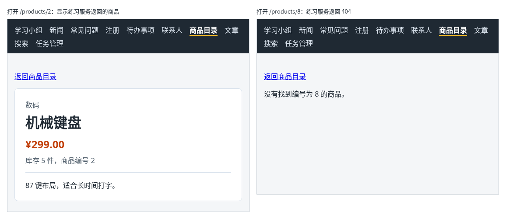

# 第 101 章：【组合】如何根据网址中的商品编号读取并显示商品详情？

前置：[第 100 章：如何让浏览器标签页标题随页面内容变化？](第100章-如何让浏览器标签页标题随页面内容变化.md)

## 一、本章要解决的问题

第 95 章的商品详情页从 `src/data/products.ts` 中找商品，这些数据写死在前端代码里。真实的详情页要向服务器读取这一件商品，因为价格、库存随时会变，而且服务器上还有更多信息，例如商品介绍。

练习服务提供了读取单件商品的接口。本章把详情页改成按网址中的编号向练习服务读取。完成后：打开 `/products/2`，先显示“正在读取商品……”，半秒后显示机械键盘的信息和一段商品介绍；打开 `/products/8`，练习服务上没有这件商品，显示“没有找到编号为 8 的商品。”；停止练习服务后打开，显示读取失败的原因。

本章不引入新的技术，组合的是：路由参数（第 95 章）、打开页面时读取数据（第 74、75 章）、联合类型区分几种状态（第 69 章）、检查接口数据（第 68 章）、用 `key` 换一个新组件（第 53 章）和标签页标题（第 100 章）。

下图左边是打开 `/products/2` 的样子，右边是打开 `/products/8` 的样子：



## 二、必要原理

### 读取一件商品的接口

| 操作 | 请求 | 返回 |
| --- | --- | --- |
| 读取一件商品 | `GET /api/products/编号` | 找到时状态 200，商品对象；找不到时状态 404 |

返回的商品比前端的示例数据多一个 `description`（商品介绍）字段：

```json
{ "id": 2, "name": "机械键盘", "category": "数码", "price": 299, "stock": 5, "description": "87 键布局，适合长时间打字。" }
```

练习服务上只有编号 1 到 6 的六件商品。商品目录仍然使用前端的 14 件示例数据，所以从目录中点进第 7 到 14 件，会看到“没有找到”的提示，这正好用来检查 404 的处理。

### 404 不是“出错”，是一种正常的结果

第 65 章讲过，`fetch` 收到 404 也算请求成功，要自己检查 `response.ok`。对详情页来说，404 和其他错误的意思不同：

- 404：服务器正常工作，只是没有这件商品，页面显示“没有找到”；
- 其他错误：服务器出了问题或者连不上，页面显示失败原因。

所以 `fetchProduct` 遇到 404 时不抛出错误，而是返回 `null`，其他失败仍然抛出错误。读取状态因此有四种，用联合类型写出来：

```tsx
type LoadState =
  | { status: 'loading' }
  | { status: 'success'; product: ProductDetail }
  | { status: 'not-found' }
  | { status: 'error'; message: string };
```

### 编号变化时重新开始读取

详情页中常有“同类商品”这样的链接，从 `/products/2` 直接跳到 `/products/4`。两个地址匹配的是同一条路由，React 会继续使用同一个详情页组件，只是 `id` 变了。

这时有两件事要做：重新读取，读取期间显示“正在读取”。第一件靠 Effect 的依赖数组 `[id]`（第 76 章）；第二件用第 53 章的做法：把读取和显示的部分放进一个内部组件 `ProductDetailContent`，外面给它加上 `key={id}`。编号变了，React 就换一个全新的组件，state 从初始值 `{ status: 'loading' }` 重新开始，不会先把上一件商品显示一会儿。

### 网址中没有编号时

`useParams` 返回的 `id` 类型是 `string | undefined`（第 95 章）。这里解构时给它一个默认值：`const { id = '' } = useParams();`，和第 10 章在解构 props 时写默认值的写法相同。这样传给 `ProductDetailContent` 的一定是字符串。

## 三、动手实现

### 第 1 步：新建商品详情的类型

新建 `src/types/product.ts`：

```ts
export type ProductDetail = {
  id: number;
  name: string;
  category: string;
  price: number;
  stock: number;
  description: string;
};

export function isProductDetail(value: unknown): value is ProductDetail {
  return (
    typeof value === 'object' &&
    value !== null &&
    'id' in value &&
    typeof value.id === 'number' &&
    'name' in value &&
    typeof value.name === 'string' &&
    'category' in value &&
    typeof value.category === 'string' &&
    'price' in value &&
    typeof value.price === 'number' &&
    'stock' in value &&
    typeof value.stock === 'number' &&
    'description' in value &&
    typeof value.description === 'string'
  );
}
```

写法和第 85 章的 `isTask` 相同。类型名用 `ProductDetail`，和 `src/data/products.ts` 中示例数据的 `Product` 区分开。

### 第 2 步：改写商品详情页

把 `src/pages/ProductDetailPage.tsx` 改为：

```tsx
import { useEffect, useState } from 'react';
import { Link, useParams } from 'react-router';
import { apiUrl } from '../lib/api';
import { formatPrice } from '../lib/format';
import { isProductDetail } from '../types/product';
import type { ProductDetail } from '../types/product';
import styles from './ProductDetailPage.module.css';

type LoadState =
  | { status: 'loading' }
  | { status: 'success'; product: ProductDetail }
  | { status: 'not-found' }
  | { status: 'error'; message: string };

// 返回 null 表示服务器上没有这件商品，和“请求失败”分开处理
async function fetchProduct(id: string): Promise<ProductDetail | null> {
  let response: Response;
  try {
    response = await fetch(apiUrl('/products/' + id));
  } catch {
    throw new Error('无法连接练习服务，请确认它已经启动。');
  }
  if (response.status === 404) {
    return null;
  }
  if (!response.ok) {
    throw new Error('商品读取失败：服务器返回了状态 ' + response.status + '。');
  }
  const data: unknown = await response.json();
  if (!isProductDetail(data)) {
    throw new Error('商品数据格式不正确，暂时无法显示。');
  }
  return data;
}

function getErrorMessage(error: unknown) {
  return error instanceof Error ? error.message : '商品读取失败。';
}

type ProductDetailContentProps = {
  id: string;
};

function ProductDetailContent({ id }: ProductDetailContentProps) {
  const [loadState, setLoadState] = useState<LoadState>({ status: 'loading' });

  useEffect(() => {
    let ignore = false;

    async function loadOnOpen() {
      try {
        const product = await fetchProduct(id);
        if (ignore) {
          return;
        }
        if (product === null) {
          setLoadState({ status: 'not-found' });
        } else {
          setLoadState({ status: 'success', product });
        }
      } catch (error) {
        if (!ignore) {
          setLoadState({ status: 'error', message: getErrorMessage(error) });
        }
      }
    }

    loadOnOpen();
    return () => {
      ignore = true;
    };
  }, [id]);

  if (loadState.status === 'loading') {
    return <p role="status">正在读取商品……</p>;
  }
  if (loadState.status === 'error') {
    return <p role="alert">{loadState.message}</p>;
  }
  if (loadState.status === 'not-found') {
    return <p>没有找到编号为 {id} 的商品。</p>;
  }

  const product = loadState.product;
  return (
    <div className={styles.card}>
      <title>{product.name + ' - 商品详情'}</title>
      <p className={styles.category}>{product.category}</p>
      <h1 className={styles.name}>{product.name}</h1>
      <p className={styles.price}>{formatPrice(product.price)}</p>
      <p className={styles.meta}>
        {product.stock === 0 ? '缺货' : '库存 ' + product.stock + ' 件'}，商品编号 {product.id}
      </p>
      <p className={styles.description}>{product.description}</p>
    </div>
  );
}

export default function ProductDetailPage() {
  const { id = '' } = useParams();

  return (
    <main className="page">
      <p>
        <Link to="/products">返回商品目录</Link>
      </p>
      {/* 编号变了就换一个新的组件，读取状态从“读取中”重新开始 */}
      <ProductDetailContent key={id} id={id} />
    </main>
  );
}
```

几处要注意的地方：

- `fetchProduct` 写在组件外面，和第 73A 章的 `fetchArticles` 一样：检查状态码、检查数据格式，失败时抛出带中文提示的错误。多出来的只有 404 返回 `null` 这一段。
- Effect 的写法和第 74、75 章相同，依赖数组是 `[id]`。`ignore` 防止开发环境中 Effect 执行两次时出错，也防止编号切换后，上一件商品的结果晚到时覆盖页面（第 78 章）。
- 四种状态依次判断，每种状态提前返回。走到最后时，TypeScript 知道 `loadState` 一定是 `success`，可以使用 `loadState.product`。
- `<title>` 只在读取成功时出现。读取中、没有找到、失败时，标签页显示默认标题。
- “返回商品目录”的链接放在外层的 `ProductDetailPage` 中，四种状态下都能看到。
- 页面不再使用 `src/data/products.ts`，导入中去掉了 `products`。

### 第 3 步：商品介绍的样式

打开 `src/pages/ProductDetailPage.module.css`，在文件最后加入：

```css

.description {
  margin: 16px 0 0;
  padding-top: 16px;
  border-top: 1px solid #d9e2ec;
}
```

## 四、运行与检查

保持开发服务器和练习服务都在运行（准备篇二）。

1. 在商品目录中点击“机械键盘”。先显示“正在读取商品……”，半秒后显示数码、机械键盘、¥299.00、“库存 5 件，商品编号 2”，下方是“87 键布局，适合长时间打字。”。标签页标题是“机械键盘 - 商品详情”。
2. 在 Network（网络）面板中可以看到对 `/api/products/2` 的请求，状态 200。开发环境中这个请求会出现两次，原因见第 75 章。
3. 回到目录，点击“降噪耳机”（编号 8）。显示“没有找到编号为 8 的商品。”，Network 中这次请求的状态是 404，标签页标题是默认的“React 日常开发练习”。
4. 在地址栏打开 `/products/abc`，显示“没有找到编号为 abc 的商品。”。
5. 打开 `/products/1`，读取完成后在地址栏把 1 改成 `3`，回车。页面先显示“正在读取商品……”，再显示 TypeScript 手册，“缺货”。
6. 停止练习服务，刷新详情页。显示“商品读取失败：服务器返回了状态 502。”。请求经过开发服务器的代理（第 72 章），练习服务停止时由开发服务器返回错误状态。重新启动练习服务后刷新，恢复正常。

最后运行检查，应没有错误：

```powershell
npm.cmd run check
```

### 阶段回顾

第 11 部分的路由完成了：用 `Link` 换页不重新加载、从网址中读取编号、把搜索条件放进网址、突出显示当前导航项、用布局路由共用导航栏、不存在的地址显示提示页、标签页标题随内容变化，最后组合成一个从服务器读取数据的详情页。下一部分开始做购物车，学习怎样让多个组件共用一份数据。

## 五、常见错误

| 现象 | 原因 | 怎么改 |
| --- | --- | --- |
| 编号为 8 的商品显示“商品读取失败：服务器返回了状态 404。” | 没有单独处理 404，和其他错误一样抛出了 | 在检查 `response.ok` 之前，先判断 `response.status === 404` 并返回 `null` |
| 检查命令报 `React Hook useEffect has a missing dependency: 'id'` | 依赖数组写成了 `[]`，编号变化时不会重新读取 | 写成 `[id]` |
| 地址中的编号变了，页面先显示上一件商品，过一会儿才换成新的 | 没有给 `ProductDetailContent` 加 `key={id}`，state 沿用了上一件商品的结果 | 加上 `key={id}` |
| 检查命令报 `Property 'product' does not exist on type` | 没有先排除读取中、失败、没找到三种情况，就使用了 `loadState.product` | 按状态依次判断并提前返回，最后再使用 `loadState.product` |

## 六、本章完整代码

### `src/types/product.ts`

同第三节第 1 步。

### `src/pages/ProductDetailPage.tsx`

同第三节第 2 步。

### `src/pages/ProductDetailPage.module.css`

```css
.card {
  max-width: 480px;
  padding: 24px;
  border: 1px solid #d9e2ec;
  border-radius: 8px;
  background: #ffffff;
}

.category {
  margin: 0;
  color: #52606d;
}

.name {
  margin: 4px 0 12px;
}

.price {
  margin: 0 0 8px;
  color: #c2410c;
  font-size: 24px;
  font-weight: bold;
}

.meta {
  margin: 0;
  color: #52606d;
}

.description {
  margin: 16px 0 0;
  padding-top: 16px;
  border-top: 1px solid #d9e2ec;
}
```

## 七、本章改动小结

新增 `src/types/product.ts`：商品详情的类型和检查函数；修改 `src/pages/ProductDetailPage.tsx`：按网址中的编号向练习服务读取商品，区分读取中、成功、没有找到、失败四种状态；修改 `src/pages/ProductDetailPage.module.css`：新增商品介绍的样式。

---

下一章：[第 102 章：如何把商品加入购物车？](第102章-如何把商品加入购物车.md)
