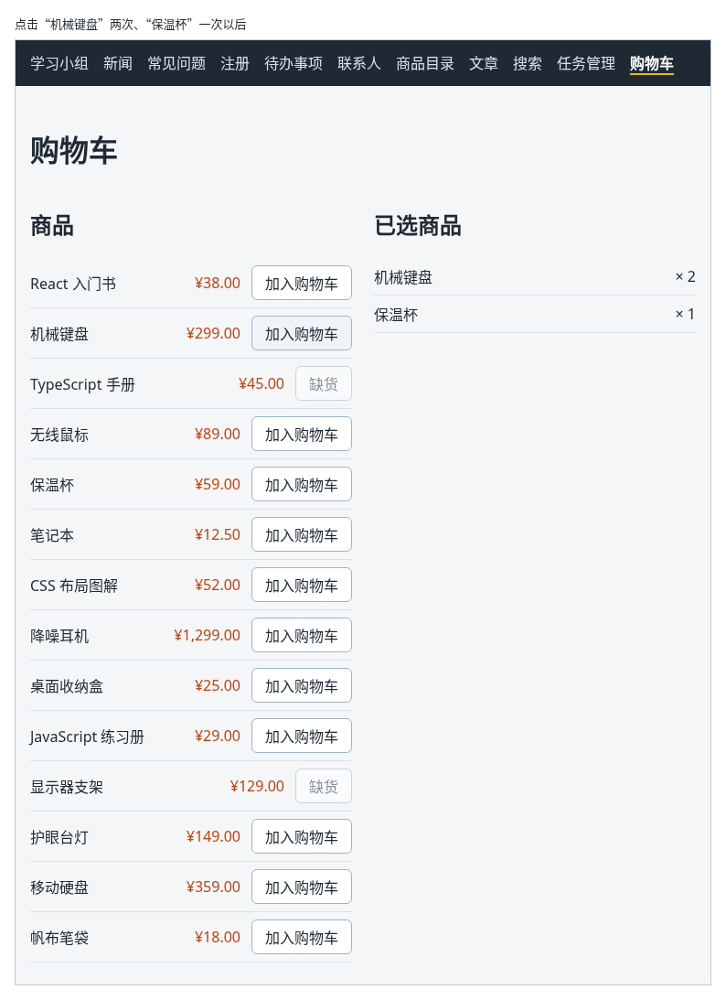

# 第 102 章：如何把商品加入购物车？

前置：[第 101 章：【组合】如何根据网址中的商品编号读取并显示商品详情？](第101章-如何根据网址中的商品编号读取并显示商品详情.md)

## 一、本章要解决的问题

网上商店都有购物车：看中一件商品，点“加入购物车”，右边的购物车中就多了这件商品；同一件商品再点一次，不是多出一行，而是数量变成 2。

本章新建一个“购物车”页，左边是商品列表，右边是已选商品。完成后：点击“机械键盘”的“加入购物车”，右边出现“机械键盘 × 1”；再点一次，变成“× 2”；再点“保温杯”，右边多出一行“保温杯 × 1”；缺货的商品按钮显示“缺货”，不能点击。

本章是第 12 部分的起点。第 12 部分（第 102—108 章）会在这个页面上继续加入修改数量、计算总价，再让导航栏中显示购物车里的商品数量，学习怎样让多个组件共用一份数据。

下图是点击“机械键盘”两次、“保温杯”一次以后的样子：



## 二、必要原理

### 购物车里只记编号和数量

购物车中的每一行，用一个很小的对象表示：

```tsx
type CartItem = {
  productId: number;
  quantity: number;
};
```

只记商品编号和数量，不把商品的名称、价格复制进来。需要显示名称和价格时，用编号到商品数据中查找。

这样做的好处是每样数据只保存一份：商品改了名称或价格，购物车中显示的跟着变；如果复制了一份，两边就可能对不上。这和第 32 章“能算出来的数据不放进 state”是同一个道理。

### 加入时分两种情况

点击“加入购物车”时，先用 `find` 看看这件商品是否已经在购物车中：

- 已经在：用 `map` 生成一个新数组，这一行的数量加 1，其余行原样保留。写法和第 48 章切换任务完成状态相同，用展开语法 `{ ...item, quantity: item.quantity + 1 }` 复制出一个新对象。
- 不在：用展开语法在数组末尾加一行，数量为 1，和第 45 章添加任务相同。

两种情况都是生成新数组再交给 `setCartItems`，不能直接修改原来的对象（第 51 章）。

### 在 map 中先查找再显示

显示购物车时，每一行都要先按编号找到商品，再显示它的名称。这时 `map` 的箭头函数要写成带花括号的形式，里面可以写多条语句，最后用 `return` 返回这一行的 JSX：

```tsx
{cartItems.map((item) => {
  const product = products.find((candidate) => candidate.id === item.productId);
  if (!product) {
    return null;
  }
  return <li key={item.productId}>{product.name}</li>;
})}
```

以前的 `map` 写的是 `(item) => (<li>…</li>)`，圆括号直接就是返回值。改成花括号后，一定要写 `return`，否则这一行什么也不显示。

`find` 可能找不到商品，返回 `undefined`。返回 `null` 表示这一行什么也不显示，React 会跳过它。

### 缺货的商品不能加入

`products` 中库存为 0 的商品，按钮加上 `disabled`，文字显示“缺货”，和第 89 章保存期间禁用按钮的写法一样。

## 三、动手实现

### 第 1 步：新建购物车页的样式

新建 `src/pages/ShopPage.module.css`：

```css
.layout {
  display: flex;
  flex-wrap: wrap;
  gap: 24px;
  align-items: flex-start;
}

.layout > section {
  flex: 1 1 280px;
}

.list {
  margin: 0;
  padding: 0;
  list-style: none;
}

.row {
  display: flex;
  align-items: center;
  gap: 12px;
  padding: 8px 0;
  border-bottom: 1px solid #d9e2ec;
}

.name {
  flex: 1;
}

.price {
  color: #c2410c;
}

.empty {
  color: #7b8794;
}
```

`.layout` 让商品列表和已选商品左右并排，窗口变窄时自动上下排列（第 13 章）。`.name` 的 `flex: 1` 让名称占满剩下的宽度，价格和按钮靠右对齐。

### 第 2 步：新建购物车页

新建 `src/pages/ShopPage.tsx`：

```tsx
import { useState } from 'react';
import { products } from '../data/products';
import { formatPrice } from '../lib/format';
import styles from './ShopPage.module.css';

// 购物车只记商品编号和数量，名称、价格用编号到商品数据中查，不重复保存
type CartItem = {
  productId: number;
  quantity: number;
};

export default function ShopPage() {
  const [cartItems, setCartItems] = useState<CartItem[]>([]);

  function handleAdd(productId: number) {
    const existing = cartItems.find((item) => item.productId === productId);
    if (existing) {
      setCartItems(
        cartItems.map((item) =>
          item.productId === productId ? { ...item, quantity: item.quantity + 1 } : item,
        ),
      );
    } else {
      setCartItems([...cartItems, { productId, quantity: 1 }]);
    }
  }

  return (
    <main className="page">
      <h1>购物车</h1>
      <div className={styles.layout}>
        <section>
          <h2>商品</h2>
          <ul className={styles.list}>
            {products.map((product) => (
              <li key={product.id} className={styles.row}>
                <span className={styles.name}>{product.name}</span>
                <span className={styles.price}>{formatPrice(product.price)}</span>
                <button
                  type="button"
                  disabled={product.stock === 0}
                  onClick={() => handleAdd(product.id)}
                >
                  {product.stock === 0 ? '缺货' : '加入购物车'}
                </button>
              </li>
            ))}
          </ul>
        </section>
        <section>
          <h2>已选商品</h2>
          {cartItems.length === 0 ? (
            <p className={styles.empty}>购物车是空的。</p>
          ) : (
            <ul className={styles.list}>
              {cartItems.map((item) => {
                const product = products.find((candidate) => candidate.id === item.productId);
                if (!product) {
                  return null;
                }
                return (
                  <li key={item.productId} className={styles.row}>
                    <span className={styles.name}>{product.name}</span>
                    <span>× {item.quantity}</span>
                  </li>
                );
              })}
            </ul>
          )}
        </section>
      </div>
    </main>
  );
}
```

- `{ productId, quantity: 1 }` 中的 `productId` 是 `productId: productId` 的简写（第 93A 章）。
- 已选商品的 `key` 用商品编号。同一件商品在购物车中只有一行，所以编号不会重复。
- 购物车为空时显示提示，写法和第 19 章相同。

### 第 3 步：加入路由和导航

打开 `src/App.tsx`，在导入 `SearchPage` 的一行下面加入：

```tsx
import ShopPage from './pages/ShopPage';
```

在 `/tasks` 那条路由的下面加入：

```tsx
        <Route path="/shop" element={<ShopPage />} />
```

打开 `src/components/AppLayout.tsx`，在“任务管理”的下面加入：

```tsx
        <NavLink to="/shop">购物车</NavLink>
```

## 四、运行与检查

保持开发服务器运行（`npm.cmd run dev`），保存文件后在浏览器中查看。

1. 导航栏最后多了“购物车”。点击它，地址变成 `/shop`，左边是 14 件商品，右边显示“购物车是空的。”。
2. “TypeScript 手册”和“显示器支架”的按钮显示“缺货”，不能点击。
3. 点击“机械键盘”的“加入购物车”，右边出现“机械键盘 × 1”。再点一次，仍然只有一行，变成“× 2”。
4. 点击“保温杯”的“加入购物车”，右边多出一行“保温杯 × 1”，排在机械键盘的下面。
5. 在 React 开发者工具中选中 `ShopPage`，它的 State 是 `[{productId: 2, quantity: 2}, {productId: 5, quantity: 1}]`，只有编号和数量。
6. 点导航中的“新闻”再回来，购物车又空了。离开页面时组件被移除，state 也随之清除（第 94 章），第 12 部分后面的章节会解决这个问题。

最后运行检查，应没有错误：

```powershell
npm.cmd run check
```

**小练习**：在已选商品的标题后面显示一共选了几种商品，例如“已选商品（2 种）”。提示：种数就是 `cartItems.length`，不需要新的 state。练习后恢复本章代码。

## 五、常见错误

| 现象 | 原因 | 怎么改 |
| --- | --- | --- |
| 同一件商品点两次，出现两行，控制台提示 ``Encountered two children with the same key, `2`.`` | 每次都在末尾加一行，没有先查找这件商品是否已在购物车中 | 先用 `find` 查找，已存在时用 `map` 把数量加 1 |
| 点了“加入购物车”，数量没有变化 | 直接修改了找到的对象：`existing.quantity += 1`，再把原数组交给 `setCartItems`，React 认为数据没变（第 51 章） | 用 `map` 和展开语法生成新数组和新对象 |
| 右边的已选商品什么也不显示，购物车也不提示为空 | `map` 的箭头函数写了花括号，但最后没有写 `return` | 在花括号中用 `return` 返回这一行的 JSX |
| 检查命令报 `'product' is possibly 'undefined'.` | `find` 可能找不到商品，直接用了 `product.name` | 先判断 `if (!product) { return null; }` |

## 六、本章完整代码

### `src/pages/ShopPage.module.css`

同第三节第 1 步。

### `src/pages/ShopPage.tsx`

同第三节第 2 步。

### `src/App.tsx`

```tsx
import { Route, Routes } from 'react-router';
import './App.css';
import AppLayout from './components/AppLayout';
import ArticlePage from './pages/ArticlePage';
import ContactsPage from './pages/ContactsPage';
import FaqPage from './pages/FaqPage';
import GroupPage from './pages/GroupPage';
import NewsPage from './pages/NewsPage';
import NotFoundPage from './pages/NotFoundPage';
import ProductDetailPage from './pages/ProductDetailPage';
import ProductPage from './pages/ProductPage';
import RegisterPage from './pages/RegisterPage';
import SearchPage from './pages/SearchPage';
import ShopPage from './pages/ShopPage';
import TaskPage from './pages/TaskPage';
import TaskServerPage from './pages/TaskServerPage';

export default function App() {
  return (
    <Routes>
      <Route element={<AppLayout />}>
        <Route path="/" element={<GroupPage />} />
        <Route path="/news" element={<NewsPage />} />
        <Route path="/faq" element={<FaqPage />} />
        <Route path="/register" element={<RegisterPage />} />
        <Route path="/todos" element={<TaskPage />} />
        <Route path="/contacts" element={<ContactsPage />} />
        <Route path="/products" element={<ProductPage />} />
        <Route path="/products/:id" element={<ProductDetailPage />} />
        <Route path="/articles" element={<ArticlePage />} />
        <Route path="/search" element={<SearchPage />} />
        <Route path="/tasks" element={<TaskServerPage />} />
        <Route path="/shop" element={<ShopPage />} />
        <Route path="*" element={<NotFoundPage />} />
      </Route>
    </Routes>
  );
}
```

### `src/components/AppLayout.tsx`

```tsx
import { NavLink, Outlet } from 'react-router';

export default function AppLayout() {
  return (
    <div>
      <nav className="site-nav" aria-label="主导航">
        <NavLink to="/">学习小组</NavLink>
        <NavLink to="/news">新闻</NavLink>
        <NavLink to="/faq">常见问题</NavLink>
        <NavLink to="/register">注册</NavLink>
        <NavLink to="/todos">待办事项</NavLink>
        <NavLink to="/contacts">联系人</NavLink>
        <NavLink to="/products">商品目录</NavLink>
        <NavLink to="/articles">文章</NavLink>
        <NavLink to="/search">搜索</NavLink>
        <NavLink to="/tasks">任务管理</NavLink>
        <NavLink to="/shop">购物车</NavLink>
      </nav>
      <Outlet />
    </div>
  );
}
```

## 七、本章改动小结

新增 `src/pages/ShopPage.tsx` 和 `src/pages/ShopPage.module.css`：购物车页，可以把商品加入购物车；修改 `src/App.tsx`：加入 `/shop` 路由；修改 `src/components/AppLayout.tsx`：导航中加入“购物车”。

---

下一章：[第 103 章：如何修改购物车中的商品数量？](第103章-如何修改购物车中的商品数量.md)
