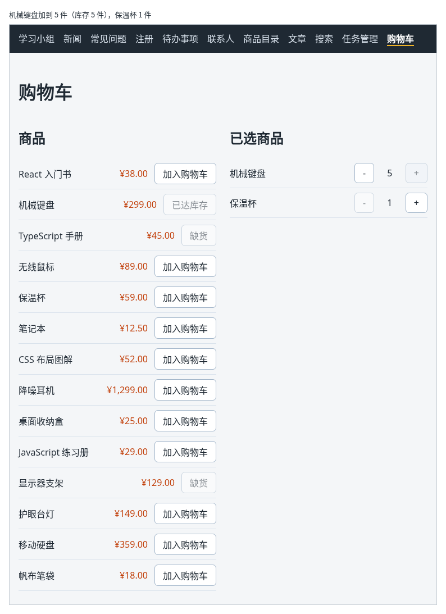

# 第 103 章：如何修改购物车中的商品数量？

前置：[第 102 章：如何把商品加入购物车？](第102章-如何把商品加入购物车.md)

## 一、本章要解决的问题

上一章的购物车只能加，不能减：多点了一次“加入购物车”，就没办法把数量改回去。另外，机械键盘只有 5 件库存，现在却可以一直加下去。

本章在已选商品的每一行加上“−”和“+”两个按钮。完成后：点“+”数量加 1，点“−”数量减 1；数量为 1 时“−”不能点击；数量达到库存时“+”不能点击，左边这件商品的按钮也变成“已达库存”。

下图是把机械键盘加到 5 件以后的样子，它的库存正好是 5 件：



## 二、必要原理

### 加一件和减一件是同一种修改

“+”和“−”都是把某一行的数量改成另一个数，区别只是加 1 还是减 1。所以只写一个处理函数，用参数 `change` 表示变化量，“+”传 `1`，“−”传 `-1`：

```tsx
function handleChangeQuantity(productId: number, change: number) {
  setCartItems(
    cartItems.map((item) =>
      item.productId === productId ? { ...item, quantity: item.quantity + change } : item,
    ),
  );
}
```

写法和上一章 `handleAdd` 中“已存在时数量加 1”的那一段相同，只是把固定的 `+ 1` 换成了 `+ change`。

### 给处理函数传参数：写成箭头函数

按钮点击时要传两个参数：商品编号和变化量。所以 `onClick` 中写一个箭头函数，在箭头函数中调用处理函数：

```tsx
onClick={() => handleChangeQuantity(item.productId, -1)}
```

不能直接写成 `onClick={handleChangeQuantity(item.productId, -1)}`。这样写，函数在**渲染时**就被调用了，而不是在点击时；它又修改了 state，引起下一次渲染，再次调用……没完没了。这一点第 46 章删除任务时已经讲过。

### 用 disabled 限制数量的范围

数量不能小于 1，也不能超过库存。与其点击后再检查，不如直接让按钮不能点：

- “−”：`disabled={item.quantity <= 1}`；
- “+”：`disabled={item.quantity >= product.stock}`。

左边的“加入购物车”也能增加数量，所以它也要按同样的规则禁用。为此，左边每一行先找到这件商品在购物车中的数量，再决定按钮的文字和是否可用：

```tsx
const cartItem = cartItems.find((item) => item.productId === product.id);
const quantity = cartItem ? cartItem.quantity : 0;
```

不在购物车中时，数量算作 0。按钮的文字有三种：库存为 0 时显示“缺货”，数量达到库存时显示“已达库存”，其余显示“加入购物车”。用第 42 章的 `if`……`else if` 先算好，再放进按钮。

### 给只有符号的按钮写清楚用途

“−”和“+”只是一个符号，而且每一行都有一对。读屏软件只读出“减号按钮”，用户不知道是给哪件商品减。和第 46 章的删除按钮一样，用 `aria-label` 写出完整的意思，例如“减少一件：机械键盘”。

## 三、动手实现

### 第 1 步：写修改数量的处理函数

打开 `src/pages/ShopPage.tsx`，在 `handleAdd` 函数的后面加入：

```tsx

  // change 是 1 或 -1：加一件或减一件
  function handleChangeQuantity(productId: number, change: number) {
    setCartItems(
      cartItems.map((item) =>
        item.productId === productId ? { ...item, quantity: item.quantity + change } : item,
      ),
    );
  }
```

### 第 2 步：已选商品中加入“−”和“+”

把已选商品中每一行的这两行：

```tsx
                    <span className={styles.name}>{product.name}</span>
                    <span>× {item.quantity}</span>
```

替换为：

```tsx
                    <span className={styles.name}>{product.name}</span>
                    <button
                      type="button"
                      aria-label={'减少一件：' + product.name}
                      disabled={item.quantity <= 1}
                      onClick={() => handleChangeQuantity(item.productId, -1)}
                    >
                      −
                    </button>
                    <span className={styles.quantity}>{item.quantity}</span>
                    <button
                      type="button"
                      aria-label={'增加一件：' + product.name}
                      disabled={item.quantity >= product.stock}
                      onClick={() => handleChangeQuantity(item.productId, 1)}
                    >
                      +
                    </button>
```

### 第 3 步：“加入购物车”也不能超过库存

把左边商品列表的 `products.map(...)` 整段替换为：

```tsx
            {products.map((product) => {
              const cartItem = cartItems.find((item) => item.productId === product.id);
              const quantity = cartItem ? cartItem.quantity : 0;
              let buttonText = '加入购物车';
              if (product.stock === 0) {
                buttonText = '缺货';
              } else if (quantity >= product.stock) {
                buttonText = '已达库存';
              }
              return (
                <li key={product.id} className={styles.row}>
                  <span className={styles.name}>{product.name}</span>
                  <span className={styles.price}>{formatPrice(product.price)}</span>
                  <button
                    type="button"
                    disabled={quantity >= product.stock}
                    onClick={() => handleAdd(product.id)}
                  >
                    {buttonText}
                  </button>
                </li>
              );
            })}
```

`map` 改成了带花括号的写法，原因和上一章显示已选商品时一样：返回 JSX 之前要先算几个值。库存为 0 时，`quantity >= product.stock` 就是 `0 >= 0`，按钮同样不能点，所以 `disabled` 只需要这一个条件。

### 第 4 步：数量的样式

打开 `src/pages/ShopPage.module.css`，在 `.empty` 规则的前面加入：

```css
.quantity {
  min-width: 2em;
  text-align: center;
}
```

`min-width: 2em` 给数字留出固定的宽度，数量从 9 变成 10 时，两个按钮的位置不会跳动。

## 四、运行与检查

保持开发服务器运行（`npm.cmd run dev`），保存文件后在浏览器中查看。

1. 打开“购物车”页，把机械键盘和保温杯各加入一次。右边每一行是“名称 − 1 +”，两行的“−”都不能点。
2. 点击机械键盘的“+”四次，数量变成 5。这时“+”不能点，左边机械键盘的按钮变成灰色的“已达库存”。
3. 点击机械键盘的“−”，数量变成 4，“+”和左边的“加入购物车”都恢复可用。
4. 点击左边机械键盘的“加入购物车”，右边数量变成 5，按钮再次变成“已达库存”。
5. 一直点保温杯的“−”，数量停在 1，不会变成 0 或负数。
6. 按 F12，在 Elements（元素）面板中选中一个“−”按钮，可以看到 `aria-label="减少一件：机械键盘"`。

最后运行检查，应没有错误：

```powershell
npm.cmd run check
```

**小练习**：在每一行的“+”后面加一个“移出”按钮，点击后从购物车中删掉这一行。删光以后，右边显示“购物车是空的。”。提示：用第 46 章删除任务的 `filter` 写法。练习后恢复本章代码。

## 五、常见错误

| 现象 | 原因 | 怎么改 |
| --- | --- | --- |
| 检查命令报 `Type 'void' is not assignable to type 'MouseEventHandler<HTMLButtonElement> \| undefined'`；如果不管检查直接运行，页面报错 `Too many re-renders` | 写成了 `onClick={handleChangeQuantity(item.productId, 1)}`，渲染时就调用了函数 | 写成箭头函数：`onClick={() => handleChangeQuantity(item.productId, 1)}` |
| 一直点“−”，数量变成了 0、-1 | “−”按钮没有写 `disabled` | 加上 `disabled={item.quantity <= 1}` |
| 右边的“+”已经不能点了，点左边的“加入购物车”还能继续加 | 只限制了“+”，没有限制“加入购物车” | 左边的按钮也按 `quantity >= product.stock` 禁用 |
| 点了“+”，其他商品的数量也变了 | `map` 中没有按编号判断，所有行都加上了 `change` | 只在 `item.productId === productId` 时修改数量，其余行原样返回 |

## 六、本章完整代码

### `src/pages/ShopPage.tsx`

```tsx
import { useState } from 'react';
import { products } from '../data/products';
import { formatPrice } from '../lib/format';
import styles from './ShopPage.module.css';

// 购物车只记商品编号和数量，名称、价格用编号到商品数据中查，不重复保存
type CartItem = {
  productId: number;
  quantity: number;
};

export default function ShopPage() {
  const [cartItems, setCartItems] = useState<CartItem[]>([]);

  function handleAdd(productId: number) {
    const existing = cartItems.find((item) => item.productId === productId);
    if (existing) {
      setCartItems(
        cartItems.map((item) =>
          item.productId === productId ? { ...item, quantity: item.quantity + 1 } : item,
        ),
      );
    } else {
      setCartItems([...cartItems, { productId, quantity: 1 }]);
    }
  }

  // change 是 1 或 -1：加一件或减一件
  function handleChangeQuantity(productId: number, change: number) {
    setCartItems(
      cartItems.map((item) =>
        item.productId === productId ? { ...item, quantity: item.quantity + change } : item,
      ),
    );
  }

  return (
    <main className="page">
      <h1>购物车</h1>
      <div className={styles.layout}>
        <section>
          <h2>商品</h2>
          <ul className={styles.list}>
            {products.map((product) => {
              const cartItem = cartItems.find((item) => item.productId === product.id);
              const quantity = cartItem ? cartItem.quantity : 0;
              let buttonText = '加入购物车';
              if (product.stock === 0) {
                buttonText = '缺货';
              } else if (quantity >= product.stock) {
                buttonText = '已达库存';
              }
              return (
                <li key={product.id} className={styles.row}>
                  <span className={styles.name}>{product.name}</span>
                  <span className={styles.price}>{formatPrice(product.price)}</span>
                  <button
                    type="button"
                    disabled={quantity >= product.stock}
                    onClick={() => handleAdd(product.id)}
                  >
                    {buttonText}
                  </button>
                </li>
              );
            })}
          </ul>
        </section>
        <section>
          <h2>已选商品</h2>
          {cartItems.length === 0 ? (
            <p className={styles.empty}>购物车是空的。</p>
          ) : (
            <ul className={styles.list}>
              {cartItems.map((item) => {
                const product = products.find((candidate) => candidate.id === item.productId);
                if (!product) {
                  return null;
                }
                return (
                  <li key={item.productId} className={styles.row}>
                    <span className={styles.name}>{product.name}</span>
                    <button
                      type="button"
                      aria-label={'减少一件：' + product.name}
                      disabled={item.quantity <= 1}
                      onClick={() => handleChangeQuantity(item.productId, -1)}
                    >
                      −
                    </button>
                    <span className={styles.quantity}>{item.quantity}</span>
                    <button
                      type="button"
                      aria-label={'增加一件：' + product.name}
                      disabled={item.quantity >= product.stock}
                      onClick={() => handleChangeQuantity(item.productId, 1)}
                    >
                      +
                    </button>
                  </li>
                );
              })}
            </ul>
          )}
        </section>
      </div>
    </main>
  );
}
```

### `src/pages/ShopPage.module.css`

```css
.layout {
  display: flex;
  flex-wrap: wrap;
  gap: 24px;
  align-items: flex-start;
}

.layout > section {
  flex: 1 1 280px;
}

.list {
  margin: 0;
  padding: 0;
  list-style: none;
}

.row {
  display: flex;
  align-items: center;
  gap: 12px;
  padding: 8px 0;
  border-bottom: 1px solid #d9e2ec;
}

.name {
  flex: 1;
}

.price {
  color: #c2410c;
}

.quantity {
  min-width: 2em;
  text-align: center;
}

.empty {
  color: #7b8794;
}
```

## 七、本章改动小结

修改 `src/pages/ShopPage.tsx`：新增 `handleChangeQuantity`，已选商品的每一行加入“−”“+”按钮，数量限制在 1 到库存之间，“加入购物车”达到库存时禁用；修改 `src/pages/ShopPage.module.css`：新增数量的样式。

