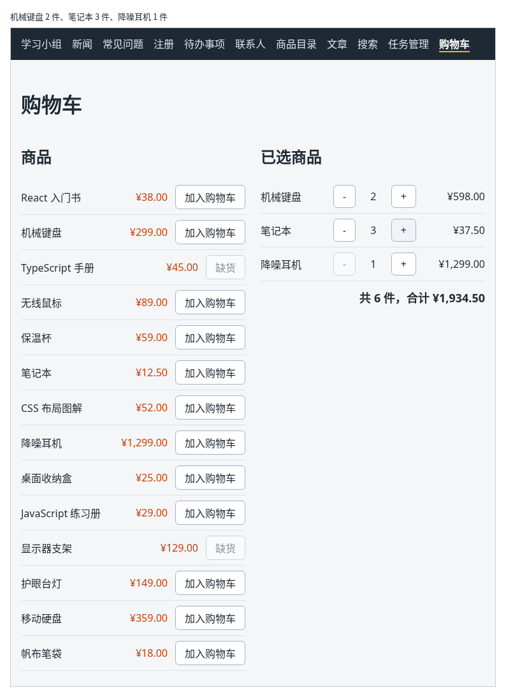

# 第 104 章：如何根据商品数量计算总价？

前置：[第 103 章：如何修改购物车中的商品数量？](第103章-如何修改购物车中的商品数量.md)

## 一、本章要解决的问题

购物车里有了商品和数量，用户最关心的却还看不到：每件商品一共多少钱，所有商品加起来要付多少。

本章在已选商品的每一行末尾显示小计，在列表下方显示总件数和合计金额。完成后：机械键盘 2 件，这一行显示“¥598.00”；再加上笔记本 3 件、降噪耳机 1 件，下方显示“共 6 件，合计 ¥1,934.50”；点“+”或“−”时，小计和合计立刻跟着变。

下图是机械键盘 2 件、笔记本 3 件、降噪耳机 1 件时的样子：



## 二、必要原理

### 总价是算出来的，不放进 state

总件数和合计金额完全由 `cartItems` 和商品价格决定。按第 32 章的判断方法，它们不需要放进 state，每次渲染时现算即可。

如果另外用一个 state 保存总价，每次加入、修改数量时都要记得同时更新它，漏掉一处，总价就和购物车对不上。现算的值永远是对的。

### 用 for...of 逐行累加

要把每一行的金额加起来，可以用 `for...of` 循环逐行处理数组：

```tsx
let totalPrice = 0;
for (const item of cartItems) {
  totalPrice += product.price * item.quantity;
}
```

`for (const item of cartItems)` 的意思是“对 `cartItems` 中的每一项，依次放进 `item`，执行一次花括号中的代码”。和 `map` 不同，它不生成新数组，适合这种“边走边累加”的计算。

`totalPrice` 要用 `let` 声明，因为循环中会不断给它重新赋值；`+=` 在第 44B 章拼接字符串时用过，用在数字上就是“加上”。

每一行的价格仍然要按编号到商品数据中查找，和显示已选商品时一样。找不到商品时跳过这一行。

### 小计也是现算的

每一行的小计就是 `product.price * item.quantity`，直接写在 JSX 中，交给第 95 章的 `formatPrice` 显示成金额格式。

价格中有小数时，例如笔记本 12.5 元，计算机算小数可能出现很长的尾数，例如 `0.1 + 0.2` 的结果是 `0.30000000000000004`。显示时 `formatPrice` 会四舍五入到两位小数，看不出这个尾数。真正结算的金额由服务器计算，前端只负责显示。

## 三、动手实现

### 第 1 步：计算总件数和合计

打开 `src/pages/ShopPage.tsx`，在 `cartItems` 那一行的下面加入：

```tsx

  // 总件数和总价都能从 cartItems 算出来，不放进 state
  let totalQuantity = 0;
  let totalPrice = 0;
  for (const item of cartItems) {
    const product = products.find((candidate) => candidate.id === item.productId);
    if (product) {
      totalQuantity += item.quantity;
      totalPrice += product.price * item.quantity;
    }
  }
```

### 第 2 步：每一行显示小计

在已选商品每一行的“+”按钮后面加入：

```tsx
                    <span className={styles.subtotal}>
                      {formatPrice(product.price * item.quantity)}
                    </span>
```

### 第 3 步：列表下方显示合计

在已选商品的 `</ul>` 和 `)}` 后面、`</section>` 前面加入：

```tsx
          {cartItems.length > 0 && (
            <p className={styles.total}>
              共 {totalQuantity} 件，合计 {formatPrice(totalPrice)}
            </p>
          )}
```

购物车为空时不显示合计，写法和第 21 章相同。

### 第 4 步：小计和合计的样式

打开 `src/pages/ShopPage.module.css`，在 `.empty` 规则的前面加入：

```css
.subtotal {
  min-width: 6em;
  text-align: right;
}

.total {
  margin: 12px 0 0;
  text-align: right;
  font-size: 18px;
  font-weight: bold;
}
```

小计给出固定的最小宽度并靠右对齐，几行的金额上下对齐，方便比较。

## 四、运行与检查

保持开发服务器运行（`npm.cmd run dev`），保存文件后在浏览器中查看。

1. 打开购物车页，右边是空的，没有合计。
2. 把机械键盘加入购物车，这一行末尾显示“¥299.00”，下方显示“共 1 件，合计 ¥299.00”。
3. 点机械键盘的“+”，小计变成“¥598.00”，合计跟着变成“共 2 件，合计 ¥598.00”。
4. 再加入笔记本，把数量加到 3；再加入降噪耳机。三行的小计分别是“¥598.00”“¥37.50”“¥1,299.00”，合计“共 6 件，合计 ¥1,934.50”。
5. 点笔记本的“−”，小计变成“¥25.00”，合计变成“共 5 件，合计 ¥1,922.00”。
6. 在 React 开发者工具中选中 `ShopPage`，State 中仍然只有 `cartItems` 这一个数组，没有总价。

最后运行检查，应没有错误：

```powershell
npm.cmd run check
```

**小练习**：合计满 1000 元时，在合计下方显示“已满 1000 元，免运费”；不满时显示“再买 X 元免运费”，X 用 `formatPrice` 显示。练习后恢复本章代码。

## 五、常见错误

| 现象 | 原因 | 怎么改 |
| --- | --- | --- |
| 检查命令报 `Cannot assign to 'totalPrice' because it is a constant.` | 用 `const` 声明了 `totalPrice`，循环中不能再给它赋值 | 改用 `let` |
| 合计只算了每件商品一次，数量改成 3 也不变 | 累加时写成了 `totalPrice += product.price`，没有乘数量 | 写成 `product.price * item.quantity` |
| 修改数量后合计偶尔对不上 | 另外用了一个 state 保存总价，有的地方忘了同时更新 | 删掉这个 state，每次渲染时从 `cartItems` 现算 |
| 检查命令报 `Property 'productId' does not exist on type 'string'.` | `for...of` 写成了 `for...in`。`for...in` 取出的是位置编号 `'0'`、`'1'`，不是数组中的每一项 | 遍历数组用 `for...of` |

## 六、本章完整代码

### `src/pages/ShopPage.tsx`

```tsx
import { useState } from 'react';
import { products } from '../data/products';
import { formatPrice } from '../lib/format';
import styles from './ShopPage.module.css';

// 购物车只记商品编号和数量，名称、价格用编号到商品数据中查，不重复保存
type CartItem = {
  productId: number;
  quantity: number;
};

export default function ShopPage() {
  const [cartItems, setCartItems] = useState<CartItem[]>([]);

  // 总件数和总价都能从 cartItems 算出来，不放进 state
  let totalQuantity = 0;
  let totalPrice = 0;
  for (const item of cartItems) {
    const product = products.find((candidate) => candidate.id === item.productId);
    if (product) {
      totalQuantity += item.quantity;
      totalPrice += product.price * item.quantity;
    }
  }

  function handleAdd(productId: number) {
    const existing = cartItems.find((item) => item.productId === productId);
    if (existing) {
      setCartItems(
        cartItems.map((item) =>
          item.productId === productId ? { ...item, quantity: item.quantity + 1 } : item,
        ),
      );
    } else {
      setCartItems([...cartItems, { productId, quantity: 1 }]);
    }
  }

  // change 是 1 或 -1：加一件或减一件
  function handleChangeQuantity(productId: number, change: number) {
    setCartItems(
      cartItems.map((item) =>
        item.productId === productId ? { ...item, quantity: item.quantity + change } : item,
      ),
    );
  }

  return (
    <main className="page">
      <h1>购物车</h1>
      <div className={styles.layout}>
        <section>
          <h2>商品</h2>
          <ul className={styles.list}>
            {products.map((product) => {
              const cartItem = cartItems.find((item) => item.productId === product.id);
              const quantity = cartItem ? cartItem.quantity : 0;
              let buttonText = '加入购物车';
              if (product.stock === 0) {
                buttonText = '缺货';
              } else if (quantity >= product.stock) {
                buttonText = '已达库存';
              }
              return (
                <li key={product.id} className={styles.row}>
                  <span className={styles.name}>{product.name}</span>
                  <span className={styles.price}>{formatPrice(product.price)}</span>
                  <button
                    type="button"
                    disabled={quantity >= product.stock}
                    onClick={() => handleAdd(product.id)}
                  >
                    {buttonText}
                  </button>
                </li>
              );
            })}
          </ul>
        </section>
        <section>
          <h2>已选商品</h2>
          {cartItems.length === 0 ? (
            <p className={styles.empty}>购物车是空的。</p>
          ) : (
            <ul className={styles.list}>
              {cartItems.map((item) => {
                const product = products.find((candidate) => candidate.id === item.productId);
                if (!product) {
                  return null;
                }
                return (
                  <li key={item.productId} className={styles.row}>
                    <span className={styles.name}>{product.name}</span>
                    <button
                      type="button"
                      aria-label={'减少一件：' + product.name}
                      disabled={item.quantity <= 1}
                      onClick={() => handleChangeQuantity(item.productId, -1)}
                    >
                      −
                    </button>
                    <span className={styles.quantity}>{item.quantity}</span>
                    <button
                      type="button"
                      aria-label={'增加一件：' + product.name}
                      disabled={item.quantity >= product.stock}
                      onClick={() => handleChangeQuantity(item.productId, 1)}
                    >
                      +
                    </button>
                    <span className={styles.subtotal}>
                      {formatPrice(product.price * item.quantity)}
                    </span>
                  </li>
                );
              })}
            </ul>
          )}
          {cartItems.length > 0 && (
            <p className={styles.total}>
              共 {totalQuantity} 件，合计 {formatPrice(totalPrice)}
            </p>
          )}
        </section>
      </div>
    </main>
  );
}
```

### `src/pages/ShopPage.module.css`

```css
.layout {
  display: flex;
  flex-wrap: wrap;
  gap: 24px;
  align-items: flex-start;
}

.layout > section {
  flex: 1 1 280px;
}

.list {
  margin: 0;
  padding: 0;
  list-style: none;
}

.row {
  display: flex;
  align-items: center;
  gap: 12px;
  padding: 8px 0;
  border-bottom: 1px solid #d9e2ec;
}

.name {
  flex: 1;
}

.price {
  color: #c2410c;
}

.quantity {
  min-width: 2em;
  text-align: center;
}

.subtotal {
  min-width: 6em;
  text-align: right;
}

.total {
  margin: 12px 0 0;
  text-align: right;
  font-size: 18px;
  font-weight: bold;
}

.empty {
  color: #7b8794;
}
```

## 七、本章改动小结

修改 `src/pages/ShopPage.tsx`：用 `for...of` 计算总件数和合计金额，每一行显示小计，列表下方显示合计；修改 `src/pages/ShopPage.module.css`：新增小计和合计的样式。

---

下一章：[第 105 章：如何让商品列表和购物车使用同一份数据？](第105章-如何让商品列表和购物车使用同一份数据.md)
