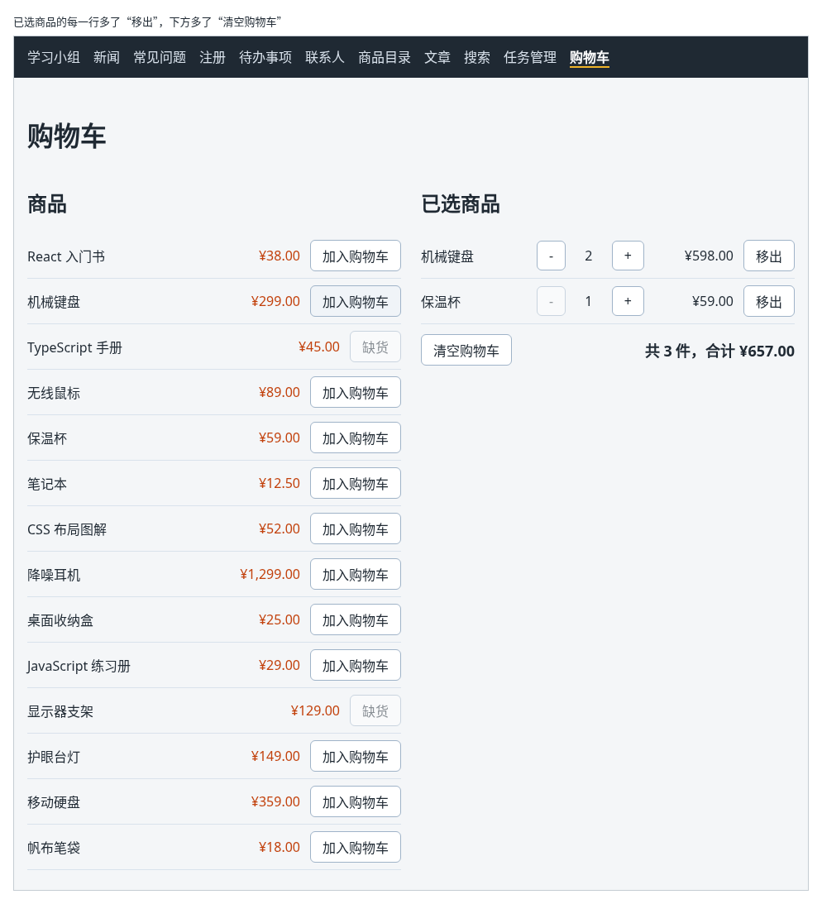

# 第 107 章：更新操作越来越多时，如何用 reducer 集中管理？

前置：[第 106 章：组件层级较深时，如何用 Context 共享数据？](第106章-组件层级较深时，如何用Context共享数据.md)

## 一、本章要解决的问题

购物车还缺两个常用操作：把某件商品整行移出，以及一次清空购物车。按现在的写法，每多一种操作，`CartProvider` 中就多一个函数，Context 的类型中多一个字段，读取的组件也要跟着改。操作一多，修改购物车的代码散落在好几个函数里，想知道“购物车一共能怎么变”要把它们全读一遍。

本章用 React 的 `useReducer`，把购物车所有的修改方式集中到一个函数中，再加上“移出”和“清空购物车”。完成后：已选商品的每一行末尾有“移出”按钮，点击后这一行消失；列表下方有“清空购物车”按钮，点击后显示“购物车是空的。”；加入和修改数量与原来一样。

下图是加入两件商品以后的样子：



## 二、必要原理

### reducer：一个函数说清楚 state 的所有变化

**reducer** 是一个普通函数，接收两个参数：当前的 state 和一个**动作**（action），返回修改后的新 state：

```tsx
function cartReducer(cartItems: CartItem[], action: CartAction): CartItem[] {
  if (action.type === 'add') {
    return （加入以后的新数组）;
  }
  （其他动作）
}
```

动作是一个对象，用 `type` 字段说明“要做什么”，再带上做这件事需要的数据，例如 `{ type: 'remove', productId: 2 }` 表示“移出编号为 2 的商品”。

reducer 中只根据参数计算新 state，不发请求、不修改参数本身，和第 51 章一样，返回的是新数组。这样同样的 state 和动作，永远得到同样的结果，出了问题只看这一个函数就行。

### 用联合类型列出所有动作

所有动作用联合类型写在一起（第 69 章）：

```tsx
export type CartAction =
  | { type: 'add'; productId: number }
  | { type: 'change'; productId: number; change: number }
  | { type: 'remove'; productId: number }
  | { type: 'clear' };
```

读这一段就知道购物车有哪四种变化，每种需要什么数据。在 reducer 中判断了 `action.type === 'change'` 以后，TypeScript 就知道这个动作一定带着 `change` 字段。动作的名字写错、少带了数据，检查命令都会报错。

### useReducer 和 dispatch

在组件中用 `useReducer` 代替 `useState`：

```tsx
const [cartItems, dispatch] = useReducer(cartReducer, []);
```

- 第一个参数是 reducer，第二个参数是初始 state。
- 返回的 `cartItems` 是当前的 state，和 `useState` 一样。
- 返回的 `dispatch` 用来“发出”一个动作：调用 `dispatch({ type: 'add', productId: 2 })`，React 就用当前 state 和这个动作调用 reducer，把返回值作为新的 state，再重新渲染。

以前组件要调用 `addToCart`、`changeQuantity` 两个函数，现在只需要一个 `dispatch`，要做什么写在动作里。以后再加新操作，只改 `CartAction` 和 reducer，Context 的类型不用再变。

`dispatch` 的类型由 React 提供，写作 `ActionDispatch<[action: CartAction]>`，意思是“接收一个 `CartAction` 参数的函数”。

reducer 每次拿到的都是最新的 state，所以连续发出两个动作时，第二个动作是在第一个动作的结果上计算的，效果和第 28 章的更新函数相同。

### 什么时候用 useState 就够了

state 只有一两种简单的改法，例如开关、输入框的内容，用 `useState` 更直接。修改方式多、几种修改之间有关联，或者要把修改逻辑交给 Context 共享时，才值得改用 reducer。

## 三、动手实现

### 第 1 步：写购物车的 reducer

新建 `src/lib/cartReducer.ts`：

```ts
import type { CartItem } from '../types/cart';

// 购物车的所有修改方式都列在这里，每种动作带上它需要的数据
export type CartAction =
  | { type: 'add'; productId: number }
  | { type: 'change'; productId: number; change: number }
  | { type: 'remove'; productId: number }
  | { type: 'clear' };

export function cartReducer(cartItems: CartItem[], action: CartAction): CartItem[] {
  if (action.type === 'add') {
    const existing = cartItems.find((item) => item.productId === action.productId);
    if (!existing) {
      return [...cartItems, { productId: action.productId, quantity: 1 }];
    }
    return cartItems.map((item) =>
      item.productId === action.productId ? { ...item, quantity: item.quantity + 1 } : item,
    );
  }
  if (action.type === 'change') {
    return cartItems.map((item) =>
      item.productId === action.productId
        ? { ...item, quantity: item.quantity + action.change }
        : item,
    );
  }
  if (action.type === 'remove') {
    return cartItems.filter((item) => item.productId !== action.productId);
  }
  return [];
}
```

前两种动作的写法就是原来 `addToCart`、`changeQuantity` 的内容；移出用第 46 章的 `filter`；最后剩下的只有 `clear`，返回空数组。

### 第 2 步：Context 中改为提供 dispatch

把 `src/lib/cartContext.ts` 改为：

```ts
import { createContext } from 'react';
import type { ActionDispatch } from 'react';
import type { CartAction } from './cartReducer';
import type { CartItem } from '../types/cart';

export type CartContextValue = {
  cartItems: CartItem[];
  dispatch: ActionDispatch<[action: CartAction]>;
};

// 默认值 null 表示“外面没有 CartProvider”，useCart 会据此给出明确的报错
export const CartContext = createContext<CartContextValue | null>(null);
```

### 第 3 步：CartProvider 改用 useReducer

把 `src/components/CartProvider.tsx` 改为：

```tsx
import { useReducer } from 'react';
import type { ReactNode } from 'react';
import { CartContext } from '../lib/cartContext';
import { cartReducer } from '../lib/cartReducer';

type CartProviderProps = {
  children: ReactNode;
};

export default function CartProvider({ children }: CartProviderProps) {
  const [cartItems, dispatch] = useReducer(cartReducer, []);

  return <CartContext value={{ cartItems, dispatch }}>{children}</CartContext>;
}
```

两个函数都不见了，`CartProvider` 只剩下保存 state、提供 Context。

### 第 4 步：商品列表发出 add 动作

打开 `src/components/ProductList.tsx`，把读取购物车的一行改为：

```tsx
  const { cartItems, dispatch } = useCart();
```

把按钮的 `onClick` 改为：

```tsx
                onClick={() => dispatch({ type: 'add', productId: product.id })}
```

### 第 5 步：已选商品发出 change、remove 和 clear 动作

打开 `src/components/CartPanel.tsx`，把读取购物车的一行改为：

```tsx
  const { cartItems, dispatch } = useCart();
```

“−”按钮的 `onClick` 改为：

```tsx
                  onClick={() =>
                    dispatch({ type: 'change', productId: item.productId, change: -1 })
                  }
```

“+”按钮的 `onClick` 改为同样的写法，`change` 写 `1`。动作对象较长，一行写不下，所以箭头后面换行。

在每一行的小计后面加入“移出”按钮：

```tsx
                <button
                  type="button"
                  aria-label={'移出：' + product.name}
                  onClick={() => dispatch({ type: 'remove', productId: item.productId })}
                >
                  移出
                </button>
```

把列表下方显示合计的一段改为：

```tsx
      {cartItems.length > 0 && (
        <div className={styles.footer}>
          <button type="button" onClick={() => dispatch({ type: 'clear' })}>
            清空购物车
          </button>
          <p className={styles.total}>
            共 {totalQuantity} 件，合计 {formatPrice(totalPrice)}
          </p>
        </div>
      )}
```

### 第 6 步：调整样式

每一行多了一个按钮，窗口较窄时商品名称会被挤成一个字一行。打开 `src/components/ShopList.module.css`，做三处修改：

1. 在 `.row` 中 `display: flex;` 的下面加一行 `flex-wrap: wrap;`，放不下时按钮换到下一行。
2. 在 `.name` 中加一行 `min-width: 6em;`，名称至少保留六个字的宽度。
3. 在 `.total` 规则的前面加入下面的 `.footer`，并把 `.total` 中的 `margin` 改为 `0`：

```css
.footer {
  display: flex;
  justify-content: space-between;
  align-items: center;
  margin-top: 12px;
}
```

`justify-content: space-between` 让“清空购物车”靠左、合计靠右。

## 四、运行与检查

保持开发服务器运行（`npm.cmd run dev`），保存文件后在浏览器中查看。

1. 加入机械键盘两次、保温杯一次，右边两行分别是“机械键盘 2”和“保温杯 1”，每行末尾有“移出”，下方是“清空购物车”和“共 3 件，合计 ¥657.00”。
2. 点保温杯的“+”，变成 2 件，合计“共 4 件，合计 ¥716.00”。加入和修改数量与第 106 章一样。
3. 点机械键盘的“移出”，这一行消失，左边机械键盘的按钮仍是“加入购物车”。
4. 再加入笔记本，点“清空购物车”，右边显示“购物车是空的。”。
5. 把窗口缩窄，已选商品中名称保持横排，放不下的按钮换到下一行。
6. 在 React 开发者工具中选中 `CartProvider`，看到的是 `Reducer` 而不是 `State`，里面是购物车数组；点“+”时它随之变化。

最后运行检查，应没有错误：

```powershell
npm.cmd run check
```

**小练习**：给 reducer 加一种动作 `{ type: 'set'; productId: number; quantity: number }`，把某件商品的数量直接设为指定的值。再在 `CartPanel` 中加一个“改为 1 件”的按钮，用它发出这个动作。练习后恢复本章代码。

## 五、常见错误

| 现象 | 原因 | 怎么改 |
| --- | --- | --- |
| 检查命令报 `Type '"ad"' is not assignable to type '"add" \| "change" \| "clear" \| "remove"'.` | 动作的 `type` 写错了 | 照 `CartAction` 中的名字写 |
| 检查命令报 `Argument of type '{ type: "change"; productId: number; }' is not assignable to parameter of type 'CartAction'.` | 发出 `change` 动作时漏了 `change` 字段 | 每种动作带齐 `CartAction` 中写明的数据 |
| 点了按钮，页面没有变化 | reducer 中直接修改了原数组，例如 `cartItems.push(...)` 后返回 `cartItems`，React 认为 state 没变 | 返回新数组：用展开语法、`map`、`filter` |
| 已选商品的名称变成一个字一行 | 每行的按钮多了，空间不够，名称被挤窄 | 给 `.row` 加 `flex-wrap: wrap`，给 `.name` 加 `min-width` |

## 六、本章完整代码

### `src/lib/cartReducer.ts`

同第三节第 1 步。

### `src/lib/cartContext.ts`

同第三节第 2 步。

### `src/components/CartProvider.tsx`

同第三节第 3 步。

### `src/components/ProductList.tsx`

```tsx
import { products } from '../data/products';
import { useCart } from '../hooks/useCart';
import { formatPrice } from '../lib/format';
import styles from './ShopList.module.css';

export default function ProductList() {
  const { cartItems, dispatch } = useCart();

  return (
    <section>
      <h2>商品</h2>
      <ul className={styles.list}>
        {products.map((product) => {
          const cartItem = cartItems.find((item) => item.productId === product.id);
          const quantity = cartItem ? cartItem.quantity : 0;
          let buttonText = '加入购物车';
          if (product.stock === 0) {
            buttonText = '缺货';
          } else if (quantity >= product.stock) {
            buttonText = '已达库存';
          }
          return (
            <li key={product.id} className={styles.row}>
              <span className={styles.name}>{product.name}</span>
              <span className={styles.price}>{formatPrice(product.price)}</span>
              <button
                type="button"
                disabled={quantity >= product.stock}
                onClick={() => dispatch({ type: 'add', productId: product.id })}
              >
                {buttonText}
              </button>
            </li>
          );
        })}
      </ul>
    </section>
  );
}
```

### `src/components/CartPanel.tsx`

```tsx
import { products } from '../data/products';
import { useCart } from '../hooks/useCart';
import { formatPrice } from '../lib/format';
import styles from './ShopList.module.css';

export default function CartPanel() {
  const { cartItems, dispatch } = useCart();
  let totalQuantity = 0;
  let totalPrice = 0;
  for (const item of cartItems) {
    const product = products.find((candidate) => candidate.id === item.productId);
    if (product) {
      totalQuantity += item.quantity;
      totalPrice += product.price * item.quantity;
    }
  }

  return (
    <section>
      <h2>已选商品</h2>
      {cartItems.length === 0 ? (
        <p className={styles.empty}>购物车是空的。</p>
      ) : (
        <ul className={styles.list}>
          {cartItems.map((item) => {
            const product = products.find((candidate) => candidate.id === item.productId);
            if (!product) {
              return null;
            }
            return (
              <li key={item.productId} className={styles.row}>
                <span className={styles.name}>{product.name}</span>
                <button
                  type="button"
                  aria-label={'减少一件：' + product.name}
                  disabled={item.quantity <= 1}
                  onClick={() =>
                    dispatch({ type: 'change', productId: item.productId, change: -1 })
                  }
                >
                  −
                </button>
                <span className={styles.quantity}>{item.quantity}</span>
                <button
                  type="button"
                  aria-label={'增加一件：' + product.name}
                  disabled={item.quantity >= product.stock}
                  onClick={() =>
                    dispatch({ type: 'change', productId: item.productId, change: 1 })
                  }
                >
                  +
                </button>
                <span className={styles.subtotal}>
                  {formatPrice(product.price * item.quantity)}
                </span>
                <button
                  type="button"
                  aria-label={'移出：' + product.name}
                  onClick={() => dispatch({ type: 'remove', productId: item.productId })}
                >
                  移出
                </button>
              </li>
            );
          })}
        </ul>
      )}
      {cartItems.length > 0 && (
        <div className={styles.footer}>
          <button type="button" onClick={() => dispatch({ type: 'clear' })}>
            清空购物车
          </button>
          <p className={styles.total}>
            共 {totalQuantity} 件，合计 {formatPrice(totalPrice)}
          </p>
        </div>
      )}
    </section>
  );
}
```

### `src/components/ShopList.module.css`

```css
.list {
  margin: 0;
  padding: 0;
  list-style: none;
}

.row {
  display: flex;
  flex-wrap: wrap;
  align-items: center;
  gap: 12px;
  padding: 8px 0;
  border-bottom: 1px solid #d9e2ec;
}

.name {
  flex: 1;
  min-width: 6em;
}

.price {
  color: #c2410c;
}

.quantity {
  min-width: 2em;
  text-align: center;
}

.subtotal {
  min-width: 6em;
  text-align: right;
}

.footer {
  display: flex;
  justify-content: space-between;
  align-items: center;
  margin-top: 12px;
}

.total {
  margin: 0;
  text-align: right;
  font-size: 18px;
  font-weight: bold;
}

.empty {
  color: #7b8794;
}
```

## 七、本章改动小结

新增 `src/lib/cartReducer.ts`：购物车的动作类型和 reducer；修改 `src/lib/cartContext.ts` 和 `src/components/CartProvider.tsx`：改用 `useReducer`，Context 中提供 `dispatch`；修改 `src/components/ProductList.tsx` 和 `src/components/CartPanel.tsx`：改为发出动作，新增“移出”和“清空购物车”；修改 `src/components/ShopList.module.css`：行内换行和底部的样式。

---

下一章：[第 108 章：【组合】如何让导航栏中的数量随购物车变化？](第108章-如何让导航栏中的数量随购物车变化.md)
