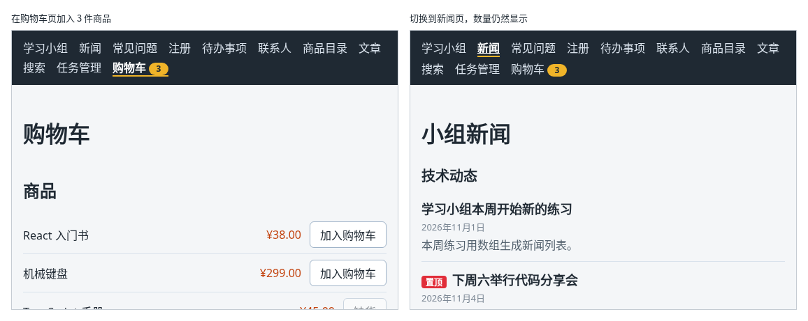

# 第 108 章：【组合】如何让导航栏中的数量随购物车变化？

前置：[第 107 章：更新操作越来越多时，如何用 reducer 集中管理？](第107章-更新操作越来越多时，如何用reducer集中管理.md)

## 一、本章要解决的问题

在购物车页以外的页面，用户看不出购物车里有没有东西。网上商店一般在导航栏的“购物车”旁边显示一个小圆标，写着里面一共有几件商品，加入、修改、移出时数字立刻变化。

本章在导航栏的“购物车”后面显示购物车中的商品件数。完成后：购物车为空时不显示圆标；加入 3 件商品，“购物车”后面出现黄色圆标“3”；切换到新闻等其他页面，圆标仍然在；点“清空购物车”，圆标消失。

本章不引入新的技术，组合的是：用 Context 读取购物车（第 106 章）、布局路由中的导航栏（第 98 章）、用 `for...of` 计算总数（第 104 章）和条件显示（第 21 章）。

下图左边是在购物车页加入 3 件商品的样子，右边是切换到新闻页以后的样子：



## 二、必要原理

### 导航栏也能读取购物车

导航栏在 `AppLayout` 中。第 106 章已经在 `App` 中用 `CartProvider` 包住了整个 `Routes`，`AppLayout` 也在里面，所以它和购物车页一样，直接调用 `useCart()` 就能拿到 `cartItems`，不需要任何组件传 props。

这正是第 106 章把购物车放进 Context 的原因：使用它的两个地方，一个是导航栏，一个是页面内容，中间隔着路由。

### 圆标中显示件数，不是种数

“机械键盘 2 件、保温杯 1 件”时，圆标显示 3，即所有行的数量加起来，和第 104 章合计中的“共 3 件”一致。不能用 `cartItems.length`，那是种数，结果是 2。

件数只需要把每一行的 `quantity` 加起来，不用查商品价格，所以计算比第 104 章简单：

```tsx
let cartCount = 0;
for (const item of cartItems) {
  cartCount += item.quantity;
}
```

### 圆标放在 NavLink 里面

圆标写在 `NavLink` 的文字后面，点击圆标也能打开购物车页，突出显示的下划线也会包括它。件数为 0 时不显示圆标。

圆标中只有一个数字，读屏软件读出来只是“3”。用 `aria-label` 写成“购物车中有 3 件商品”，意思才完整（第 103 章）。

圆标的样式写在全局的 `App.css` 中，和导航栏的其他样式放在一起（第 97 章）。

## 三、动手实现

### 第 1 步：导航栏中计算件数并显示圆标

打开 `src/components/AppLayout.tsx`，在导入中加入：

```tsx
import { useCart } from '../hooks/useCart';
```

在 `return` 的前面加入：

```tsx
  const { cartItems } = useCart();
  let cartCount = 0;
  for (const item of cartItems) {
    cartCount += item.quantity;
  }
```

把“购物车”的链接改为：

```tsx
        <NavLink to="/shop">
          购物车
          {cartCount > 0 && (
            <span className="cart-count" aria-label={'购物车中有 ' + cartCount + ' 件商品'}>
              {cartCount}
            </span>
          )}
        </NavLink>
```

### 第 2 步：圆标的样式

打开 `src/App.css`，在文件最后加入：

```css

.cart-count {
  display: inline-block;
  min-width: 18px;
  margin-left: 4px;
  padding: 0 5px;
  border-radius: 9px;
  background: #f0b429;
  color: #1f2933;
  font-size: 12px;
  font-weight: bold;
  line-height: 18px;
  text-align: center;
}
```

- `border-radius: 9px` 是高度 18px 的一半，左右两端成半圆；数字是一位数时，`min-width` 让它刚好是一个圆。
- 背景色和当前导航项的下划线用同一种黄色。

## 四、运行与检查

保持开发服务器运行（`npm.cmd run dev`），保存文件后在浏览器中查看。

1. 打开首页，导航栏中“购物车”后面没有圆标。
2. 打开购物车页，加入机械键盘两次、保温杯一次，“购物车”后面出现黄色圆标“3”，和右边合计中的“共 3 件”一致。
3. 点保温杯的“+”，圆标变成 4；点机械键盘的“移出”，变成 2。
4. 点导航中的“新闻”，圆标仍然显示 2。再点圆标本身，打开的是购物车页。
5. 点“清空购物车”，圆标消失。
6. 按 F12，在 Elements（元素）面板中选中圆标，可以看到 `aria-label="购物车中有 2 件商品"` 这样的属性。

最后运行检查，应没有错误：

```powershell
npm.cmd run check
```

### 阶段回顾

第 12 部分的购物车完成了：加入商品、修改数量、计算总价，用状态提升让商品列表和已选商品共用一份数据，用 Context 让购物车在换页后仍然保留，用 reducer 集中管理所有修改方式，最后让导航栏中的数量随购物车变化。下一部分开始做登录，让应用知道“现在是谁在使用”。

## 五、常见错误

| 现象 | 原因 | 怎么改 |
| --- | --- | --- |
| 机械键盘 2 件、保温杯 1 件时，圆标显示 2 | 用了 `cartItems.length`，那是商品的种数 | 把每一行的 `quantity` 加起来 |
| 购物车为空时，导航栏中显示一个 0 | 写成了 `{cartCount && …}`。`cartCount` 是 0 时，`&&` 的结果就是 0，React 会把它显示出来 | 写成 `{cartCount > 0 && …}`，左边是真正的 `true` 或 `false` |
| 页面空白，控制台显示“useCart 只能在 CartProvider 里面使用” | `CartProvider` 包在了某个页面里面，没有包住 `AppLayout` | 在 `App` 中用 `CartProvider` 包住整个 `Routes`（第 106 章） |

## 六、本章完整代码

### `src/components/AppLayout.tsx`

```tsx
import { NavLink, Outlet } from 'react-router';
import { useCart } from '../hooks/useCart';

export default function AppLayout() {
  const { cartItems } = useCart();
  let cartCount = 0;
  for (const item of cartItems) {
    cartCount += item.quantity;
  }

  return (
    <div>
      <nav className="site-nav" aria-label="主导航">
        <NavLink to="/">学习小组</NavLink>
        <NavLink to="/news">新闻</NavLink>
        <NavLink to="/faq">常见问题</NavLink>
        <NavLink to="/register">注册</NavLink>
        <NavLink to="/todos">待办事项</NavLink>
        <NavLink to="/contacts">联系人</NavLink>
        <NavLink to="/products">商品目录</NavLink>
        <NavLink to="/articles">文章</NavLink>
        <NavLink to="/search">搜索</NavLink>
        <NavLink to="/tasks">任务管理</NavLink>
        <NavLink to="/shop">
          购物车
          {cartCount > 0 && (
            <span className="cart-count" aria-label={'购物车中有 ' + cartCount + ' 件商品'}>
              {cartCount}
            </span>
          )}
        </NavLink>
      </nav>
      <Outlet />
    </div>
  );
}
```

### `src/App.css`

```css
body {
  margin: 0;
  font-family: system-ui, sans-serif;
  background: #f4f6f8;
  color: #1f2933;
}

.page {
  max-width: 960px;
  margin: 0 auto;
  padding: 24px 16px;
}

.page-header p {
  color: #52606d;
}

.page-footer {
  margin-top: 24px;
  padding-top: 16px;
  border-top: 1px solid #d9e2ec;
  color: #52606d;
}

.card-list {
  display: flex;
  flex-wrap: wrap;
  gap: 16px;
  margin-top: 16px;
}

.card-list > * {
  flex: 1 1 200px;
}

button {
  padding: 6px 14px;
  border: 1px solid #9fb3c8;
  border-radius: 6px;
  background: #ffffff;
  color: #1f2933;
  font: inherit;
  cursor: pointer;
}

button:hover {
  background: #f0f4f8;
}

button:disabled {
  cursor: not-allowed;
  opacity: 0.5;
}

.site-nav {
  display: flex;
  flex-wrap: wrap;
  gap: 4px 16px;
  padding: 12px 16px;
  background: #1f2933;
}

.site-nav a {
  color: #d9e2ec;
  text-decoration: none;
}

.site-nav a:hover {
  color: #ffffff;
  text-decoration: underline;
}

.site-nav a.active {
  color: #ffffff;
  font-weight: bold;
  border-bottom: 2px solid #f0b429;
}

.cart-count {
  display: inline-block;
  min-width: 18px;
  margin-left: 4px;
  padding: 0 5px;
  border-radius: 9px;
  background: #f0b429;
  color: #1f2933;
  font-size: 12px;
  font-weight: bold;
  line-height: 18px;
  text-align: center;
}
```

## 七、本章改动小结

修改 `src/components/AppLayout.tsx`：读取购物车，在“购物车”链接后面显示商品件数；修改 `src/App.css`：新增圆标的样式。

---

下一章：[第 109 章：如何提交登录表单并显示登录结果？](第109章-如何提交登录表单并显示登录结果.md)
