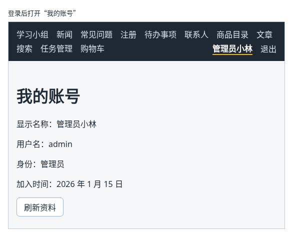
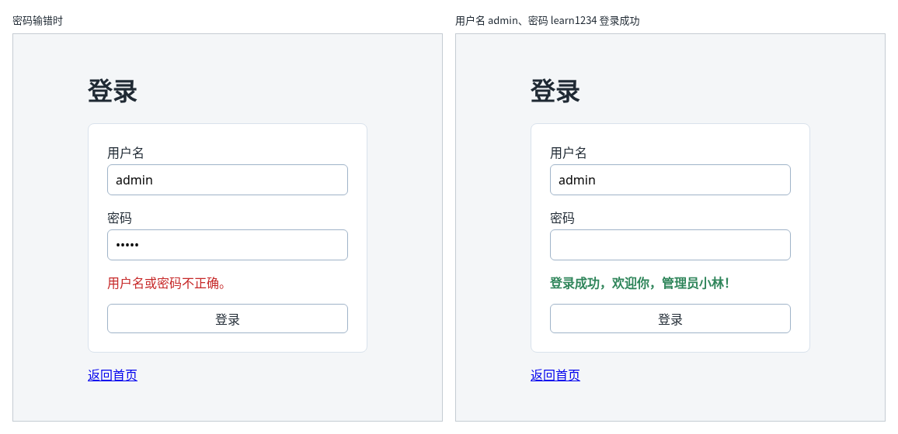

# 第 109 章：如何提交登录表单并显示登录结果？

前置：[第 108 章：【组合】如何让导航栏中的数量随购物车变化？](第108章-如何让导航栏中的数量随购物车变化.md)

## 一、本章要解决的问题

很多页面只能给登录后的用户看，例如“我的账号”。要做到这一点，第一步是让用户能登录：输入用户名和密码，交给服务器检查，服务器认可以后，记住“这个浏览器已经登录”。

本章做一个登录页。完成后：导航栏右侧有“登录”链接，点击后打开不带导航栏的登录页；用户名、密码没填就点“登录”，提示“请填写用户名和密码。”；密码输错，显示服务器给出的“用户名或密码不正确。”；用练习服务的账号 `admin`、密码 `learn1234` 登录，显示“登录成功，欢迎你，管理员小林！”。

本章是第 13 部分的起点。学完第 13 部分（第 109—115 章）时，效果如下图：登录后导航栏右侧显示用户名和“退出”；“我的账号”页只有登录后才能打开，没登录时会先跳到登录页，登录后再回来；登录失效时，页面会提示重新登录。



下图是本章完成后，密码输错和登录成功时的样子：



## 二、必要原理

### 登录接口

练习服务提供了登录接口（准备篇二中的账号表）：

| 请求 | 正文 | 结果 |
| --- | --- | --- |
| `POST /api/auth/login` | `{ "username": "admin", "password": "learn1234" }` | 成功：状态 200，返回用户信息；用户名或密码不对：状态 401 |

成功时返回的用户信息：

```json
{ "username": "admin", "displayName": "管理员小林", "role": "admin", "avatarUrl": null }
```

`role` 是身份，只有 `admin`（管理员）和 `member`（普通成员）两种。本章的 `User` 类型只取用得到的三个字段，`avatarUrl` 到第 16 部分上传头像时再加。

失败时返回 `{ "message": "用户名或密码不正确" }`。

### 服务器用 Cookie 记住“已经登录”

登录成功的响应中，除了用户信息，还带着一个响应头 `Set-Cookie`。浏览器收到后，会把它保存为一条 **Cookie**（浏览器为某个网站保存的一小段文字）。以后每次向同一个网站发请求，浏览器都会自动带上这条 Cookie，服务器看到它，就知道是哪个用户。

练习服务设置的 Cookie 叫 `practice_session`，并带有 `HttpOnly` 标记：页面中的 JavaScript 读不到它，只有浏览器在发请求时使用。这样即使页面中混进了恶意代码，也偷不走它。所以前端代码中**不需要、也不能**自己保存或读取这条 Cookie。

浏览器只给“同一个网站”的请求自动带 Cookie。我们的请求经过开发服务器代理（第 72 章），对浏览器来说，页面和接口都是 `http://127.0.0.1:5173`，属于同一个网站，Cookie 能正常使用。

### 401：可以改正的失败

用户名或密码不对，服务器返回 401。这和“练习服务没启动”不同：它是用户可以改正的情况。所以 `login` 函数遇到 401 时不抛出错误，而是返回一个表示失败的结果，带着服务器给的原因；其他错误仍然抛出。这和第 101 章把 404 单独处理是同一个思路，用联合类型表示两种结果：

```tsx
type LoginResult = { status: 'success'; user: User } | { status: 'failed'; message: string };
```

### 登录页不放在布局路由中

登录页只需要一个登录框，不需要导航栏。按第 98 章的做法，把 `/login` 路由写在布局路由的外面。

### 密码输入框的两个属性

- `type="password"`：输入的内容显示成圆点（第 37 章）。
- `autoComplete`：告诉浏览器这个输入框是什么，用户名写 `username`，密码写 `current-password`。浏览器据此提供“保存密码”和自动填写。

## 三、动手实现

### 第 1 步：用户类型

新建 `src/types/user.ts`：

```ts
export type User = {
  username: string;
  displayName: string;
  role: 'admin' | 'member';
};

export function isUser(value: unknown): value is User {
  return (
    typeof value === 'object' &&
    value !== null &&
    'username' in value &&
    typeof value.username === 'string' &&
    'displayName' in value &&
    typeof value.displayName === 'string' &&
    'role' in value &&
    (value.role === 'admin' || value.role === 'member')
  );
}
```

`role` 的类型是 `'admin' | 'member'`，检查时也只接受这两个值。

### 第 2 步：登录请求

新建 `src/lib/authApi.ts`：

```ts
import { apiUrl } from './api';
import { isUser } from '../types/user';
import type { User } from '../types/user';

export type LoginResult = { status: 'success'; user: User } | { status: 'failed'; message: string };

async function readMessage(response: Response, fallback: string): Promise<string> {
  try {
    const data: unknown = await response.json();
    if (typeof data === 'object' && data !== null && 'message' in data) {
      if (typeof data.message === 'string') {
        return data.message + '。';
      }
    }
  } catch {
    // 返回的不是 JSON 时，使用默认的提示
  }
  return fallback;
}

export async function login(username: string, password: string): Promise<LoginResult> {
  let response: Response;
  try {
    response = await fetch(apiUrl('/auth/login'), {
      method: 'POST',
      headers: { 'Content-Type': 'application/json' },
      body: JSON.stringify({ username, password }),
    });
  } catch {
    throw new Error('无法连接练习服务，请确认它已经启动。');
  }
  // 401 表示用户名或密码不对，这是用户可以改正的情况，不当作程序出错
  if (response.status === 401) {
    return { status: 'failed', message: await readMessage(response, '用户名或密码不正确。') };
  }
  if (!response.ok) {
    throw new Error('登录失败：服务器返回了状态 ' + response.status + '。');
  }
  const data: unknown = await response.json();
  if (!isUser(data)) {
    throw new Error('登录成功，但返回的用户信息格式不正确。');
  }
  return { status: 'success', user: data };
}
```

- 发送请求的写法和第 86 章新增任务相同：`POST`、`Content-Type` 请求头和 JSON 正文。
- `readMessage` 读出服务器返回的 `message`，写法和第 92A 章读取字段错误的 `readTitleError` 相似。

### 第 3 步：登录页的样式

新建 `src/pages/LoginPage.module.css`：

```css
.page {
  max-width: 360px;
  margin: 48px auto;
  padding: 0 16px;
}

.form {
  display: flex;
  flex-direction: column;
  gap: 16px;
  padding: 24px;
  border: 1px solid #d9e2ec;
  border-radius: 8px;
  background: #ffffff;
}

.field {
  display: flex;
  flex-direction: column;
  gap: 4px;
}

.field input {
  padding: 8px 10px;
  border: 1px solid #9fb3c8;
  border-radius: 6px;
  font: inherit;
}

.error {
  margin: 0;
  color: #c62828;
}

.success {
  margin: 0;
  color: #2f855a;
  font-weight: bold;
}
```

### 第 4 步：登录页

新建 `src/pages/LoginPage.tsx`：

```tsx
import { useState } from 'react';
import type { SubmitEvent } from 'react';
import { Link } from 'react-router';
import { login } from '../lib/authApi';
import styles from './LoginPage.module.css';

function getErrorMessage(error: unknown) {
  return error instanceof Error ? error.message : '登录失败，请稍后重试。';
}

export default function LoginPage() {
  const [username, setUsername] = useState('');
  const [password, setPassword] = useState('');
  const [isSubmitting, setIsSubmitting] = useState(false);
  const [error, setError] = useState('');
  const [message, setMessage] = useState('');

  async function handleSubmit(event: SubmitEvent<HTMLFormElement>) {
    event.preventDefault();
    if (username.trim() === '' || password === '') {
      setError('请填写用户名和密码。');
      return;
    }
    setError('');
    setMessage('');
    setIsSubmitting(true);
    try {
      const result = await login(username.trim(), password);
      if (result.status === 'failed') {
        setError(result.message);
        return;
      }
      setPassword('');
      setMessage('登录成功，欢迎你，' + result.user.displayName + '！');
    } catch (caught) {
      setError(getErrorMessage(caught));
    } finally {
      setIsSubmitting(false);
    }
  }

  return (
    <main className={styles.page}>
      <title>登录</title>
      <h1>登录</h1>
      <form className={styles.form} onSubmit={handleSubmit}>
        <div className={styles.field}>
          <label htmlFor="login-username">用户名</label>
          <input
            id="login-username"
            autoComplete="username"
            value={username}
            onChange={(event) => setUsername(event.target.value)}
          />
        </div>
        <div className={styles.field}>
          <label htmlFor="login-password">密码</label>
          <input
            id="login-password"
            type="password"
            autoComplete="current-password"
            value={password}
            onChange={(event) => setPassword(event.target.value)}
          />
        </div>
        {error && (
          <p role="alert" className={styles.error}>
            {error}
          </p>
        )}
        {message && (
          <p role="status" className={styles.success}>
            {message}
          </p>
        )}
        <button type="submit" disabled={isSubmitting}>
          {isSubmitting ? '正在登录……' : '登录'}
        </button>
      </form>
      <p>
        <Link to="/">返回首页</Link>
      </p>
    </main>
  );
}
```

- 提交中禁用按钮、`try / catch / finally` 的写法和第 89 章相同。`catch` 后的变量叫 `caught`，避免和 state 中的 `error` 重名。
- 登录成功后清空密码输入框，不让密码留在页面上；用户名保留。
- 用户名去掉首尾空格再提交，密码原样提交：密码中的空格可能是密码的一部分。

### 第 5 步：加入路由和导航链接

打开 `src/App.tsx`，在导入 `GroupPage` 的一行下面加入：

```tsx
import LoginPage from './pages/LoginPage';
```

在布局路由的 `</Route>` 后面、`</Routes>` 前面加入：

```tsx
        <Route path="/login" element={<LoginPage />} />
```

打开 `src/components/AppLayout.tsx`，在“购物车”链接的 `</NavLink>` 后面加入：

```tsx
        <NavLink to="/login" className="nav-user">
          登录
        </NavLink>
```

`NavLink` 的 `className` 写成字符串时，当前页面是它时仍会加上 `active`。

打开 `src/App.css`，在 `.site-nav a.active` 规则的前面加入：

```css
.site-nav .nav-user {
  margin-left: auto;
}

```

在弹性布局中，`margin-left: auto` 会占满左边所有剩余的空间，把这个链接推到导航栏的最右边。

## 四、运行与检查

保持开发服务器和练习服务都在运行（准备篇二）。

1. 导航栏最右边是“登录”。点击它，打开登录页，地址是 `/login`，页面上没有导航栏，标签页标题是“登录”。
2. 什么都不填，点“登录”，提示“请填写用户名和密码。”，Network（网络）中没有请求。
3. 用户名填 `admin`，密码填 `wrong`，点“登录”。按钮变成“正在登录……”，半秒后提示“用户名或密码不正确。”。Network 中 `/api/auth/login` 的状态是 401。
4. 密码改为 `learn1234`，登录，显示“登录成功，欢迎你，管理员小林！”，密码输入框清空。
5. 在开发者工具的 Application（应用）面板中，左侧选 Cookies 下的 `http://127.0.0.1:5173`，可以看到一条名为 `practice_session` 的 Cookie，`HttpOnly` 一栏有勾。在 Console（控制台）中输入 `document.cookie` 回车，结果是空字符串 `''`，页面代码读不到它。
6. 用 `member` 和 `learn1234` 登录，显示“登录成功，欢迎你，成员小王！”。
7. 停止练习服务再登录，提示“登录失败：服务器返回了状态 502。”。
8. 点“返回首页”回到首页。导航栏中仍然显示“登录”：页面还不知道你已经登录了，下一章解决。

最后运行检查，应没有错误：

```powershell
npm.cmd run check
```

**小练习**：登录失败时，把密码输入框清空，用户名保留。想一想：为什么登录失败清空密码，比清空用户名更合理？练习后恢复本章代码。

## 五、常见错误

| 现象 | 原因 | 怎么改 |
| --- | --- | --- |
| 密码输错时，提示“登录失败：服务器返回了状态 401。” | 没有单独处理 401，和其他错误一样抛出 | 先判断 `response.status === 401`，返回失败的结果和服务器的原因 |
| 登录成功了，Application 面板中却没有 Cookie | 地址直接写成了 `http://127.0.0.1:3001/api/...`，绕过了开发代理，接口和页面不是同一个网站 | 用 `apiUrl('/auth/login')`，请求经过开发代理（第 73 章） |
| 服务器返回 `请求正文不是有效的 JSON`，或者一直提示用户名或密码不正确 | 正文没有用 `JSON.stringify` 转换，或者漏了 `Content-Type` 请求头 | 对照第 2 步，写全请求头和正文 |
| 登录页上也显示了导航栏 | `/login` 路由写在了布局路由里面 | 移到布局路由的 `</Route>` 后面 |

## 六、本章完整代码

### `src/types/user.ts`

同第三节第 1 步。

### `src/lib/authApi.ts`

同第三节第 2 步。

### `src/pages/LoginPage.module.css`

同第三节第 3 步。

### `src/pages/LoginPage.tsx`

同第三节第 4 步。

### `src/App.tsx`

```tsx
import { Route, Routes } from 'react-router';
import './App.css';
import AppLayout from './components/AppLayout';
import CartProvider from './components/CartProvider';
import ArticlePage from './pages/ArticlePage';
import ContactsPage from './pages/ContactsPage';
import FaqPage from './pages/FaqPage';
import GroupPage from './pages/GroupPage';
import LoginPage from './pages/LoginPage';
import NewsPage from './pages/NewsPage';
import NotFoundPage from './pages/NotFoundPage';
import ProductDetailPage from './pages/ProductDetailPage';
import ProductPage from './pages/ProductPage';
import RegisterPage from './pages/RegisterPage';
import SearchPage from './pages/SearchPage';
import ShopPage from './pages/ShopPage';
import TaskPage from './pages/TaskPage';
import TaskServerPage from './pages/TaskServerPage';

export default function App() {
  return (
    <CartProvider>
      <Routes>
        <Route element={<AppLayout />}>
          <Route path="/" element={<GroupPage />} />
          <Route path="/news" element={<NewsPage />} />
          <Route path="/faq" element={<FaqPage />} />
          <Route path="/register" element={<RegisterPage />} />
          <Route path="/todos" element={<TaskPage />} />
          <Route path="/contacts" element={<ContactsPage />} />
          <Route path="/products" element={<ProductPage />} />
          <Route path="/products/:id" element={<ProductDetailPage />} />
          <Route path="/articles" element={<ArticlePage />} />
          <Route path="/search" element={<SearchPage />} />
          <Route path="/tasks" element={<TaskServerPage />} />
          <Route path="/shop" element={<ShopPage />} />
          <Route path="*" element={<NotFoundPage />} />
        </Route>
        <Route path="/login" element={<LoginPage />} />
      </Routes>
    </CartProvider>
  );
}
```

### `src/components/AppLayout.tsx`

```tsx
import { NavLink, Outlet } from 'react-router';
import { useCart } from '../hooks/useCart';

export default function AppLayout() {
  const { cartItems } = useCart();
  let cartCount = 0;
  for (const item of cartItems) {
    cartCount += item.quantity;
  }

  return (
    <div>
      <nav className="site-nav" aria-label="主导航">
        <NavLink to="/">学习小组</NavLink>
        <NavLink to="/news">新闻</NavLink>
        <NavLink to="/faq">常见问题</NavLink>
        <NavLink to="/register">注册</NavLink>
        <NavLink to="/todos">待办事项</NavLink>
        <NavLink to="/contacts">联系人</NavLink>
        <NavLink to="/products">商品目录</NavLink>
        <NavLink to="/articles">文章</NavLink>
        <NavLink to="/search">搜索</NavLink>
        <NavLink to="/tasks">任务管理</NavLink>
        <NavLink to="/shop">
          购物车
          {cartCount > 0 && (
            <span className="cart-count" aria-label={'购物车中有 ' + cartCount + ' 件商品'}>
              {cartCount}
            </span>
          )}
        </NavLink>
        <NavLink to="/login" className="nav-user">
          登录
        </NavLink>
      </nav>
      <Outlet />
    </div>
  );
}
```

### `src/App.css`

```css
body {
  margin: 0;
  font-family: system-ui, sans-serif;
  background: #f4f6f8;
  color: #1f2933;
}

.page {
  max-width: 960px;
  margin: 0 auto;
  padding: 24px 16px;
}

.page-header p {
  color: #52606d;
}

.page-footer {
  margin-top: 24px;
  padding-top: 16px;
  border-top: 1px solid #d9e2ec;
  color: #52606d;
}

.card-list {
  display: flex;
  flex-wrap: wrap;
  gap: 16px;
  margin-top: 16px;
}

.card-list > * {
  flex: 1 1 200px;
}

button {
  padding: 6px 14px;
  border: 1px solid #9fb3c8;
  border-radius: 6px;
  background: #ffffff;
  color: #1f2933;
  font: inherit;
  cursor: pointer;
}

button:hover {
  background: #f0f4f8;
}

button:disabled {
  cursor: not-allowed;
  opacity: 0.5;
}

.site-nav {
  display: flex;
  flex-wrap: wrap;
  gap: 4px 16px;
  padding: 12px 16px;
  background: #1f2933;
}

.site-nav a {
  color: #d9e2ec;
  text-decoration: none;
}

.site-nav a:hover {
  color: #ffffff;
  text-decoration: underline;
}

.site-nav .nav-user {
  margin-left: auto;
}

.site-nav a.active {
  color: #ffffff;
  font-weight: bold;
  border-bottom: 2px solid #f0b429;
}

.cart-count {
  display: inline-block;
  min-width: 18px;
  margin-left: 4px;
  padding: 0 5px;
  border-radius: 9px;
  background: #f0b429;
  color: #1f2933;
  font-size: 12px;
  font-weight: bold;
  line-height: 18px;
  text-align: center;
}
```

## 七、本章改动小结

新增 `src/types/user.ts`、`src/lib/authApi.ts`、`src/pages/LoginPage.tsx` 和 `src/pages/LoginPage.module.css`：用户类型、登录请求和登录页；修改 `src/App.tsx`：在布局路由外加入 `/login`；修改 `src/components/AppLayout.tsx` 和 `src/App.css`：导航栏最右边加入“登录”链接。

---

下一章：[第 110 章：如何让所有页面都能读取当前登录用户？](第110章-如何让所有页面都能读取当前登录用户.md)
