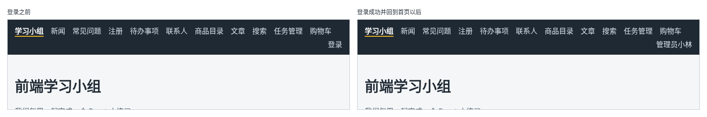

# 第 110 章：如何让所有页面都能读取当前登录用户？

前置：[第 109 章：如何提交登录表单并显示登录结果？](第109章-如何提交登录表单并显示登录结果.md)

## 一、本章要解决的问题

上一章登录成功了，可回到首页，导航栏中仍然显示“登录”。登录得到的用户信息只保存在登录页的 state 中，离开登录页就没了，导航栏和其他页面都不知道现在是谁登录了。

本章用第 106 章学过的 Context，把“当前登录用户”放到整个应用的最外层。完成后：登录成功并回到首页，导航栏最右边显示“管理员小林”；在各个页面之间切换，名字一直都在。

下图左边是登录之前的导航栏，右边是登录成功并回到首页以后的导航栏：



## 二、必要原理

### 当前用户和购物车一样，很多地方都要用

导航栏要显示用户名，“我的账号”页要显示用户资料（第 112 章），某些按钮只给管理员看。用户信息在登录页得到，却要在很多不相邻的地方使用，正是第 106 章说的适合放进 Context 的数据。

做法和购物车完全相同，分三个文件：

| 文件 | 内容 |
| --- | --- |
| `src/lib/authContext.ts` | `AuthContext` 对象和它的类型 |
| `src/hooks/useAuth.ts` | 读取当前用户的 `useAuth` |
| `src/components/AuthProvider.tsx` | 保存当前用户、提供 Context 的组件 |

`auth` 是 authentication（身份认证）的简写，前端项目中常用它给登录相关的代码命名。

### 用 null 表示没有登录

当前用户的 state 类型是 `User | null`，`null` 表示没有人登录：

```tsx
const [user, setUser] = useState<User | null>(null);
```

Context 中同时提供 `user` 和 `setUser`。登录页登录成功后调用 `setUser(result.user)`；导航栏读取 `user`，有值就显示名字，`null` 就显示“登录”链接。

只有 `user` 和 `setUser` 两样，用 `useState` 就够了，不需要第 107 章的 reducer。

### 两个 Provider 套在一起

`App` 中已经有 `CartProvider`，再用 `AuthProvider` 包在它的外面。两个 Provider 互不影响，里面的组件两样数据都能读取。哪个在外、哪个在里都可以；把登录放在最外层，以后购物车如果要按用户区分，也能读到当前用户。

### 刷新后又要重新登录

用户信息只保存在 state 中，刷新网页后 state 回到初始值 `null`，导航栏又显示“登录”。但服务器那边仍然记得你已经登录：浏览器中的 Cookie 还在。下一章让页面在启动时向服务器确认。

## 三、动手实现

### 第 1 步：创建 Context

新建 `src/lib/authContext.ts`：

```ts
import { createContext } from 'react';
import type { User } from '../types/user';

export type AuthContextValue = {
  user: User | null;
  setUser: (user: User | null) => void;
};

export const AuthContext = createContext<AuthContextValue | null>(null);
```

### 第 2 步：读取当前用户的 Hook

新建 `src/hooks/useAuth.ts`：

```ts
import { useContext } from 'react';
import { AuthContext } from '../lib/authContext';

export function useAuth() {
  const value = useContext(AuthContext);
  if (value === null) {
    throw new Error('useAuth 只能在 AuthProvider 里面使用');
  }
  return value;
}
```

### 第 3 步：提供当前用户的组件

新建 `src/components/AuthProvider.tsx`：

```tsx
import { useState } from 'react';
import type { ReactNode } from 'react';
import { AuthContext } from '../lib/authContext';
import type { User } from '../types/user';

type AuthProviderProps = {
  children: ReactNode;
};

export default function AuthProvider({ children }: AuthProviderProps) {
  // null 表示没有登录
  const [user, setUser] = useState<User | null>(null);

  return <AuthContext value={{ user, setUser }}>{children}</AuthContext>;
}
```

### 第 4 步：在 App 中包上 AuthProvider

打开 `src/App.tsx`，在导入 `AppLayout` 的一行下面加入：

```tsx
import AuthProvider from './components/AuthProvider';
```

用 `<AuthProvider>` 包住 `<CartProvider>`，里面的内容各多缩进一级：

```tsx
    <AuthProvider>
      <CartProvider>
        <Routes>
          （各条路由不变）
        </Routes>
      </CartProvider>
    </AuthProvider>
```

### 第 5 步：登录成功后保存当前用户

打开 `src/pages/LoginPage.tsx`，在导入中加入：

```tsx
import { useAuth } from '../hooks/useAuth';
```

在组件的第一行加入：

```tsx
  const { setUser } = useAuth();
```

在登录成功后的 `setPassword('');` 下面加入：

```tsx
      setUser(result.user);
```

### 第 6 步：导航栏显示用户名

打开 `src/components/AppLayout.tsx`，在导入中加入：

```tsx
import { useAuth } from '../hooks/useAuth';
```

在 `const { cartItems } = useCart();` 的上面加入：

```tsx
  const { user } = useAuth();
```

把“登录”链接改为：

```tsx
        {user ? (
          <span className="nav-user">{user.displayName}</span>
        ) : (
          <NavLink to="/login" className="nav-user">
            登录
          </NavLink>
        )}
```

登录后显示的名字不是链接，所以用 `span`。第 112 章做好“我的账号”页后，再把它改成链接。

打开 `src/App.css`，在 `.site-nav .nav-user` 规则中加一行，让名字和链接的颜色一致：

```css
  color: #d9e2ec;
```

## 四、运行与检查

保持开发服务器和练习服务都在运行（准备篇二）。

1. 打开首页，导航栏最右边是“登录”。
2. 点“登录”，用 `admin` 和 `learn1234` 登录，再点“返回首页”。导航栏最右边变成“管理员小林”。
3. 在各个页面之间切换，名字一直都在。
4. 在 React 开发者工具中选中 `AuthProvider`，State 中是 `{username: "admin", displayName: "管理员小林", role: "admin"}`。
5. 按 F5 刷新，导航栏又显示“登录”。打开 Application（应用）面板，`practice_session` 这条 Cookie 仍然在。页面忘了登录状态，服务器其实还记得，下一章解决。
6. 刷新后用 `member` 登录，导航栏显示“成员小王”。

最后运行检查，应没有错误：

```powershell
npm.cmd run check
```

**小练习**：在首页（学习小组页）的标题下面显示一行欢迎语：登录后显示“你好，管理员小林”，没有登录时显示“登录后可以查看更多内容”。提示：在 `GroupPage` 中调用 `useAuth()`。练习后恢复本章代码。

## 五、常见错误

| 现象 | 原因 | 怎么改 |
| --- | --- | --- |
| 登录页一片空白，控制台显示“useAuth 只能在 AuthProvider 里面使用” | `App` 中没有包 `AuthProvider`，或者 `/login` 路由在它外面 | 用 `AuthProvider` 包住整个 `Routes`，包括 `/login` |
| 检查命令报 `'user' is possibly 'null'.` | 直接使用了 `user.displayName`，没有先判断是否已登录 | 先判断 `user` 是否为 `null`，例如 `user ? … : …` |
| 登录成功了，导航栏仍然显示“登录” | 登录页中只显示了成功信息，忘了调用 `setUser(result.user)` | 登录成功后调用 `setUser` |

## 六、本章完整代码

### `src/lib/authContext.ts`

同第三节第 1 步。

### `src/hooks/useAuth.ts`

同第三节第 2 步。

### `src/components/AuthProvider.tsx`

同第三节第 3 步。

### `src/App.tsx`

```tsx
import { Route, Routes } from 'react-router';
import './App.css';
import AppLayout from './components/AppLayout';
import AuthProvider from './components/AuthProvider';
import CartProvider from './components/CartProvider';
import ArticlePage from './pages/ArticlePage';
import ContactsPage from './pages/ContactsPage';
import FaqPage from './pages/FaqPage';
import GroupPage from './pages/GroupPage';
import LoginPage from './pages/LoginPage';
import NewsPage from './pages/NewsPage';
import NotFoundPage from './pages/NotFoundPage';
import ProductDetailPage from './pages/ProductDetailPage';
import ProductPage from './pages/ProductPage';
import RegisterPage from './pages/RegisterPage';
import SearchPage from './pages/SearchPage';
import ShopPage from './pages/ShopPage';
import TaskPage from './pages/TaskPage';
import TaskServerPage from './pages/TaskServerPage';

export default function App() {
  return (
    <AuthProvider>
      <CartProvider>
        <Routes>
          <Route element={<AppLayout />}>
            <Route path="/" element={<GroupPage />} />
            <Route path="/news" element={<NewsPage />} />
            <Route path="/faq" element={<FaqPage />} />
            <Route path="/register" element={<RegisterPage />} />
            <Route path="/todos" element={<TaskPage />} />
            <Route path="/contacts" element={<ContactsPage />} />
            <Route path="/products" element={<ProductPage />} />
            <Route path="/products/:id" element={<ProductDetailPage />} />
            <Route path="/articles" element={<ArticlePage />} />
            <Route path="/search" element={<SearchPage />} />
            <Route path="/tasks" element={<TaskServerPage />} />
            <Route path="/shop" element={<ShopPage />} />
            <Route path="*" element={<NotFoundPage />} />
          </Route>
          <Route path="/login" element={<LoginPage />} />
        </Routes>
      </CartProvider>
    </AuthProvider>
  );
}
```

### `src/pages/LoginPage.tsx`

```tsx
import { useState } from 'react';
import type { SubmitEvent } from 'react';
import { Link } from 'react-router';
import { useAuth } from '../hooks/useAuth';
import { login } from '../lib/authApi';
import styles from './LoginPage.module.css';

function getErrorMessage(error: unknown) {
  return error instanceof Error ? error.message : '登录失败，请稍后重试。';
}

export default function LoginPage() {
  const { setUser } = useAuth();
  const [username, setUsername] = useState('');
  const [password, setPassword] = useState('');
  const [isSubmitting, setIsSubmitting] = useState(false);
  const [error, setError] = useState('');
  const [message, setMessage] = useState('');

  async function handleSubmit(event: SubmitEvent<HTMLFormElement>) {
    event.preventDefault();
    if (username.trim() === '' || password === '') {
      setError('请填写用户名和密码。');
      return;
    }
    setError('');
    setMessage('');
    setIsSubmitting(true);
    try {
      const result = await login(username.trim(), password);
      if (result.status === 'failed') {
        setError(result.message);
        return;
      }
      setPassword('');
      setUser(result.user);
      setMessage('登录成功，欢迎你，' + result.user.displayName + '！');
    } catch (caught) {
      setError(getErrorMessage(caught));
    } finally {
      setIsSubmitting(false);
    }
  }

  return (
    <main className={styles.page}>
      <title>登录</title>
      <h1>登录</h1>
      <form className={styles.form} onSubmit={handleSubmit}>
        <div className={styles.field}>
          <label htmlFor="login-username">用户名</label>
          <input
            id="login-username"
            autoComplete="username"
            value={username}
            onChange={(event) => setUsername(event.target.value)}
          />
        </div>
        <div className={styles.field}>
          <label htmlFor="login-password">密码</label>
          <input
            id="login-password"
            type="password"
            autoComplete="current-password"
            value={password}
            onChange={(event) => setPassword(event.target.value)}
          />
        </div>
        {error && (
          <p role="alert" className={styles.error}>
            {error}
          </p>
        )}
        {message && (
          <p role="status" className={styles.success}>
            {message}
          </p>
        )}
        <button type="submit" disabled={isSubmitting}>
          {isSubmitting ? '正在登录……' : '登录'}
        </button>
      </form>
      <p>
        <Link to="/">返回首页</Link>
      </p>
    </main>
  );
}
```

### `src/components/AppLayout.tsx`

```tsx
import { NavLink, Outlet } from 'react-router';
import { useAuth } from '../hooks/useAuth';
import { useCart } from '../hooks/useCart';

export default function AppLayout() {
  const { user } = useAuth();
  const { cartItems } = useCart();
  let cartCount = 0;
  for (const item of cartItems) {
    cartCount += item.quantity;
  }

  return (
    <div>
      <nav className="site-nav" aria-label="主导航">
        <NavLink to="/">学习小组</NavLink>
        <NavLink to="/news">新闻</NavLink>
        <NavLink to="/faq">常见问题</NavLink>
        <NavLink to="/register">注册</NavLink>
        <NavLink to="/todos">待办事项</NavLink>
        <NavLink to="/contacts">联系人</NavLink>
        <NavLink to="/products">商品目录</NavLink>
        <NavLink to="/articles">文章</NavLink>
        <NavLink to="/search">搜索</NavLink>
        <NavLink to="/tasks">任务管理</NavLink>
        <NavLink to="/shop">
          购物车
          {cartCount > 0 && (
            <span className="cart-count" aria-label={'购物车中有 ' + cartCount + ' 件商品'}>
              {cartCount}
            </span>
          )}
        </NavLink>
        {user ? (
          <span className="nav-user">{user.displayName}</span>
        ) : (
          <NavLink to="/login" className="nav-user">
            登录
          </NavLink>
        )}
      </nav>
      <Outlet />
    </div>
  );
}
```

### `src/App.css`

```css
body {
  margin: 0;
  font-family: system-ui, sans-serif;
  background: #f4f6f8;
  color: #1f2933;
}

.page {
  max-width: 960px;
  margin: 0 auto;
  padding: 24px 16px;
}

.page-header p {
  color: #52606d;
}

.page-footer {
  margin-top: 24px;
  padding-top: 16px;
  border-top: 1px solid #d9e2ec;
  color: #52606d;
}

.card-list {
  display: flex;
  flex-wrap: wrap;
  gap: 16px;
  margin-top: 16px;
}

.card-list > * {
  flex: 1 1 200px;
}

button {
  padding: 6px 14px;
  border: 1px solid #9fb3c8;
  border-radius: 6px;
  background: #ffffff;
  color: #1f2933;
  font: inherit;
  cursor: pointer;
}

button:hover {
  background: #f0f4f8;
}

button:disabled {
  cursor: not-allowed;
  opacity: 0.5;
}

.site-nav {
  display: flex;
  flex-wrap: wrap;
  gap: 4px 16px;
  padding: 12px 16px;
  background: #1f2933;
}

.site-nav a {
  color: #d9e2ec;
  text-decoration: none;
}

.site-nav a:hover {
  color: #ffffff;
  text-decoration: underline;
}

.site-nav .nav-user {
  margin-left: auto;
  color: #d9e2ec;
}

.site-nav a.active {
  color: #ffffff;
  font-weight: bold;
  border-bottom: 2px solid #f0b429;
}

.cart-count {
  display: inline-block;
  min-width: 18px;
  margin-left: 4px;
  padding: 0 5px;
  border-radius: 9px;
  background: #f0b429;
  color: #1f2933;
  font-size: 12px;
  font-weight: bold;
  line-height: 18px;
  text-align: center;
}
```

## 七、本章改动小结

新增 `src/lib/authContext.ts`、`src/hooks/useAuth.ts` 和 `src/components/AuthProvider.tsx`：当前登录用户的 Context；修改 `src/App.tsx`：用 `AuthProvider` 包住整个应用；修改 `src/pages/LoginPage.tsx`：登录成功后保存当前用户；修改 `src/components/AppLayout.tsx` 和 `src/App.css`：导航栏显示用户名。

---

下一章：[第 111 章：刷新页面后，如何向服务器确认是否仍然登录？](第111章-刷新页面后，如何向服务器确认是否仍然登录.md)
