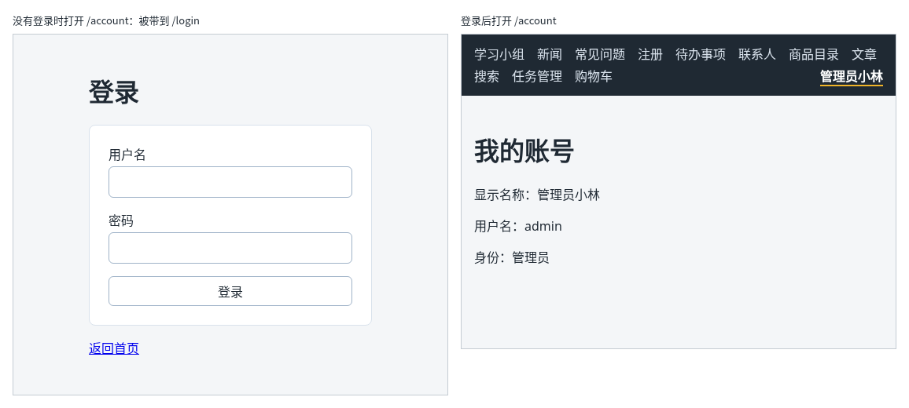

# 第 112 章：未登录访问个人页面时，如何跳转到登录页？

前置：[第 111 章：刷新页面后，如何向服务器确认是否仍然登录？](第111章-刷新页面后，如何向服务器确认是否仍然登录.md)

## 一、本章要解决的问题

有些页面只给登录后的用户看，例如显示个人资料的“我的账号”页。没有登录的人如果在地址栏直接输入这个页面的地址，不能让他看到一个内容为空、或者报错的页面，而应该把他带到登录页。

本章新建“我的账号”页，并写一个“守门”的组件 `RequireAuth`，用它包住只给登录用户看的页面。完成后：登录后导航栏中的用户名变成链接，点击打开“我的账号”，显示显示名称、用户名和身份；没有登录时打开 `/account`，先显示“正在确认登录状态……”，随后地址变成 `/login`，显示登录页；已经登录时刷新 `/account`，仍然留在这个页面。

下图左边是没有登录时打开 `/account` 的结果，右边是登录后打开的样子：



## 二、必要原理

### 在页面外面包一层判断

“没有登录就去登录页”这个规则，以后会用在好几个页面上。不在每个页面中重复写，而是写成一个组件，像第 16 章的卡片容器一样，用它包住页面：

```tsx
<Route
  path="/account"
  element={
    <RequireAuth>
      <AccountPage />
    </RequireAuth>
  }
/>
```

`RequireAuth` 读取当前用户，已经登录就显示 `children`，也就是里面的页面；没有登录就跳转到登录页。这种包在页面外面、决定能不能进入的组件，常被叫作**路由守卫**。

### Navigate：渲染时跳转

到现在为止，换页都是用户点击 `Link`。`RequireAuth` 要在**渲染时**根据条件换页，用的是 React Router 的 `Navigate` 组件：

```tsx
return <Navigate to="/login" replace />;
```

组件返回 `Navigate`，React Router 就会把地址换成 `to` 指定的地址。

`replace` 的意思和第 96 章的 `{ replace: true }` 相同：用登录页替换当前这条历史记录。不写的话，历史中会留下 `/account`，在登录页按“后退”回到 `/account`，又被送回登录页，用户就退不回去了。

### 先等确认完，再做决定

刷新页面时，应用要先向服务器确认是否已经登录（第 111 章）。确认完之前 `user` 是 `null`，如果这时就判断“没有登录”，已经登录的用户一刷新就会被送去登录页。

所以 `RequireAuth` 先看 `checking`：还在确认时显示“正在确认登录状态……”，确认完了再按 `user` 决定。这就是上一章要区分三种状态的原因。

### 页面中再判断一次 null

`AccountPage` 只会在登录后显示，但 TypeScript 不知道这一点，`useAuth()` 返回的 `user` 类型仍然是 `User | null`。页面中加一句 `if (!user) { return null; }`，之后就可以放心使用 `user.displayName`。

### 守卫只管“能不能看到页面”

`RequireAuth` 只是不让没有登录的人在**页面上**看到内容。真正的个人数据由服务器保护：服务器的接口会检查 Cookie，没有登录就返回 401（第 115 章）。不能因为前端加了守卫，就让服务器少做检查。

## 三、动手实现

### 第 1 步：写路由守卫组件

新建 `src/components/RequireAuth.tsx`：

```tsx
import type { ReactNode } from 'react';
import { Navigate } from 'react-router';
import { useAuth } from '../hooks/useAuth';

type RequireAuthProps = {
  children: ReactNode;
};

export default function RequireAuth({ children }: RequireAuthProps) {
  const { user, checking } = useAuth();

  // 还不知道是否登录时先等一等，否则刷新页面时已登录的用户也会被送去登录页
  if (checking) {
    return <p className="page">正在确认登录状态……</p>;
  }
  if (!user) {
    return <Navigate to="/login" replace />;
  }
  return children;
}
```

`className="page"` 借用页面的外边距，让提示和其他页面的内容对齐。

### 第 2 步：新建“我的账号”页

新建 `src/pages/AccountPage.tsx`：

```tsx
import { useAuth } from '../hooks/useAuth';

export default function AccountPage() {
  const { user } = useAuth();

  // RequireAuth 已经保证只有登录后才会显示本页，这里的判断只是为了让 TypeScript 放心
  if (!user) {
    return null;
  }

  return (
    <main className="page">
      <title>我的账号</title>
      <h1>我的账号</h1>
      <p>显示名称：{user.displayName}</p>
      <p>用户名：{user.username}</p>
      <p>身份：{user.role === 'admin' ? '管理员' : '普通成员'}</p>
    </main>
  );
}
```

### 第 3 步：用守卫包住路由

打开 `src/App.tsx`，在导入 `CartProvider` 的一行下面加入：

```tsx
import RequireAuth from './components/RequireAuth';
import AccountPage from './pages/AccountPage';
```

在布局路由中 `/shop` 那条路由的下面加入：

```tsx
            <Route
              path="/account"
              element={
                <RequireAuth>
                  <AccountPage />
                </RequireAuth>
              }
            />
```

`element` 中的内容较长，按 JSX 的习惯分成几行写。

### 第 4 步：导航栏中的用户名改成链接

打开 `src/components/AppLayout.tsx`，把显示用户名的一行改为：

```tsx
        {!checking && user && (
          <NavLink to="/account" className="nav-user">
            {user.displayName}
          </NavLink>
        )}
```

## 四、运行与检查

保持开发服务器和练习服务都在运行（准备篇二）。如果当前是登录状态，先重启一次练习服务，再刷新页面，回到没有登录的状态（第 111 章）。

1. 在地址栏打开 `http://127.0.0.1:5173/account`。先看到“正在确认登录状态……”，半秒后地址变成 `/login`，显示登录页。
2. 在登录页按浏览器的“后退”，回到的是打开 `/account` 之前的页面，而不是 `/account`。
3. 用 `admin` 登录，点“返回首页”，再点导航栏中的“管理员小林”。打开“我的账号”，显示“显示名称：管理员小林”“用户名：admin”“身份：管理员”，导航栏中“管理员小林”突出显示。
4. 在“我的账号”页按 F5 刷新。先显示“正在确认登录状态……”，随后仍然是“我的账号”，没有被送去登录页。
5. 重启练习服务后刷新“我的账号”，又被带到登录页。
6. 用 `member` 登录后打开“我的账号”，身份显示“普通成员”。

最后运行检查，应没有错误：

```powershell
npm.cmd run check
```

**小练习**：把第 85 章的“任务管理”页（`/tasks`）也改成只有登录后才能打开。只需要修改 `App.tsx` 中的一条路由。练习后恢复本章代码。

## 五、常见错误

| 现象 | 原因 | 怎么改 |
| --- | --- | --- |
| 已经登录，刷新“我的账号”页时仍被送去登录页 | `RequireAuth` 没有等待 `checking`，确认完之前 `user` 是 `null`，就跳转了 | 先判断 `checking`，确认中显示提示 |
| 控制台警告 `Cannot update a component (BrowserRouter) while rendering a different component (RequireAuth)` | 在渲染过程中直接调用了 `navigate('/login')` | 渲染时跳转用 `<Navigate to="/login" replace />` |
| 在登录页按“后退”，又被送回登录页，怎么也退不回去 | `Navigate` 没有写 `replace`，历史中留下了 `/account` | 加上 `replace` |
| 检查命令报 `Property 'children' is missing` | 路由中写成了 `<RequireAuth />`，没有把页面放进去 | 写成 `<RequireAuth><AccountPage /></RequireAuth>` |

## 六、本章完整代码

### `src/components/RequireAuth.tsx`

同第三节第 1 步。

### `src/pages/AccountPage.tsx`

同第三节第 2 步。

### `src/App.tsx`

```tsx
import { Route, Routes } from 'react-router';
import './App.css';
import AppLayout from './components/AppLayout';
import AuthProvider from './components/AuthProvider';
import CartProvider from './components/CartProvider';
import RequireAuth from './components/RequireAuth';
import AccountPage from './pages/AccountPage';
import ArticlePage from './pages/ArticlePage';
import ContactsPage from './pages/ContactsPage';
import FaqPage from './pages/FaqPage';
import GroupPage from './pages/GroupPage';
import LoginPage from './pages/LoginPage';
import NewsPage from './pages/NewsPage';
import NotFoundPage from './pages/NotFoundPage';
import ProductDetailPage from './pages/ProductDetailPage';
import ProductPage from './pages/ProductPage';
import RegisterPage from './pages/RegisterPage';
import SearchPage from './pages/SearchPage';
import ShopPage from './pages/ShopPage';
import TaskPage from './pages/TaskPage';
import TaskServerPage from './pages/TaskServerPage';

export default function App() {
  return (
    <AuthProvider>
      <CartProvider>
        <Routes>
          <Route element={<AppLayout />}>
            <Route path="/" element={<GroupPage />} />
            <Route path="/news" element={<NewsPage />} />
            <Route path="/faq" element={<FaqPage />} />
            <Route path="/register" element={<RegisterPage />} />
            <Route path="/todos" element={<TaskPage />} />
            <Route path="/contacts" element={<ContactsPage />} />
            <Route path="/products" element={<ProductPage />} />
            <Route path="/products/:id" element={<ProductDetailPage />} />
            <Route path="/articles" element={<ArticlePage />} />
            <Route path="/search" element={<SearchPage />} />
            <Route path="/tasks" element={<TaskServerPage />} />
            <Route path="/shop" element={<ShopPage />} />
            <Route
              path="/account"
              element={
                <RequireAuth>
                  <AccountPage />
                </RequireAuth>
              }
            />
            <Route path="*" element={<NotFoundPage />} />
          </Route>
          <Route path="/login" element={<LoginPage />} />
        </Routes>
      </CartProvider>
    </AuthProvider>
  );
}
```

### `src/components/AppLayout.tsx`

```tsx
import { NavLink, Outlet } from 'react-router';
import { useAuth } from '../hooks/useAuth';
import { useCart } from '../hooks/useCart';

export default function AppLayout() {
  const { user, checking } = useAuth();
  const { cartItems } = useCart();
  let cartCount = 0;
  for (const item of cartItems) {
    cartCount += item.quantity;
  }

  return (
    <div>
      <nav className="site-nav" aria-label="主导航">
        <NavLink to="/">学习小组</NavLink>
        <NavLink to="/news">新闻</NavLink>
        <NavLink to="/faq">常见问题</NavLink>
        <NavLink to="/register">注册</NavLink>
        <NavLink to="/todos">待办事项</NavLink>
        <NavLink to="/contacts">联系人</NavLink>
        <NavLink to="/products">商品目录</NavLink>
        <NavLink to="/articles">文章</NavLink>
        <NavLink to="/search">搜索</NavLink>
        <NavLink to="/tasks">任务管理</NavLink>
        <NavLink to="/shop">
          购物车
          {cartCount > 0 && (
            <span className="cart-count" aria-label={'购物车中有 ' + cartCount + ' 件商品'}>
              {cartCount}
            </span>
          )}
        </NavLink>
        {/* 确认登录状态期间什么也不显示，避免先闪一下“登录”再变成用户名 */}
        {!checking && user && (
          <NavLink to="/account" className="nav-user">
            {user.displayName}
          </NavLink>
        )}
        {!checking && !user && (
          <NavLink to="/login" className="nav-user">
            登录
          </NavLink>
        )}
      </nav>
      <Outlet />
    </div>
  );
}
```

## 七、本章改动小结

新增 `src/components/RequireAuth.tsx`：没有登录时跳转到登录页的路由守卫；新增 `src/pages/AccountPage.tsx`：“我的账号”页；修改 `src/App.tsx`：加入用守卫包住的 `/account` 路由；修改 `src/components/AppLayout.tsx`：导航栏中的用户名链接到“我的账号”。

---

下一章：[第 113 章：登录成功后，如何回到原来要访问的页面？](第113章-登录成功后，如何回到原来要访问的页面.md)
