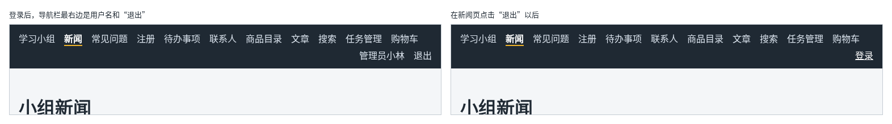

# 第 114 章：退出登录后，如何清除页面中的用户信息？

前置：[第 113 章：登录成功后，如何回到原来要访问的页面？](第113章-登录成功后，如何回到原来要访问的页面.md)

## 一、本章要解决的问题

登录以后，没有办法退出。在公用电脑上用完，下一个人打开浏览器，看到的还是你的账号。退出登录要做到两点：服务器那边忘掉这次登录，页面上的用户信息也全部清除。

本章在导航栏的用户名后面加一个“退出”按钮。完成后：点击“退出”，按钮先变成“正在退出……”，随后导航栏右侧变回“登录”；如果当时在“我的账号”页，会被带到登录页；退出后刷新页面，仍然是没有登录的状态。

下图左边是登录后的导航栏，右边是在新闻页点击“退出”以后的导航栏：



## 二、必要原理

### 退出要告诉服务器

登录状态保存在两个地方：服务器记着这次登录，浏览器保存着 Cookie（第 109 章）；页面的 Context 中保存着当前用户（第 110 章）。

只把 Context 中的用户清成 `null`，页面上看起来是退出了，可服务器还记得你，Cookie 也还在。一刷新，应用启动时问服务器“我是谁”（第 111 章），又自动登录回来了。

所以退出要先调用练习服务的退出接口：

| 请求 | 结果 |
| --- | --- |
| `POST /api/auth/logout` | 状态 204，服务器删除这次登录的记录，并让浏览器删掉 Cookie |

服务器确认以后，再清除页面中的用户。Cookie 带有 `HttpOnly`，页面代码本来也删不掉它，只能交给服务器处理。

### 清除用户以后，页面会自己处理

调用 `setUser(null)` 以后，所有读取当前用户的地方都会重新渲染：

- 导航栏中的用户名和“退出”不再显示，换成“登录”；
- 如果当前在“我的账号”这类用 `RequireAuth` 包住的页面，守卫发现没有登录，会把人送到登录页（第 112 章）；
- 其他不需要登录的页面，例如新闻页，留在原地不动。

所以退出时不需要自己写跳转。每个读取当前用户的组件都会按新的状态显示，这正是把用户放进 Context 的好处。

### 退出期间禁用按钮

退出要等服务器回答，期间按钮显示“正在退出……”并禁用，防止连点，写法和第 89 章相同。

退出失败的情况很少，例如练习服务没有启动，这时开发服务器的代理返回 502。这时用户还是登录状态，弹出浏览器自带的提示框 `window.alert` 告诉他原因即可。`alert` 和第 93B 章的 `confirm` 是一类对话框，只有一个“确定”按钮。

### 导航栏中的按钮

“退出”是一个操作，不是去往另一个页面，所以用 `<button>`，不用链接。它放在深色的导航栏中，要去掉按钮默认的边框和白色背景，看起来和旁边的链接一样。

## 三、动手实现

### 第 1 步：退出请求

打开 `src/lib/authApi.ts`，在文件最后加入：

```ts

export async function logout(): Promise<void> {
  let response: Response;
  try {
    response = await fetch(apiUrl('/auth/logout'), { method: 'POST' });
  } catch {
    throw new Error('无法连接练习服务，请确认它已经启动。');
  }
  if (!response.ok) {
    throw new Error('退出失败：服务器返回了状态 ' + response.status + '。');
  }
}
```

退出接口不需要正文，也不返回数据，只检查状态码。

### 第 2 步：导航栏中加入“退出”按钮

打开 `src/components/AppLayout.tsx`，在文件开头加入：

```tsx
import { useState } from 'react';
```

在导入 `useCart` 的一行下面加入：

```tsx
import { logout } from '../lib/authApi';
```

把读取当前用户的一行改为下面两行，多取出 `setUser`，并增加一个 state：

```tsx
  const { user, checking, setUser } = useAuth();
  const [isLoggingOut, setIsLoggingOut] = useState(false);
```

在 `return` 的前面加入退出的处理函数：

```tsx
  async function handleLogout() {
    setIsLoggingOut(true);
    try {
      // 先让服务器删除登录记录，否则刷新页面后又会自动登录
      await logout();
      // 当前页面如果需要登录，RequireAuth 会自动把人送去登录页
      setUser(null);
    } catch (error) {
      window.alert(error instanceof Error ? error.message : '退出失败，请稍后重试。');
    } finally {
      setIsLoggingOut(false);
    }
  }

```

在用户名链接的后面加入：

```tsx
        {!checking && user && (
          <button
            type="button"
            className="nav-logout"
            disabled={isLoggingOut}
            onClick={handleLogout}
          >
            {isLoggingOut ? '正在退出……' : '退出'}
          </button>
        )}
```

### 第 3 步：退出按钮的样式

打开 `src/App.css`，在 `.site-nav a.active` 规则的前面加入：

```css
.site-nav .nav-logout {
  padding: 0;
  border: 0;
  background: transparent;
  color: #d9e2ec;
}

.site-nav .nav-logout:hover {
  color: #ffffff;
  text-decoration: underline;
}

```

`App.css` 前面给所有 `button` 写了边框和白色背景，这里的选择器更具体（第 97 章），会把它们覆盖掉。

## 四、运行与检查

保持开发服务器和练习服务都在运行（准备篇二）。

1. 用 `admin` 登录，打开新闻页。导航栏最右边是“管理员小林”和“退出”。
2. 点“退出”，按钮先变成“正在退出……”，半秒后导航栏右侧变回“登录”，页面仍是新闻页。Network（网络）中有一个 `/api/auth/logout` 的请求，状态 204。
3. 按 F5 刷新，导航栏仍是“登录”。Application（应用）面板中，`practice_session` 这条 Cookie 已经不见了。
4. 再登录，打开“我的账号”，点“退出”。页面被带到登录页。
5. 停止练习服务后点“退出”，弹出提示“退出失败：服务器返回了状态 502。”。点“确定”后，导航栏中仍是用户名，仍然是登录状态。重新启动练习服务后，刷新页面重新登录。

最后运行检查，应没有错误：

```powershell
npm.cmd run check
```

**小练习**：退出成功后，把购物车也清空。提示：在 `AppLayout` 中从 `useCart()` 取出 `dispatch`，退出成功后发出第 107 章的 `clear` 动作。想一想：在实际的商店中，退出时清空购物车合理吗？练习后恢复本章代码。

## 五、常见错误

| 现象 | 原因 | 怎么改 |
| --- | --- | --- |
| 点“退出”后导航栏显示“登录”，一刷新又自动登录了 | 只调用了 `setUser(null)`，没有请求退出接口，服务器还记得这次登录 | 先 `await logout()`，成功后再 `setUser(null)` |
| 退出按钮是一个白底带边框的按钮，和导航栏不协调 | 全局的 `button` 样式生效了，没有写 `.site-nav .nav-logout` | 加上第 3 步的样式 |
| 停止练习服务时点“退出”，导航栏显示“登录”，刷新后又是登录状态 | `setUser(null)` 写在了 `finally` 中，请求失败时也清除了用户 | `setUser(null)` 只写在 `try` 中 `await logout()` 的后面 |

## 六、本章完整代码

### `src/lib/authApi.ts`

```ts
import { apiUrl } from './api';
import { isUser } from '../types/user';
import type { User } from '../types/user';

export type LoginResult = { status: 'success'; user: User } | { status: 'failed'; message: string };

async function readMessage(response: Response, fallback: string): Promise<string> {
  try {
    const data: unknown = await response.json();
    if (typeof data === 'object' && data !== null && 'message' in data) {
      if (typeof data.message === 'string') {
        return data.message + '。';
      }
    }
  } catch {
    // 返回的不是 JSON 时，使用默认的提示
  }
  return fallback;
}

export async function login(username: string, password: string): Promise<LoginResult> {
  let response: Response;
  try {
    response = await fetch(apiUrl('/auth/login'), {
      method: 'POST',
      headers: { 'Content-Type': 'application/json' },
      body: JSON.stringify({ username, password }),
    });
  } catch {
    throw new Error('无法连接练习服务，请确认它已经启动。');
  }
  // 401 表示用户名或密码不对，这是用户可以改正的情况，不当作程序出错
  if (response.status === 401) {
    return { status: 'failed', message: await readMessage(response, '用户名或密码不正确。') };
  }
  if (!response.ok) {
    throw new Error('登录失败：服务器返回了状态 ' + response.status + '。');
  }
  const data: unknown = await response.json();
  if (!isUser(data)) {
    throw new Error('登录成功，但返回的用户信息格式不正确。');
  }
  return { status: 'success', user: data };
}

// 返回 null 表示没有登录：浏览器没有 Cookie，或者服务器上的登录已经失效
export async function fetchCurrentUser(): Promise<User | null> {
  let response: Response;
  try {
    response = await fetch(apiUrl('/auth/me'));
  } catch {
    throw new Error('无法连接练习服务，请确认它已经启动。');
  }
  if (response.status === 401) {
    return null;
  }
  if (!response.ok) {
    throw new Error('读取登录状态失败：服务器返回了状态 ' + response.status + '。');
  }
  const data: unknown = await response.json();
  if (!isUser(data)) {
    throw new Error('用户信息格式不正确。');
  }
  return data;
}

export async function logout(): Promise<void> {
  let response: Response;
  try {
    response = await fetch(apiUrl('/auth/logout'), { method: 'POST' });
  } catch {
    throw new Error('无法连接练习服务，请确认它已经启动。');
  }
  if (!response.ok) {
    throw new Error('退出失败：服务器返回了状态 ' + response.status + '。');
  }
}
```

### `src/components/AppLayout.tsx`

```tsx
import { useState } from 'react';
import { NavLink, Outlet } from 'react-router';
import { useAuth } from '../hooks/useAuth';
import { useCart } from '../hooks/useCart';
import { logout } from '../lib/authApi';

export default function AppLayout() {
  const { user, checking, setUser } = useAuth();
  const [isLoggingOut, setIsLoggingOut] = useState(false);
  const { cartItems } = useCart();
  let cartCount = 0;
  for (const item of cartItems) {
    cartCount += item.quantity;
  }

  async function handleLogout() {
    setIsLoggingOut(true);
    try {
      // 先让服务器删除登录记录，否则刷新页面后又会自动登录
      await logout();
      // 当前页面如果需要登录，RequireAuth 会自动把人送去登录页
      setUser(null);
    } catch (error) {
      window.alert(error instanceof Error ? error.message : '退出失败，请稍后重试。');
    } finally {
      setIsLoggingOut(false);
    }
  }

  return (
    <div>
      <nav className="site-nav" aria-label="主导航">
        <NavLink to="/">学习小组</NavLink>
        <NavLink to="/news">新闻</NavLink>
        <NavLink to="/faq">常见问题</NavLink>
        <NavLink to="/register">注册</NavLink>
        <NavLink to="/todos">待办事项</NavLink>
        <NavLink to="/contacts">联系人</NavLink>
        <NavLink to="/products">商品目录</NavLink>
        <NavLink to="/articles">文章</NavLink>
        <NavLink to="/search">搜索</NavLink>
        <NavLink to="/tasks">任务管理</NavLink>
        <NavLink to="/shop">
          购物车
          {cartCount > 0 && (
            <span className="cart-count" aria-label={'购物车中有 ' + cartCount + ' 件商品'}>
              {cartCount}
            </span>
          )}
        </NavLink>
        {/* 确认登录状态期间什么也不显示，避免先闪一下“登录”再变成用户名 */}
        {!checking && user && (
          <NavLink to="/account" className="nav-user">
            {user.displayName}
          </NavLink>
        )}
        {!checking && user && (
          <button
            type="button"
            className="nav-logout"
            disabled={isLoggingOut}
            onClick={handleLogout}
          >
            {isLoggingOut ? '正在退出……' : '退出'}
          </button>
        )}
        {!checking && !user && (
          <NavLink to="/login" className="nav-user">
            登录
          </NavLink>
        )}
      </nav>
      <Outlet />
    </div>
  );
}
```

### `src/App.css`

```css
body {
  margin: 0;
  font-family: system-ui, sans-serif;
  background: #f4f6f8;
  color: #1f2933;
}

.page {
  max-width: 960px;
  margin: 0 auto;
  padding: 24px 16px;
}

.page-header p {
  color: #52606d;
}

.page-footer {
  margin-top: 24px;
  padding-top: 16px;
  border-top: 1px solid #d9e2ec;
  color: #52606d;
}

.card-list {
  display: flex;
  flex-wrap: wrap;
  gap: 16px;
  margin-top: 16px;
}

.card-list > * {
  flex: 1 1 200px;
}

button {
  padding: 6px 14px;
  border: 1px solid #9fb3c8;
  border-radius: 6px;
  background: #ffffff;
  color: #1f2933;
  font: inherit;
  cursor: pointer;
}

button:hover {
  background: #f0f4f8;
}

button:disabled {
  cursor: not-allowed;
  opacity: 0.5;
}

.site-nav {
  display: flex;
  flex-wrap: wrap;
  gap: 4px 16px;
  padding: 12px 16px;
  background: #1f2933;
}

.site-nav a {
  color: #d9e2ec;
  text-decoration: none;
}

.site-nav a:hover {
  color: #ffffff;
  text-decoration: underline;
}

.site-nav .nav-user {
  margin-left: auto;
  color: #d9e2ec;
}

.site-nav .nav-logout {
  padding: 0;
  border: 0;
  background: transparent;
  color: #d9e2ec;
}

.site-nav .nav-logout:hover {
  color: #ffffff;
  text-decoration: underline;
}

.site-nav a.active {
  color: #ffffff;
  font-weight: bold;
  border-bottom: 2px solid #f0b429;
}

.cart-count {
  display: inline-block;
  min-width: 18px;
  margin-left: 4px;
  padding: 0 5px;
  border-radius: 9px;
  background: #f0b429;
  color: #1f2933;
  font-size: 12px;
  font-weight: bold;
  line-height: 18px;
  text-align: center;
}
```

## 七、本章改动小结

修改 `src/lib/authApi.ts`：新增 `logout`；修改 `src/components/AppLayout.tsx`：导航栏中加入“退出”按钮，退出时先请求服务器，再清除当前用户；修改 `src/App.css`：新增退出按钮的样式。

---

下一章：[第 115 章：登录失效后，如何提示用户重新登录？](第115章-登录失效后，如何提示用户重新登录.md)
