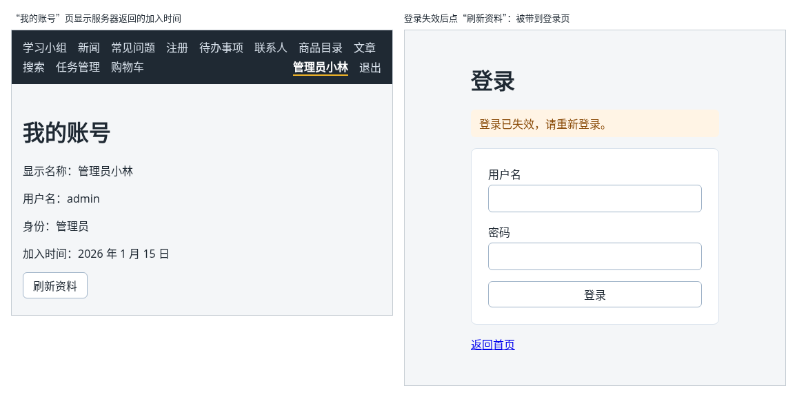

# 第 115 章：登录失效后，如何提示用户重新登录？

前置：[第 114 章：退出登录后，如何清除页面中的用户信息？](第114章-退出登录后，如何清除页面中的用户信息.md)

## 一、本章要解决的问题

登录不会永远有效：练习服务的登录 30 分钟后过期，服务器重启、管理员强制下线也会让登录失效。这时页面上仍然显示着用户名，可服务器已经不认了，再请求个人数据，服务器返回 401。如果页面只显示“读取失败：服务器返回了状态 401。”，用户不知道该怎么办。

本章让“我的账号”页向服务器读取加入时间，并处理登录失效的情况。完成后：“我的账号”页显示“加入时间：2026 年 1 月 15 日”；登录失效后点“刷新资料”，页面自动来到登录页，上方提示“登录已失效，请重新登录。”；重新登录后回到“我的账号”，提示消失。

下图左边是“我的账号”页，右边是登录失效后点“刷新资料”的结果：



## 二、必要原理

### 个人数据的接口会检查登录

练习服务提供了读取账号资料的接口：

| 请求 | 已经登录 | 没有登录或登录已失效 |
| --- | --- | --- |
| `GET /api/account` | 状态 200，返回用户信息和 `joinedAt`（加入日期，例如 `"2026-01-15"`） | 状态 401，`{ "message": "登录已失效，请重新登录" }` |

这就是第 112 章说的“真正的数据由服务器保护”：前端的守卫只决定显示不显示页面，服务器每次都会检查 Cookie。

### 401 就是“登录已经失效”

页面能显示“我的账号”，说明前端认为已经登录。这时服务器却返回 401，只有一个解释：服务器那边的登录已经失效了。所以 `fetchAccountInfo` 遇到 401 返回 `null`，页面收到 `null`，就当作登录失效处理。

处理分两步，都写在 `AuthProvider` 提供的 `expireSession` 中：

1. 清除当前用户：`setUser(null)`。页面上的用户名随之消失，`RequireAuth` 把人送去登录页，并记下原来的地址（第 113 章）。
2. 记下“刚才是登录失效”：`sessionExpired` 设为 `true`。登录页读到它，就在上方显示提示。

为什么不直接跳到登录页并带上提示？因为清除用户以后，守卫自己也会跳转，两处都跳，结果取决于谁先谁后，难以预料。只改数据、让守卫负责跳转，流程就只有一条。

### 提示什么时候消失

`sessionExpired` 只在“刚发现失效”时为 `true`。重新登录、或者用户自己退出，都会调用 `setUser`，这时提示就不再需要了。所以 `AuthProvider` 把 `setUser` 包了一层：`changeUser` 在设置用户的同时，把 `sessionExpired` 改回 `false`。Context 中对外提供的 `setUser` 就是它，登录页和导航栏的代码不用改。

### Effect 中调用 Context 的函数

“我的账号”页打开时在 Effect 中读取资料（第 74 章），读到 `null` 要调用 `expireSession`。`expireSession` 来自 Context，`AuthProvider` 每次渲染都会重新创建它，如果写进依赖数组，Effect 就会反复执行。这正是第 82 章 `useEffectEvent` 解决的问题：把调用包在 `onExpired` 中，Effect 中调用 `onExpired()`，依赖数组仍然是 `[]`。

### 怎样让登录失效

真实的登录要等半小时才过期。练习服务提供了一个接口 `POST /api/dev/expire-sessions`，让所有登录立刻失效。在浏览器的 Console（控制台）中执行下面这一行即可调用它：

```js
fetch('/api/dev/expire-sessions', { method: 'POST' })
```

请求经过开发代理，和页面中的请求一样。

## 三、动手实现

### 第 1 步：账号资料的类型

打开 `src/types/user.ts`，在文件最后加入：

```ts

// “我的账号”页向服务器读取的额外资料
export type AccountInfo = {
  joinedAt: string;
};

export function isAccountInfo(value: unknown): value is AccountInfo {
  return (
    typeof value === 'object' &&
    value !== null &&
    'joinedAt' in value &&
    typeof value.joinedAt === 'string'
  );
}
```

接口返回的内容中，显示名称等字段 Context 中已经有了，这里只取页面还缺的 `joinedAt`。

### 第 2 步：读取账号资料的请求

打开 `src/lib/authApi.ts`，把导入用户类型的两行改为：

```ts
import { isAccountInfo, isUser } from '../types/user';
import type { AccountInfo, User } from '../types/user';
```

在文件最后加入：

```ts

// 返回 null 表示服务器认为没有登录：登录已经失效
export async function fetchAccountInfo(): Promise<AccountInfo | null> {
  let response: Response;
  try {
    response = await fetch(apiUrl('/account'));
  } catch {
    throw new Error('无法连接练习服务，请确认它已经启动。');
  }
  if (response.status === 401) {
    return null;
  }
  if (!response.ok) {
    throw new Error('读取账号资料失败：服务器返回了状态 ' + response.status + '。');
  }
  const data: unknown = await response.json();
  if (!isAccountInfo(data)) {
    throw new Error('账号资料格式不正确。');
  }
  return data;
}
```

### 第 3 步：Context 中加入登录失效

打开 `src/lib/authContext.ts`，在 `setUser` 的下面加入：

```ts
  // 为 true 表示刚才发现登录已经失效，登录页据此提示用户
  sessionExpired: boolean;
  expireSession: () => void;
```

打开 `src/components/AuthProvider.tsx`，在 `checking` 那一行的下面加入：

```tsx
  const [sessionExpired, setSessionExpired] = useState(false);

  // 重新登录或退出后，“登录已失效”的提示就不需要了
  function changeUser(nextUser: User | null) {
    setUser(nextUser);
    setSessionExpired(false);
  }

  function expireSession() {
    setUser(null);
    setSessionExpired(true);
  }
```

把最后的 `return` 改为：

```tsx
  return (
    <AuthContext value={{ user, checking, setUser: changeUser, sessionExpired, expireSession }}>
      {children}
    </AuthContext>
  );
```

`setUser: changeUser` 表示 Context 中名为 `setUser` 的字段，值是 `changeUser` 函数。Effect 中确认登录状态时仍然直接使用 `useState` 的 `setUser`。

### 第 4 步：登录页显示提示

打开 `src/pages/LoginPage.tsx`，把读取 Context 的一行改为：

```tsx
  const { setUser, sessionExpired } = useAuth();
```

在 `<h1>登录</h1>` 的下面加入：

```tsx
      {sessionExpired && (
        <p role="status" className={styles.notice}>
          登录已失效，请重新登录。
        </p>
      )}
```

打开 `src/pages/LoginPage.module.css`，在文件最后加入：

```css

.notice {
  padding: 8px 12px;
  border-radius: 6px;
  background: #fff4e5;
  color: #8a4b08;
}
```

### 第 5 步：“我的账号”页读取资料

把 `src/pages/AccountPage.tsx` 改为：

```tsx
import { useEffect, useEffectEvent, useState } from 'react';
import { useAuth } from '../hooks/useAuth';
import { fetchAccountInfo } from '../lib/authApi';
import type { AccountInfo } from '../types/user';

type LoadState =
  | { status: 'loading' }
  | { status: 'success'; info: AccountInfo }
  | { status: 'error'; message: string };

function getErrorMessage(error: unknown) {
  return error instanceof Error ? error.message : '读取账号资料失败。';
}

function formatDate(dateText: string) {
  const [year, month, day] = dateText.split('-');
  return year + ' 年 ' + Number(month) + ' 月 ' + Number(day) + ' 日';
}

export default function AccountPage() {
  const { user, expireSession } = useAuth();
  const [loadState, setLoadState] = useState<LoadState>({ status: 'loading' });

  // 服务器说没有登录，说明登录已经失效：清除当前用户，RequireAuth 会把人送去登录页
  const onExpired = useEffectEvent(() => {
    expireSession();
  });

  useEffect(() => {
    let ignore = false;

    async function loadOnOpen() {
      try {
        const info = await fetchAccountInfo();
        if (ignore) {
          return;
        }
        if (info === null) {
          onExpired();
        } else {
          setLoadState({ status: 'success', info });
        }
      } catch (error) {
        if (!ignore) {
          setLoadState({ status: 'error', message: getErrorMessage(error) });
        }
      }
    }

    loadOnOpen();
    return () => {
      ignore = true;
    };
  }, []);

  async function handleReload() {
    setLoadState({ status: 'loading' });
    try {
      const info = await fetchAccountInfo();
      if (info === null) {
        expireSession();
      } else {
        setLoadState({ status: 'success', info });
      }
    } catch (error) {
      setLoadState({ status: 'error', message: getErrorMessage(error) });
    }
  }

  // RequireAuth 已经保证只有登录后才会显示本页，这里的判断只是为了让 TypeScript 放心
  if (!user) {
    return null;
  }

  return (
    <main className="page">
      <title>我的账号</title>
      <h1>我的账号</h1>
      <p>显示名称：{user.displayName}</p>
      <p>用户名：{user.username}</p>
      <p>身份：{user.role === 'admin' ? '管理员' : '普通成员'}</p>
      {loadState.status === 'loading' && <p role="status">正在读取账号资料……</p>}
      {loadState.status === 'error' && <p role="alert">{loadState.message}</p>}
      {loadState.status === 'success' && <p>加入时间：{formatDate(loadState.info.joinedAt)}</p>}
      <button type="button" onClick={handleReload} disabled={loadState.status === 'loading'}>
        刷新资料
      </button>
    </main>
  );
}
```

- 打开时读取、点按钮重新读取，写法和文章页（第 74、82 章）相同。`handleReload` 是事件处理函数，直接调用 `expireSession` 即可，不需要 `useEffectEvent`。
- `formatDate` 把 `"2026-01-15"` 显示成“2026 年 1 月 15 日”，写法和第 44C 章相同。

## 四、运行与检查

保持开发服务器和练习服务都在运行（准备篇二）。

1. 用 `admin` 登录，打开“我的账号”。先显示“正在读取账号资料……”，随后显示“加入时间：2026 年 1 月 15 日”。用 `member` 登录时是“2026 年 3 月 2 日”。
2. 按 F12 打开 Console（控制台），输入 `fetch('/api/dev/expire-sessions', { method: 'POST' })` 并回车，让登录失效。页面上暂时没有变化：页面还不知道。
3. 点“刷新资料”。Network（网络）中 `/api/account` 的状态是 401。页面来到登录页，上方显示“登录已失效，请重新登录。”，导航栏中的用户名也不见了。
4. 重新登录，回到“我的账号”页，加入时间正常显示。点“退出”，登录页上方没有“登录已失效”的提示。
5. 再登录、打开“我的账号”，让登录失效，然后按 F5 刷新。应用启动时确认登录状态得到 401（第 111 章），被带到登录页，这次没有“登录已失效”的提示：刷新后应用并不知道之前登录过。
6. 停止练习服务后点“刷新资料”，页面显示“读取账号资料失败：服务器返回了状态 502。”，仍然留在“我的账号”页。

最后运行检查，应没有错误：

```powershell
npm.cmd run check
```

### 阶段练习：自己做一个“我的收藏”页

学到这里，你已经能做出带路由和登录流程的多页面应用。下面的练习请**不看教程代码**，独立完成。参考答案见[附录 A](附录A-阶段练习参考答案.md)，完成后再对照。

**需求**：新建一个“我的收藏”页，地址是 `/favorites`。

- 只有登录后才能打开。没有登录时直接打开 `/favorites`，被带到登录页；登录后回到“我的收藏”。
- 登录后导航栏中出现“我的收藏”链接，没有登录时不显示。
- 页面标题和标签页标题都是“某某 的收藏”，某某是当前用户的显示名称。
- 页面上列出商品目录中的全部商品（`src/data/products.ts`），每件商品后面有一个按钮：没有收藏时显示“收藏”，收藏后显示“取消收藏”。列表上方显示“已收藏 N 件”。
- 收藏只保存在页面的 state 中，离开页面后清空也可以。

**验收标准**：

1. 没有登录时导航栏中没有“我的收藏”；直接打开 `/favorites` 会来到登录页，登录后地址是 `/favorites`。
2. 用 `member` 登录时，标题是“成员小王 的收藏”，标签页标题也是。
3. 点击“机械键盘”的“收藏”，按钮变成“取消收藏”，上方显示“已收藏 1 件”；再点一次，变回“收藏”和“已收藏 0 件”。
4. 在“我的收藏”页点“退出”，被带到登录页。
5. `npm.cmd run check` 没有错误。

练习完成后，把 `App.tsx` 和 `AppLayout.tsx` 恢复为本章的内容，后面的章节从本章的完整代码继续。

### 阶段回顾

第 13 部分的登录完成了：提交登录表单、用 Context 共享当前用户、打开应用时向服务器确认登录状态、没有登录时跳到登录页、登录后回到原来的页面、退出登录，以及登录失效时提示重新登录。

## 五、常见错误

| 现象 | 原因 | 怎么改 |
| --- | --- | --- |
| 登录失效后，“我的账号”页显示“读取账号资料失败：服务器返回了状态 401。”，用户名还在导航栏中 | 把 401 当成普通错误抛出了 | 401 返回 `null`，页面调用 `expireSession` |
| 检查命令提示 `React Hook useEffect has a missing dependency: 'expireSession'` | 在 Effect 中直接调用了 `expireSession` | 包在 `useEffectEvent` 中，Effect 里调用 `onExpired()` |
| 重新登录后，登录页的“登录已失效”提示一直在 | 登录成功时没有把 `sessionExpired` 改回 `false` | Context 中提供 `changeUser`，设置用户时同时清除提示 |
| 登录失效后被带到了登录页，但没有提示 | 只调用了 `setUser(null)`，没有设置 `sessionExpired` | 调用 `expireSession`，两件事一起做 |

## 六、本章完整代码

### `src/types/user.ts`

```ts
export type User = {
  username: string;
  displayName: string;
  role: 'admin' | 'member';
};

export function isUser(value: unknown): value is User {
  return (
    typeof value === 'object' &&
    value !== null &&
    'username' in value &&
    typeof value.username === 'string' &&
    'displayName' in value &&
    typeof value.displayName === 'string' &&
    'role' in value &&
    (value.role === 'admin' || value.role === 'member')
  );
}

// “我的账号”页向服务器读取的额外资料
export type AccountInfo = {
  joinedAt: string;
};

export function isAccountInfo(value: unknown): value is AccountInfo {
  return (
    typeof value === 'object' &&
    value !== null &&
    'joinedAt' in value &&
    typeof value.joinedAt === 'string'
  );
}
```

### `src/lib/authApi.ts`

```ts
import { apiUrl } from './api';
import { isAccountInfo, isUser } from '../types/user';
import type { AccountInfo, User } from '../types/user';

export type LoginResult = { status: 'success'; user: User } | { status: 'failed'; message: string };

async function readMessage(response: Response, fallback: string): Promise<string> {
  try {
    const data: unknown = await response.json();
    if (typeof data === 'object' && data !== null && 'message' in data) {
      if (typeof data.message === 'string') {
        return data.message + '。';
      }
    }
  } catch {
    // 返回的不是 JSON 时，使用默认的提示
  }
  return fallback;
}

export async function login(username: string, password: string): Promise<LoginResult> {
  let response: Response;
  try {
    response = await fetch(apiUrl('/auth/login'), {
      method: 'POST',
      headers: { 'Content-Type': 'application/json' },
      body: JSON.stringify({ username, password }),
    });
  } catch {
    throw new Error('无法连接练习服务，请确认它已经启动。');
  }
  // 401 表示用户名或密码不对，这是用户可以改正的情况，不当作程序出错
  if (response.status === 401) {
    return { status: 'failed', message: await readMessage(response, '用户名或密码不正确。') };
  }
  if (!response.ok) {
    throw new Error('登录失败：服务器返回了状态 ' + response.status + '。');
  }
  const data: unknown = await response.json();
  if (!isUser(data)) {
    throw new Error('登录成功，但返回的用户信息格式不正确。');
  }
  return { status: 'success', user: data };
}

// 返回 null 表示没有登录：浏览器没有 Cookie，或者服务器上的登录已经失效
export async function fetchCurrentUser(): Promise<User | null> {
  let response: Response;
  try {
    response = await fetch(apiUrl('/auth/me'));
  } catch {
    throw new Error('无法连接练习服务，请确认它已经启动。');
  }
  if (response.status === 401) {
    return null;
  }
  if (!response.ok) {
    throw new Error('读取登录状态失败：服务器返回了状态 ' + response.status + '。');
  }
  const data: unknown = await response.json();
  if (!isUser(data)) {
    throw new Error('用户信息格式不正确。');
  }
  return data;
}

export async function logout(): Promise<void> {
  let response: Response;
  try {
    response = await fetch(apiUrl('/auth/logout'), { method: 'POST' });
  } catch {
    throw new Error('无法连接练习服务，请确认它已经启动。');
  }
  if (!response.ok) {
    throw new Error('退出失败：服务器返回了状态 ' + response.status + '。');
  }
}

// 返回 null 表示服务器认为没有登录：登录已经失效
export async function fetchAccountInfo(): Promise<AccountInfo | null> {
  let response: Response;
  try {
    response = await fetch(apiUrl('/account'));
  } catch {
    throw new Error('无法连接练习服务，请确认它已经启动。');
  }
  if (response.status === 401) {
    return null;
  }
  if (!response.ok) {
    throw new Error('读取账号资料失败：服务器返回了状态 ' + response.status + '。');
  }
  const data: unknown = await response.json();
  if (!isAccountInfo(data)) {
    throw new Error('账号资料格式不正确。');
  }
  return data;
}
```

### `src/lib/authContext.ts`

```ts
import { createContext } from 'react';
import type { User } from '../types/user';

export type AuthContextValue = {
  user: User | null;
  // 打开页面后先向服务器确认登录状态，确认完之前为 true
  checking: boolean;
  setUser: (user: User | null) => void;
  // 为 true 表示刚才发现登录已经失效，登录页据此提示用户
  sessionExpired: boolean;
  expireSession: () => void;
};

export const AuthContext = createContext<AuthContextValue | null>(null);
```

### `src/components/AuthProvider.tsx`

```tsx
import { useEffect, useState } from 'react';
import type { ReactNode } from 'react';
import { fetchCurrentUser } from '../lib/authApi';
import { AuthContext } from '../lib/authContext';
import type { User } from '../types/user';

type AuthProviderProps = {
  children: ReactNode;
};

export default function AuthProvider({ children }: AuthProviderProps) {
  // null 表示没有登录
  const [user, setUser] = useState<User | null>(null);
  const [checking, setChecking] = useState(true);
  const [sessionExpired, setSessionExpired] = useState(false);

  // 重新登录或退出后，“登录已失效”的提示就不需要了
  function changeUser(nextUser: User | null) {
    setUser(nextUser);
    setSessionExpired(false);
  }

  function expireSession() {
    setUser(null);
    setSessionExpired(true);
  }

  useEffect(() => {
    let ignore = false;

    async function checkOnOpen() {
      try {
        const currentUser = await fetchCurrentUser();
        if (!ignore) {
          // 确认期间用户可能已经在登录页登录了，这时以登录得到的用户为准
          setUser((current) => current ?? currentUser);
        }
      } catch {
        // 确认失败时保持“没有登录”，用户仍然可以去登录页重新登录
      } finally {
        if (!ignore) {
          setChecking(false);
        }
      }
    }

    checkOnOpen();
    return () => {
      ignore = true;
    };
  }, []);

  return (
    <AuthContext value={{ user, checking, setUser: changeUser, sessionExpired, expireSession }}>
      {children}
    </AuthContext>
  );
}
```

### `src/pages/LoginPage.tsx`

```tsx
import { useState } from 'react';
import type { SubmitEvent } from 'react';
import { Link, useLocation, useNavigate } from 'react-router';
import { useAuth } from '../hooks/useAuth';
import { login } from '../lib/authApi';
import styles from './LoginPage.module.css';

// 跳转时带来的 state 可能是任何内容，确认是字符串地址才使用
function getRedirectPath(state: unknown) {
  if (typeof state === 'object' && state !== null && 'from' in state) {
    if (typeof state.from === 'string') {
      return state.from;
    }
  }
  return '/';
}

function getErrorMessage(error: unknown) {
  return error instanceof Error ? error.message : '登录失败，请稍后重试。';
}

export default function LoginPage() {
  const { setUser, sessionExpired } = useAuth();
  const location = useLocation();
  const navigate = useNavigate();
  const [username, setUsername] = useState('');
  const [password, setPassword] = useState('');
  const [isSubmitting, setIsSubmitting] = useState(false);
  const [error, setError] = useState('');

  async function handleSubmit(event: SubmitEvent<HTMLFormElement>) {
    event.preventDefault();
    if (username.trim() === '' || password === '') {
      setError('请填写用户名和密码。');
      return;
    }
    setError('');
    setIsSubmitting(true);
    try {
      const result = await login(username.trim(), password);
      if (result.status === 'failed') {
        setError(result.message);
        return;
      }
      setUser(result.user);
      navigate(getRedirectPath(location.state), { replace: true });
    } catch (caught) {
      setError(getErrorMessage(caught));
    } finally {
      setIsSubmitting(false);
    }
  }

  return (
    <main className={styles.page}>
      <title>登录</title>
      <h1>登录</h1>
      {sessionExpired && (
        <p role="status" className={styles.notice}>
          登录已失效，请重新登录。
        </p>
      )}
      <form className={styles.form} onSubmit={handleSubmit}>
        <div className={styles.field}>
          <label htmlFor="login-username">用户名</label>
          <input
            id="login-username"
            autoComplete="username"
            value={username}
            onChange={(event) => setUsername(event.target.value)}
          />
        </div>
        <div className={styles.field}>
          <label htmlFor="login-password">密码</label>
          <input
            id="login-password"
            type="password"
            autoComplete="current-password"
            value={password}
            onChange={(event) => setPassword(event.target.value)}
          />
        </div>
        {error && (
          <p role="alert" className={styles.error}>
            {error}
          </p>
        )}
        <button type="submit" disabled={isSubmitting}>
          {isSubmitting ? '正在登录……' : '登录'}
        </button>
      </form>
      <p>
        <Link to="/">返回首页</Link>
      </p>
    </main>
  );
}
```

### `src/pages/LoginPage.module.css`

```css
.page {
  max-width: 360px;
  margin: 48px auto;
  padding: 0 16px;
}

.form {
  display: flex;
  flex-direction: column;
  gap: 16px;
  padding: 24px;
  border: 1px solid #d9e2ec;
  border-radius: 8px;
  background: #ffffff;
}

.field {
  display: flex;
  flex-direction: column;
  gap: 4px;
}

.field input {
  padding: 8px 10px;
  border: 1px solid #9fb3c8;
  border-radius: 6px;
  font: inherit;
}

.error {
  margin: 0;
  color: #c62828;
}

.notice {
  padding: 8px 12px;
  border-radius: 6px;
  background: #fff4e5;
  color: #8a4b08;
}
```

### `src/pages/AccountPage.tsx`

同第三节第 5 步。

## 七、本章改动小结

修改 `src/types/user.ts` 和 `src/lib/authApi.ts`：新增账号资料的类型和读取请求；修改 `src/lib/authContext.ts` 和 `src/components/AuthProvider.tsx`：新增 `sessionExpired` 和 `expireSession`；修改 `src/pages/LoginPage.tsx` 和 `src/pages/LoginPage.module.css`：登录失效时显示提示；修改 `src/pages/AccountPage.tsx`：读取加入时间，收到 401 时按登录失效处理。

---

下一章：[第 115A 章：如何拿到页面上的某个元素，让光标回到输入框？](第115A章-如何拿到页面上的某个元素，让光标回到输入框.md)
