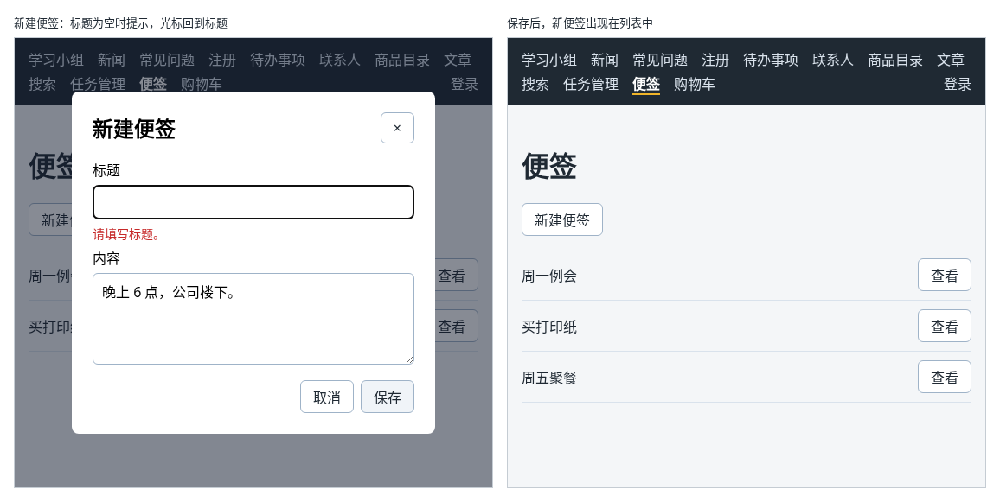
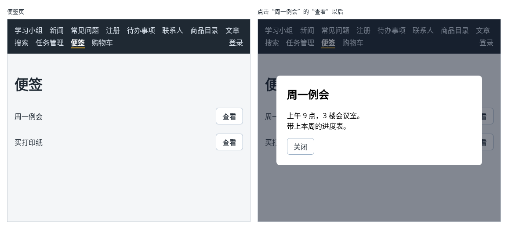

# 第 116 章：如何用 dialog 元素显示一个弹窗？

前置：[第 115A 章：如何拿到页面上的某个元素，让光标回到输入框？](第115A章-如何拿到页面上的某个元素，让光标回到输入框.md)

## 一、本章要解决的问题

列表中只显示每条记录的标题，想看完整内容时，常见的做法是弹出一个窗口：页面变暗，中间出现一个白色的框，看完点“关闭”回到原来的页面。弹窗看起来简单，自己用 `div` 做却要处理很多事：盖住后面的页面、不让后面的按钮被点到、按 Esc 关闭、关闭后光标回到原来的按钮上……

浏览器自带的 `<dialog>` 元素已经把这些都做好了。本章新建一个“便签”页，点击便签的“查看”，用 `dialog` 弹出便签的完整内容。完成后：弹窗出现时后面的页面变暗，不能点击；点“关闭”或按 Esc 键，弹窗消失，光标回到刚才点的“查看”按钮上。

本章是第 14 部分的起点。学完第 14 部分（第 116—121 章）时，便签页的效果如下图：可以查看便签；点“新建便签”弹出表单，光标自动在标题输入框中，名称为空时提示并定位到输入框；保存后新便签出现在列表中；填了内容又想关闭时，会先确认是否放弃。



下图左边是便签页，右边是点击“周一例会”的“查看”以后的样子：



## 二、必要原理

### dialog 元素和 showModal

`<dialog>` 是 HTML 的弹窗元素，默认是隐藏的。调用它的 `showModal()` 方法，它就以**模态**的方式显示出来；调用 `close()` 方法，它就关闭。

“模态”的意思是：弹窗打开期间，只能操作弹窗中的内容，后面的页面被挡住，不能点击、不能用 Tab 键进入。浏览器还会自动做好这几件事：

| 效果 | 谁来做 |
| --- | --- |
| 显示在所有内容的最上层，并放在窗口中间 | 浏览器 |
| 后面加一层半透明的遮罩，可以用 CSS 的 `::backdrop` 改它的颜色 | 浏览器 |
| 打开时焦点移到弹窗中的第一个可以操作的元素上 | 浏览器 |
| 按 Esc 键关闭 | 浏览器 |
| 关闭后焦点回到打开它之前的元素上 | 浏览器 |

最后两条对用键盘操作的人尤其重要。自己用 `div` 做弹窗，这些都要自己写。

### 用 ref 调用 showModal

`showModal()` 和 `close()` 是元素的方法，要先拿到 `dialog` 元素，这就是第 115A 章的 `useRef`：

```tsx
const viewDialogRef = useRef<HTMLDialogElement>(null);

<dialog ref={viewDialogRef}>…</dialog>
```

弹窗元素的类型是 `HTMLDialogElement`。点击“查看”时调用 `viewDialogRef.current.showModal()`，点击“关闭”时调用 `viewDialogRef.current.close()`。

### 一个弹窗显示不同的便签

页面上只放一个 `dialog`，用一个 state 记住正在查看哪一条：`viewingId`。点击“查看”时先 `setViewingId(id)`，再打开弹窗。弹窗中显示的内容由 `viewingId` 找到的便签决定，这和第 95 章按编号找商品是同一种做法。

`find` 可能找不到，例如还没点过任何“查看”时，所以弹窗中写成 `viewingNote ? viewingNote.title : ''`。弹窗关闭时不显示，这里的空字符串不会被看到。

### 给弹窗一个名字

读屏软件读到弹窗时，要知道它叫什么。`aria-labelledby="view-title"` 表示“这个弹窗的名字，是 id 为 `view-title` 的元素中的文字”，也就是弹窗中的标题。写法和第 43 章的 `aria-describedby` 相似。

### 不要改 dialog 的 display

关闭的 `dialog` 是靠浏览器默认的 `display: none` 隐藏的。如果在样式中给它写了 `display: flex` 之类的值，关闭时它也会显示出来。弹窗内部要排版时，在它里面再放一层元素，对里层写 `display`。

## 三、动手实现

### 第 1 步：便签的数据

新建 `src/data/notes.ts`：

```ts
export type Note = {
  id: number;
  title: string;
  content: string;
};

export const initialNotes: Note[] = [
  { id: 1, title: '周一例会', content: '上午 9 点，3 楼会议室。\n带上本周的进度表。' },
  { id: 2, title: '买打印纸', content: 'A4 两箱，记得要发票。' },
];
```

内容中的 `\n` 是换行（第 44B 章）。

### 第 2 步：便签页的样式

新建 `src/pages/NotesPage.module.css`：

```css
.list {
  margin: 0;
  padding: 0;
  list-style: none;
}

.item {
  display: flex;
  align-items: center;
  gap: 12px;
  padding: 10px 0;
  border-bottom: 1px solid #d9e2ec;
}

.itemTitle {
  flex: 1;
}

.dialog {
  width: min(420px, 90vw);
  padding: 24px;
  border: 0;
  border-radius: 8px;
}

.dialog::backdrop {
  background: rgba(15, 23, 42, 0.5);
}

.dialog h2 {
  margin-top: 0;
}

.content {
  white-space: pre-line;
}
```

- `width: min(420px, 90vw)`：取两者中较小的一个。窗口宽时弹窗宽 420px，手机上是窗口宽度的 90%（`vw` 是窗口宽度的百分之一）。
- `.dialog::backdrop` 设置遮罩的颜色。`rgba` 的最后一个数是不透明度，0.5 表示半透明。
- `.content` 中的 `white-space: pre-line` 让内容中的换行显示出来（第 44B 章）。

### 第 3 步：便签页

新建 `src/pages/NotesPage.tsx`：

```tsx
import { useRef, useState } from 'react';
import { initialNotes } from '../data/notes';
import styles from './NotesPage.module.css';

export default function NotesPage() {
  const [notes] = useState(initialNotes);
  const [viewingId, setViewingId] = useState<number | null>(null);
  const viewDialogRef = useRef<HTMLDialogElement>(null);
  const viewingNote = notes.find((note) => note.id === viewingId);

  function handleView(id: number) {
    setViewingId(id);
    if (viewDialogRef.current) {
      viewDialogRef.current.showModal();
    }
  }

  function handleCloseView() {
    if (viewDialogRef.current) {
      viewDialogRef.current.close();
    }
  }

  return (
    <main className="page">
      <title>便签</title>
      <h1>便签</h1>
      <ul className={styles.list}>
        {notes.map((note) => (
          <li key={note.id} className={styles.item}>
            <span className={styles.itemTitle}>{note.title}</span>
            <button type="button" onClick={() => handleView(note.id)}>
              查看
            </button>
          </li>
        ))}
      </ul>
      <dialog ref={viewDialogRef} className={styles.dialog} aria-labelledby="view-title">
        <h2 id="view-title">{viewingNote ? viewingNote.title : ''}</h2>
        <p className={styles.content}>{viewingNote ? viewingNote.content : ''}</p>
        <button type="button" onClick={handleCloseView}>
          关闭
        </button>
      </dialog>
    </main>
  );
}
```

- `const [notes] = useState(initialNotes);` 只取出了 state，没有取 set 函数：本章便签还不会变化，第 119 章新建便签时再加上。
- `dialog` 写在列表的后面，它关闭时不显示，放在哪里都不影响页面布局。

### 第 4 步：加入路由和导航

打开 `src/App.tsx`，在导入 `NewsPage` 的一行下面加入：

```tsx
import NotesPage from './pages/NotesPage';
```

在 `/shop` 那条路由的下面加入：

```tsx
            <Route path="/notes" element={<NotesPage />} />
```

打开 `src/components/AppLayout.tsx`，在“购物车”链接的前面加入：

```tsx
        <NavLink to="/notes">便签</NavLink>
```

## 四、运行与检查

保持开发服务器运行（`npm.cmd run dev`），保存文件后在浏览器中查看。

1. 点导航中的“便签”，页面上有“周一例会”“买打印纸”两条，每条后面有“查看”。
2. 点“周一例会”的“查看”。页面变暗，中间弹出白色的框，标题“周一例会”，内容分两行。
3. 弹窗打开时，试着点后面导航栏中的链接，点不动。按 Tab 键，焦点只在弹窗中的“关闭”上。
4. 按 Esc 键，弹窗关闭，焦点回到“周一例会”的“查看”按钮上（按钮周围有一圈焦点框）。
5. 点“买打印纸”的“查看”，弹窗中显示的是这一条。点“关闭”，弹窗关闭。
6. 在 Elements（元素）面板中找到 `dialog`。打开时它带有 `open` 属性，下面多了一个 `::backdrop`；关闭后 `open` 属性消失。

最后运行检查，应没有错误：

```powershell
npm.cmd run check
```

**小练习**：在弹窗的“关闭”按钮前面显示这条便签的字数，例如“周一例会”显示“共 24 个字”。提示：用 `viewingNote.content.length`，和第 44B 章一样，换行也算一个字。练习后恢复本章代码。

## 五、常见错误

| 现象 | 原因 | 怎么改 |
| --- | --- | --- |
| 弹窗还没打开，内容就显示在页面上 | 给 `.dialog` 写了 `display: flex` 等样式，覆盖了关闭时的 `display: none` | 不要改 `dialog` 的 `display`，排版写在里层元素上 |
| 弹窗显示了，但后面的页面没有变暗，按 Esc 也关不掉 | 用 `<dialog open>` 或者 `show()` 打开，这是非模态的显示方式 | 用 `showModal()` 打开 |
| 检查命令报 `'viewDialogRef.current' is possibly 'null'.` | 直接调用了 `viewDialogRef.current.showModal()` | 先判断 `viewDialogRef.current` 不是 `null` |
| 弹窗中显示的是上一次查看的便签 | 打开弹窗时没有调用 `setViewingId(id)`，或者传错了编号 | 在 `handleView` 中先保存编号，再打开弹窗 |

## 六、本章完整代码

### `src/data/notes.ts`

同第三节第 1 步。

### `src/pages/NotesPage.module.css`

同第三节第 2 步。

### `src/pages/NotesPage.tsx`

同第三节第 3 步。

### `src/App.tsx`

```tsx
import { Route, Routes } from 'react-router';
import './App.css';
import AppLayout from './components/AppLayout';
import AuthProvider from './components/AuthProvider';
import CartProvider from './components/CartProvider';
import RequireAuth from './components/RequireAuth';
import AccountPage from './pages/AccountPage';
import ArticlePage from './pages/ArticlePage';
import ContactsPage from './pages/ContactsPage';
import FaqPage from './pages/FaqPage';
import GroupPage from './pages/GroupPage';
import LoginPage from './pages/LoginPage';
import NewsPage from './pages/NewsPage';
import NotesPage from './pages/NotesPage';
import NotFoundPage from './pages/NotFoundPage';
import ProductDetailPage from './pages/ProductDetailPage';
import ProductPage from './pages/ProductPage';
import RegisterPage from './pages/RegisterPage';
import SearchPage from './pages/SearchPage';
import ShopPage from './pages/ShopPage';
import TaskPage from './pages/TaskPage';
import TaskServerPage from './pages/TaskServerPage';

export default function App() {
  return (
    <AuthProvider>
      <CartProvider>
        <Routes>
          <Route element={<AppLayout />}>
            <Route path="/" element={<GroupPage />} />
            <Route path="/news" element={<NewsPage />} />
            <Route path="/faq" element={<FaqPage />} />
            <Route path="/register" element={<RegisterPage />} />
            <Route path="/todos" element={<TaskPage />} />
            <Route path="/contacts" element={<ContactsPage />} />
            <Route path="/products" element={<ProductPage />} />
            <Route path="/products/:id" element={<ProductDetailPage />} />
            <Route path="/articles" element={<ArticlePage />} />
            <Route path="/search" element={<SearchPage />} />
            <Route path="/tasks" element={<TaskServerPage />} />
            <Route path="/shop" element={<ShopPage />} />
            <Route path="/notes" element={<NotesPage />} />
            <Route
              path="/account"
              element={
                <RequireAuth>
                  <AccountPage />
                </RequireAuth>
              }
            />
            <Route path="*" element={<NotFoundPage />} />
          </Route>
          <Route path="/login" element={<LoginPage />} />
        </Routes>
      </CartProvider>
    </AuthProvider>
  );
}
```

### `src/components/AppLayout.tsx`

```tsx
import { useState } from 'react';
import { NavLink, Outlet } from 'react-router';
import { useAuth } from '../hooks/useAuth';
import { useCart } from '../hooks/useCart';
import { logout } from '../lib/authApi';

export default function AppLayout() {
  const { user, checking, setUser } = useAuth();
  const [isLoggingOut, setIsLoggingOut] = useState(false);
  const { cartItems } = useCart();
  let cartCount = 0;
  for (const item of cartItems) {
    cartCount += item.quantity;
  }

  async function handleLogout() {
    setIsLoggingOut(true);
    try {
      // 先让服务器删除登录记录，否则刷新页面后又会自动登录
      await logout();
      // 当前页面如果需要登录，RequireAuth 会自动把人送去登录页
      setUser(null);
    } catch (error) {
      window.alert(error instanceof Error ? error.message : '退出失败，请稍后重试。');
    } finally {
      setIsLoggingOut(false);
    }
  }

  return (
    <div>
      <nav className="site-nav" aria-label="主导航">
        <NavLink to="/">学习小组</NavLink>
        <NavLink to="/news">新闻</NavLink>
        <NavLink to="/faq">常见问题</NavLink>
        <NavLink to="/register">注册</NavLink>
        <NavLink to="/todos">待办事项</NavLink>
        <NavLink to="/contacts">联系人</NavLink>
        <NavLink to="/products">商品目录</NavLink>
        <NavLink to="/articles">文章</NavLink>
        <NavLink to="/search">搜索</NavLink>
        <NavLink to="/tasks">任务管理</NavLink>
        <NavLink to="/notes">便签</NavLink>
        <NavLink to="/shop">
          购物车
          {cartCount > 0 && (
            <span className="cart-count" aria-label={'购物车中有 ' + cartCount + ' 件商品'}>
              {cartCount}
            </span>
          )}
        </NavLink>
        {/* 确认登录状态期间什么也不显示，避免先闪一下“登录”再变成用户名 */}
        {!checking && user && (
          <NavLink to="/account" className="nav-user">
            {user.displayName}
          </NavLink>
        )}
        {!checking && user && (
          <button
            type="button"
            className="nav-logout"
            disabled={isLoggingOut}
            onClick={handleLogout}
          >
            {isLoggingOut ? '正在退出……' : '退出'}
          </button>
        )}
        {!checking && !user && (
          <NavLink to="/login" className="nav-user">
            登录
          </NavLink>
        )}
      </nav>
      <Outlet />
    </div>
  );
}
```

## 七、本章改动小结

新增 `src/data/notes.ts`、`src/pages/NotesPage.tsx` 和 `src/pages/NotesPage.module.css`：便签页，用 `dialog` 弹出便签的完整内容；修改 `src/App.tsx` 和 `src/components/AppLayout.tsx`：加入 `/notes` 路由和导航链接。

---

下一章：[第 117 章：如何点击弹窗外的遮罩关闭弹窗？](第117章-如何点击弹窗外的遮罩关闭弹窗.md)
