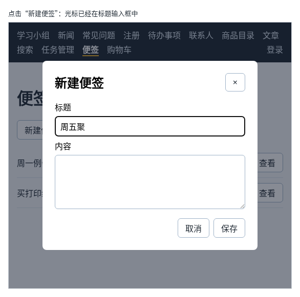

# 第 118 章：打开弹窗后，如何自动聚焦第一个输入框？

前置：[第 117 章：如何点击弹窗外的遮罩关闭弹窗？](第117章-如何点击弹窗外的遮罩关闭弹窗.md)

## 一、本章要解决的问题

便签页要能新建便签：点“新建便签”，弹出一个表单，填写标题和内容后保存。弹窗打开后，用户接下来要做的事一定是输入标题，可浏览器默认把焦点放在弹窗中的第一个按钮上，也就是右上角的“×”。用户只好再用鼠标点一下标题输入框；用键盘的人如果直接按回车，弹窗反而被关掉了。

本章做好新建便签的弹窗，并让它打开时把光标放进标题输入框。完成后：点“新建便签”，弹窗打开，光标已经在“标题”中，可以直接输入；填好标题后按回车或点“保存”，新便签出现在列表的最后；没有填标题时“保存”按钮不能点。

下图是点击“新建便签”并输入几个字以后的样子：



## 二、必要原理

### 浏览器把焦点放在哪里

第 116 章说过，`showModal()` 会把焦点移到弹窗中**第一个可以操作的元素**上。新建便签的弹窗中，排在最前面的是标题旁边的“×”关闭按钮，所以焦点落在它上面。

不能为了让输入框排第一，就把“×”挪到表单后面：关闭按钮放在右上角是用户熟悉的位置。

### 打开后自己调用 focus

和第 115A 章一样，用一个 ref 拿到标题输入框，在打开弹窗之后调用它的 `focus()`：

```tsx
createDialogRef.current.showModal();
titleInputRef.current.focus();
```

顺序很重要：先打开，再聚焦。弹窗关闭时，里面的元素是看不见的，看不见的元素不能获得焦点，先调用 `focus()` 什么也不会发生；而且随后 `showModal()` 又会把焦点放到“×”上。

这里不需要 Effect：打开弹窗本身就发生在点击按钮的处理函数中，紧接着聚焦即可。

### React 的 autoFocus 在弹窗中不起作用

HTML 的输入框有一个 `autofocus` 属性，React 中写作 `autoFocus`。但 React 并不会把这个属性写到页面上，而是在输入框**第一次出现在页面上时**调用一次 `focus()`。便签页一打开，弹窗中的输入框就已经在页面上了，只是弹窗关着；那时调用的 `focus()` 没有效果，之后打开弹窗也不会再调用。所以在这里写 `autoFocus`，焦点仍然在“×”上。

### 每次打开前清空表单

新建便签的标题和内容用两个 state 保存，和第 35 章的受控输入框一样。打开弹窗之前，先把两个 state 清空，上一次填写的内容就不会留在表单中。

### 保存和第 45 章添加任务一样

表单的 `onSubmit` 中阻止页面刷新（第 40 章），用展开语法把新便签加到数组末尾（第 45 章），然后关闭弹窗。便签的编号用 `Date.now()`：它返回从 1970 年起到现在的毫秒数，每次点保存都不一样，适合做练习中的编号。

关闭弹窗后，焦点自动回到“新建便签”按钮上（第 116 章）。

## 三、动手实现

### 第 1 步：增加 state 和 ref

打开 `src/pages/NotesPage.tsx`，把导入事件类型的一行改为：

```tsx
import type { MouseEvent, SubmitEvent } from 'react';
```

把 `notes` 的 state 改为同时取出 `setNotes`：

```tsx
  const [notes, setNotes] = useState(initialNotes);
```

在 `viewingNote` 那一行的下面加入：

```tsx
  const [draftTitle, setDraftTitle] = useState('');
  const [draftContent, setDraftContent] = useState('');
  const createDialogRef = useRef<HTMLDialogElement>(null);
  const titleInputRef = useRef<HTMLInputElement>(null);
```

### 第 2 步：打开、关闭和保存

在 `return` 的前面加入三个函数：

```tsx
  function handleOpenCreate() {
    setDraftTitle('');
    setDraftContent('');
    if (createDialogRef.current) {
      createDialogRef.current.showModal();
    }
    // 弹窗打开时浏览器会把焦点放在第一个按钮“×”上，这里改放到标题输入框
    if (titleInputRef.current) {
      titleInputRef.current.focus();
    }
  }

  function handleCloseCreate() {
    if (createDialogRef.current) {
      createDialogRef.current.close();
    }
  }

  function handleCreate(event: SubmitEvent<HTMLFormElement>) {
    event.preventDefault();
    const newNote = { id: Date.now(), title: draftTitle.trim(), content: draftContent.trim() };
    setNotes([...notes, newNote]);
    handleCloseCreate();
  }

```

### 第 3 步：“新建便签”按钮

在 `<h1>便签</h1>` 的下面加入：

```tsx
      <p>
        <button type="button" onClick={handleOpenCreate}>
          新建便签
        </button>
      </p>
```

### 第 4 步：新建便签的弹窗

在查看弹窗的 `</dialog>` 后面、`</main>` 前面加入：

```tsx
      <dialog ref={createDialogRef} className={styles.dialog} aria-labelledby="create-title">
        <div className={styles.dialogBody}>
          <div className={styles.dialogHeader}>
            <h2 id="create-title">新建便签</h2>
            <button type="button" aria-label="关闭" onClick={handleCloseCreate}>
              ×
            </button>
          </div>
          <form className={styles.form} onSubmit={handleCreate}>
            <label htmlFor="note-title">标题</label>
            <input
              ref={titleInputRef}
              id="note-title"
              value={draftTitle}
              onChange={(event) => setDraftTitle(event.target.value)}
            />
            <label htmlFor="note-content">内容</label>
            <textarea
              id="note-content"
              rows={4}
              value={draftContent}
              onChange={(event) => setDraftContent(event.target.value)}
            />
            <div className={styles.actions}>
              <button type="button" onClick={handleCloseCreate}>
                取消
              </button>
              <button type="submit" disabled={draftTitle.trim() === ''}>
                保存
              </button>
            </div>
          </form>
        </div>
      </dialog>
```

- “×”只是一个符号，用 `aria-label="关闭"` 告诉读屏软件它的作用（第 103 章）。
- “取消”和“×”都是 `type="button"`，点击它们不会提交表单。
- 本章先用 `disabled` 防止保存空标题，第 119 章改为提示错误。

### 第 5 步：弹窗中表单的样式

打开 `src/pages/NotesPage.module.css`，在文件最后加入：

```css

.dialogHeader {
  display: flex;
  justify-content: space-between;
  align-items: flex-start;
}

.form {
  display: flex;
  flex-direction: column;
  gap: 6px;
}

.form input,
.form textarea {
  padding: 8px 10px;
  border: 1px solid #9fb3c8;
  border-radius: 6px;
  font: inherit;
}

.actions {
  display: flex;
  justify-content: flex-end;
  gap: 8px;
  margin-top: 12px;
}
```

## 四、运行与检查

保持开发服务器运行（`npm.cmd run dev`），保存文件后在浏览器中查看。

1. 打开便签页，点“新建便签”。弹窗打开，标题输入框中有闪烁的光标，“保存”是灰色的。
2. 直接输入“周五聚餐”，“保存”变为可用。按 Tab 键进入“内容”，输入“晚上 6 点”。
3. 点“保存”。弹窗关闭，列表最后多了“周五聚餐”，焦点回到“新建便签”按钮上。点它的“查看”，内容是“晚上 6 点”。
4. 再点“新建便签”，表单是空的，光标仍在标题中。在标题中输入几个字后按回车，也能保存。
5. 再打开一次，分别用“×”、“取消”和 Esc 键关闭，列表都没有变化。
6. 做一个小实验：把 `handleOpenCreate` 中调用 `focus()` 的三行删掉，在标题输入框上写 `autoFocus`。打开弹窗，焦点在“×”上，`autoFocus` 没有起作用。实验后恢复。

最后运行检查，应没有错误：

```powershell
npm.cmd run check
```

**小练习**：给新建便签的弹窗也加上“点遮罩关闭”，写法照第 117 章。想一想：表单中已经填了很多内容时，点遮罩就关闭，用户会不会不小心丢掉内容？第 121 章会处理这个问题。练习后恢复本章代码。

## 五、常见错误

| 现象 | 原因 | 怎么改 |
| --- | --- | --- |
| 弹窗打开后，焦点在“×”上 | 用了 `autoFocus`；或者没有调用 `focus()` | 在 `showModal()` 之后调用 `titleInputRef.current.focus()` |
| 写了 `focus()`，焦点仍然在“×”上 | `focus()` 写在了 `showModal()` 的前面，那时弹窗还关着 | 先 `showModal()`，再 `focus()` |
| 再次打开时，表单中还是上一次填的内容 | 打开前没有清空两个 state | 在 `handleOpenCreate` 中先 `setDraftTitle('')`、`setDraftContent('')` |
| 点“取消”时，便签也被保存了 | “取消”按钮没写 `type="button"`，在表单中默认是提交按钮 | 写上 `type="button"` |

## 六、本章完整代码

### `src/pages/NotesPage.tsx`

```tsx
import { useRef, useState } from 'react';
import type { MouseEvent, SubmitEvent } from 'react';
import { initialNotes } from '../data/notes';
import styles from './NotesPage.module.css';

export default function NotesPage() {
  const [notes, setNotes] = useState(initialNotes);
  const [viewingId, setViewingId] = useState<number | null>(null);
  const viewDialogRef = useRef<HTMLDialogElement>(null);
  const viewingNote = notes.find((note) => note.id === viewingId);
  const [draftTitle, setDraftTitle] = useState('');
  const [draftContent, setDraftContent] = useState('');
  const createDialogRef = useRef<HTMLDialogElement>(null);
  const titleInputRef = useRef<HTMLInputElement>(null);

  function handleView(id: number) {
    setViewingId(id);
    if (viewDialogRef.current) {
      viewDialogRef.current.showModal();
    }
  }

  function handleCloseView() {
    if (viewDialogRef.current) {
      viewDialogRef.current.close();
    }
  }

  function handleViewDialogClick(event: MouseEvent<HTMLDialogElement>) {
    // 点在遮罩上时，事件的目标是 dialog 本身；点在内容上时，目标是里面的元素
    if (event.target === event.currentTarget) {
      handleCloseView();
    }
  }

  function handleOpenCreate() {
    setDraftTitle('');
    setDraftContent('');
    if (createDialogRef.current) {
      createDialogRef.current.showModal();
    }
    // 弹窗打开时浏览器会把焦点放在第一个按钮“×”上，这里改放到标题输入框
    if (titleInputRef.current) {
      titleInputRef.current.focus();
    }
  }

  function handleCloseCreate() {
    if (createDialogRef.current) {
      createDialogRef.current.close();
    }
  }

  function handleCreate(event: SubmitEvent<HTMLFormElement>) {
    event.preventDefault();
    const newNote = { id: Date.now(), title: draftTitle.trim(), content: draftContent.trim() };
    setNotes([...notes, newNote]);
    handleCloseCreate();
  }

  return (
    <main className="page">
      <title>便签</title>
      <h1>便签</h1>
      <p>
        <button type="button" onClick={handleOpenCreate}>
          新建便签
        </button>
      </p>
      <ul className={styles.list}>
        {notes.map((note) => (
          <li key={note.id} className={styles.item}>
            <span className={styles.itemTitle}>{note.title}</span>
            <button type="button" onClick={() => handleView(note.id)}>
              查看
            </button>
          </li>
        ))}
      </ul>
      <dialog
        ref={viewDialogRef}
        className={styles.dialog}
        aria-labelledby="view-title"
        onClick={handleViewDialogClick}
      >
        <div className={styles.dialogBody}>
          <h2 id="view-title">{viewingNote ? viewingNote.title : ''}</h2>
          <p className={styles.content}>{viewingNote ? viewingNote.content : ''}</p>
          <button type="button" onClick={handleCloseView}>
            关闭
          </button>
        </div>
      </dialog>
      <dialog ref={createDialogRef} className={styles.dialog} aria-labelledby="create-title">
        <div className={styles.dialogBody}>
          <div className={styles.dialogHeader}>
            <h2 id="create-title">新建便签</h2>
            <button type="button" aria-label="关闭" onClick={handleCloseCreate}>
              ×
            </button>
          </div>
          <form className={styles.form} onSubmit={handleCreate}>
            <label htmlFor="note-title">标题</label>
            <input
              ref={titleInputRef}
              id="note-title"
              value={draftTitle}
              onChange={(event) => setDraftTitle(event.target.value)}
            />
            <label htmlFor="note-content">内容</label>
            <textarea
              id="note-content"
              rows={4}
              value={draftContent}
              onChange={(event) => setDraftContent(event.target.value)}
            />
            <div className={styles.actions}>
              <button type="button" onClick={handleCloseCreate}>
                取消
              </button>
              <button type="submit" disabled={draftTitle.trim() === ''}>
                保存
              </button>
            </div>
          </form>
        </div>
      </dialog>
    </main>
  );
}
```

### `src/pages/NotesPage.module.css`

```css
.list {
  margin: 0;
  padding: 0;
  list-style: none;
}

.item {
  display: flex;
  align-items: center;
  gap: 12px;
  padding: 10px 0;
  border-bottom: 1px solid #d9e2ec;
}

.itemTitle {
  flex: 1;
}

.dialog {
  width: min(420px, 90vw);
  padding: 0;
  border: 0;
  border-radius: 8px;
}

/* 内边距放在里层，点在内边距上也算点在内容上，不会被当成点遮罩 */
.dialogBody {
  padding: 24px;
}

.dialog::backdrop {
  background: rgba(15, 23, 42, 0.5);
}

.dialogBody h2 {
  margin-top: 0;
}

.content {
  white-space: pre-line;
}

.dialogHeader {
  display: flex;
  justify-content: space-between;
  align-items: flex-start;
}

.form {
  display: flex;
  flex-direction: column;
  gap: 6px;
}

.form input,
.form textarea {
  padding: 8px 10px;
  border: 1px solid #9fb3c8;
  border-radius: 6px;
  font: inherit;
}

.actions {
  display: flex;
  justify-content: flex-end;
  gap: 8px;
  margin-top: 12px;
}
```

## 七、本章改动小结

修改 `src/pages/NotesPage.tsx`：新增新建便签的弹窗，打开后把焦点放到标题输入框，保存后把便签加到列表末尾；修改 `src/pages/NotesPage.module.css`：新增弹窗标题栏、表单和按钮区的样式。

---

下一章：[第 119 章：如何把 ref 传给自定义输入组件？](第119章-如何把ref传给自定义输入组件.md)
