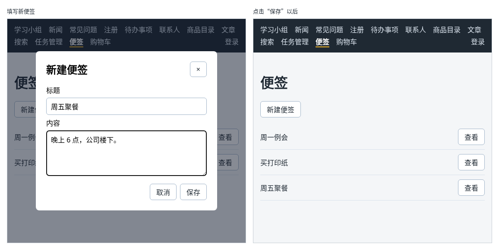

# 第 120 章：如何让弹窗中的表单把结果交回页面？

前置：[第 119 章：如何把 ref 传给自定义输入组件？](第119章-如何把ref传给自定义输入组件.md)

## 一、本章要解决的问题

`NotesPage.tsx` 中现在有两个弹窗、三个 ref、五个 state，新建便签的表单、校验、聚焦和保存全都写在页面里。如果别的页面也要一个“新建便签”的弹窗，只能整段复制。

更好的分工是：弹窗自己管理表单的输入、校验和打开关闭；页面只关心两件事：什么时候打开弹窗，以及用户保存时拿到填好的结果，加进自己的列表。本章把新建便签的弹窗提取成组件 `NoteFormDialog`，用回调把结果交回页面。完成后，新建便签的效果和第 119 章一样：打开时光标在标题中，标题为空时提示，保存后便签加入列表；但页面中只剩下一行 `<NoteFormDialog … />`。

下图左边是填写新便签的样子，右边是点击“保存”以后的样子：



## 二、必要原理

### 弹窗通过回调把结果交回去

弹窗组件不知道、也不应该知道页面怎样保存便签：页面可能加到列表末尾，也可能发给服务器。所以弹窗只负责把用户填好的内容交出去，这就是第 31 章“子组件通知父组件”的回调 props：

```tsx
type NoteFormDialogProps = {
  onSave: (note: NoteInput) => void;
  onClose: () => void;
};
```

- `onSave`：用户点“保存”并通过校验后调用，参数是填好的标题和内容。
- `onClose`：弹窗关闭时调用，不论是保存后关闭、点“取消”、点“×”还是按 Esc。

`NoteInput` 是便签中由用户填写的部分，编号由页面生成，所以用第 93A 章的 `Omit` 从 `Note` 中去掉 `id`：`Omit<Note, 'id'>`。

### 需要时才显示弹窗组件

页面用一个 state `creating` 表示“正在新建”，只在它为 `true` 时显示弹窗组件：

```tsx
{creating && <NoteFormDialog onSave={handleSave} onClose={() => setCreating(false)} />}
```

每次点“新建便签”，`NoteFormDialog` 都是一个新出现的组件，它的 state 从初始值开始，表单自然是空的，错误提示也没有了。第 118、119 章中“打开前清空几个 state”的代码就不再需要了，这和第 53 章用 `key` 得到新组件是同一个道理。

### 出现时打开，关闭时通知页面

组件出现在页面上以后，才有 `dialog` 元素可以调用 `showModal()`。“组件出现以后做一件事”，用的是 Effect（第 74 章），依赖数组写 `[]`：

```tsx
useEffect(() => {
  const dialog = dialogRef.current;
  if (!dialog) {
    return;
  }
  dialog.showModal();
  if (titleInputRef.current) {
    titleInputRef.current.focus();
  }
}, []);
```

开发环境中这个 Effect 会执行两次（第 75 章）。对已经打开的弹窗再调用一次 `showModal()`，浏览器什么也不做，所以没有问题。

关闭时的流程是：组件调用 `dialog.close()`，浏览器关闭弹窗、把焦点还给“新建便签”按钮，然后在 `dialog` 上触发 `close` 事件。React 中用 `onClose` 接收这个事件，组件把它直接交给页面传来的 `onClose`。页面收到后 `setCreating(false)`，弹窗组件从页面上移除。按 Esc 时浏览器自己关闭弹窗，同样会触发 `close` 事件，走的是同一条路。

不要在 Effect 的清理函数中调用 `close()`。开发环境中 Effect 执行两次之间会先执行一次清理，清理时一关闭，就触发了 `onClose`，页面立刻把弹窗移除，用户看到弹窗一闪就没了。

### 用更新函数保存

页面的 `handleSave` 用更新函数把新便签加进去：

```tsx
setNotes((current) => [...current, { id: Date.now(), ...input }]);
```

`{ id: Date.now(), ...input }` 先写上编号，再把 `input` 中的标题和内容展开进来（第 48 章的展开语法）。`handleSave` 是弹窗组件调用的，用更新函数保证在最新的列表上添加（第 28 章）。

## 三、动手实现

### 第 1 步：新建便签输入的类型

打开 `src/data/notes.ts`，在 `Note` 类型的后面加入：

```ts

// 新建便签时由用户填写的部分，编号由页面生成
export type NoteInput = Omit<Note, 'id'>;
```

### 第 2 步：弹窗组件的样式

新建 `src/components/NoteFormDialog.module.css`，前几条和便签页中查看弹窗的样式相同，后面是从 `NotesPage.module.css` 移过来的表单样式：

```css
.dialog {
  width: min(420px, 90vw);
  padding: 0;
  border: 0;
  border-radius: 8px;
}

.dialog::backdrop {
  background: rgba(15, 23, 42, 0.5);
}

.body {
  padding: 24px;
}

.header {
  display: flex;
  justify-content: space-between;
  align-items: flex-start;
}

.header h2 {
  margin-top: 0;
}

.form {
  display: flex;
  flex-direction: column;
  gap: 6px;
}

.form textarea {
  padding: 8px 10px;
  border: 1px solid #9fb3c8;
  border-radius: 6px;
  font: inherit;
}

.actions {
  display: flex;
  justify-content: flex-end;
  gap: 8px;
  margin-top: 12px;
}
```

然后打开 `src/pages/NotesPage.module.css`，删掉最后的 `.dialogHeader`、`.form`、`.form textarea`、`.actions` 四条规则。

### 第 3 步：弹窗组件

新建 `src/components/NoteFormDialog.tsx`：

```tsx
import { useEffect, useRef, useState } from 'react';
import type { SubmitEvent } from 'react';
import TextField from './TextField';
import type { NoteInput } from '../data/notes';
import styles from './NoteFormDialog.module.css';

type NoteFormDialogProps = {
  // 保存时把填好的便签交给页面，由页面决定怎样加入列表
  onSave: (note: NoteInput) => void;
  // 弹窗关闭时通知页面，不论是保存、取消还是按 Esc
  onClose: () => void;
};

export default function NoteFormDialog({ onSave, onClose }: NoteFormDialogProps) {
  const [draftTitle, setDraftTitle] = useState('');
  const [draftContent, setDraftContent] = useState('');
  const [titleError, setTitleError] = useState('');
  const dialogRef = useRef<HTMLDialogElement>(null);
  const titleInputRef = useRef<HTMLInputElement>(null);

  // 组件一出现在页面上就打开弹窗；组件被移除时，弹窗随元素一起消失
  useEffect(() => {
    const dialog = dialogRef.current;
    if (!dialog) {
      return;
    }
    dialog.showModal();
    if (titleInputRef.current) {
      titleInputRef.current.focus();
    }
  }, []);

  function handleClose() {
    if (dialogRef.current) {
      dialogRef.current.close();
    }
  }

  function handleSubmit(event: SubmitEvent<HTMLFormElement>) {
    event.preventDefault();
    if (draftTitle.trim() === '') {
      setTitleError('请填写标题。');
      // 把光标送到出错的输入框，用户可以直接补填
      if (titleInputRef.current) {
        titleInputRef.current.focus();
      }
      return;
    }
    onSave({ title: draftTitle.trim(), content: draftContent.trim() });
    handleClose();
  }

  return (
    <dialog
      ref={dialogRef}
      className={styles.dialog}
      aria-labelledby="create-title"
      onClose={onClose}
    >
      <div className={styles.body}>
        <div className={styles.header}>
          <h2 id="create-title">新建便签</h2>
          <button type="button" aria-label="关闭" onClick={handleClose}>
            ×
          </button>
        </div>
        <form className={styles.form} onSubmit={handleSubmit}>
          <TextField
            ref={titleInputRef}
            id="note-title"
            label="标题"
            value={draftTitle}
            onChange={setDraftTitle}
            error={titleError}
          />
          <label htmlFor="note-content">内容</label>
          <textarea
            id="note-content"
            rows={4}
            value={draftContent}
            onChange={(event) => setDraftContent(event.target.value)}
          />
          <div className={styles.actions}>
            <button type="button" onClick={handleClose}>
              取消
            </button>
            <button type="submit">保存</button>
          </div>
        </form>
      </div>
    </dialog>
  );
}
```

表单部分从 `NotesPage` 原样搬过来。三处不同：打开改在 Effect 中；保存时调用 `onSave` 交出结果，不再自己修改列表；`dialog` 上多了 `onClose={onClose}`。

### 第 4 步：便签页只负责打开和接收结果

把 `src/pages/NotesPage.tsx` 改为：

```tsx
import { useRef, useState } from 'react';
import type { MouseEvent } from 'react';
import NoteFormDialog from '../components/NoteFormDialog';
import { initialNotes } from '../data/notes';
import type { NoteInput } from '../data/notes';
import styles from './NotesPage.module.css';

export default function NotesPage() {
  const [notes, setNotes] = useState(initialNotes);
  const [viewingId, setViewingId] = useState<number | null>(null);
  const viewDialogRef = useRef<HTMLDialogElement>(null);
  const viewingNote = notes.find((note) => note.id === viewingId);
  // 为 true 时才显示新建便签的弹窗组件，每次打开都是一个全新的表单
  const [creating, setCreating] = useState(false);

  function handleView(id: number) {
    setViewingId(id);
    if (viewDialogRef.current) {
      viewDialogRef.current.showModal();
    }
  }

  function handleCloseView() {
    if (viewDialogRef.current) {
      viewDialogRef.current.close();
    }
  }

  function handleViewDialogClick(event: MouseEvent<HTMLDialogElement>) {
    // 点在遮罩上时，事件的目标是 dialog 本身；点在内容上时，目标是里面的元素
    if (event.target === event.currentTarget) {
      handleCloseView();
    }
  }

  function handleSave(input: NoteInput) {
    setNotes((current) => [...current, { id: Date.now(), ...input }]);
  }

  return (
    <main className="page">
      <title>便签</title>
      <h1>便签</h1>
      <p>
        <button type="button" onClick={() => setCreating(true)}>
          新建便签
        </button>
      </p>
      <ul className={styles.list}>
        {notes.map((note) => (
          <li key={note.id} className={styles.item}>
            <span className={styles.itemTitle}>{note.title}</span>
            <button type="button" onClick={() => handleView(note.id)}>
              查看
            </button>
          </li>
        ))}
      </ul>
      <dialog
        ref={viewDialogRef}
        className={styles.dialog}
        aria-labelledby="view-title"
        onClick={handleViewDialogClick}
      >
        <div className={styles.dialogBody}>
          <h2 id="view-title">{viewingNote ? viewingNote.title : ''}</h2>
          <p className={styles.content}>{viewingNote ? viewingNote.content : ''}</p>
          <button type="button" onClick={handleCloseView}>
            关闭
          </button>
        </div>
      </dialog>
      {creating && <NoteFormDialog onSave={handleSave} onClose={() => setCreating(false)} />}
    </main>
  );
}
```

和新建便签有关的 state、ref、`handleOpenCreate`、`handleCloseCreate`、`handleCreate` 都删掉了，换成 `creating` 和 `handleSave`；`TextField` 和 `SubmitEvent` 的导入也不再需要。

## 四、运行与检查

保持开发服务器运行（`npm.cmd run dev`），保存文件后在浏览器中查看。

1. 打开便签页，点“新建便签”。弹窗打开，光标在标题中。
2. 不填标题就点“保存”，显示“请填写标题。”，光标回到标题中。
3. 填上“周五聚餐”，内容填“晚上 6 点，公司楼下。”，点“保存”。弹窗关闭，列表最后多了“周五聚餐”，焦点回到“新建便签”按钮。
4. 再点“新建便签”，随便输入几个字后按 Esc，弹窗关闭；再打开，表单是空的。
5. 在 React 开发者工具的 Components 面板中，弹窗打开时 `NotesPage` 下面有一个 `NoteFormDialog`，关闭后它消失了。
6. 查看便签的弹窗和第 117 章一样正常。

最后运行检查，应没有错误：

```powershell
npm.cmd run check
```

**小练习**：给 `NoteFormDialog` 加一个可选的 prop `dialogTitle`，默认值为“新建便签”，用来替换弹窗标题中的文字。在 `NotesPage` 中传入“新建工作便签”，确认弹窗标题变了。提示：可选 prop 的默认值写法见第 10 章。练习后恢复本章代码。

## 五、常见错误

| 现象 | 原因 | 怎么改 |
| --- | --- | --- |
| 点“新建便签”，弹窗一闪就没了 | 在 Effect 的清理函数中调用了 `dialog.close()`。开发环境中执行两次之间先清理，一关闭就触发了 `onClose` | 去掉清理函数，组件被移除时弹窗会随元素一起消失 |
| 按 Esc 关闭后，再点“新建便签”没有反应；检查命令也提示 `'onClose' is declared but its value is never read.` | `dialog` 上漏写了 `onClose={onClose}`，页面不知道弹窗关了，`creating` 一直是 `true` | 在 `dialog` 上写 `onClose={onClose}` |
| 保存后便签没有加入列表 | 弹窗组件中只关闭了弹窗，忘了调用 `onSave` | 校验通过后先 `onSave(…)`，再关闭 |
| 再次打开时，上一次填的内容还在 | 弹窗组件一直显示着，只是开关 `dialog`，state 没有重新开始 | 用 `{creating && <NoteFormDialog … />}`，每次打开都是新组件 |

## 六、本章完整代码

### `src/data/notes.ts`

```ts
export type Note = {
  id: number;
  title: string;
  content: string;
};

// 新建便签时由用户填写的部分，编号由页面生成
export type NoteInput = Omit<Note, 'id'>;

export const initialNotes: Note[] = [
  { id: 1, title: '周一例会', content: '上午 9 点，3 楼会议室。\n带上本周的进度表。' },
  { id: 2, title: '买打印纸', content: 'A4 两箱，记得要发票。' },
];
```

### `src/components/NoteFormDialog.module.css`

同第三节第 2 步。

### `src/pages/NotesPage.module.css`

```css
.list {
  margin: 0;
  padding: 0;
  list-style: none;
}

.item {
  display: flex;
  align-items: center;
  gap: 12px;
  padding: 10px 0;
  border-bottom: 1px solid #d9e2ec;
}

.itemTitle {
  flex: 1;
}

.dialog {
  width: min(420px, 90vw);
  padding: 0;
  border: 0;
  border-radius: 8px;
}

/* 内边距放在里层，点在内边距上也算点在内容上，不会被当成点遮罩 */
.dialogBody {
  padding: 24px;
}

.dialog::backdrop {
  background: rgba(15, 23, 42, 0.5);
}

.dialogBody h2 {
  margin-top: 0;
}

.content {
  white-space: pre-line;
}
```

### `src/components/NoteFormDialog.tsx`

同第三节第 3 步。

### `src/pages/NotesPage.tsx`

同第三节第 4 步。

## 七、本章改动小结

新增 `src/components/NoteFormDialog.tsx` 和 `src/components/NoteFormDialog.module.css`：新建便签的弹窗组件，用 `onSave` 交出结果、用 `onClose` 通知关闭；修改 `src/data/notes.ts`：新增 `NoteInput` 类型；修改 `src/pages/NotesPage.tsx`：只保留打开弹窗和接收结果；修改 `src/pages/NotesPage.module.css`：删掉移走的表单样式。

---

下一章：[第 121 章：【组合】关闭弹窗前，如何确认用户是否放弃修改？](第121章-关闭弹窗前，如何确认用户是否放弃修改.md)
