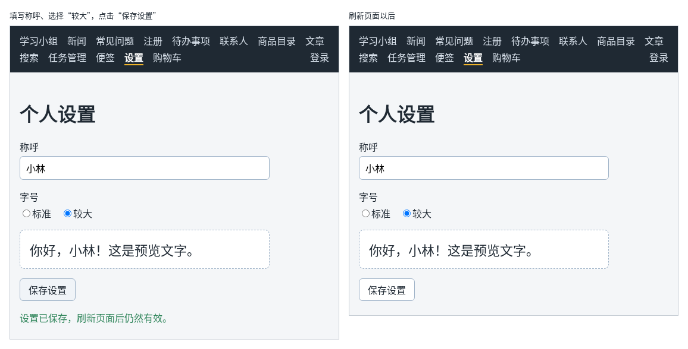

# 第 122 章：刷新页面后，如何恢复上次保存的设置？

前置：[第 121 章：【组合】关闭弹窗前，如何确认用户是否放弃修改？](第121章-关闭弹窗前，如何确认用户是否放弃修改.md)

## 一、本章要解决的问题

很多网站都有“个人设置”：怎么称呼你、字体大一点还是小一点。这些设置只和这台电脑上的这个浏览器有关，不需要存到服务器上；但刷新页面、关掉浏览器再打开，设置都应该还在。可 state 一刷新就回到初始值（第 106 章）。

本章做一个“个人设置”页，用浏览器的**本地存储**保存设置。完成后：填写称呼、选择字号，下方的预览随之变化；点“保存设置”，显示“设置已保存，刷新页面后仍然有效。”；刷新页面，称呼和字号都是上次保存的值；没有保存就刷新，回到原来的设置。

下图左边是保存设置时的样子，右边是刷新以后的样子：



## 二、必要原理

### localStorage：浏览器为网站保存的一块空间

浏览器为每个网站提供一块本地存储，叫 **localStorage**。存进去的内容保存在这台电脑上，刷新页面、关闭浏览器、重启电脑以后都还在，直到被代码或用户删除。

它的用法像一个只能存文字的小表格，每一项有一个名字：

| 写法 | 作用 |
| --- | --- |
| `localStorage.setItem('名字', '文字')` | 保存，同名的会被覆盖 |
| `localStorage.getItem('名字')` | 读取，没有这个名字时返回 `null` |
| `localStorage.removeItem('名字')` | 删除 |

同一个网站的所有页面共用这块空间，所以名字要起得能看出是谁的、做什么用的，本章用 `react-daily-practice.settings`。

它适合保存设置这类不重要、和这台电脑有关的小数据。不要把密码、登录凭证这类敏感内容放进去：页面中的任何代码都能读到它（第 109 章的 Cookie 用了 `HttpOnly`，就是为了避免这种情况）。

### 只能存文字：用 JSON 转换

设置是一个对象 `{ nickname: '小林', fontSize: 'large' }`，而本地存储只能存文字。保存前用 `JSON.stringify` 把对象变成文字，读取后用 `JSON.parse` 把文字变回对象，和第 86 章发送请求正文是同一对方法。

### 读出来的内容要检查

本地存储中的内容可能被用户在开发者工具中改坏，也可能是旧版本的程序存的、格式已经不同。所以读出来以后：

- `JSON.parse` 遇到不是 JSON 的文字会抛出错误，用 `try / catch` 接住；
- 解析出来的是 `unknown`，用 `isSettings` 检查格式（第 68 章）。

任何一步不对，就使用默认设置。这些都写在 `src/lib/settings.ts` 中，页面只调用 `loadSettings()` 和 `saveSettings()`。

### 用函数作为 state 的初始值

页面打开时，用读取到的设置作为 state 的初始值：

```tsx
const [settings, setSettings] = useState<Settings>(loadSettings);
```

注意这里传的是函数 `loadSettings` 本身，不是调用结果 `loadSettings()`。`useState` 收到一个函数时，只在第一次渲染时调用它，把返回值作为初始值。如果写成 `useState(loadSettings())`，每次渲染都会读一次本地存储、解析一次 JSON，只是结果被丢掉了，白白浪费。

### 一个对象保存两项设置

称呼和字号放在同一个 state 对象中，修改其中一项时用展开语法复制其他项（第 48 章）：

```tsx
updateSettings({ ...settings, nickname: event.target.value });
```

单选按钮的写法和第 44A 章相同。修改任何一项后，把“已保存”的提示去掉，因为现在的内容又和保存的不一样了。

## 三、动手实现

### 第 1 步：设置的读取和保存

新建 `src/lib/settings.ts`：

```ts
export type Settings = {
  nickname: string;
  fontSize: 'normal' | 'large';
};

// 本地存储中的名字，整个网站共用同一个存储空间，名字要起得能看出用途
const STORAGE_KEY = 'react-daily-practice.settings';

const defaultSettings: Settings = { nickname: '', fontSize: 'normal' };

function isSettings(value: unknown): value is Settings {
  return (
    typeof value === 'object' &&
    value !== null &&
    'nickname' in value &&
    typeof value.nickname === 'string' &&
    'fontSize' in value &&
    (value.fontSize === 'normal' || value.fontSize === 'large')
  );
}

export function loadSettings(): Settings {
  const text = localStorage.getItem(STORAGE_KEY);
  if (text === null) {
    return defaultSettings;
  }
  try {
    const data: unknown = JSON.parse(text);
    if (isSettings(data)) {
      return data;
    }
  } catch {
    // 内容不是有效的 JSON，按没有保存过处理
  }
  return defaultSettings;
}

export function saveSettings(settings: Settings) {
  localStorage.setItem(STORAGE_KEY, JSON.stringify(settings));
}
```

### 第 2 步：设置页的样式

新建 `src/pages/SettingsPage.module.css`：

```css
.form {
  display: flex;
  flex-direction: column;
  gap: 16px;
  max-width: 420px;
}

.field {
  display: flex;
  flex-direction: column;
  gap: 4px;
}

.field input {
  padding: 8px 10px;
  border: 1px solid #9fb3c8;
  border-radius: 6px;
  font: inherit;
}

.options {
  display: flex;
  gap: 16px;
  margin: 0;
  padding: 0;
  border: 0;
}

.options legend {
  margin-bottom: 4px;
  padding: 0;
}

.preview {
  padding: 16px;
  border: 1px dashed #9fb3c8;
  border-radius: 8px;
  background: #ffffff;
}

.large {
  font-size: 22px;
}

.saved {
  margin: 0;
  color: #2f855a;
}
```

### 第 3 步：设置页

新建 `src/pages/SettingsPage.tsx`：

```tsx
import { useState } from 'react';
import { loadSettings, saveSettings } from '../lib/settings';
import type { Settings } from '../lib/settings';
import styles from './SettingsPage.module.css';

export default function SettingsPage() {
  // 传入函数而不是调用结果：只在第一次渲染时读取一次本地存储
  const [settings, setSettings] = useState<Settings>(loadSettings);
  const [saved, setSaved] = useState(false);
  const previewClass =
    settings.fontSize === 'large' ? styles.preview + ' ' + styles.large : styles.preview;
  const displayName = settings.nickname.trim() === '' ? '朋友' : settings.nickname.trim();

  function updateSettings(next: Settings) {
    setSettings(next);
    setSaved(false);
  }

  function handleSave() {
    saveSettings(settings);
    setSaved(true);
  }

  return (
    <main className="page">
      <title>个人设置</title>
      <h1>个人设置</h1>
      <div className={styles.form}>
        <div className={styles.field}>
          <label htmlFor="nickname">称呼</label>
          <input
            id="nickname"
            value={settings.nickname}
            onChange={(event) => updateSettings({ ...settings, nickname: event.target.value })}
          />
        </div>
        <fieldset className={styles.options}>
          <legend>字号</legend>
          <label>
            <input
              type="radio"
              name="fontSize"
              checked={settings.fontSize === 'normal'}
              onChange={() => updateSettings({ ...settings, fontSize: 'normal' })}
            />
            标准
          </label>
          <label>
            <input
              type="radio"
              name="fontSize"
              checked={settings.fontSize === 'large'}
              onChange={() => updateSettings({ ...settings, fontSize: 'large' })}
            />
            较大
          </label>
        </fieldset>
        <div className={previewClass}>你好，{displayName}！这是预览文字。</div>
        <div>
          <button type="button" onClick={handleSave}>
            保存设置
          </button>
        </div>
        {saved && (
          <p role="status" className={styles.saved}>
            设置已保存，刷新页面后仍然有效。
          </p>
        )}
      </div>
    </main>
  );
}
```

- 单选按钮的 `onChange` 中直接写出要设置的值，不需要读 `event.target.value`，这样 TypeScript 也能确认值只会是 `'normal'` 或 `'large'`。
- 预览区的类名按字号选择，写法和第 60 章选中商品的样式相同。

### 第 4 步：加入路由和导航

打开 `src/App.tsx`，在导入 `SearchPage` 的一行下面加入：

```tsx
import SettingsPage from './pages/SettingsPage';
```

在 `/notes` 那条路由的下面加入：

```tsx
            <Route path="/settings" element={<SettingsPage />} />
```

打开 `src/components/AppLayout.tsx`，在“便签”链接的下面加入：

```tsx
        <NavLink to="/settings">设置</NavLink>
```

## 四、运行与检查

保持开发服务器运行（`npm.cmd run dev`），保存文件后在浏览器中查看。

1. 点导航中的“设置”。称呼是空的，字号是“标准”，预览显示“你好，朋友！这是预览文字。”。
2. 称呼填“小林”，选择“较大”。预览变成“你好，小林！”，字变大了。
3. 不点保存，直接按 F5 刷新，回到第 1 步的样子。
4. 再填一次，点“保存设置”，显示“设置已保存，刷新页面后仍然有效。”。按 F5 刷新，称呼是“小林”，字号是“较大”。关掉标签页重新打开，也一样。
5. 打开开发者工具的 Application（应用）面板，左侧选 Local storage 下的 `http://127.0.0.1:5173`，有一项 `react-daily-practice.settings`，值是 `{"nickname":"小林","fontSize":"large"}`。
6. 在 Application 面板中把这个值改成 `{坏了`，刷新页面，设置回到默认值，页面没有出错。最后右键删除这一项。

最后运行检查，应没有错误：

```powershell
npm.cmd run check
```

**小练习**：加一个“恢复默认”按钮，点击后把设置改回默认值并保存。提示：在 `settings.ts` 中导出一个返回默认设置的函数，或者把 `defaultSettings` 导出。练习后恢复本章代码。

## 五、常见错误

| 现象 | 原因 | 怎么改 |
| --- | --- | --- |
| 检查命令报 `Argument of type 'Settings' is not assignable to parameter of type 'string'.` | 直接把对象交给了 `localStorage.setItem` | 先用 `JSON.stringify(settings)` 转成文字 |
| 本地存储中的内容被改坏后，页面一片空白，控制台显示 `Expected property name or '}' in JSON` | `JSON.parse` 没有放在 `try / catch` 中 | 用 `try / catch` 接住错误，返回默认设置 |
| 每次输入一个字，都会读一次本地存储 | 写成了 `useState(loadSettings())`，每次渲染都调用了函数 | 传入函数本身：`useState(loadSettings)` |
| 保存后刷新，设置又回到了默认值 | 读取和保存用的名字不一致 | 两处都用 `STORAGE_KEY` 这一个常量 |

## 六、本章完整代码

### `src/lib/settings.ts`

同第三节第 1 步。

### `src/pages/SettingsPage.module.css`

同第三节第 2 步。

### `src/pages/SettingsPage.tsx`

同第三节第 3 步。

### `src/App.tsx`

```tsx
import { Route, Routes } from 'react-router';
import './App.css';
import AppLayout from './components/AppLayout';
import AuthProvider from './components/AuthProvider';
import CartProvider from './components/CartProvider';
import RequireAuth from './components/RequireAuth';
import AccountPage from './pages/AccountPage';
import ArticlePage from './pages/ArticlePage';
import ContactsPage from './pages/ContactsPage';
import FaqPage from './pages/FaqPage';
import GroupPage from './pages/GroupPage';
import LoginPage from './pages/LoginPage';
import NewsPage from './pages/NewsPage';
import NotesPage from './pages/NotesPage';
import NotFoundPage from './pages/NotFoundPage';
import ProductDetailPage from './pages/ProductDetailPage';
import ProductPage from './pages/ProductPage';
import RegisterPage from './pages/RegisterPage';
import SearchPage from './pages/SearchPage';
import SettingsPage from './pages/SettingsPage';
import ShopPage from './pages/ShopPage';
import TaskPage from './pages/TaskPage';
import TaskServerPage from './pages/TaskServerPage';

export default function App() {
  return (
    <AuthProvider>
      <CartProvider>
        <Routes>
          <Route element={<AppLayout />}>
            <Route path="/" element={<GroupPage />} />
            <Route path="/news" element={<NewsPage />} />
            <Route path="/faq" element={<FaqPage />} />
            <Route path="/register" element={<RegisterPage />} />
            <Route path="/todos" element={<TaskPage />} />
            <Route path="/contacts" element={<ContactsPage />} />
            <Route path="/products" element={<ProductPage />} />
            <Route path="/products/:id" element={<ProductDetailPage />} />
            <Route path="/articles" element={<ArticlePage />} />
            <Route path="/search" element={<SearchPage />} />
            <Route path="/tasks" element={<TaskServerPage />} />
            <Route path="/shop" element={<ShopPage />} />
            <Route path="/notes" element={<NotesPage />} />
            <Route path="/settings" element={<SettingsPage />} />
            <Route
              path="/account"
              element={
                <RequireAuth>
                  <AccountPage />
                </RequireAuth>
              }
            />
            <Route path="*" element={<NotFoundPage />} />
          </Route>
          <Route path="/login" element={<LoginPage />} />
        </Routes>
      </CartProvider>
    </AuthProvider>
  );
}
```

### `src/components/AppLayout.tsx`

```tsx
import { useState } from 'react';
import { NavLink, Outlet } from 'react-router';
import { useAuth } from '../hooks/useAuth';
import { useCart } from '../hooks/useCart';
import { logout } from '../lib/authApi';

export default function AppLayout() {
  const { user, checking, setUser } = useAuth();
  const [isLoggingOut, setIsLoggingOut] = useState(false);
  const { cartItems } = useCart();
  let cartCount = 0;
  for (const item of cartItems) {
    cartCount += item.quantity;
  }

  async function handleLogout() {
    setIsLoggingOut(true);
    try {
      // 先让服务器删除登录记录，否则刷新页面后又会自动登录
      await logout();
      // 当前页面如果需要登录，RequireAuth 会自动把人送去登录页
      setUser(null);
    } catch (error) {
      window.alert(error instanceof Error ? error.message : '退出失败，请稍后重试。');
    } finally {
      setIsLoggingOut(false);
    }
  }

  return (
    <div>
      <nav className="site-nav" aria-label="主导航">
        <NavLink to="/">学习小组</NavLink>
        <NavLink to="/news">新闻</NavLink>
        <NavLink to="/faq">常见问题</NavLink>
        <NavLink to="/register">注册</NavLink>
        <NavLink to="/todos">待办事项</NavLink>
        <NavLink to="/contacts">联系人</NavLink>
        <NavLink to="/products">商品目录</NavLink>
        <NavLink to="/articles">文章</NavLink>
        <NavLink to="/search">搜索</NavLink>
        <NavLink to="/tasks">任务管理</NavLink>
        <NavLink to="/notes">便签</NavLink>
        <NavLink to="/settings">设置</NavLink>
        <NavLink to="/shop">
          购物车
          {cartCount > 0 && (
            <span className="cart-count" aria-label={'购物车中有 ' + cartCount + ' 件商品'}>
              {cartCount}
            </span>
          )}
        </NavLink>
        {/* 确认登录状态期间什么也不显示，避免先闪一下“登录”再变成用户名 */}
        {!checking && user && (
          <NavLink to="/account" className="nav-user">
            {user.displayName}
          </NavLink>
        )}
        {!checking && user && (
          <button
            type="button"
            className="nav-logout"
            disabled={isLoggingOut}
            onClick={handleLogout}
          >
            {isLoggingOut ? '正在退出……' : '退出'}
          </button>
        )}
        {!checking && !user && (
          <NavLink to="/login" className="nav-user">
            登录
          </NavLink>
        )}
      </nav>
      <Outlet />
    </div>
  );
}
```

## 七、本章改动小结

新增 `src/lib/settings.ts`：用本地存储读取和保存设置；新增 `src/pages/SettingsPage.tsx` 和 `src/pages/SettingsPage.module.css`：个人设置页；修改 `src/App.tsx` 和 `src/components/AppLayout.tsx`：加入 `/settings` 路由和导航链接。

---

下一章：[第 123 章：设置变化后，如何自动保存到本地存储？](第123章-设置变化后，如何自动保存到本地存储.md)
