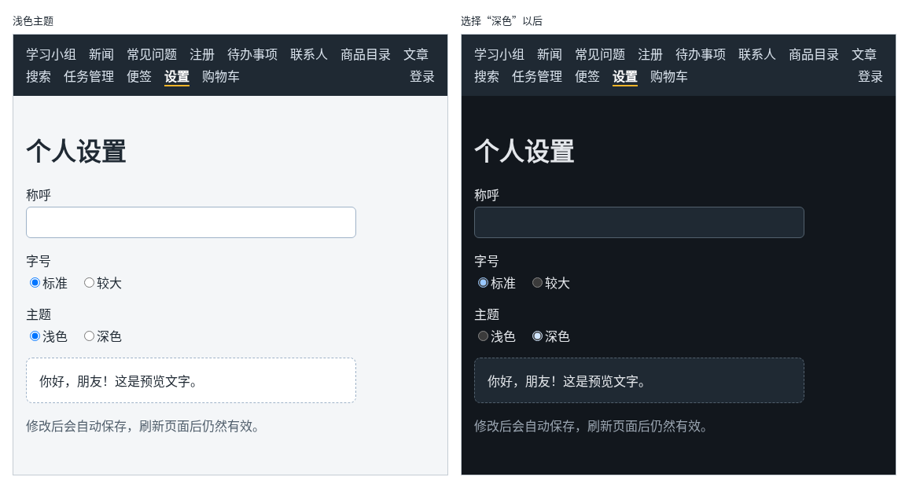

# 第 124 章：如何让主题设置改变整个页面的外观？

前置：[第 123 章：设置变化后，如何自动保存到本地存储？](第123章-设置变化后，如何自动保存到本地存储.md)

## 一、本章要解决的问题

晚上用电脑时，很多人喜欢深色的页面。设置页要能选择“浅色”或“深色”主题，而且选了以后，不只是设置页，整个网站的背景、文字和按钮都要跟着变；刷新页面、打开别的页面，也要保持选好的主题。

本章给设置加上主题，用 CSS 变量让整个页面换色。完成后：在设置页选择“深色”，页面背景马上变成深灰色，文字变成浅色，按钮也变成深色；切换到新闻页、按 F5 刷新，仍然是深色；选回“浅色”，恢复原样。

下图左边是浅色主题，右边是选择“深色”以后的样子：



## 二、必要原理

### CSS 变量：把颜色起个名字

CSS 可以定义**变量**（也叫自定义属性），名字以两个短横线开头，用 `var(名字)` 使用：

```css
:root {
  --color-page: #f4f6f8;
}

body {
  background: var(--color-page);
}
```

`:root` 就是页面最外层的 `html` 元素，在这里定义的变量，整个页面都能使用。

好处是：换主题时，不用一处一处去改颜色，只要换变量的值，所有用到这个变量的地方一起变。

### 按属性切换整套变量

深色主题写成一条规则，选择器是 `[data-theme='dark']`，意思是“带有 `data-theme="dark"` 属性的元素”：

```css
[data-theme='dark'] {
  --color-page: #12171d;
  --color-text: #e4e7eb;
}
```

只要给 `html` 元素加上 `data-theme="dark"`，这里的值就覆盖了 `:root` 中的值，整个页面换成深色。`color-scheme: dark` 再告诉浏览器：输入框、滚动条这类浏览器自己画的部分，也用深色样式。

以 `data-` 开头的属性是 HTML 允许随意添加的自定义属性。在 JavaScript 中，通过元素的 `dataset` 读写它们，`data-theme` 对应 `dataset.theme`：

```tsx
document.documentElement.dataset.theme = 'dark';
```

`document.documentElement` 就是 `html` 元素。这一行写在 `settings.ts` 的 `applyTheme` 函数中。

### 两个地方要设置主题

| 时机 | 写在哪里 | 为什么 |
| --- | --- | --- |
| 页面刚打开 | `main.tsx`，在渲染之前 | 用户可能直接打开新闻页，根本不经过设置页，也要用上保存的主题 |
| 在设置页切换主题 | `SettingsPage` 的 Effect 中 | 让页面外的 `html` 元素跟着 `settings.theme` 变化（第 123 章） |

`main.tsx` 中在 `createRoot(...).render(...)` 之前调用，页面第一次显示时就已经是正确的颜色，不会先闪一下浅色。

Effect 的依赖数组只写 `settings.theme`：改称呼时主题没变，就不用再设置一次。

### 旧的设置缺少 theme

上一章保存在本地存储中的设置没有 `theme`。`isSettings` 现在要求必须有 `theme`，旧的设置检查不通过，会使用默认设置，称呼和字号也回到默认值。这是增加设置项时常见的情况，重新设置一次即可。真实项目中，通常会把读到的旧设置和默认设置合并，只给缺少的项补上默认值。

### 本章只改了一部分颜色

本章把 `App.css` 中的页面背景、文字、按钮，以及设置页自己的颜色改成了变量。其他页面的样式模块中还写着固定的颜色，例如商品卡片的白色背景，在深色主题下它们仍然是白色的。用同样的方法把它们改成变量，就能全部跟着主题变化。

## 三、动手实现

### 第 1 步：设置中加入主题

打开 `src/lib/settings.ts`，在 `Settings` 类型中加一行：

```ts
  theme: 'light' | 'dark';
```

默认设置改为：

```ts
const defaultSettings: Settings = { nickname: '', fontSize: 'normal', theme: 'light' };
```

在 `isSettings` 的最后一个条件后面加上主题的检查：

```ts
    (value.fontSize === 'normal' || value.fontSize === 'large') &&
    'theme' in value &&
    (value.theme === 'light' || value.theme === 'dark')
```

在文件最后加入：

```ts

// 主题写在 html 元素的 data-theme 属性上，App.css 按这个属性切换整套颜色
export function applyTheme(theme: Settings['theme']) {
  document.documentElement.dataset.theme = theme;
}
```

`Settings['theme']` 表示“`Settings` 类型中 `theme` 字段的类型”，也就是 `'light' | 'dark'`。这样主题的取值只在 `Settings` 中写一次。

### 第 2 步：页面打开时就用上保存的主题

打开 `src/main.tsx`，在导入 `App` 的一行下面加入：

```tsx
import { applyTheme, loadSettings } from './lib/settings';
```

在 `const container = ...` 的上面加入：

```tsx
// 页面一打开就用上保存的主题，不用等用户进入设置页
applyTheme(loadSettings().theme);

```

### 第 3 步：设置页中选择主题

打开 `src/pages/SettingsPage.tsx`，把导入设置函数的一行改为：

```tsx
import { applyTheme, loadSettings, saveSettings } from '../lib/settings';
```

在自动保存的 Effect 下面加入：

```tsx

  // 主题变了，马上换掉整个页面的颜色
  useEffect(() => {
    applyTheme(settings.theme);
  }, [settings.theme]);
```

在预览区 `<div className={previewClass}>` 的上面加入主题的单选按钮：

```tsx
        <fieldset className={styles.options}>
          <legend>主题</legend>
          <label>
            <input
              type="radio"
              name="theme"
              checked={settings.theme === 'light'}
              onChange={() => setSettings({ ...settings, theme: 'light' })}
            />
            浅色
          </label>
          <label>
            <input
              type="radio"
              name="theme"
              checked={settings.theme === 'dark'}
              onChange={() => setSettings({ ...settings, theme: 'dark' })}
            />
            深色
          </label>
        </fieldset>
```

### 第 4 步：全局颜色改用变量

打开 `src/App.css`，把开头的 `body` 规则替换为：

```css
:root {
  --color-page: #f4f6f8;
  --color-text: #1f2933;
  --color-muted: #52606d;
  --color-surface: #ffffff;
  --color-hover: #f0f4f8;
  --color-border: #9fb3c8;
}

/* 深色主题只改变量的值，用到变量的地方会自动换颜色 */
[data-theme='dark'] {
  --color-page: #12171d;
  --color-text: #e4e7eb;
  --color-muted: #9aa5b1;
  --color-surface: #1f2933;
  --color-hover: #323f4b;
  --color-border: #52606d;
  color-scheme: dark;
}

body {
  margin: 0;
  font-family: system-ui, sans-serif;
  background: var(--color-page);
  color: var(--color-text);
}
```

再把下面几处写死的颜色换成变量：

- `.page-header p` 和 `.page-footer` 中的 `color: #52606d;` 改为 `color: var(--color-muted);`；
- `button` 中的 `border`、`background`、`color` 三行改为：

```css
  border: 1px solid var(--color-border);
  border-radius: 6px;
  background: var(--color-surface);
  color: var(--color-text);
```

- `button:hover` 中的背景改为 `background: var(--color-hover);`。

导航栏本来就是深色的，不需要改。

### 第 5 步：设置页的颜色改用变量

打开 `src/pages/SettingsPage.module.css`：

- `.field input` 中把 `border` 改为 `1px solid var(--color-border)`，并加上 `background: var(--color-surface);` 和 `color: var(--color-text);`；
- `.preview` 中把 `border` 改为 `1px dashed var(--color-border)`，`background` 改为 `var(--color-surface)`；
- `.hint` 中的颜色改为 `var(--color-muted)`。

改完的完整内容见第六节。

## 四、运行与检查

保持开发服务器运行（`npm.cmd run dev`），保存文件后在浏览器中查看。

1. 打开设置页。如果称呼和字号回到了默认值，这是因为旧的设置中没有主题（第二节），重新设置一次即可。
2. 主题默认是“浅色”。选择“深色”，页面背景变成深灰色，文字变成浅色，输入框、按钮和预览区也变成深色。
3. 点导航中的“新闻”，仍然是深色背景。按 F5 刷新，打开页面的一瞬间就是深色，没有先闪一下浅色。
4. 在 Elements（元素）面板中选中最上面的 `<html>`，它带有 `data-theme="dark"`。在 Styles（样式）中可以看到 `[data-theme='dark']` 规则中的变量。
5. 回到设置页选择“浅色”，页面恢复原样，`data-theme` 变成 `"light"`。
6. 在 Application（应用）面板中查看本地存储，设置中多了 `"theme":"light"`。

最后运行检查，应没有错误：

```powershell
npm.cmd run check
```

**小练习**：把第 95 章商品详情页的卡片（`ProductDetailPage.module.css` 中的 `.card`）改成跟着主题变化：背景用 `var(--color-surface)`，分类和库存的文字用 `var(--color-muted)`。切换到深色主题，打开一件商品的详情页检查。练习后恢复本章代码。

## 五、常见错误

| 现象 | 原因 | 怎么改 |
| --- | --- | --- |
| 在设置页能切换，打开别的页面或刷新后又是浅色 | 只在设置页中调用了 `applyTheme`，页面打开时没有设置 | 在 `main.tsx` 渲染之前调用 `applyTheme(loadSettings().theme)` |
| 选了“深色”，颜色没有变化 | `App.css` 中仍然写着固定的颜色，没有使用变量 | 把颜色改成 `var(--color-…)` |
| 变量的值没有生效，颜色变成了浏览器默认的黑白 | 用的时候名字写错了，例如 `var(--color-pages)` | 变量名和定义时完全一致，包括开头的两个短横线 |
| 切换主题后，某些卡片仍然是白色 | 这些卡片的样式模块中写着固定的 `#ffffff` | 同样改成 `var(--color-surface)` |

## 六、本章完整代码

### `src/lib/settings.ts`

```ts
export type Settings = {
  nickname: string;
  fontSize: 'normal' | 'large';
  theme: 'light' | 'dark';
};

// 本地存储中的名字，整个网站共用同一个存储空间，名字要起得能看出用途
const STORAGE_KEY = 'react-daily-practice.settings';

const defaultSettings: Settings = { nickname: '', fontSize: 'normal', theme: 'light' };

function isSettings(value: unknown): value is Settings {
  return (
    typeof value === 'object' &&
    value !== null &&
    'nickname' in value &&
    typeof value.nickname === 'string' &&
    'fontSize' in value &&
    (value.fontSize === 'normal' || value.fontSize === 'large') &&
    'theme' in value &&
    (value.theme === 'light' || value.theme === 'dark')
  );
}

export function loadSettings(): Settings {
  const text = localStorage.getItem(STORAGE_KEY);
  if (text === null) {
    return defaultSettings;
  }
  try {
    const data: unknown = JSON.parse(text);
    if (isSettings(data)) {
      return data;
    }
  } catch {
    // 内容不是有效的 JSON，按没有保存过处理
  }
  return defaultSettings;
}

export function saveSettings(settings: Settings) {
  localStorage.setItem(STORAGE_KEY, JSON.stringify(settings));
}

// 主题写在 html 元素的 data-theme 属性上，App.css 按这个属性切换整套颜色
export function applyTheme(theme: Settings['theme']) {
  document.documentElement.dataset.theme = theme;
}
```

### `src/main.tsx`

```tsx
import { StrictMode } from 'react';
import { createRoot } from 'react-dom/client';
import { BrowserRouter } from 'react-router';
import App from './App';
import { applyTheme, loadSettings } from './lib/settings';

// 页面一打开就用上保存的主题，不用等用户进入设置页
applyTheme(loadSettings().theme);

const container = document.getElementById('root');

if (!container) {
  throw new Error('找不到 id 为 root 的页面容器');
}

createRoot(container).render(
  <StrictMode>
    <BrowserRouter>
      <App />
    </BrowserRouter>
  </StrictMode>,
);
```

### `src/pages/SettingsPage.tsx`

```tsx
import { useEffect, useState } from 'react';
import { applyTheme, loadSettings, saveSettings } from '../lib/settings';
import type { Settings } from '../lib/settings';
import styles from './SettingsPage.module.css';

export default function SettingsPage() {
  // 传入函数而不是调用结果：只在第一次渲染时读取一次本地存储
  const [settings, setSettings] = useState<Settings>(loadSettings);
  const previewClass =
    settings.fontSize === 'large' ? styles.preview + ' ' + styles.large : styles.preview;
  const displayName = settings.nickname.trim() === '' ? '朋友' : settings.nickname.trim();

  // settings 每次变化都保存一次，用户不需要再点按钮
  useEffect(() => {
    saveSettings(settings);
  }, [settings]);

  // 主题变了，马上换掉整个页面的颜色
  useEffect(() => {
    applyTheme(settings.theme);
  }, [settings.theme]);

  return (
    <main className="page">
      <title>个人设置</title>
      <h1>个人设置</h1>
      <div className={styles.form}>
        <div className={styles.field}>
          <label htmlFor="nickname">称呼</label>
          <input
            id="nickname"
            value={settings.nickname}
            onChange={(event) => setSettings({ ...settings, nickname: event.target.value })}
          />
        </div>
        <fieldset className={styles.options}>
          <legend>字号</legend>
          <label>
            <input
              type="radio"
              name="fontSize"
              checked={settings.fontSize === 'normal'}
              onChange={() => setSettings({ ...settings, fontSize: 'normal' })}
            />
            标准
          </label>
          <label>
            <input
              type="radio"
              name="fontSize"
              checked={settings.fontSize === 'large'}
              onChange={() => setSettings({ ...settings, fontSize: 'large' })}
            />
            较大
          </label>
        </fieldset>
        <fieldset className={styles.options}>
          <legend>主题</legend>
          <label>
            <input
              type="radio"
              name="theme"
              checked={settings.theme === 'light'}
              onChange={() => setSettings({ ...settings, theme: 'light' })}
            />
            浅色
          </label>
          <label>
            <input
              type="radio"
              name="theme"
              checked={settings.theme === 'dark'}
              onChange={() => setSettings({ ...settings, theme: 'dark' })}
            />
            深色
          </label>
        </fieldset>
        <div className={previewClass}>你好，{displayName}！这是预览文字。</div>
        <p className={styles.hint}>修改后会自动保存，刷新页面后仍然有效。</p>
      </div>
    </main>
  );
}
```

### `src/App.css`

```css
:root {
  --color-page: #f4f6f8;
  --color-text: #1f2933;
  --color-muted: #52606d;
  --color-surface: #ffffff;
  --color-hover: #f0f4f8;
  --color-border: #9fb3c8;
}

/* 深色主题只改变量的值，用到变量的地方会自动换颜色 */
[data-theme='dark'] {
  --color-page: #12171d;
  --color-text: #e4e7eb;
  --color-muted: #9aa5b1;
  --color-surface: #1f2933;
  --color-hover: #323f4b;
  --color-border: #52606d;
  color-scheme: dark;
}

body {
  margin: 0;
  font-family: system-ui, sans-serif;
  background: var(--color-page);
  color: var(--color-text);
}

.page {
  max-width: 960px;
  margin: 0 auto;
  padding: 24px 16px;
}

.page-header p {
  color: var(--color-muted);
}

.page-footer {
  margin-top: 24px;
  padding-top: 16px;
  border-top: 1px solid #d9e2ec;
  color: var(--color-muted);
}

.card-list {
  display: flex;
  flex-wrap: wrap;
  gap: 16px;
  margin-top: 16px;
}

.card-list > * {
  flex: 1 1 200px;
}

button {
  padding: 6px 14px;
  border: 1px solid var(--color-border);
  border-radius: 6px;
  background: var(--color-surface);
  color: var(--color-text);
  font: inherit;
  cursor: pointer;
}

button:hover {
  background: var(--color-hover);
}

button:disabled {
  cursor: not-allowed;
  opacity: 0.5;
}

.site-nav {
  display: flex;
  flex-wrap: wrap;
  gap: 4px 16px;
  padding: 12px 16px;
  background: #1f2933;
}

.site-nav a {
  color: #d9e2ec;
  text-decoration: none;
}

.site-nav a:hover {
  color: #ffffff;
  text-decoration: underline;
}

.site-nav .nav-user {
  margin-left: auto;
  color: #d9e2ec;
}

.site-nav .nav-logout {
  padding: 0;
  border: 0;
  background: transparent;
  color: #d9e2ec;
}

.site-nav .nav-logout:hover {
  color: #ffffff;
  text-decoration: underline;
}

.site-nav a.active {
  color: #ffffff;
  font-weight: bold;
  border-bottom: 2px solid #f0b429;
}

.cart-count {
  display: inline-block;
  min-width: 18px;
  margin-left: 4px;
  padding: 0 5px;
  border-radius: 9px;
  background: #f0b429;
  color: #1f2933;
  font-size: 12px;
  font-weight: bold;
  line-height: 18px;
  text-align: center;
}
```

### `src/pages/SettingsPage.module.css`

```css
.form {
  display: flex;
  flex-direction: column;
  gap: 16px;
  max-width: 420px;
}

.field {
  display: flex;
  flex-direction: column;
  gap: 4px;
}

.field input {
  padding: 8px 10px;
  border: 1px solid var(--color-border);
  border-radius: 6px;
  background: var(--color-surface);
  color: var(--color-text);
  font: inherit;
}

.options {
  display: flex;
  gap: 16px;
  margin: 0;
  padding: 0;
  border: 0;
}

.options legend {
  margin-bottom: 4px;
  padding: 0;
}

.preview {
  padding: 16px;
  border: 1px dashed var(--color-border);
  border-radius: 8px;
  background: var(--color-surface);
}

.large {
  font-size: 22px;
}

.hint {
  margin: 0;
  color: var(--color-muted);
}
```

## 七、本章改动小结

修改 `src/lib/settings.ts`：设置中加入主题，新增 `applyTheme`；修改 `src/main.tsx`：页面打开时就用上保存的主题；修改 `src/pages/SettingsPage.tsx`：可以选择主题，主题变化时立刻应用；修改 `src/App.css` 和 `src/pages/SettingsPage.module.css`：颜色改用 CSS 变量，并定义深色主题的变量值。

---

下一章：[第 125 章：如何在窗口大小变化时更新页面？](第125章-如何在窗口大小变化时更新页面.md)
