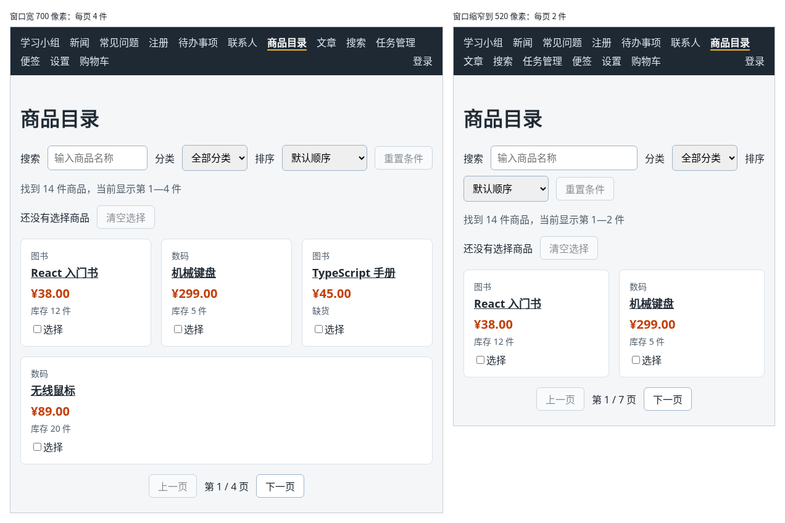

# 第 125 章：如何在窗口大小变化时更新页面？

前置：[第 124 章：如何让主题设置改变整个页面的外观？](第124章-如何让主题设置改变整个页面的外观.md)

## 一、本章要解决的问题

商品目录每页显示 4 件商品。在电脑上一屏刚好放下；在手机上卡片变成一列，4 件要往下翻好几屏才能看到分页按钮。手机上每页显示 2 件更合适。

“窄屏时卡片排成一列”可以用 CSS 做到（第 13 章），但“每页显示几件”是程序中的数字，CSS 改不了，要让程序知道窗口现在有多宽。本章写一个自定义 Hook `useWindowWidth`，在窗口大小变化时更新页面。完成后：窗口宽度小于 640 像素时，商品目录每页 2 件，共 7 页；拉宽窗口，马上变回每页 4 件，共 4 页；如果缩窄时翻到了第 7 页，拉宽后显示第 4 页，不会出现空白页。

下图左边是窗口宽 700 像素时的样子，右边是缩窄到 520 像素以后的样子：



## 二、必要原理

### 窗口宽度和 resize 事件

`window.innerWidth` 是浏览器窗口内容区的宽度，单位是像素。窗口大小改变时，浏览器会在 `window` 上触发 `resize` 事件。

`window` 不是 React 画出来的元素，不能写 `onResize`，要用浏览器提供的方法自己监听：

```tsx
window.addEventListener('resize', handleResize);
window.removeEventListener('resize', handleResize);
```

`addEventListener` 开始监听：每次触发都调用 `handleResize`；`removeEventListener` 取消监听，要传入同一个函数。

### 在 Effect 中监听，在清理函数中取消

“组件显示期间一直监听，离开时停止”，和第 81 章的定时器是一样的结构：

```tsx
useEffect(() => {
  window.addEventListener('resize', handleResize);
  return () => {
    window.removeEventListener('resize', handleResize);
  };
}, []);
```

如果忘了在清理函数中取消，组件每出现一次就多一个监听：离开商品目录再回来，窗口每变一次，`handleResize` 就会被调用好几次，其中一些还在更新已经离开页面的组件。

窗口大小变化时，`handleResize` 把新的宽度存进 state，组件随之重新渲染，用的就是新的宽度。

### 提取成自定义 Hook

“读窗口宽度并跟着变化”和具体的页面无关，任何组件都可能用到，所以和第 83 章的 `useDebouncedValue` 一样，提取成自定义 Hook，组件中只写一行：

```tsx
const pageSize = useWindowWidth() < 640 ? 2 : 4;
```

state 的初始值直接写 `window.innerWidth`，组件第一次显示时就是正确的宽度。

### 页码超出范围时显示最后一页

缩窄窗口时翻到第 7 页，再拉宽，总页数变成 4 页，可 `page` 仍然是 7，这一页没有商品。

可以在 Effect 中检测并修改 `page`，但这会让页面先显示一次空白，再改正。更简单的办法是在渲染时算出实际显示的页码（第 32 章）：

```tsx
const currentPage = Math.min(page, pageCount);
```

`Math.min` 取两个数中较小的一个。页面上显示、翻页按钮计算用的都是 `currentPage`。

### 什么时候不需要监听窗口

只是外观随窗口变化，例如变成一列、字变小、隐藏某块内容，优先用 CSS 的 `@media`（第 13 章）：不需要写代码，也不会让组件重新渲染。只有程序中的数据或逻辑要跟着窗口变，才需要本章的写法。

## 三、动手实现

### 第 1 步：写读取窗口宽度的 Hook

新建 `src/hooks/useWindowWidth.ts`：

```ts
import { useEffect, useState } from 'react';

export function useWindowWidth() {
  const [width, setWidth] = useState(window.innerWidth);

  useEffect(() => {
    function handleResize() {
      setWidth(window.innerWidth);
    }

    window.addEventListener('resize', handleResize);
    // 组件离开页面时取消监听，否则窗口一变就会去更新一个已经不在的组件
    return () => {
      window.removeEventListener('resize', handleResize);
    };
  }, []);

  return width;
}
```

`handleResize` 写在 Effect 里面，添加和取消用的是同一个函数。

### 第 2 步：商品目录按窗口宽度决定每页件数

打开 `src/pages/ProductPage.tsx`，在导入 `formatPrice` 的一行上面加入：

```tsx
import { useWindowWidth } from '../hooks/useWindowWidth';
```

删掉文件开头的 `const PAGE_SIZE = 4;`。在 `page` 那一行的下面加入：

```tsx
  // 窄屏上一屏放不下 4 件，每页只显示 2 件
  const pageSize = useWindowWidth() < 640 ? 2 : 4;
```

把计算分页的三行改为：

```tsx
  const pageCount = Math.max(1, Math.ceil(visibleProducts.length / pageSize));
  // 窗口变宽后总页数变少，原来的页码可能超出范围，这时显示最后一页
  const currentPage = Math.min(page, pageCount);
  const startIndex = (currentPage - 1) * pageSize;
  const pageProducts = visibleProducts.slice(startIndex, startIndex + pageSize);
```

### 第 3 步：分页按钮使用 currentPage

把分页导航中的两个按钮和页码改为：

```tsx
        <button
          type="button"
          disabled={currentPage === 1}
          onClick={() => setPage(currentPage - 1)}
        >
          上一页
        </button>
        <span>
          第 {currentPage} / {pageCount} 页
        </span>
        <button
          type="button"
          disabled={currentPage === pageCount}
          onClick={() => setPage(currentPage + 1)}
        >
          下一页
        </button>
```

翻页也从 `currentPage` 算起：在第 4 页（实际 `page` 还是 7）点“上一页”，应该到第 3 页，而不是第 6 页。

## 四、运行与检查

保持开发服务器运行（`npm.cmd run dev`），保存文件后在浏览器中查看。

1. 打开商品目录，窗口较宽时显示“当前显示第 1—4 件”和“第 1 / 4 页”。
2. 慢慢缩窄窗口，宽度小于 640 像素的一刻，变成“第 1—2 件”和“第 1 / 7 页”。也可以按 F12 打开手机模式（Device Toolbar），在上方输入宽度来调整。
3. 在窄屏下一直点“下一页”，翻到“第 7 / 7 页”，显示第 13—14 件。
4. 拉宽窗口，显示“第 4 / 4 页”和第 13—14 件，不是空白页。点“上一页”，到“第 3 / 4 页”，显示第 9—12 件。
5. 搜索、分类、排序仍然正常，改变条件后回到第 1 页。

最后运行检查，应没有错误：

```powershell
npm.cmd run check
```

**小练习**：在设置页的预览区下面显示“当前窗口宽度：X 像素”，拖动窗口时数字跟着变化。只需要在 `SettingsPage` 中调用 `useWindowWidth()`。练习后恢复本章代码。

## 五、常见错误

| 现象 | 原因 | 怎么改 |
| --- | --- | --- |
| 离开商品目录再回来几次后，窗口每变一次，`handleResize` 被调用好几次 | 清理函数中没有取消监听，每次出现都多了一个 | 在清理函数中调用 `removeEventListener` |
| 写了取消监听，但没有效果 | 添加和取消传的不是同一个函数，例如两处各写了一个箭头函数 | 先定义 `handleResize`，两处都传它 |
| 窗口拉宽后，商品目录显示一个空白页 | 用的还是 `page`，超出了新的总页数 | 用 `Math.min(page, pageCount)` 算出实际页码 |
| 宽度只在打开页面时读一次，拖动窗口不变 | 直接写 `const width = window.innerWidth;`，没有监听 `resize`，也没有放进 state | 使用 `useWindowWidth` |

## 六、本章完整代码

### `src/hooks/useWindowWidth.ts`

同第三节第 1 步。

### `src/pages/ProductPage.tsx`

```tsx
import { useState } from 'react';
import type { ChangeEvent } from 'react';
import { Link, useSearchParams } from 'react-router';
import { categories, products } from '../data/products';
import { useWindowWidth } from '../hooks/useWindowWidth';
import { formatPrice } from '../lib/format';
import styles from './ProductPage.module.css';


export default function ProductPage() {
  const [searchParams, setSearchParams] = useSearchParams();
  const keyword = searchParams.get('q') ?? '';
  const [category, setCategory] = useState('all');
  const [sortOrder, setSortOrder] = useState('default');
  const [page, setPage] = useState(1);
  // 窄屏上一屏放不下 4 件，每页只显示 2 件
  const pageSize = useWindowWidth() < 640 ? 2 : 4;
  const [selectedIds, setSelectedIds] = useState<number[]>([]);
  const normalizedKeyword = keyword.trim().toLowerCase();
  const filteredProducts = products.filter((product) => {
    const matchesKeyword = product.name.toLowerCase().includes(normalizedKeyword);
    const matchesCategory = category === 'all' || product.category === category;
    return matchesKeyword && matchesCategory;
  });
  const visibleProducts = [...filteredProducts];
  if (sortOrder === 'price-asc') {
    visibleProducts.sort((a, b) => a.price - b.price);
  } else if (sortOrder === 'price-desc') {
    visibleProducts.sort((a, b) => b.price - a.price);
  }
  const pageCount = Math.max(1, Math.ceil(visibleProducts.length / pageSize));
  // 窗口变宽后总页数变少，原来的页码可能超出范围，这时显示最后一页
  const currentPage = Math.min(page, pageCount);
  const startIndex = (currentPage - 1) * pageSize;
  const pageProducts = visibleProducts.slice(startIndex, startIndex + pageSize);
  const pageTitle = keyword === '' ? '商品目录' : '搜索“' + keyword + '” - 商品目录';
  const hasConditions = keyword !== '' || category !== 'all' || sortOrder !== 'default';
  const selectedNames = products
    .filter((product) => selectedIds.includes(product.id))
    .map((product) => product.name);

  function handleKeywordChange(event: ChangeEvent<HTMLInputElement>) {
    const value = event.target.value;
    // 每输入一个字都新增一条历史记录，“后退”就要按很多次，所以替换当前这一条
    setSearchParams(value === '' ? {} : { q: value }, { replace: true });
    setPage(1);
  }

  function handleCategoryChange(event: ChangeEvent<HTMLSelectElement>) {
    setCategory(event.target.value);
    setPage(1);
  }

  function handleSortChange(event: ChangeEvent<HTMLSelectElement>) {
    setSortOrder(event.target.value);
    setPage(1);
  }

  function isSelected(id: number) {
    return selectedIds.includes(id);
  }

  function handleReset() {
    setSearchParams({});
    setCategory('all');
    setSortOrder('default');
    setPage(1);
  }

  function handleSelectChange(id: number) {
    if (isSelected(id)) {
      setSelectedIds(selectedIds.filter((selectedId) => selectedId !== id));
    } else {
      setSelectedIds([...selectedIds, id]);
    }
  }

  return (
    <main className="page">
      <title>{pageTitle}</title>
      <h1>商品目录</h1>
      <div className={styles.filters}>
        <label htmlFor="keyword">搜索</label>
        <input
          id="keyword"
          type="search"
          placeholder="输入商品名称"
          value={keyword}
          onChange={handleKeywordChange}
        />
        <label htmlFor="category">分类</label>
        <select id="category" value={category} onChange={handleCategoryChange}>
          <option value="all">全部分类</option>
          {categories.map((item) => (
            <option key={item} value={item}>
              {item}
            </option>
          ))}
        </select>
        <label htmlFor="sort">排序</label>
        <select id="sort" value={sortOrder} onChange={handleSortChange}>
          <option value="default">默认顺序</option>
          <option value="price-asc">价格从低到高</option>
          <option value="price-desc">价格从高到低</option>
        </select>
        <button type="button" disabled={!hasConditions} onClick={handleReset}>
          重置条件
        </button>
      </div>
      <p className={styles.summary}>
        找到 {visibleProducts.length} 件商品
        {visibleProducts.length > 0 && (
          <span>
            ，当前显示第 {startIndex + 1}—{startIndex + pageProducts.length} 件
          </span>
        )}
      </p>
      <div className={styles.selection}>
        <span>
          {selectedIds.length === 0
            ? '还没有选择商品'
            : '已选 ' + selectedIds.length + ' 件：' + selectedNames.join('、')}
        </span>
        <button
          type="button"
          disabled={selectedIds.length === 0}
          onClick={() => setSelectedIds([])}
        >
          清空选择
        </button>
      </div>
      {visibleProducts.length === 0 ? (
        <p className={styles.empty}>没有找到符合条件的商品。</p>
      ) : (
        <ul className={styles.list}>
          {pageProducts.map((product) => (
            <li
              key={product.id}
              className={isSelected(product.id) ? styles.item + ' ' + styles.selected : styles.item}
            >
              <p className={styles.category}>{product.category}</p>
              <h2 className={styles.name}>
                <Link to={'/products/' + product.id}>{product.name}</Link>
              </h2>
              <p className={styles.price}>{formatPrice(product.price)}</p>
              <p className={styles.stock}>
                {product.stock === 0 ? '缺货' : '库存 ' + product.stock + ' 件'}
              </p>
              <label className={styles.select}>
                <input
                  type="checkbox"
                  aria-label={'选择：' + product.name}
                  checked={isSelected(product.id)}
                  onChange={() => handleSelectChange(product.id)}
                />
                选择
              </label>
            </li>
          ))}
        </ul>
      )}
      <nav className={styles.pagination} aria-label="分页">
        <button
          type="button"
          disabled={currentPage === 1}
          onClick={() => setPage(currentPage - 1)}
        >
          上一页
        </button>
        <span>
          第 {currentPage} / {pageCount} 页
        </span>
        <button
          type="button"
          disabled={currentPage === pageCount}
          onClick={() => setPage(currentPage + 1)}
        >
          下一页
        </button>
      </nav>
    </main>
  );
}
```

## 七、本章改动小结

新增 `src/hooks/useWindowWidth.ts`：监听窗口大小变化，返回当前宽度；修改 `src/pages/ProductPage.tsx`：每页件数随窗口宽度变化，页码超出范围时显示最后一页。

---

下一章：[第 126 章：为什么定时器中读到的状态可能一直是旧值？](第126章-为什么定时器中读到的状态可能一直是旧值.md)
