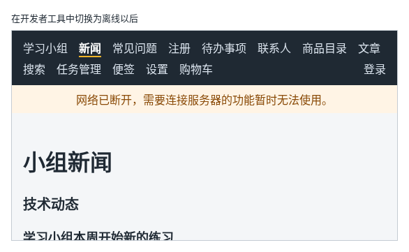

# 第 127 章：如何让页面显示浏览器当前是否联网？

前置：[第 126 章：为什么定时器中读到的状态可能一直是旧值？](第126章-为什么定时器中读到的状态可能一直是旧值.md)

## 一、本章要解决的问题

笔记本电脑换了个会议室，无线网络断了，用户还在任务管理页点“添加”，结果只得到一条“无法连接练习服务”。如果页面能在断网时马上告诉他“网络已断开”，他就知道问题出在哪里，不会以为是网站坏了。

本章写一个自定义 Hook `useOnlineStatus`，在导航栏下方显示断网提示。完成后：网络正常时什么也不显示；断开网络的一瞬间，导航栏下方出现一条橙色提示“网络已断开，需要连接服务器的功能暂时无法使用。”，不论在哪个页面；网络恢复后提示自动消失。

下图是在开发者工具中切换为离线以后的样子：



## 二、必要原理

### navigator.onLine 和两个事件

浏览器用 `navigator.onLine` 表示当前是否联网：`true` 是联网，`false` 是断网。网络状态改变时，浏览器在 `window` 上触发事件：

| 事件 | 什么时候触发 |
| --- | --- |
| `online` | 从断网变为联网 |
| `offline` | 从联网变为断网 |

这和第 125 章的 `resize` 一样：初始值从 `navigator.onLine` 读，之后在 Effect 中监听两个事件，在清理函数中取消监听。所以写法几乎相同，只是监听的事件有两个。

### “联网”指的是什么

`navigator.onLine` 为 `true` 只说明电脑连上了某个网络，例如连上了无线路由器，并不保证一定能访问到服务器：路由器可能没接外网，服务器也可能停了。所以它适合用来给出“网络已断开”这类明确的提示；请求本身能不能成功，仍然要按第 62A、65 章的方法处理失败。

### 提示放在布局组件中

断网和具体页面无关，所以提示写在 `AppLayout` 中、导航栏和 `Outlet` 之间，所有带导航栏的页面都能看到。提示用 `role="status"`，读屏软件会在它出现时读出来（第 41 章）。

### 在开发者工具中模拟断网

不用真的拔网线：在开发者工具的 Network（网络）面板中，把上方的“No throttling”（不限速）下拉框改成“Offline”（离线），页面就会收到 `offline` 事件；改回“No throttling”，收到 `online` 事件。

## 三、动手实现

### 第 1 步：写读取联网状态的 Hook

新建 `src/hooks/useOnlineStatus.ts`：

```ts
import { useEffect, useState } from 'react';

export function useOnlineStatus() {
  const [online, setOnline] = useState(navigator.onLine);

  useEffect(() => {
    function handleOnline() {
      setOnline(true);
    }

    function handleOffline() {
      setOnline(false);
    }

    window.addEventListener('online', handleOnline);
    window.addEventListener('offline', handleOffline);
    return () => {
      window.removeEventListener('online', handleOnline);
      window.removeEventListener('offline', handleOffline);
    };
  }, []);

  return online;
}
```

### 第 2 步：在导航栏下方显示提示

打开 `src/components/AppLayout.tsx`，在导入 `useCart` 的一行下面加入：

```tsx
import { useOnlineStatus } from '../hooks/useOnlineStatus';
```

在 `const { cartItems } = useCart();` 的下面加入：

```tsx
  const online = useOnlineStatus();
```

在 `</nav>` 和 `<Outlet />` 之间加入：

```tsx
      {!online && (
        <p role="status" className="offline-banner">
          网络已断开，需要连接服务器的功能暂时无法使用。
        </p>
      )}
```

### 第 3 步：提示的样式

打开 `src/App.css`，在文件最后加入：

```css

.offline-banner {
  margin: 0;
  padding: 8px 16px;
  background: #fff4e5;
  color: #8a4b08;
  text-align: center;
}
```

## 四、运行与检查

保持开发服务器运行（`npm.cmd run dev`），保存文件后在浏览器中查看。

1. 打开新闻页，导航栏下方没有提示。
2. 在 Network（网络）面板中把“No throttling”改成“Offline”。导航栏下方立刻出现“网络已断开，需要连接服务器的功能暂时无法使用。”。
3. 断网时点导航中的其他页面，提示一直在。页面本身的代码已经下载过了，换页仍然可以，需要请求接口的页面会显示读取失败。
4. 把“Offline”改回“No throttling”，提示马上消失。
5. 如果开发服务器和页面都在同一台电脑上，断网时开发服务器不受影响；本章的提示反映的是浏览器的网络状态。

最后运行检查，应没有错误：

```powershell
npm.cmd run check
```

**小练习**：断网时，把任务管理页（第 85 章）的“添加”按钮禁用，并把按钮文字改成“已断网”。提示：在 `TaskServerPage` 中也调用 `useOnlineStatus()`。练习后恢复本章代码。

### 阶段回顾

第 15 部分的个人设置页完成了：用本地存储在刷新后恢复设置、设置变化后自动保存、用 CSS 变量切换整个页面的主题、在窗口大小变化时更新页面、用更新函数避免定时器中的旧值，以及显示浏览器是否联网。

## 五、常见错误

| 现象 | 原因 | 怎么改 |
| --- | --- | --- |
| 打开页面时已经断网，却没有提示，要等网络变化一次才显示 | state 的初始值写成了 `true`，没有读 `navigator.onLine` | 初始值写 `navigator.onLine` |
| 网络恢复后，提示不消失 | 只监听了 `offline`，没有监听 `online` | 两个事件都要监听 |
| 显示“联网”，请求却仍然失败 | `navigator.onLine` 只表示连上了网络，不保证服务器能访问 | 请求失败照常按第 65 章处理，联网状态只作提示 |

## 六、本章完整代码

### `src/hooks/useOnlineStatus.ts`

同第三节第 1 步。

### `src/components/AppLayout.tsx`

```tsx
import { useState } from 'react';
import { NavLink, Outlet } from 'react-router';
import { useAuth } from '../hooks/useAuth';
import { useCart } from '../hooks/useCart';
import { useOnlineStatus } from '../hooks/useOnlineStatus';
import { logout } from '../lib/authApi';

export default function AppLayout() {
  const { user, checking, setUser } = useAuth();
  const [isLoggingOut, setIsLoggingOut] = useState(false);
  const { cartItems } = useCart();
  const online = useOnlineStatus();
  let cartCount = 0;
  for (const item of cartItems) {
    cartCount += item.quantity;
  }

  async function handleLogout() {
    setIsLoggingOut(true);
    try {
      // 先让服务器删除登录记录，否则刷新页面后又会自动登录
      await logout();
      // 当前页面如果需要登录，RequireAuth 会自动把人送去登录页
      setUser(null);
    } catch (error) {
      window.alert(error instanceof Error ? error.message : '退出失败，请稍后重试。');
    } finally {
      setIsLoggingOut(false);
    }
  }

  return (
    <div>
      <nav className="site-nav" aria-label="主导航">
        <NavLink to="/">学习小组</NavLink>
        <NavLink to="/news">新闻</NavLink>
        <NavLink to="/faq">常见问题</NavLink>
        <NavLink to="/register">注册</NavLink>
        <NavLink to="/todos">待办事项</NavLink>
        <NavLink to="/contacts">联系人</NavLink>
        <NavLink to="/products">商品目录</NavLink>
        <NavLink to="/articles">文章</NavLink>
        <NavLink to="/search">搜索</NavLink>
        <NavLink to="/tasks">任务管理</NavLink>
        <NavLink to="/notes">便签</NavLink>
        <NavLink to="/settings">设置</NavLink>
        <NavLink to="/shop">
          购物车
          {cartCount > 0 && (
            <span className="cart-count" aria-label={'购物车中有 ' + cartCount + ' 件商品'}>
              {cartCount}
            </span>
          )}
        </NavLink>
        {/* 确认登录状态期间什么也不显示，避免先闪一下“登录”再变成用户名 */}
        {!checking && user && (
          <NavLink to="/account" className="nav-user">
            {user.displayName}
          </NavLink>
        )}
        {!checking && user && (
          <button
            type="button"
            className="nav-logout"
            disabled={isLoggingOut}
            onClick={handleLogout}
          >
            {isLoggingOut ? '正在退出……' : '退出'}
          </button>
        )}
        {!checking && !user && (
          <NavLink to="/login" className="nav-user">
            登录
          </NavLink>
        )}
      </nav>
      {!online && (
        <p role="status" className="offline-banner">
          网络已断开，需要连接服务器的功能暂时无法使用。
        </p>
      )}
      <Outlet />
    </div>
  );
}
```

### `src/App.css`

```css
:root {
  --color-page: #f4f6f8;
  --color-text: #1f2933;
  --color-muted: #52606d;
  --color-surface: #ffffff;
  --color-hover: #f0f4f8;
  --color-border: #9fb3c8;
}

/* 深色主题只改变量的值，用到变量的地方会自动换颜色 */
[data-theme='dark'] {
  --color-page: #12171d;
  --color-text: #e4e7eb;
  --color-muted: #9aa5b1;
  --color-surface: #1f2933;
  --color-hover: #323f4b;
  --color-border: #52606d;
  color-scheme: dark;
}

body {
  margin: 0;
  font-family: system-ui, sans-serif;
  background: var(--color-page);
  color: var(--color-text);
}

.page {
  max-width: 960px;
  margin: 0 auto;
  padding: 24px 16px;
}

.page-header p {
  color: var(--color-muted);
}

.page-footer {
  margin-top: 24px;
  padding-top: 16px;
  border-top: 1px solid #d9e2ec;
  color: var(--color-muted);
}

.card-list {
  display: flex;
  flex-wrap: wrap;
  gap: 16px;
  margin-top: 16px;
}

.card-list > * {
  flex: 1 1 200px;
}

button {
  padding: 6px 14px;
  border: 1px solid var(--color-border);
  border-radius: 6px;
  background: var(--color-surface);
  color: var(--color-text);
  font: inherit;
  cursor: pointer;
}

button:hover {
  background: var(--color-hover);
}

button:disabled {
  cursor: not-allowed;
  opacity: 0.5;
}

.site-nav {
  display: flex;
  flex-wrap: wrap;
  gap: 4px 16px;
  padding: 12px 16px;
  background: #1f2933;
}

.site-nav a {
  color: #d9e2ec;
  text-decoration: none;
}

.site-nav a:hover {
  color: #ffffff;
  text-decoration: underline;
}

.site-nav .nav-user {
  margin-left: auto;
  color: #d9e2ec;
}

.site-nav .nav-logout {
  padding: 0;
  border: 0;
  background: transparent;
  color: #d9e2ec;
}

.site-nav .nav-logout:hover {
  color: #ffffff;
  text-decoration: underline;
}

.site-nav a.active {
  color: #ffffff;
  font-weight: bold;
  border-bottom: 2px solid #f0b429;
}

.cart-count {
  display: inline-block;
  min-width: 18px;
  margin-left: 4px;
  padding: 0 5px;
  border-radius: 9px;
  background: #f0b429;
  color: #1f2933;
  font-size: 12px;
  font-weight: bold;
  line-height: 18px;
  text-align: center;
}

.offline-banner {
  margin: 0;
  padding: 8px 16px;
  background: #fff4e5;
  color: #8a4b08;
  text-align: center;
}
```

## 七、本章改动小结

新增 `src/hooks/useOnlineStatus.ts`：读取并监听浏览器的联网状态；修改 `src/components/AppLayout.tsx`：断网时在导航栏下方显示提示；修改 `src/App.css`：新增断网提示的样式。

---

下一章：[第 128 章：上传之前，如何预览用户选择的图片？](第128章-上传之前，如何预览用户选择的图片.md)
