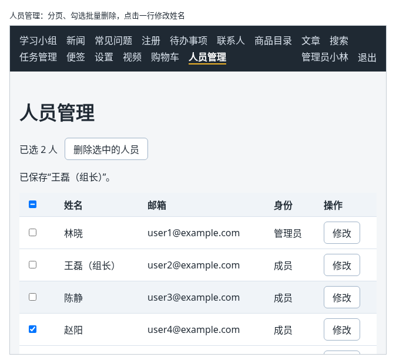
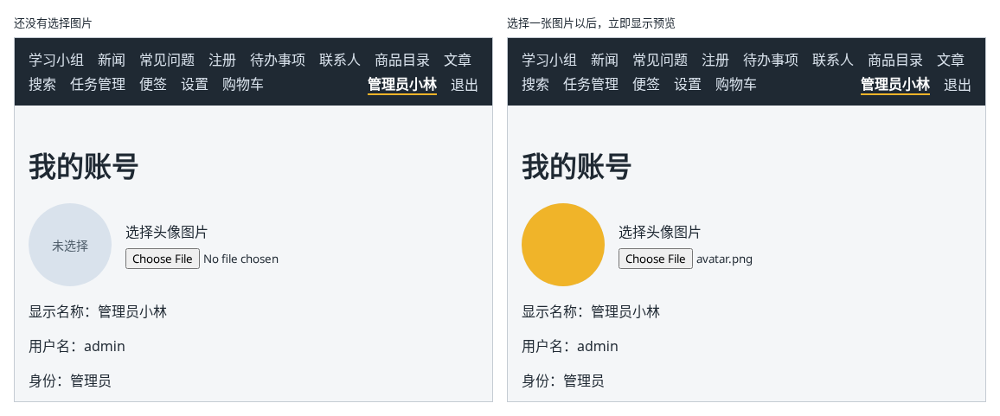

# 第 128 章：上传之前，如何预览用户选择的图片？

前置：[第 127 章：如何让页面显示浏览器当前是否联网？](第127章-如何让页面显示浏览器当前是否联网.md)

## 一、本章要解决的问题

“我的账号”页要能换头像。用户从电脑里选了一张图片，在真正上传之前，应该先看到这张图片做成头像是什么样子，选错了还能重选。如果要等上传完才能看到，选错一次就要多传一次。

本章在“我的账号”页加一个选择头像的区域，选好图片后立即显示圆形的预览。完成后：没有选择时，圆形区域显示“未选择”；选择一张图片，圆形区域马上显示这张图片；换一张，预览跟着换；整个过程都还没有向服务器发送任何内容。

本章是第 16 部分的起点。学完第 16 部分（第 128—134 章）时，效果如下图：可以检查并上传头像；可以上传大视频，看到上传进度并随时取消；管理员可以分页查看人员列表，勾选多人批量删除，点击一行在弹窗中修改姓名。



下图左边是还没有选择图片的样子，右边是选择一张图片以后的样子：



## 二、必要原理

### 文件选择框

`<input type="file">` 是文件选择框，点击后弹出系统的“打开文件”窗口。`accept` 属性告诉这个窗口只显示哪些类型的文件：

```tsx
<input type="file" accept="image/png,image/jpeg,image/webp" />
```

`accept` 只是让选择窗口默认筛选，用户仍然可以切换成“所有文件”，选一个别的类型。下一章会在程序中再检查一次。

文件选择框不能做成受控的：出于安全考虑，页面不能用代码往里面填一个文件。所以不写 `value`，只写 `onChange`。

### 从事件中取出文件

选择文件后，`event.target.files` 是一个文件列表，类型是 `FileList | null`。只选了一个文件时，它就是 `files[0]`，类型是 `File`。用户在选择窗口中点了“取消”，或者清空了选择，列表可能是 `null` 或者长度为 0，要先判断。

### 用临时地址显示还没上传的图片

`img` 的 `src` 需要一个地址，而用户选的文件还在他自己的电脑上，没有网址。`URL.createObjectURL(file)` 为这个文件生成一个临时地址，形如 `blob:http://127.0.0.1:5173/5d4…`。这个地址只在当前页面中有效，`img` 可以直接显示它：

```tsx
setPreviewUrl(URL.createObjectURL(files[0]));
```

### 用完要释放

每生成一个临时地址，浏览器就要把这个文件留在内存中，直到页面关闭，或者调用 `URL.revokeObjectURL(地址)` 释放它。用户反复换图片时，旧的地址应该及时释放。

释放写在 Effect 的清理函数中，依赖数组是 `[previewUrl]`：

```tsx
useEffect(() => {
  return () => {
    if (previewUrl) {
      URL.revokeObjectURL(previewUrl);
    }
  };
}, [previewUrl]);
```

`previewUrl` 变成新地址时，React 先执行上一次的清理函数，释放旧地址；组件离开页面时，再释放最后一个地址。这个 Effect 只做清理，不需要在主体中做任何事。

### 视频也能先预览

同样的方法也适用于视频：把临时地址交给 `<video src={地址} controls />`，用户选好视频后就能先播放看看，第 130A 章上传大视频时可以用上。

### 把头像区域做成组件

选择、预览、检查、上传都和头像有关，下面几章还会继续加内容，所以从一开始就写成一个组件 `AvatarUploader`，放在“我的账号”页中。

## 三、动手实现

### 第 1 步：头像区域的样式

新建 `src/components/AvatarUploader.module.css`：

```css
.box {
  display: flex;
  align-items: center;
  gap: 16px;
  margin: 16px 0;
}

.preview {
  width: 96px;
  height: 96px;
  border-radius: 50%;
  object-fit: cover;
  background: #d9e2ec;
}

.empty {
  display: flex;
  align-items: center;
  justify-content: center;
  color: #52606d;
  font-size: 14px;
}

.controls {
  display: flex;
  flex-direction: column;
  gap: 8px;
}
```

`object-fit: cover` 让图片按比例缩放并裁掉多余的部分，填满圆形，长方形的照片也不会被压扁。第 5 章的头像用的也是圆形，写法相同。

### 第 2 步：头像组件

新建 `src/components/AvatarUploader.tsx`：

```tsx
import { useEffect, useState } from 'react';
import type { ChangeEvent } from 'react';
import styles from './AvatarUploader.module.css';

export default function AvatarUploader() {
  const [previewUrl, setPreviewUrl] = useState<string | null>(null);

  // 换了图片或离开页面时，释放上一张图片占用的内存
  useEffect(() => {
    return () => {
      if (previewUrl) {
        URL.revokeObjectURL(previewUrl);
      }
    };
  }, [previewUrl]);

  function handleFileChange(event: ChangeEvent<HTMLInputElement>) {
    const files = event.target.files;
    if (!files || files.length === 0) {
      setPreviewUrl(null);
      return;
    }
    // 为用户电脑上的文件生成一个临时地址，img 可以直接显示它，不需要先上传
    setPreviewUrl(URL.createObjectURL(files[0]));
  }

  return (
    <div className={styles.box}>
      {previewUrl ? (
        
      ) : (
        <div className={styles.preview + ' ' + styles.empty}>未选择</div>
      )}
      <div className={styles.controls}>
        <label htmlFor="avatar-file">选择头像图片</label>
        <input
          id="avatar-file"
          type="file"
          accept="image/png,image/jpeg,image/webp"
          onChange={handleFileChange}
        />
      </div>
    </div>
  );
}
```

### 第 3 步：放进“我的账号”页

打开 `src/pages/AccountPage.tsx`，在导入中加入：

```tsx
import AvatarUploader from '../components/AvatarUploader';
```

在 `<h1>我的账号</h1>` 的下面加入：

```tsx
      <AvatarUploader />
```

## 四、运行与检查

保持开发服务器和练习服务都在运行（准备篇二）。

1. 登录后打开“我的账号”，标题下方是一个灰色的圆形，写着“未选择”，右边是“选择头像图片”和文件选择框。
2. 点文件选择框，弹出的窗口中默认只显示 PNG、JPEG、WebP 图片。选一张图片，圆形区域马上显示这张图片，长方形的照片被裁成圆形，没有变形。
3. Network（网络）面板中没有新的请求：图片还没有上传。
4. 再选另一张图片，预览跟着换。在 Elements（元素）面板中选中预览图，`src` 是 `blob:` 开头的地址。

最后运行检查，应没有错误：

```powershell
npm.cmd run check
```

**小练习**：在预览图下面显示所选文件的名称和大小，例如“avatar.png，590 字节”。提示：`File` 对象有 `name` 和 `size` 两个属性，需要再用一个 state 保存所选的文件。练习后恢复本章代码。

## 五、常见错误

| 现象 | 原因 | 怎么改 |
| --- | --- | --- |
| 检查命令报 `'files' is possibly 'null'.` | 直接使用了 `event.target.files[0]` | 先判断 `files` 不是 `null`、长度不为 0 |
| 把选择的文件直接当作 `img` 的 `src`，图片不显示 | `src` 要的是地址，`File` 对象不是地址 | 用 `URL.createObjectURL(file)` 生成临时地址 |
| 反复换图片后，浏览器占用的内存越来越多 | 生成的临时地址没有释放 | 在 Effect 的清理函数中调用 `URL.revokeObjectURL` |

## 六、本章完整代码

### `src/components/AvatarUploader.module.css`

同第三节第 1 步。

### `src/components/AvatarUploader.tsx`

同第三节第 2 步。

### `src/pages/AccountPage.tsx`

```tsx
import { useEffect, useEffectEvent, useState } from 'react';
import AvatarUploader from '../components/AvatarUploader';
import { useAuth } from '../hooks/useAuth';
import { fetchAccountInfo } from '../lib/authApi';
import type { AccountInfo } from '../types/user';

type LoadState =
  | { status: 'loading' }
  | { status: 'success'; info: AccountInfo }
  | { status: 'error'; message: string };

function getErrorMessage(error: unknown) {
  return error instanceof Error ? error.message : '读取账号资料失败。';
}

function formatDate(dateText: string) {
  const [year, month, day] = dateText.split('-');
  return year + ' 年 ' + Number(month) + ' 月 ' + Number(day) + ' 日';
}

export default function AccountPage() {
  const { user, expireSession } = useAuth();
  const [loadState, setLoadState] = useState<LoadState>({ status: 'loading' });

  // 服务器说没有登录，说明登录已经失效：清除当前用户，RequireAuth 会把人送去登录页
  const onExpired = useEffectEvent(() => {
    expireSession();
  });

  useEffect(() => {
    let ignore = false;

    async function loadOnOpen() {
      try {
        const info = await fetchAccountInfo();
        if (ignore) {
          return;
        }
        if (info === null) {
          onExpired();
        } else {
          setLoadState({ status: 'success', info });
        }
      } catch (error) {
        if (!ignore) {
          setLoadState({ status: 'error', message: getErrorMessage(error) });
        }
      }
    }

    loadOnOpen();
    return () => {
      ignore = true;
    };
  }, []);

  async function handleReload() {
    setLoadState({ status: 'loading' });
    try {
      const info = await fetchAccountInfo();
      if (info === null) {
        expireSession();
      } else {
        setLoadState({ status: 'success', info });
      }
    } catch (error) {
      setLoadState({ status: 'error', message: getErrorMessage(error) });
    }
  }

  // RequireAuth 已经保证只有登录后才会显示本页，这里的判断只是为了让 TypeScript 放心
  if (!user) {
    return null;
  }

  return (
    <main className="page">
      <title>我的账号</title>
      <h1>我的账号</h1>
      <AvatarUploader />
      <p>显示名称：{user.displayName}</p>
      <p>用户名：{user.username}</p>
      <p>身份：{user.role === 'admin' ? '管理员' : '普通成员'}</p>
      {loadState.status === 'loading' && <p role="status">正在读取账号资料……</p>}
      {loadState.status === 'error' && <p role="alert">{loadState.message}</p>}
      {loadState.status === 'success' && <p>加入时间：{formatDate(loadState.info.joinedAt)}</p>}
      <button type="button" onClick={handleReload} disabled={loadState.status === 'loading'}>
        刷新资料
      </button>
    </main>
  );
}
```

## 七、本章改动小结

新增 `src/components/AvatarUploader.tsx` 和 `src/components/AvatarUploader.module.css`：选择头像图片并立即预览；修改 `src/pages/AccountPage.tsx`：在页面中放入头像区域。

---

下一章：[第 129 章：如何检查所选文件的类型和大小？](第129章-如何检查所选文件的类型和大小.md)
