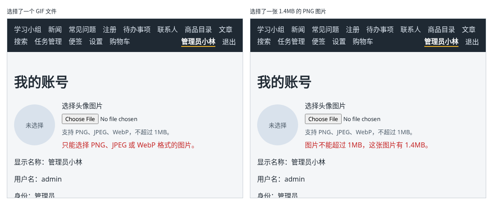

# 第 129 章：如何检查所选文件的类型和大小？

前置：[第 128 章：上传之前，如何预览用户选择的图片？](第128章-上传之前，如何预览用户选择的图片.md)

## 一、本章要解决的问题

练习服务的头像接口只接受 PNG、JPEG、WebP 三种图片，而且不能超过 1MB（准备篇二）。如果用户选了一张 5MB 的照片，要等它传到一半甚至传完，服务器才说“太大了”，白白浪费时间和流量。文件选择框的 `accept` 也挡不住：选择窗口中切换成“所有文件”，什么都能选。

本章在用户选好文件的那一刻就检查类型和大小，不合格就当场提示。完成后：选了 GIF 或其他文件，提示“只能选择 PNG、JPEG 或 WebP 格式的图片。”，不显示预览；选了一张 1.4MB 的图片，提示“图片不能超过 1MB，这张图片有 1.4MB。”；选一张合格的图片，提示消失，显示预览。

下图左边是选择了一个 GIF 文件的样子，右边是选择了一张 1.4MB 的 PNG 图片的样子：



## 二、必要原理

### File 对象中的类型和大小

第 128 章取出的 `files[0]` 是一个 `File` 对象，它带着几个有用的属性：

| 属性 | 含义 | 例子 |
| --- | --- | --- |
| `name` | 文件名 | `'avatar.png'` |
| `type` | 文件类型，叫 MIME 类型 | `'image/png'`、`'image/jpeg'`，浏览器认不出的类型是 `''` |
| `size` | 大小，单位是字节 | `590` |

检查时，类型用 `type` 判断，不要用文件名的后缀：用户可以把任意文件改名成 `.png`，后缀大小写也可能是 `.PNG`、`.Jpg`。`type` 是浏览器根据文件判断的，更可靠一些。

1MB 是 `1024 * 1024` 字节。显示给用户时，把字节数除以两次 1024，再用 `toFixed(1)` 保留一位小数（第 61A 章提到过 `toFixed`），例如 1471213 字节显示成“1.4MB”。

### 检查写成一个函数

检查规则和组件无关，写成组件外面的函数 `checkFile`，返回一句提示；符合要求时返回空字符串。`includes` 判断数组中是否有某个值（第 60 章用过）。

### 不合格时清空选择框

文件不合格时，除了显示提示、不显示预览，还要把选择框清空：

```tsx
event.target.value = '';
```

不清空的话，选择框中仍然留着这个不合格的文件，下一章点“上传”时就会把它传上去。另外，浏览器只在“选择的文件变了”时才触发 `onChange`：如果用户把图片压缩到 1MB 以内、文件名不变，再选一次，不清空就不会触发，检查也就不会重新进行。

这和第 128 章说的“不能写 `value`”并不矛盾：页面不能往文件选择框里**填**文件，但可以把它**清空**。

### 前端检查之后，服务器仍会检查

前端的检查只是为了让用户早点知道，并不能代替服务器：有人可以绕过页面，直接向接口发送文件。练习服务收到超过 1MB 的图片，会返回状态 413（内容太大）；类型不对，返回 422。下一章上传时，这两种情况也要处理。

## 三、动手实现

### 第 1 步：写检查规则

打开 `src/components/AvatarUploader.tsx`，在导入的下面加入：

```tsx

// 和练习服务的要求一致：只接受这三种图片，不超过 1MB
const ALLOWED_TYPES = ['image/png', 'image/jpeg', 'image/webp'];
const MAX_SIZE = 1024 * 1024;

function formatSize(bytes: number) {
  return (bytes / 1024 / 1024).toFixed(1) + 'MB';
}

// 返回空字符串表示文件符合要求
function checkFile(file: File) {
  if (!ALLOWED_TYPES.includes(file.type)) {
    return '只能选择 PNG、JPEG 或 WebP 格式的图片。';
  }
  if (file.size > MAX_SIZE) {
    return '图片不能超过 1MB，这张图片有 ' + formatSize(file.size) + '。';
  }
  return '';
}
```

### 第 2 步：选择文件时检查

在 `previewUrl` 那一行的下面加入：

```tsx
  const [error, setError] = useState('');
```

把 `handleFileChange` 中判断之后的部分改为：

```tsx
    if (!files || files.length === 0) {
      setPreviewUrl(null);
      setError('');
      return;
    }
    const message = checkFile(files[0]);
    if (message !== '') {
      setPreviewUrl(null);
      setError(message);
      // 清空选择框，用户改好文件后再选同一个文件，也能再次触发 onChange
      event.target.value = '';
      return;
    }
    setError('');
    // 为用户电脑上的文件生成一个临时地址，img 可以直接显示它，不需要先上传
    setPreviewUrl(URL.createObjectURL(files[0]));
```

### 第 3 步：显示要求和错误提示

在文件选择框的 `onChange={handleFileChange}` 下面加一行，并在 `/>` 后面加入说明和错误提示：

```tsx
          onChange={handleFileChange}
          aria-describedby="avatar-hint"
        />
        <p id="avatar-hint" className={styles.hint}>
          支持 PNG、JPEG、WebP，不超过 1MB。
        </p>
        {error && (
          <p role="alert" className={styles.error}>
            {error}
          </p>
        )}
```

先把要求写在页面上，用户选之前就知道；`aria-describedby` 把说明和选择框关联起来（第 43 章）。

### 第 4 步：说明和错误的样式

打开 `src/components/AvatarUploader.module.css`，在文件最后加入：

```css

.hint {
  margin: 0;
  color: #52606d;
  font-size: 14px;
}

.error {
  margin: 0;
  color: #c62828;
}
```

## 四、运行与检查

保持开发服务器和练习服务都在运行（准备篇二）。

1. 登录后打开“我的账号”，选择框下方写着“支持 PNG、JPEG、WebP，不超过 1MB。”。
2. 在选择窗口中切换成“所有文件”，选一个 GIF 图片或文本文件。提示“只能选择 PNG、JPEG 或 WebP 格式的图片。”，没有预览，选择框中显示“未选择任何文件”。
3. 选一张超过 1MB 的照片，提示“图片不能超过 1MB，这张图片有 X.XMB。”，数字是这张照片的实际大小。
4. 选一张合格的图片，提示消失，显示圆形预览。
5. 在合格的预览显示时，再选一个不合格的文件，预览消失，显示提示。

最后运行检查，应没有错误：

```powershell
npm.cmd run check
```

**小练习**：再加一条规则：图片不能小于 1KB（1024 字节），太小的图片提示“图片太小，可能已经损坏。”。练习后恢复本章代码。

## 五、常见错误

| 现象 | 原因 | 怎么改 |
| --- | --- | --- |
| 把文件改名成 `.png` 就能通过检查 | 按文件名后缀判断类型 | 用 `file.type` 判断 |
| 1MB 以内的图片也提示太大 | 把 `size` 当成了 KB，和 `1024` 比较 | `size` 的单位是字节，1MB 是 `1024 * 1024` |
| 选了不合格的文件后，再选同一个文件没有任何反应 | 选择框没有清空，选择的文件没变，不会触发 `onChange` | 不合格时 `event.target.value = ''` |
| 显示了错误提示，但旧的预览还在 | 不合格时没有把 `previewUrl` 设为 `null` | 同时 `setPreviewUrl(null)` |

## 六、本章完整代码

### `src/components/AvatarUploader.tsx`

```tsx
import { useEffect, useState } from 'react';
import type { ChangeEvent } from 'react';
import styles from './AvatarUploader.module.css';

// 和练习服务的要求一致：只接受这三种图片，不超过 1MB
const ALLOWED_TYPES = ['image/png', 'image/jpeg', 'image/webp'];
const MAX_SIZE = 1024 * 1024;

function formatSize(bytes: number) {
  return (bytes / 1024 / 1024).toFixed(1) + 'MB';
}

// 返回空字符串表示文件符合要求
function checkFile(file: File) {
  if (!ALLOWED_TYPES.includes(file.type)) {
    return '只能选择 PNG、JPEG 或 WebP 格式的图片。';
  }
  if (file.size > MAX_SIZE) {
    return '图片不能超过 1MB，这张图片有 ' + formatSize(file.size) + '。';
  }
  return '';
}

export default function AvatarUploader() {
  const [previewUrl, setPreviewUrl] = useState<string | null>(null);
  const [error, setError] = useState('');

  // 换了图片或离开页面时，释放上一张图片占用的内存
  useEffect(() => {
    return () => {
      if (previewUrl) {
        URL.revokeObjectURL(previewUrl);
      }
    };
  }, [previewUrl]);

  function handleFileChange(event: ChangeEvent<HTMLInputElement>) {
    const files = event.target.files;
    if (!files || files.length === 0) {
      setPreviewUrl(null);
      setError('');
      return;
    }
    const message = checkFile(files[0]);
    if (message !== '') {
      setPreviewUrl(null);
      setError(message);
      // 清空选择框，用户改好文件后再选同一个文件，也能再次触发 onChange
      event.target.value = '';
      return;
    }
    setError('');
    // 为用户电脑上的文件生成一个临时地址，img 可以直接显示它，不需要先上传
    setPreviewUrl(URL.createObjectURL(files[0]));
  }

  return (
    <div className={styles.box}>
      {previewUrl ? (
        
      ) : (
        <div className={styles.preview + ' ' + styles.empty}>未选择</div>
      )}
      <div className={styles.controls}>
        <label htmlFor="avatar-file">选择头像图片</label>
        <input
          id="avatar-file"
          type="file"
          accept="image/png,image/jpeg,image/webp"
          onChange={handleFileChange}
          aria-describedby="avatar-hint"
        />
        <p id="avatar-hint" className={styles.hint}>
          支持 PNG、JPEG、WebP，不超过 1MB。
        </p>
        {error && (
          <p role="alert" className={styles.error}>
            {error}
          </p>
        )}
      </div>
    </div>
  );
}
```

### `src/components/AvatarUploader.module.css`

```css
.box {
  display: flex;
  align-items: center;
  gap: 16px;
  margin: 16px 0;
}

.preview {
  width: 96px;
  height: 96px;
  border-radius: 50%;
  object-fit: cover;
  background: #d9e2ec;
}

.empty {
  display: flex;
  align-items: center;
  justify-content: center;
  color: #52606d;
  font-size: 14px;
}

.controls {
  display: flex;
  flex-direction: column;
  gap: 8px;
}

.hint {
  margin: 0;
  color: #52606d;
  font-size: 14px;
}

.error {
  margin: 0;
  color: #c62828;
}
```

## 七、本章改动小结

修改 `src/components/AvatarUploader.tsx`：选择文件时检查类型和大小，不合格时提示并清空选择框；修改 `src/components/AvatarUploader.module.css`：新增说明和错误提示的样式。

---

下一章：[第 130 章：如何把用户选择的文件上传到服务器？](第130章-如何把用户选择的文件上传到服务器.md)
