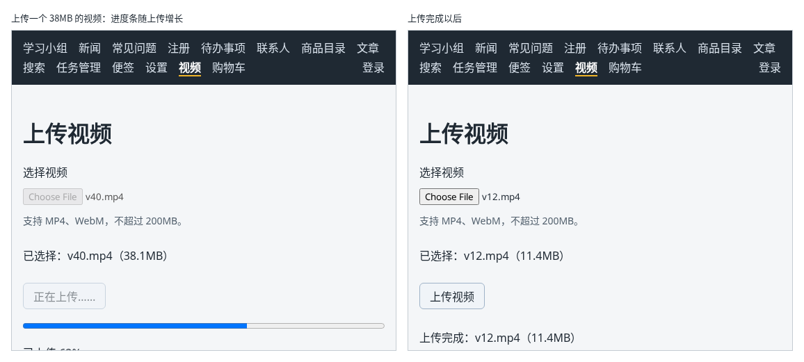

# 第 130A 章：上传大视频时，如何显示上传进度？

前置：[第 130 章：如何把用户选择的文件上传到服务器？](第130章-如何把用户选择的文件上传到服务器.md)

## 一、本章要解决的问题

头像只有几百 KB，一眨眼就传完了。一段几十 MB 的视频却要传好几十秒，如果页面上只有一个“正在上传……”，用户不知道传了多少、还要等多久，等着等着就以为卡住了，关掉页面重来。

本章新建一个“上传视频”页，上传时显示进度条和百分比。完成后：选择一个 MP4 或 WebM 视频，点“上传视频”，进度条从左往右增长，下方显示“已上传 65%”这样的文字；全部发送完以后显示“已全部发送，正在等待服务器保存……”；完成后显示视频的名称和大小，下面可以直接播放刚上传的视频。

下图左边是上传一个 38MB 视频的过程中，右边是上传完成以后：



## 二、必要原理

### 上传视频的接口

| 请求 | 正文 | 结果 |
| --- | --- | --- |
| `POST /api/videos` | 表单格式，字段名 `video`，MP4 或 WebM，不超过 200MB | 成功：状态 201，返回 `{ id, name, size, type, url }` |

不需要登录。类型不对返回 422，太大返回 413。上传的视频可以在返回的 `url` 播放，地址以 `/uploads` 开头，第 130 章已经为它配置了代理。

在自己电脑上上传，文件几乎是瞬间就到了服务器，看不出进度。所以练习服务默认按每秒 2MB 的速度接收视频，你能看清进度的变化；地址后面加 `?speed=0` 可以不限速。

### fetch 拿不到上传进度

`fetch` 能告诉你请求什么时候完成，但不能告诉你“已经发送了多少”。要知道上传进度，要用浏览器更早提供的 **XMLHttpRequest**（常简写为 XHR）。它的用法比 `fetch` 繁琐，是用事件来通知的：

| 写法 | 作用 |
| --- | --- |
| `xhr.open('POST', 地址)` | 准备一个请求 |
| `xhr.upload.addEventListener('progress', …)` | 上传过程中多次触发，`event.loaded` 是已发送的字节数，`event.total` 是总字节数 |
| `xhr.addEventListener('load', …)` | 收到了服务器的回答，`xhr.status` 是状态码，`xhr.responseText` 是返回的文字 |
| `xhr.addEventListener('error', …)` | 连不上服务器 |
| `xhr.send(form)` | 发送，可以直接发送 `FormData` |

注意是 `xhr.upload` 上的 `progress`，它表示**上传**的进度；`xhr` 自己的 `progress` 是**下载**回答的进度。

百分比是 `loaded / total * 100`，用 `Math.round` 取整。`event.lengthComputable` 为 `false` 时浏览器不知道总大小，算不出百分比，就跳过这一次。

### 把事件写法包装成 Promise

页面中一直用 `await` 等待请求完成。XHR 用的是事件，不能直接 `await`。可以用 `new Promise` 把它包装起来：

```tsx
return new Promise((resolve, reject) => {
  （创建并发送 xhr）
  xhr.addEventListener('load', () => resolve(结果));
  xhr.addEventListener('error', () => reject(new Error('…')));
});
```

`new Promise` 接收一个函数，这个函数会拿到两个参数：调用 `resolve(值)` 表示成功，`await` 得到这个值；调用 `reject(错误)` 表示失败，`await` 会抛出这个错误，被 `catch` 接住。这样，`uploadWithProgress` 用起来就和 `fetch` 一样，可以 `await`。

`load` 只表示收到了回答，状态码可能是 413、422，所以返回 `{ status, body }`，由页面判断状态码，和用 `fetch` 时检查 `response.ok` 一样。

### 100% 以后还要等一会儿

进度到 100% 只说明文件**发出去了**。在自己电脑上，请求先经过开发服务器的代理，代理会先收下一大段内容再慢慢转给练习服务，所以进度条一开始会跳得很快，到 100% 以后还要等几秒，服务器才保存完并回答。真实部署后，这段等待通常是服务器在保存文件。

所以 100% 时显示“已全部发送，正在等待服务器保存……”，用户不会以为卡住了。

### 上传前先检查

和第 129 章一样，先检查类型和大小：只接受 `video/mp4` 和 `video/webm`，不超过 200MB。200MB 的视频传到最后才被拒绝，代价比图片大得多，提前检查更重要。

## 三、动手实现

### 第 1 步：视频的类型

新建 `src/types/video.ts`：

```ts
export type Video = {
  id: string;
  name: string;
  size: number;
  type: string;
  url: string;
};

export function isVideo(value: unknown): value is Video {
  return (
    typeof value === 'object' &&
    value !== null &&
    'id' in value &&
    typeof value.id === 'string' &&
    'name' in value &&
    typeof value.name === 'string' &&
    'size' in value &&
    typeof value.size === 'number' &&
    'type' in value &&
    typeof value.type === 'string' &&
    'url' in value &&
    typeof value.url === 'string'
  );
}
```

### 第 2 步：带进度的上传函数

新建 `src/lib/uploadWithProgress.ts`：

```ts
export type UploadResponse = {
  status: number;
  body: string;
};

// fetch 拿不到上传进度，所以用浏览器更早提供的 XMLHttpRequest 发送
export function uploadWithProgress(
  url: string,
  form: FormData,
  onProgress: (percent: number) => void,
): Promise<UploadResponse> {
  return new Promise((resolve, reject) => {
    const xhr = new XMLHttpRequest();
    xhr.open('POST', url);
    xhr.upload.addEventListener('progress', (event) => {
      if (event.lengthComputable) {
        onProgress(Math.round((event.loaded / event.total) * 100));
      }
    });
    // load 表示收到了服务器的回答，不论状态码是多少
    xhr.addEventListener('load', () => {
      resolve({ status: xhr.status, body: xhr.responseText });
    });
    xhr.addEventListener('error', () => {
      reject(new Error('无法连接练习服务，请确认它已经启动。'));
    });
    xhr.send(form);
  });
}
```

`onProgress` 是一个回调（第 31 章），每次有新的进度就调用它，由页面决定怎样显示。

### 第 3 步：上传视频页的样式

新建 `src/pages/VideosPage.module.css`：

```css
.box {
  display: flex;
  flex-direction: column;
  gap: 12px;
  max-width: 520px;
}

.progress {
  width: 100%;
  height: 16px;
}

.hint {
  margin: 0;
  color: #52606d;
  font-size: 14px;
}

.error {
  margin: 0;
  color: #c62828;
}

.player {
  width: 100%;
  border-radius: 8px;
  background: #000000;
}
```

### 第 4 步：上传视频页

新建 `src/pages/VideosPage.tsx`：

```tsx
import { useState } from 'react';
import type { ChangeEvent } from 'react';
import { apiUrl } from '../lib/api';
import { uploadWithProgress } from '../lib/uploadWithProgress';
import { isVideo } from '../types/video';
import type { Video } from '../types/video';
import styles from './VideosPage.module.css';

const ALLOWED_TYPES = ['video/mp4', 'video/webm'];
const MAX_SIZE = 200 * 1024 * 1024;

function formatSize(bytes: number) {
  return (bytes / 1024 / 1024).toFixed(1) + 'MB';
}

function readMessage(body: string, fallback: string) {
  try {
    const data: unknown = JSON.parse(body);
    if (typeof data === 'object' && data !== null && 'message' in data) {
      if (typeof data.message === 'string') {
        return data.message + '。';
      }
    }
  } catch {
    // 返回的不是 JSON 时，使用默认的提示
  }
  return fallback;
}

export default function VideosPage() {
  const [file, setFile] = useState<File | null>(null);
  const [error, setError] = useState('');
  const [progress, setProgress] = useState<number | null>(null);
  const [video, setVideo] = useState<Video | null>(null);
  const isUploading = progress !== null;

  function handleFileChange(event: ChangeEvent<HTMLInputElement>) {
    const files = event.target.files;
    setVideo(null);
    if (!files || files.length === 0) {
      setFile(null);
      return;
    }
    const selected = files[0];
    if (!ALLOWED_TYPES.includes(selected.type)) {
      setError('只能选择 MP4 或 WebM 格式的视频。');
    } else if (selected.size > MAX_SIZE) {
      setError('视频不能超过 200MB，这个视频有 ' + formatSize(selected.size) + '。');
    } else {
      setError('');
      setFile(selected);
      return;
    }
    setFile(null);
    event.target.value = '';
  }

  async function handleUpload() {
    if (!file) {
      return;
    }
    const form = new FormData();
    form.append('video', file);
    setError('');
    setProgress(0);
    try {
      const response = await uploadWithProgress(apiUrl('/videos'), form, setProgress);
      if (response.status !== 201) {
        setError(readMessage(response.body, '上传失败：服务器返回了状态 ' + response.status + '。'));
        return;
      }
      const data: unknown = JSON.parse(response.body);
      if (!isVideo(data)) {
        setError('上传成功，但返回的数据格式不正确。');
        return;
      }
      setVideo(data);
    } catch (caught) {
      setError(caught instanceof Error ? caught.message : '上传失败，请稍后重试。');
    } finally {
      setProgress(null);
    }
  }

  return (
    <main className="page">
      <title>上传视频</title>
      <h1>上传视频</h1>
      <div className={styles.box}>
        <label htmlFor="video-file">选择视频</label>
        <input
          id="video-file"
          type="file"
          accept="video/mp4,video/webm"
          disabled={isUploading}
          onChange={handleFileChange}
        />
        <p className={styles.hint}>支持 MP4、WebM，不超过 200MB。</p>
        {file && <p>已选择：{file.name}（{formatSize(file.size)}）</p>}
        {error && (
          <p role="alert" className={styles.error}>
            {error}
          </p>
        )}
        <div>
          <button type="button" disabled={!file || isUploading} onClick={handleUpload}>
            {isUploading ? '正在上传……' : '上传视频'}
          </button>
        </div>
        {progress !== null && (
          <div>
            <progress className={styles.progress} max={100} value={progress}>
              {progress}%
            </progress>
            <p role="status">
              {/* 文件全部发出去以后，服务器还要一点时间保存，这段时间不算失败 */}
              {progress < 100 ? '已上传 ' + progress + '%' : '已全部发送，正在等待服务器保存……'}
            </p>
          </div>
        )}
        {video && (
          <div>
            <p role="status">上传完成：{video.name}（{formatSize(video.size)}）</p>
            <video className={styles.player} src={video.url} controls />
          </div>
        )}
      </div>
    </main>
  );
}
```

- `progress` 是 `number | null`：`null` 表示没有在上传，数字表示当前百分比。`isUploading` 从它算出来，不另外保存（第 32 章）。
- 调用 `uploadWithProgress` 时直接把 `setProgress` 作为回调传进去：它正好接收一个数字。
- `<progress>` 是 HTML 自带的进度条，`max` 是总量，`value` 是当前进度。标签中间的文字只在浏览器不支持进度条时显示。
- 上传期间禁用文件选择框，防止中途换文件。
- `readMessage` 和第 109 章的写法相同，只是这里要先用 `JSON.parse` 把文字解析出来。

### 第 5 步：加入路由和导航

打开 `src/App.tsx`，在导入 `TaskServerPage` 的一行下面加入：

```tsx
import VideosPage from './pages/VideosPage';
```

在 `/settings` 那条路由的下面加入：

```tsx
            <Route path="/videos" element={<VideosPage />} />
```

打开 `src/components/AppLayout.tsx`，在“设置”链接的下面加入：

```tsx
        <NavLink to="/videos">视频</NavLink>
```

## 四、运行与检查

保持开发服务器和练习服务都在运行（准备篇二）。准备一个几十 MB 的 MP4 视频，例如用手机拍的一小段。

1. 点导航中的“视频”。选择一个文本文件，提示“只能选择 MP4 或 WebM 格式的视频。”。
2. 选择视频，显示“已选择：文件名（大小）”。点“上传视频”。
3. 进度条出现并逐渐增长，下方的百分比跟着变化。刚开始可能会一下跳到 40% 左右，这是开发代理先收下了一部分内容（第二节）。
4. 到 100% 后显示“已全部发送，正在等待服务器保存……”，几秒后显示“上传完成：文件名（大小）”，下方出现播放器，点播放可以看到刚上传的视频。
5. 在 Network（网络）面板中，`/api/videos` 请求的类型是 `xhr`，不是 `fetch`。
6. 地址栏中没有用到 `?speed=0`，所以上传速度大约是每秒 2MB。临时把 `uploadWithProgress` 的地址改成 `apiUrl('/videos?speed=0')`，再上传一次，进度很快就到 100%。看完后改回。

最后运行检查，应没有错误：

```powershell
npm.cmd run check
```

**小练习**：在百分比后面再显示已上传的大小，例如“已上传 65%（24.8MB / 38.1MB）”。提示：已上传的字节数约等于 `file.size * progress / 100`，用本页的 `formatSize` 显示。练习后恢复本章代码。

## 五、常见错误

| 现象 | 原因 | 怎么改 |
| --- | --- | --- |
| 进度一直不动，直到上传完成才一下变成 100% | 监听的是 `xhr` 的 `progress`，那是下载进度 | 监听 `xhr.upload` 的 `progress` |
| 服务器返回 413，页面却显示“上传完成” | 收到 `load` 就当作成功，没有看状态码 | 检查 `response.status`，不是 201 时显示服务器的原因 |
| 进度到 100% 后停了好几秒，以为卡住了 | 文件发完了，服务器还在保存 | 100% 时显示“正在等待服务器保存……” |
| 想用 `fetch` 显示进度，找不到办法 | `fetch` 不提供上传进度 | 需要上传进度时用 `XMLHttpRequest` |

## 六、本章完整代码

### `src/types/video.ts`

同第三节第 1 步。

### `src/lib/uploadWithProgress.ts`

同第三节第 2 步。

### `src/pages/VideosPage.module.css`

同第三节第 3 步。

### `src/pages/VideosPage.tsx`

同第三节第 4 步。

### `src/App.tsx`

```tsx
import { Route, Routes } from 'react-router';
import './App.css';
import AppLayout from './components/AppLayout';
import AuthProvider from './components/AuthProvider';
import CartProvider from './components/CartProvider';
import RequireAuth from './components/RequireAuth';
import AccountPage from './pages/AccountPage';
import ArticlePage from './pages/ArticlePage';
import ContactsPage from './pages/ContactsPage';
import FaqPage from './pages/FaqPage';
import GroupPage from './pages/GroupPage';
import LoginPage from './pages/LoginPage';
import NewsPage from './pages/NewsPage';
import NotesPage from './pages/NotesPage';
import NotFoundPage from './pages/NotFoundPage';
import ProductDetailPage from './pages/ProductDetailPage';
import ProductPage from './pages/ProductPage';
import RegisterPage from './pages/RegisterPage';
import SearchPage from './pages/SearchPage';
import SettingsPage from './pages/SettingsPage';
import ShopPage from './pages/ShopPage';
import TaskPage from './pages/TaskPage';
import TaskServerPage from './pages/TaskServerPage';
import VideosPage from './pages/VideosPage';

export default function App() {
  return (
    <AuthProvider>
      <CartProvider>
        <Routes>
          <Route element={<AppLayout />}>
            <Route path="/" element={<GroupPage />} />
            <Route path="/news" element={<NewsPage />} />
            <Route path="/faq" element={<FaqPage />} />
            <Route path="/register" element={<RegisterPage />} />
            <Route path="/todos" element={<TaskPage />} />
            <Route path="/contacts" element={<ContactsPage />} />
            <Route path="/products" element={<ProductPage />} />
            <Route path="/products/:id" element={<ProductDetailPage />} />
            <Route path="/articles" element={<ArticlePage />} />
            <Route path="/search" element={<SearchPage />} />
            <Route path="/tasks" element={<TaskServerPage />} />
            <Route path="/shop" element={<ShopPage />} />
            <Route path="/notes" element={<NotesPage />} />
            <Route path="/settings" element={<SettingsPage />} />
            <Route path="/videos" element={<VideosPage />} />
            <Route
              path="/account"
              element={
                <RequireAuth>
                  <AccountPage />
                </RequireAuth>
              }
            />
            <Route path="*" element={<NotFoundPage />} />
          </Route>
          <Route path="/login" element={<LoginPage />} />
        </Routes>
      </CartProvider>
    </AuthProvider>
  );
}
```

### `src/components/AppLayout.tsx`

```tsx
import { useState } from 'react';
import { NavLink, Outlet } from 'react-router';
import { useAuth } from '../hooks/useAuth';
import { useCart } from '../hooks/useCart';
import { useOnlineStatus } from '../hooks/useOnlineStatus';
import { logout } from '../lib/authApi';

export default function AppLayout() {
  const { user, checking, setUser } = useAuth();
  const [isLoggingOut, setIsLoggingOut] = useState(false);
  const { cartItems } = useCart();
  const online = useOnlineStatus();
  let cartCount = 0;
  for (const item of cartItems) {
    cartCount += item.quantity;
  }

  async function handleLogout() {
    setIsLoggingOut(true);
    try {
      // 先让服务器删除登录记录，否则刷新页面后又会自动登录
      await logout();
      // 当前页面如果需要登录，RequireAuth 会自动把人送去登录页
      setUser(null);
    } catch (error) {
      window.alert(error instanceof Error ? error.message : '退出失败，请稍后重试。');
    } finally {
      setIsLoggingOut(false);
    }
  }

  return (
    <div>
      <nav className="site-nav" aria-label="主导航">
        <NavLink to="/">学习小组</NavLink>
        <NavLink to="/news">新闻</NavLink>
        <NavLink to="/faq">常见问题</NavLink>
        <NavLink to="/register">注册</NavLink>
        <NavLink to="/todos">待办事项</NavLink>
        <NavLink to="/contacts">联系人</NavLink>
        <NavLink to="/products">商品目录</NavLink>
        <NavLink to="/articles">文章</NavLink>
        <NavLink to="/search">搜索</NavLink>
        <NavLink to="/tasks">任务管理</NavLink>
        <NavLink to="/notes">便签</NavLink>
        <NavLink to="/settings">设置</NavLink>
        <NavLink to="/videos">视频</NavLink>
        <NavLink to="/shop">
          购物车
          {cartCount > 0 && (
            <span className="cart-count" aria-label={'购物车中有 ' + cartCount + ' 件商品'}>
              {cartCount}
            </span>
          )}
        </NavLink>
        {/* 确认登录状态期间什么也不显示，避免先闪一下“登录”再变成用户名 */}
        {!checking && user && (
          <NavLink to="/account" className="nav-user">
            {user.displayName}
          </NavLink>
        )}
        {!checking && user && (
          <button
            type="button"
            className="nav-logout"
            disabled={isLoggingOut}
            onClick={handleLogout}
          >
            {isLoggingOut ? '正在退出……' : '退出'}
          </button>
        )}
        {!checking && !user && (
          <NavLink to="/login" className="nav-user">
            登录
          </NavLink>
        )}
      </nav>
      {!online && (
        <p role="status" className="offline-banner">
          网络已断开，需要连接服务器的功能暂时无法使用。
        </p>
      )}
      <Outlet />
    </div>
  );
}
```

## 七、本章改动小结

新增 `src/types/video.ts`、`src/lib/uploadWithProgress.ts`、`src/pages/VideosPage.tsx` 和 `src/pages/VideosPage.module.css`：用 `XMLHttpRequest` 上传视频并显示进度，完成后播放上传的视频；修改 `src/App.tsx` 和 `src/components/AppLayout.tsx`：加入 `/videos` 路由和导航链接。

---

下一章：[第 130B 章：大视频上传到一半时，如何让用户取消？](第130B章-大视频上传到一半时，如何让用户取消.md)
