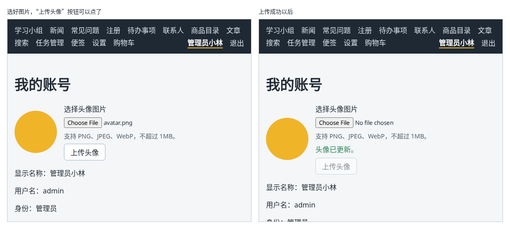

# 第 130 章：如何把用户选择的文件上传到服务器？

前置：[第 129 章：如何检查所选文件的类型和大小？](第129章-如何检查所选文件的类型和大小.md)

## 一、本章要解决的问题

头像已经能选择、检查和预览了，最后一步是把它真正上传到服务器，以后再打开“我的账号”，看到的就是自己的头像。

本章把选好的图片上传到练习服务。完成后：选好一张合格的图片，“上传头像”按钮变为可用；点击后按钮变成“正在上传……”，半秒后显示“头像已更新。”，圆形中显示的是服务器上的头像；刷新页面，头像还在；登录已经失效时上传，会被带到登录页。

下图左边是选好图片的样子，右边是上传成功以后的样子：



## 二、必要原理

### 上传头像的接口

| 请求 | 正文 | 结果 |
| --- | --- | --- |
| `POST /api/account/avatar` | 表单格式，字段名 `avatar`，内容是图片文件 | 成功：状态 200，返回带有 `avatarUrl` 的用户信息 |

需要登录，否则返回 401。图片类型不对返回 422，太大返回 413，都带有 `message`。

成功时返回的 `avatarUrl` 形如 `/uploads/7677063c-….png`，这就是头像图片在练习服务上的地址。第 109 章没有放进 `User` 类型的 `avatarUrl`，现在要加上了，类型是 `string | null`：没有上传过头像时是 `null`。

### FormData：用表单格式发送文件

以前发送的正文都是 JSON 文字（第 86 章）。文件不是文字，要用**表单格式**（multipart/form-data）发送，这也是网页中普通的上传表单使用的格式。浏览器提供了 `FormData` 来组装它：

```tsx
const form = new FormData();
form.append('avatar', file);

fetch(apiUrl('/account/avatar'), { method: 'POST', body: form });
```

`append` 的第一个参数是字段名，要和服务器约定的一致；第二个参数是 `File` 对象。

注意**不要自己写 `Content-Type` 请求头**。表单格式的请求头中，除了 `multipart/form-data`，还要带一个分隔各部分内容的标记（boundary）。把 `FormData` 交给 `body` 时，浏览器会自动写上完整的请求头；自己写了，就少了这个标记，服务器解析不了，返回 400。

### 上传结果有三种

和登录一样（第 109 章），用联合类型表示可以改正的失败：

```tsx
type UploadResult =
  | { status: 'success'; user: User }
  | { status: 'failed'; message: string }
  | { status: 'unauthorized' };
```

- 413、422：用户可以换一张图片再试，显示服务器给的原因。
- 401：登录已经失效，调用第 115 章的 `expireSession`，页面被带到登录页。
- 其他错误：抛出，显示“上传失败：……”。

### 上传成功后更新当前用户

服务器返回了新的用户信息，其中的 `avatarUrl` 是新头像的地址。调用 `setUser(result.user)` 把它更新到 Context 中（第 110 章），所有读取当前用户的地方都拿到了新头像。

头像区域现在的显示规则是：有预览时显示预览；没有预览时显示 `user.avatarUrl`；都没有时显示“未选择”。上传成功后清除预览，显示的就是服务器上的头像了。

`a ?? b` 是第 20 章的写法：`a` 是 `null` 时用 `b`。

### 让开发服务器转发图片地址

`img` 要显示 `/uploads/…` 这个地址，请求会发给开发服务器。第 72 章只为 `/api` 配置了代理，`/uploads` 开头的请求不会转发给练习服务，图片显示不出来。所以在 `vite.config.js` 中再加一条代理规则。

### 上传完成后清空选择框

上传成功后，用第 115A 章的 ref 拿到文件选择框，把它的 `value` 清空（第 129 章），否则选择框中还显示着刚才的文件名。

## 三、动手实现

### 第 1 步：用户类型加上头像地址

打开 `src/types/user.ts`，在 `User` 类型中 `role` 的下面加入：

```ts
  // 头像图片的地址，例如 /uploads/xxx.png；还没有上传头像时是 null
  avatarUrl: string | null;
```

在 `isUser` 的最后一个条件后面加上：

```ts
    (value.role === 'admin' || value.role === 'member') &&
    'avatarUrl' in value &&
    (typeof value.avatarUrl === 'string' || value.avatarUrl === null)
```

### 第 2 步：转发图片地址

打开 `vite.config.js`，在 `'/api'` 那一行的下面加入：

```js
      // 上传的图片由练习服务提供，地址以 /uploads 开头
      '/uploads': 'http://127.0.0.1:3001',
```

修改了 Vite 的配置，在运行开发服务器的终端按 Ctrl+C 停止它，再运行一次 `npm.cmd run dev`。

### 第 3 步：上传请求

打开 `src/lib/authApi.ts`，在文件最后加入：

```ts

export type UploadResult =
  | { status: 'success'; user: User }
  | { status: 'failed'; message: string }
  | { status: 'unauthorized' };

export async function uploadAvatar(file: File): Promise<UploadResult> {
  // 文件要用表单格式发送，字段名 avatar 是练习服务约定的
  const form = new FormData();
  form.append('avatar', file);
  let response: Response;
  try {
    // 不要自己写 Content-Type，浏览器会根据 FormData 自动写上正确的值
    response = await fetch(apiUrl('/account/avatar'), { method: 'POST', body: form });
  } catch {
    throw new Error('无法连接练习服务，请确认它已经启动。');
  }
  if (response.status === 401) {
    return { status: 'unauthorized' };
  }
  // 413 是文件太大，422 是类型不对，都是用户可以改正的情况
  if (response.status === 413 || response.status === 422) {
    return { status: 'failed', message: await readMessage(response, '这张图片不能上传。') };
  }
  if (!response.ok) {
    throw new Error('上传失败：服务器返回了状态 ' + response.status + '。');
  }
  const data: unknown = await response.json();
  if (!isUser(data)) {
    throw new Error('上传成功，但返回的用户信息格式不正确。');
  }
  return { status: 'success', user: data };
}
```

`readMessage` 是第 109 章写好的，读出服务器返回的 `message`。

### 第 4 步：头像组件加上上传

打开 `src/components/AvatarUploader.tsx`，把第一行改为：

```tsx
import { useEffect, useRef, useState } from 'react';
```

在导入样式的一行上面加入：

```tsx
import { useAuth } from '../hooks/useAuth';
import { uploadAvatar } from '../lib/authApi';
```

在 `checkFile` 函数的后面加入：

```tsx

function getErrorMessage(error: unknown) {
  return error instanceof Error ? error.message : '上传失败，请稍后重试。';
}
```

把组件开头的 state 改为：

```tsx
  const { user, setUser, expireSession } = useAuth();
  const [selectedFile, setSelectedFile] = useState<File | null>(null);
  const [previewUrl, setPreviewUrl] = useState<string | null>(null);
  const [error, setError] = useState('');
  const [message, setMessage] = useState('');
  const [isUploading, setIsUploading] = useState(false);
  const fileInputRef = useRef<HTMLInputElement>(null);
```

在 `handleFileChange` 中记下所选的文件。改动后的完整函数是：

```tsx
  function handleFileChange(event: ChangeEvent<HTMLInputElement>) {
    const files = event.target.files;
    setMessage('');
    if (!files || files.length === 0) {
      setSelectedFile(null);
      setPreviewUrl(null);
      setError('');
      return;
    }
    const problem = checkFile(files[0]);
    if (problem !== '') {
      setSelectedFile(null);
      setPreviewUrl(null);
      setError(problem);
      // 清空选择框，用户改好文件后再选同一个文件，也能再次触发 onChange
      event.target.value = '';
      return;
    }
    setError('');
    setSelectedFile(files[0]);
    // 为用户电脑上的文件生成一个临时地址，img 可以直接显示它，不需要先上传
    setPreviewUrl(URL.createObjectURL(files[0]));
  }
```

检查结果的变量从 `message` 改名为 `problem`，因为 `message` 现在是 state 的名字。

在 `handleFileChange` 的后面加入上传的处理函数，以及要显示的头像地址：

```tsx

  async function handleUpload() {
    if (!selectedFile) {
      return;
    }
    setError('');
    setIsUploading(true);
    try {
      const result = await uploadAvatar(selectedFile);
      if (result.status === 'unauthorized') {
        expireSession();
        return;
      }
      if (result.status === 'failed') {
        setError(result.message);
        return;
      }
      // 服务器返回了带新头像地址的用户信息，更新到 Context 中，显示的就是服务器上的头像
      setUser(result.user);
      setSelectedFile(null);
      setPreviewUrl(null);
      setMessage('头像已更新。');
      if (fileInputRef.current) {
        fileInputRef.current.value = '';
      }
    } catch (caught) {
      setError(getErrorMessage(caught));
    } finally {
      setIsUploading(false);
    }
  }

  // 有预览时显示预览；没有预览时显示服务器上已有的头像
  const shownUrl = previewUrl ?? (user ? user.avatarUrl : null);
```

### 第 5 步：显示头像和上传按钮

把显示预览的 `img` 改为：

```tsx
      {shownUrl ? (
        
```

在文件选择框上加入 `ref={fileInputRef}`。在错误提示的后面加入成功提示和按钮：

```tsx
        {message && (
          <p role="status" className={styles.success}>
            {message}
          </p>
        )}
        <div>
          <button type="button" disabled={!selectedFile || isUploading} onClick={handleUpload}>
            {isUploading ? '正在上传……' : '上传头像'}
          </button>
        </div>
```

打开 `src/components/AvatarUploader.module.css`，在文件最后加入：

```css

.success {
  margin: 0;
  color: #2f855a;
}
```

## 四、运行与检查

保持开发服务器和练习服务都在运行（准备篇二）。修改了 `vite.config.js`，记得先重启开发服务器。

1. 登录后打开“我的账号”。没有选择图片时，“上传头像”是灰色的。
2. 选一张合格的图片，显示预览，按钮变为可用。点“上传头像”，按钮先变成“正在上传……”，半秒后显示“头像已更新。”，选择框清空。
3. 在 Network（网络）面板中选中 `/api/account/avatar` 请求：请求头中 `Content-Type` 是 `multipart/form-data; boundary=…`，Payload（载荷）中有 `avatar` 字段。
4. 在 Elements（元素）面板中选中头像，`alt` 是“当前头像”，`src` 是 `/uploads/` 开头的地址，Network 中这张图片的状态是 200。
5. 按 F5 刷新，头像还在：应用启动时读到的用户信息中带着 `avatarUrl`（第 111 章）。
6. 在控制台中执行 `fetch('/api/dev/expire-sessions', { method: 'POST' })`，再选一张图片上传，页面被带到登录页，提示“登录已失效，请重新登录。”。

最后运行检查，应没有错误：

```powershell
npm.cmd run check
```

**小练习**：在导航栏的用户名前面显示一个 20 像素大小的圆形头像，没有头像时不显示。上传新头像后，导航栏中的头像立刻跟着变。提示：导航栏中的 `user` 也来自 Context。练习后恢复本章代码。

## 五、常见错误

| 现象 | 原因 | 怎么改 |
| --- | --- | --- |
| 上传时显示“上传失败：服务器返回了状态 400。” | 自己写了 `'Content-Type': 'multipart/form-data'`，缺少分隔标记，服务器解析不了 | 删掉这个请求头，让浏览器自动写 |
| 显示“头像已更新。”，但头像是一个破损的图片 | `vite.config.js` 中没有转发 `/uploads`，或者改了配置没有重启开发服务器 | 加上 `/uploads` 的代理，并重启开发服务器 |
| 检查命令报 `Property 'avatarUrl' does not exist on type 'User'.` | 用到了 `user.avatarUrl`，但 `User` 类型中还没有这个字段 | 按第 1 步在 `User` 中加上 `avatarUrl`，并在 `isUser` 中检查 |
| 服务器返回“没有收到图片” | `append` 的字段名写错了，例如写成 `'file'` | 字段名用练习服务约定的 `'avatar'` |

## 六、本章完整代码

### `src/types/user.ts`

```ts
export type User = {
  username: string;
  displayName: string;
  role: 'admin' | 'member';
  // 头像图片的地址，例如 /uploads/xxx.png；还没有上传头像时是 null
  avatarUrl: string | null;
};

export function isUser(value: unknown): value is User {
  return (
    typeof value === 'object' &&
    value !== null &&
    'username' in value &&
    typeof value.username === 'string' &&
    'displayName' in value &&
    typeof value.displayName === 'string' &&
    'role' in value &&
    (value.role === 'admin' || value.role === 'member') &&
    'avatarUrl' in value &&
    (typeof value.avatarUrl === 'string' || value.avatarUrl === null)
  );
}

// “我的账号”页向服务器读取的额外资料
export type AccountInfo = {
  joinedAt: string;
};

export function isAccountInfo(value: unknown): value is AccountInfo {
  return (
    typeof value === 'object' &&
    value !== null &&
    'joinedAt' in value &&
    typeof value.joinedAt === 'string'
  );
}
```

### `vite.config.js`

```js
import { defineConfig } from 'vite';
import react from '@vitejs/plugin-react';

export default defineConfig({
  plugins: [react()],
  server: {
    proxy: {
      '/api': 'http://127.0.0.1:3001',
      // 上传的图片由练习服务提供，地址以 /uploads 开头
      '/uploads': 'http://127.0.0.1:3001',
    },
  },
});
```

### `src/lib/authApi.ts`

```ts
import { apiUrl } from './api';
import { isAccountInfo, isUser } from '../types/user';
import type { AccountInfo, User } from '../types/user';

export type LoginResult = { status: 'success'; user: User } | { status: 'failed'; message: string };

async function readMessage(response: Response, fallback: string): Promise<string> {
  try {
    const data: unknown = await response.json();
    if (typeof data === 'object' && data !== null && 'message' in data) {
      if (typeof data.message === 'string') {
        return data.message + '。';
      }
    }
  } catch {
    // 返回的不是 JSON 时，使用默认的提示
  }
  return fallback;
}

export async function login(username: string, password: string): Promise<LoginResult> {
  let response: Response;
  try {
    response = await fetch(apiUrl('/auth/login'), {
      method: 'POST',
      headers: { 'Content-Type': 'application/json' },
      body: JSON.stringify({ username, password }),
    });
  } catch {
    throw new Error('无法连接练习服务，请确认它已经启动。');
  }
  // 401 表示用户名或密码不对，这是用户可以改正的情况，不当作程序出错
  if (response.status === 401) {
    return { status: 'failed', message: await readMessage(response, '用户名或密码不正确。') };
  }
  if (!response.ok) {
    throw new Error('登录失败：服务器返回了状态 ' + response.status + '。');
  }
  const data: unknown = await response.json();
  if (!isUser(data)) {
    throw new Error('登录成功，但返回的用户信息格式不正确。');
  }
  return { status: 'success', user: data };
}

// 返回 null 表示没有登录：浏览器没有 Cookie，或者服务器上的登录已经失效
export async function fetchCurrentUser(): Promise<User | null> {
  let response: Response;
  try {
    response = await fetch(apiUrl('/auth/me'));
  } catch {
    throw new Error('无法连接练习服务，请确认它已经启动。');
  }
  if (response.status === 401) {
    return null;
  }
  if (!response.ok) {
    throw new Error('读取登录状态失败：服务器返回了状态 ' + response.status + '。');
  }
  const data: unknown = await response.json();
  if (!isUser(data)) {
    throw new Error('用户信息格式不正确。');
  }
  return data;
}

export async function logout(): Promise<void> {
  let response: Response;
  try {
    response = await fetch(apiUrl('/auth/logout'), { method: 'POST' });
  } catch {
    throw new Error('无法连接练习服务，请确认它已经启动。');
  }
  if (!response.ok) {
    throw new Error('退出失败：服务器返回了状态 ' + response.status + '。');
  }
}

// 返回 null 表示服务器认为没有登录：登录已经失效
export async function fetchAccountInfo(): Promise<AccountInfo | null> {
  let response: Response;
  try {
    response = await fetch(apiUrl('/account'));
  } catch {
    throw new Error('无法连接练习服务，请确认它已经启动。');
  }
  if (response.status === 401) {
    return null;
  }
  if (!response.ok) {
    throw new Error('读取账号资料失败：服务器返回了状态 ' + response.status + '。');
  }
  const data: unknown = await response.json();
  if (!isAccountInfo(data)) {
    throw new Error('账号资料格式不正确。');
  }
  return data;
}

export type UploadResult =
  | { status: 'success'; user: User }
  | { status: 'failed'; message: string }
  | { status: 'unauthorized' };

export async function uploadAvatar(file: File): Promise<UploadResult> {
  // 文件要用表单格式发送，字段名 avatar 是练习服务约定的
  const form = new FormData();
  form.append('avatar', file);
  let response: Response;
  try {
    // 不要自己写 Content-Type，浏览器会根据 FormData 自动写上正确的值
    response = await fetch(apiUrl('/account/avatar'), { method: 'POST', body: form });
  } catch {
    throw new Error('无法连接练习服务，请确认它已经启动。');
  }
  if (response.status === 401) {
    return { status: 'unauthorized' };
  }
  // 413 是文件太大，422 是类型不对，都是用户可以改正的情况
  if (response.status === 413 || response.status === 422) {
    return { status: 'failed', message: await readMessage(response, '这张图片不能上传。') };
  }
  if (!response.ok) {
    throw new Error('上传失败：服务器返回了状态 ' + response.status + '。');
  }
  const data: unknown = await response.json();
  if (!isUser(data)) {
    throw new Error('上传成功，但返回的用户信息格式不正确。');
  }
  return { status: 'success', user: data };
}
```

### `src/components/AvatarUploader.tsx`

```tsx
import { useEffect, useRef, useState } from 'react';
import type { ChangeEvent } from 'react';
import { useAuth } from '../hooks/useAuth';
import { uploadAvatar } from '../lib/authApi';
import styles from './AvatarUploader.module.css';

// 和练习服务的要求一致：只接受这三种图片，不超过 1MB
const ALLOWED_TYPES = ['image/png', 'image/jpeg', 'image/webp'];
const MAX_SIZE = 1024 * 1024;

function formatSize(bytes: number) {
  return (bytes / 1024 / 1024).toFixed(1) + 'MB';
}

// 返回空字符串表示文件符合要求
function checkFile(file: File) {
  if (!ALLOWED_TYPES.includes(file.type)) {
    return '只能选择 PNG、JPEG 或 WebP 格式的图片。';
  }
  if (file.size > MAX_SIZE) {
    return '图片不能超过 1MB，这张图片有 ' + formatSize(file.size) + '。';
  }
  return '';
}

function getErrorMessage(error: unknown) {
  return error instanceof Error ? error.message : '上传失败，请稍后重试。';
}

export default function AvatarUploader() {
  const { user, setUser, expireSession } = useAuth();
  const [selectedFile, setSelectedFile] = useState<File | null>(null);
  const [previewUrl, setPreviewUrl] = useState<string | null>(null);
  const [error, setError] = useState('');
  const [message, setMessage] = useState('');
  const [isUploading, setIsUploading] = useState(false);
  const fileInputRef = useRef<HTMLInputElement>(null);

  // 换了图片或离开页面时，释放上一张图片占用的内存
  useEffect(() => {
    return () => {
      if (previewUrl) {
        URL.revokeObjectURL(previewUrl);
      }
    };
  }, [previewUrl]);

  function handleFileChange(event: ChangeEvent<HTMLInputElement>) {
    const files = event.target.files;
    setMessage('');
    if (!files || files.length === 0) {
      setSelectedFile(null);
      setPreviewUrl(null);
      setError('');
      return;
    }
    const problem = checkFile(files[0]);
    if (problem !== '') {
      setSelectedFile(null);
      setPreviewUrl(null);
      setError(problem);
      // 清空选择框，用户改好文件后再选同一个文件，也能再次触发 onChange
      event.target.value = '';
      return;
    }
    setError('');
    setSelectedFile(files[0]);
    // 为用户电脑上的文件生成一个临时地址，img 可以直接显示它，不需要先上传
    setPreviewUrl(URL.createObjectURL(files[0]));
  }

  async function handleUpload() {
    if (!selectedFile) {
      return;
    }
    setError('');
    setIsUploading(true);
    try {
      const result = await uploadAvatar(selectedFile);
      if (result.status === 'unauthorized') {
        expireSession();
        return;
      }
      if (result.status === 'failed') {
        setError(result.message);
        return;
      }
      // 服务器返回了带新头像地址的用户信息，更新到 Context 中，显示的就是服务器上的头像
      setUser(result.user);
      setSelectedFile(null);
      setPreviewUrl(null);
      setMessage('头像已更新。');
      if (fileInputRef.current) {
        fileInputRef.current.value = '';
      }
    } catch (caught) {
      setError(getErrorMessage(caught));
    } finally {
      setIsUploading(false);
    }
  }

  // 有预览时显示预览；没有预览时显示服务器上已有的头像
  const shownUrl = previewUrl ?? (user ? user.avatarUrl : null);

  return (
    <div className={styles.box}>
      {shownUrl ? (
        
      ) : (
        <div className={styles.preview + ' ' + styles.empty}>未选择</div>
      )}
      <div className={styles.controls}>
        <label htmlFor="avatar-file">选择头像图片</label>
        <input
          ref={fileInputRef}
          id="avatar-file"
          type="file"
          accept="image/png,image/jpeg,image/webp"
          onChange={handleFileChange}
          aria-describedby="avatar-hint"
        />
        <p id="avatar-hint" className={styles.hint}>
          支持 PNG、JPEG、WebP，不超过 1MB。
        </p>
        {error && (
          <p role="alert" className={styles.error}>
            {error}
          </p>
        )}
        {message && (
          <p role="status" className={styles.success}>
            {message}
          </p>
        )}
        <div>
          <button type="button" disabled={!selectedFile || isUploading} onClick={handleUpload}>
            {isUploading ? '正在上传……' : '上传头像'}
          </button>
        </div>
      </div>
    </div>
  );
}
```

### `src/components/AvatarUploader.module.css`

```css
.box {
  display: flex;
  align-items: center;
  gap: 16px;
  margin: 16px 0;
}

.preview {
  width: 96px;
  height: 96px;
  border-radius: 50%;
  object-fit: cover;
  background: #d9e2ec;
}

.empty {
  display: flex;
  align-items: center;
  justify-content: center;
  color: #52606d;
  font-size: 14px;
}

.controls {
  display: flex;
  flex-direction: column;
  gap: 8px;
}

.hint {
  margin: 0;
  color: #52606d;
  font-size: 14px;
}

.error {
  margin: 0;
  color: #c62828;
}

.success {
  margin: 0;
  color: #2f855a;
}
```

## 七、本章改动小结

修改 `src/types/user.ts`：用户信息中加入 `avatarUrl`；修改 `vite.config.js`：转发 `/uploads` 开头的图片地址；修改 `src/lib/authApi.ts`：新增用 `FormData` 上传头像的 `uploadAvatar`；修改 `src/components/AvatarUploader.tsx` 和 `src/components/AvatarUploader.module.css`：上传选好的图片，成功后更新当前用户并显示服务器上的头像。

---

下一章：[第 130A 章：上传大视频时，如何显示上传进度？](第130A章-上传大视频时，如何显示上传进度.md)
