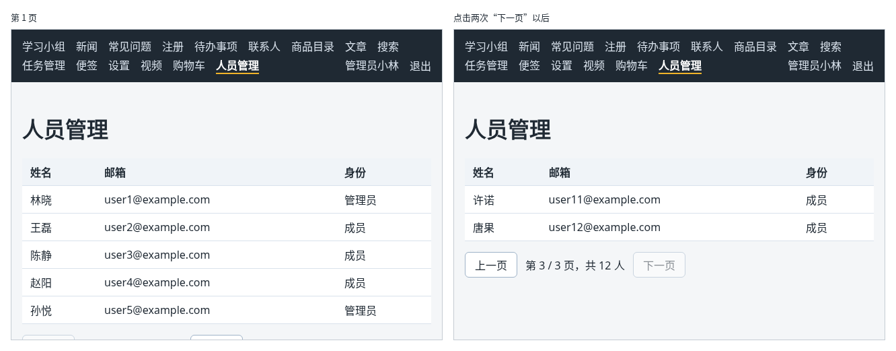

# 第 131 章：如何从服务器读取指定页的数据？

前置：[第 130B 章：大视频上传到一半时，如何让用户取消？](第130B章-大视频上传到一半时，如何让用户取消.md)

## 一、本章要解决的问题

第 58 章的商品目录分页时，14 件商品全部在前端，只是每次显示其中几件。真实的后台中，人员、订单动辄成千上万条，不可能一次全部读到浏览器里。常见的做法是让服务器分页：前端说“我要第 2 页、每页 5 条”，服务器只返回这 5 条，以及一共有多少条。

本章做一个只有管理员能看的“人员管理”页，按页从练习服务读取人员。完成后：用 `admin` 登录，导航栏中出现“人员管理”；打开后表格中显示第 1 页的 5 个人，下方是“第 1 / 3 页，共 12 人”；点“下一页”，表格变淡一下，随后换成第 2 页的人；到第 3 页时只有 2 个人，“下一页”不能点；用 `member` 登录，导航栏中没有这一项，直接打开地址会提示“只有管理员可以查看人员管理。”。

下图左边是第 1 页，右边是第 3 页：



## 二、必要原理

### 分页接口

| 请求 | 说明 |
| --- | --- |
| `GET /api/people?page=2&pageSize=5` | 读取第 2 页，每页 5 条；只有管理员可以调用 |

成功时返回：

```json
{
  "items": [{ "id": "p6", "name": "周宁", "email": "user6@example.com", "role": "成员" }],
  "page": 2,
  "pageSize": 5,
  "total": 12,
  "totalPages": 3
}
```

`items` 是这一页的人员；`total` 是总人数，`totalPages` 是总页数。页面上的“第 2 / 3 页，共 12 人”和翻页按钮能不能点，全靠这几个数字，前端不需要知道其他页的数据。

没有登录返回 401；登录了但不是管理员，返回 403（没有权限）。

### 用 URLSearchParams 拼查询参数

查询参数可以手工拼成字符串，但值中有特殊字符时容易出错。浏览器提供的 `URLSearchParams` 会自动处理编码：

```tsx
const query = new URLSearchParams({ page: String(page), pageSize: String(PAGE_SIZE) });
query.toString(); // 'page=2&pageSize=5'
```

它要求每个值都是字符串，所以数字先用 `String` 转换（第 44C 章）。第 96 章 `useSearchParams` 返回的，也是这种对象。

### 页码变了就重新读取

`page` 是一个 state。读取写在 Effect 中，依赖数组是 `[page]`：翻页时 `page` 变了，Effect 重新执行，读取新的一页。这和第 76 章“搜索关键词变化后重新请求”是同一种写法，也用 `ignore` 防止快速翻页时，先发出的请求后回来，覆盖了后面的结果（第 78 章）。

### 翻页时不闪空白

翻页时如果先把内容清空、显示“正在读取”，表格会消失半秒再出现，页面上下跳动。第 70 章的做法是读取期间保留原来的内容：`loading` 状态中也带着上一页的数据，表格只是变淡，翻页按钮暂时不能点。

把状态改成 `loading` 写在翻页按钮的处理函数 `handlePageChange` 中，而不是 Effect 中：Effect 中同步调用 `setState` 会多引起一次渲染，检查命令也会给出警告（第 77 章起出现过的 `set-state-in-effect`）。

### 403：没有权限

401 和 403 不一样：

| 状态码 | 意思 | 页面怎样处理 |
| --- | --- | --- |
| 401 | 没有登录，或者登录已失效 | 调用 `expireSession`，去登录页（第 115 章） |
| 403 | 登录了，但这个账号没有权限 | 告诉用户“没有权限”，重新登录也没用 |

导航栏中“人员管理”只对管理员显示，但普通成员仍然可以在地址栏直接输入 `/people`。所以页面中仍要处理 403，真正决定能不能看的是服务器（第 112 章）。

## 三、动手实现

### 第 1 步：人员和分页数据的类型

新建 `src/types/person.ts`：

```ts
export type Person = {
  id: string;
  name: string;
  email: string;
  role: string;
};

// 服务器返回的一页数据：本页的人员，以及计算页码要用的几个数字
export type PeoplePageData = {
  items: Person[];
  page: number;
  pageSize: number;
  total: number;
  totalPages: number;
};

function isPerson(value: unknown): value is Person {
  return (
    typeof value === 'object' &&
    value !== null &&
    'id' in value &&
    typeof value.id === 'string' &&
    'name' in value &&
    typeof value.name === 'string' &&
    'email' in value &&
    typeof value.email === 'string' &&
    'role' in value &&
    typeof value.role === 'string'
  );
}

export function isPeoplePageData(value: unknown): value is PeoplePageData {
  return (
    typeof value === 'object' &&
    value !== null &&
    'items' in value &&
    Array.isArray(value.items) &&
    value.items.every(isPerson) &&
    'page' in value &&
    typeof value.page === 'number' &&
    'pageSize' in value &&
    typeof value.pageSize === 'number' &&
    'total' in value &&
    typeof value.total === 'number' &&
    'totalPages' in value &&
    typeof value.totalPages === 'number'
  );
}
```

`isPerson` 只在这个文件中使用，不需要导出。

### 第 2 步：读取一页人员的请求

新建 `src/lib/peopleApi.ts`：

```ts
import { apiUrl } from './api';
import { isPeoplePageData } from '../types/person';
import type { PeoplePageData } from '../types/person';

export const PAGE_SIZE = 5;

export type PeopleResult =
  | { status: 'success'; data: PeoplePageData }
  | { status: 'unauthorized' }
  | { status: 'forbidden' };

export async function fetchPeople(page: number): Promise<PeopleResult> {
  // 第几页、每页几条都写在查询参数中，服务器只返回这一页
  const query = new URLSearchParams({ page: String(page), pageSize: String(PAGE_SIZE) });
  let response: Response;
  try {
    response = await fetch(apiUrl('/people?' + query.toString()));
  } catch {
    throw new Error('无法连接练习服务，请确认它已经启动。');
  }
  if (response.status === 401) {
    return { status: 'unauthorized' };
  }
  if (response.status === 403) {
    return { status: 'forbidden' };
  }
  if (!response.ok) {
    throw new Error('人员读取失败：服务器返回了状态 ' + response.status + '。');
  }
  const data: unknown = await response.json();
  if (!isPeoplePageData(data)) {
    throw new Error('人员数据格式不正确，暂时无法显示。');
  }
  return { status: 'success', data };
}
```

### 第 3 步：人员管理页的样式

新建 `src/pages/PeoplePage.module.css`：

```css
.table {
  width: 100%;
  border-collapse: collapse;
  background: #ffffff;
}

.table th,
.table td {
  padding: 8px 12px;
  border-bottom: 1px solid #d9e2ec;
  text-align: left;
}

.table th {
  background: #f0f4f8;
}

.pagination {
  display: flex;
  align-items: center;
  gap: 12px;
  margin-top: 16px;
}

.loading {
  opacity: 0.5;
}
```

`border-collapse: collapse` 让表格相邻单元格的边框合成一条线。

### 第 4 步：人员管理页

新建 `src/pages/PeoplePage.tsx`：

```tsx
import { useEffect, useEffectEvent, useState } from 'react';
import { useAuth } from '../hooks/useAuth';
import { fetchPeople } from '../lib/peopleApi';
import type { PeoplePageData } from '../types/person';
import styles from './PeoplePage.module.css';

type LoadState =
  | { status: 'loading'; data: PeoplePageData | null }
  | { status: 'success'; data: PeoplePageData }
  | { status: 'forbidden' }
  | { status: 'error'; message: string };

function getErrorMessage(error: unknown) {
  return error instanceof Error ? error.message : '人员读取失败。';
}

export default function PeoplePage() {
  const { expireSession } = useAuth();
  const [page, setPage] = useState(1);
  const [loadState, setLoadState] = useState<LoadState>({ status: 'loading', data: null });

  const onExpired = useEffectEvent(() => {
    expireSession();
  });

  // 页码变了就向服务器读取这一页
  useEffect(() => {
    let ignore = false;

    async function loadPage() {
      try {
        const result = await fetchPeople(page);
        if (ignore) {
          return;
        }
        if (result.status === 'unauthorized') {
          onExpired();
        } else if (result.status === 'forbidden') {
          setLoadState({ status: 'forbidden' });
        } else {
          setLoadState({ status: 'success', data: result.data });
        }
      } catch (error) {
        if (!ignore) {
          setLoadState({ status: 'error', message: getErrorMessage(error) });
        }
      }
    }

    loadPage();
    return () => {
      ignore = true;
    };
  }, [page]);

  function handlePageChange(nextPage: number) {
    // 读取期间保留上一页的内容，只是变淡，翻页时不会闪一下空白
    setLoadState((current) => ({
      status: 'loading',
      data: current.status === 'success' || current.status === 'loading' ? current.data : null,
    }));
    setPage(nextPage);
  }

  if (loadState.status === 'forbidden') {
    return (
      <main className="page">
        <h1>人员管理</h1>
        <p role="alert">只有管理员可以查看人员管理。</p>
      </main>
    );
  }

  const data = loadState.status === 'error' ? null : loadState.data;

  return (
    <main className="page">
      <title>人员管理</title>
      <h1>人员管理</h1>
      {loadState.status === 'error' && <p role="alert">{loadState.message}</p>}
      {loadState.status === 'loading' && data === null && <p role="status">正在读取人员……</p>}
      {data && (
        <div className={loadState.status === 'loading' ? styles.loading : undefined}>
          <table className={styles.table}>
            <thead>
              <tr>
                <th>姓名</th>
                <th>邮箱</th>
                <th>身份</th>
              </tr>
            </thead>
            <tbody>
              {data.items.map((person) => (
                <tr key={person.id}>
                  <td>{person.name}</td>
                  <td>{person.email}</td>
                  <td>{person.role}</td>
                </tr>
              ))}
            </tbody>
          </table>
          <nav className={styles.pagination} aria-label="分页">
            <button
              type="button"
              disabled={data.page <= 1 || loadState.status === 'loading'}
              onClick={() => handlePageChange(data.page - 1)}
            >
              上一页
            </button>
            <span>
              第 {data.page} / {data.totalPages} 页，共 {data.total} 人
            </span>
            <button
              type="button"
              disabled={data.page >= data.totalPages || loadState.status === 'loading'}
              onClick={() => handlePageChange(data.page + 1)}
            >
              下一页
            </button>
          </nav>
        </div>
      )}
    </main>
  );
}
```

- 表格用 HTML 的 `table`：`thead` 中是标题行，`tbody` 中是数据行，每行一个 `tr`，标题单元格是 `th`，数据单元格是 `td`。
- 翻页按钮根据服务器返回的 `data.page` 和 `data.totalPages` 判断能不能点，读取期间都不能点。
- 401 时用 `useEffectEvent` 调用 `expireSession`，和第 115 章相同。

### 第 5 步：加入路由和导航

打开 `src/App.tsx`，在导入 `NotesPage` 的一行下面加入：

```tsx
import PeoplePage from './pages/PeoplePage';
```

在 `/account` 那条路由的上面加入：

```tsx
            <Route
              path="/people"
              element={
                <RequireAuth>
                  <PeoplePage />
                </RequireAuth>
              }
            />
```

打开 `src/components/AppLayout.tsx`，在显示用户名的代码上面加入：

```tsx
        {!checking && user && user.role === 'admin' && <NavLink to="/people">人员管理</NavLink>}
```

## 四、运行与检查

保持开发服务器和练习服务都在运行（准备篇二）。先运行一次 `npm.cmd run reset-data`，让人员恢复成初始的 12 人。

1. 用 `admin` 登录，导航栏中出现“人员管理”。打开它，表格中是林晓、王磊、陈静、赵阳、孙悦，下方显示“第 1 / 3 页，共 12 人”，“上一页”不能点。
2. 点“下一页”。表格先变淡，半秒后换成周宁到何琳 5 个人，页码变成“第 2 / 3 页”。
3. 再点“下一页”，第 3 页只有许诺和唐果，“下一页”不能点。
4. 在 Network（网络）面板中，每次翻页都只有一个请求，地址是 `/api/people?page=2&pageSize=5` 这样的形式，返回的 `items` 中只有这一页的人。
5. 退出后用 `member` 登录，导航栏中没有“人员管理”。在地址栏打开 `/people`，显示“只有管理员可以查看人员管理。”，Network 中这次请求的状态是 403。

最后运行检查，应没有错误：

```powershell
npm.cmd run check
```

**小练习**：把当前页码放进网址，例如 `/people?page=2`，刷新后仍然停在第 2 页。提示：用第 96 章的 `useSearchParams` 代替 `page` 这个 state。练习后恢复本章代码。

## 五、常见错误

| 现象 | 原因 | 怎么改 |
| --- | --- | --- |
| 翻页后表格中还是第 1 页的人 | Effect 的依赖数组写成了 `[]`，页码变了也不重新读取 | 写成 `[page]` |
| 普通成员打开 `/people`，显示“人员读取失败：服务器返回了状态 403。” | 没有单独处理 403 | 返回 `forbidden`，显示“只有管理员可以查看” |
| 检查命令报 `Type 'number' is not assignable to type 'string'` | 把数字直接交给了 `URLSearchParams` | 用 `String(page)` 转成字符串 |
| 每次翻页，表格都会消失半秒 | 翻页时把状态改成了不带数据的“读取中” | 读取期间保留上一页的数据，只让表格变淡 |

## 六、本章完整代码

### `src/types/person.ts`

同第三节第 1 步。

### `src/lib/peopleApi.ts`

同第三节第 2 步。

### `src/pages/PeoplePage.module.css`

同第三节第 3 步。

### `src/pages/PeoplePage.tsx`

同第三节第 4 步。

### `src/App.tsx`

```tsx
import { Route, Routes } from 'react-router';
import './App.css';
import AppLayout from './components/AppLayout';
import AuthProvider from './components/AuthProvider';
import CartProvider from './components/CartProvider';
import RequireAuth from './components/RequireAuth';
import AccountPage from './pages/AccountPage';
import ArticlePage from './pages/ArticlePage';
import ContactsPage from './pages/ContactsPage';
import FaqPage from './pages/FaqPage';
import GroupPage from './pages/GroupPage';
import LoginPage from './pages/LoginPage';
import NewsPage from './pages/NewsPage';
import NotesPage from './pages/NotesPage';
import PeoplePage from './pages/PeoplePage';
import NotFoundPage from './pages/NotFoundPage';
import ProductDetailPage from './pages/ProductDetailPage';
import ProductPage from './pages/ProductPage';
import RegisterPage from './pages/RegisterPage';
import SearchPage from './pages/SearchPage';
import SettingsPage from './pages/SettingsPage';
import ShopPage from './pages/ShopPage';
import TaskPage from './pages/TaskPage';
import TaskServerPage from './pages/TaskServerPage';
import VideosPage from './pages/VideosPage';

export default function App() {
  return (
    <AuthProvider>
      <CartProvider>
        <Routes>
          <Route element={<AppLayout />}>
            <Route path="/" element={<GroupPage />} />
            <Route path="/news" element={<NewsPage />} />
            <Route path="/faq" element={<FaqPage />} />
            <Route path="/register" element={<RegisterPage />} />
            <Route path="/todos" element={<TaskPage />} />
            <Route path="/contacts" element={<ContactsPage />} />
            <Route path="/products" element={<ProductPage />} />
            <Route path="/products/:id" element={<ProductDetailPage />} />
            <Route path="/articles" element={<ArticlePage />} />
            <Route path="/search" element={<SearchPage />} />
            <Route path="/tasks" element={<TaskServerPage />} />
            <Route path="/shop" element={<ShopPage />} />
            <Route path="/notes" element={<NotesPage />} />
            <Route path="/settings" element={<SettingsPage />} />
            <Route path="/videos" element={<VideosPage />} />
            <Route
              path="/people"
              element={
                <RequireAuth>
                  <PeoplePage />
                </RequireAuth>
              }
            />
            <Route
              path="/account"
              element={
                <RequireAuth>
                  <AccountPage />
                </RequireAuth>
              }
            />
            <Route path="*" element={<NotFoundPage />} />
          </Route>
          <Route path="/login" element={<LoginPage />} />
        </Routes>
      </CartProvider>
    </AuthProvider>
  );
}
```

### `src/components/AppLayout.tsx`

```tsx
import { useState } from 'react';
import { NavLink, Outlet } from 'react-router';
import { useAuth } from '../hooks/useAuth';
import { useCart } from '../hooks/useCart';
import { useOnlineStatus } from '../hooks/useOnlineStatus';
import { logout } from '../lib/authApi';

export default function AppLayout() {
  const { user, checking, setUser } = useAuth();
  const [isLoggingOut, setIsLoggingOut] = useState(false);
  const { cartItems } = useCart();
  const online = useOnlineStatus();
  let cartCount = 0;
  for (const item of cartItems) {
    cartCount += item.quantity;
  }

  async function handleLogout() {
    setIsLoggingOut(true);
    try {
      // 先让服务器删除登录记录，否则刷新页面后又会自动登录
      await logout();
      // 当前页面如果需要登录，RequireAuth 会自动把人送去登录页
      setUser(null);
    } catch (error) {
      window.alert(error instanceof Error ? error.message : '退出失败，请稍后重试。');
    } finally {
      setIsLoggingOut(false);
    }
  }

  return (
    <div>
      <nav className="site-nav" aria-label="主导航">
        <NavLink to="/">学习小组</NavLink>
        <NavLink to="/news">新闻</NavLink>
        <NavLink to="/faq">常见问题</NavLink>
        <NavLink to="/register">注册</NavLink>
        <NavLink to="/todos">待办事项</NavLink>
        <NavLink to="/contacts">联系人</NavLink>
        <NavLink to="/products">商品目录</NavLink>
        <NavLink to="/articles">文章</NavLink>
        <NavLink to="/search">搜索</NavLink>
        <NavLink to="/tasks">任务管理</NavLink>
        <NavLink to="/notes">便签</NavLink>
        <NavLink to="/settings">设置</NavLink>
        <NavLink to="/videos">视频</NavLink>
        <NavLink to="/shop">
          购物车
          {cartCount > 0 && (
            <span className="cart-count" aria-label={'购物车中有 ' + cartCount + ' 件商品'}>
              {cartCount}
            </span>
          )}
        </NavLink>
        {!checking && user && user.role === 'admin' && <NavLink to="/people">人员管理</NavLink>}
        {/* 确认登录状态期间什么也不显示，避免先闪一下“登录”再变成用户名 */}
        {!checking && user && (
          <NavLink to="/account" className="nav-user">
            {user.displayName}
          </NavLink>
        )}
        {!checking && user && (
          <button
            type="button"
            className="nav-logout"
            disabled={isLoggingOut}
            onClick={handleLogout}
          >
            {isLoggingOut ? '正在退出……' : '退出'}
          </button>
        )}
        {!checking && !user && (
          <NavLink to="/login" className="nav-user">
            登录
          </NavLink>
        )}
      </nav>
      {!online && (
        <p role="status" className="offline-banner">
          网络已断开，需要连接服务器的功能暂时无法使用。
        </p>
      )}
      <Outlet />
    </div>
  );
}
```

## 七、本章改动小结

新增 `src/types/person.ts`、`src/lib/peopleApi.ts`、`src/pages/PeoplePage.tsx` 和 `src/pages/PeoplePage.module.css`：按页向服务器读取人员并用表格显示，处理 401 和 403；修改 `src/App.tsx` 和 `src/components/AppLayout.tsx`：加入只有管理员可见的“人员管理”。

---

下一章：[第 132 章：如何实现当前页的全选与取消全选？](第132章-如何实现当前页的全选与取消全选.md)
