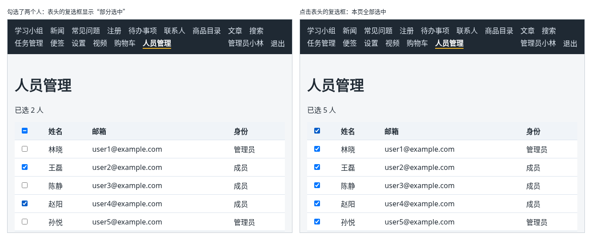

# 第 132 章：如何实现当前页的全选与取消全选？

前置：[第 131 章：如何从服务器读取指定页的数据？](第131章-如何从服务器读取指定页的数据.md)

## 一、本章要解决的问题

人员管理中，管理员经常要对几个人一起操作，例如一次删除好几个离职的人（下一章）。表格的每一行前面需要一个复选框，表头还要有一个“全选”复选框，一下选中这一页的所有人。

本章给人员表格加上勾选。完成后：每一行前面有复选框，勾选后表格上方显示“已选 2 人”；点表头的复选框，本页 5 个人全部选中；再点一次，全部取消；只选了一部分时，表头的复选框显示成一条横线，表示“部分选中”；翻到下一页时，勾选全部清空。

下图左边是勾选了两个人的样子，右边是点击表头复选框以后的样子：



## 二、必要原理

### 只记被选中的编号

和第 60 章选商品一样，用一个编号数组 `selectedIds` 记住选中了谁。每一行的复选框是否勾选，由“这个编号在不在数组中”算出来；点击时用 `filter` 去掉或用展开语法加上（第 45、46 章）。

### 全选的三种状态都是算出来的

表头复选框的状态不需要另外保存，从本页的人员和 `selectedIds` 算出来（第 32 章）：

| 本页选中的人数 | 表头复选框 |
| --- | --- |
| 0 | 不勾选 |
| 和本页人数相同 | 勾选 |
| 介于两者之间 | 部分选中（显示一条横线） |

点击表头复选框时：已经全选，就清空；否则把本页所有人的编号都放进去。从“部分选中”点一下，变成全选，这和大多数软件的习惯一致。

### “部分选中”要用 ref 设置

复选框的“部分选中”是元素的 `indeterminate` 属性。它只能用 JavaScript 设置，没有对应的 HTML 属性，React 也不支持在 JSX 中写 `indeterminate={…}`。

所以用第 115A 章的 ref 拿到表头复选框，在 Effect 中设置它：

```tsx
useEffect(() => {
  if (selectAllRef.current) {
    selectAllRef.current.indeterminate = someSelected;
  }
}, [someSelected]);
```

这是 Effect 的典型用途：让 React 管不到的东西，跟着 state 变化（第 123 章）。

### 只选当前页

数据是按页从服务器读取的（第 131 章），其他页的人员不在浏览器中。如果翻页后还留着上一页的勾选，用户在第 2 页点“删除”，删掉的却包括第 1 页那些他已经看不见的人，很容易出错。所以本章约定：只能选当前页，翻页时清空勾选。

需要跨页选择的系统也有，但要在页面上明确显示“已选 X 人（包括其他页）”，复杂得多。

## 三、动手实现

### 第 1 步：增加 state 和 ref

打开 `src/pages/PeoplePage.tsx`，把第一行改为：

```tsx
import { useEffect, useEffectEvent, useRef, useState } from 'react';
```

在 `loadState` 那一行的下面加入：

```tsx
  const [selectedIds, setSelectedIds] = useState<string[]>([]);
  const selectAllRef = useRef<HTMLInputElement>(null);
```

### 第 2 步：计算全选状态，写处理函数

在 `handlePageChange` 函数的上面加入：

```tsx
  const currentItems = loadState.status === 'success' ? loadState.data.items : [];
  const selectedCount = currentItems.filter((person) => selectedIds.includes(person.id)).length;
  const allSelected = currentItems.length > 0 && selectedCount === currentItems.length;
  const someSelected = selectedCount > 0 && !allSelected;

  // “选了一部分”只能通过元素的 indeterminate 属性显示，JSX 中没有对应的写法
  useEffect(() => {
    if (selectAllRef.current) {
      selectAllRef.current.indeterminate = someSelected;
    }
  }, [someSelected]);

  function handleToggleAll() {
    setSelectedIds(allSelected ? [] : currentItems.map((person) => person.id));
  }

  function handleToggle(id: string) {
    setSelectedIds((current) =>
      current.includes(id) ? current.filter((item) => item !== id) : [...current, id],
    );
  }

```

`allSelected` 中要先判断 `currentItems.length > 0`：本页一个人都没有时，`0 === 0` 也成立，不能算作全选。

### 第 3 步：翻页时清空勾选

在 `handlePageChange` 的第一行加入：

```tsx
    // 只选当前页：换页时清空勾选，避免在看不见的页面上留着选中的人
    setSelectedIds([]);
```

### 第 4 步：表格中加入复选框

在 `<div className={…}>` 的下面、表格的上面加入选中人数：

```tsx
          <p>{selectedCount === 0 ? '还没有选择人员' : '已选 ' + selectedCount + ' 人'}</p>
```

在表头 `<th>姓名</th>` 的前面加入：

```tsx
                <th>
                  <input
                    ref={selectAllRef}
                    type="checkbox"
                    aria-label="选择本页全部人员"
                    checked={allSelected}
                    onChange={handleToggleAll}
                  />
                </th>
```

在每一行 `<td>{person.name}</td>` 的前面加入：

```tsx
                  <td>
                    <input
                      type="checkbox"
                      aria-label={'选择：' + person.name}
                      checked={selectedIds.includes(person.id)}
                      onChange={() => handleToggle(person.id)}
                    />
                  </td>
```

复选框旁边没有文字，用 `aria-label` 说明它选的是谁（第 46 章）。

### 第 5 步：复选框这一列的宽度

打开 `src/pages/PeoplePage.module.css`，在 `.table th` 规则的后面加入：

```css

.table th:first-child,
.table td:first-child {
  width: 40px;
}
```

`:first-child` 表示“同一层中的第一个元素”，这里就是每一行的第一个单元格。

## 四、运行与检查

保持开发服务器和练习服务都在运行（准备篇二），用 `admin` 登录后打开“人员管理”。

1. 表格第一列是复选框，表格上方显示“还没有选择人员”。
2. 勾选王磊，显示“已选 1 人”，表头的复选框显示成一条横线。
3. 点表头的复选框，本页 5 个人全部勾选，显示“已选 5 人”，表头的复选框打勾。
4. 取消王磊，显示“已选 4 人”，表头又变成横线。再点表头的复选框，5 人全部选中；再点一次，全部取消。
5. 全选后点“下一页”，第 2 页没有任何勾选，显示“还没有选择人员”。点“上一页”回来，第 1 页的勾选也没有了。
6. 在 Elements（元素）面板中选中表头的复选框，在 Properties（属性）中可以看到 `indeterminate` 随部分选中变为 `true`。

最后运行检查，应没有错误：

```powershell
npm.cmd run check
```

**小练习**：给被勾选的行加上浅蓝色背景，让用户一眼看出选了谁。提示：在 `tr` 上按 `selectedIds.includes(person.id)` 选择类名，写法和第 60 章选中商品的样式相同。练习后恢复本章代码。

## 五、常见错误

| 现象 | 原因 | 怎么改 |
| --- | --- | --- |
| 只选了一部分时，表头复选框仍然是空的 | 没有设置 `indeterminate`，或者想在 JSX 中写 `indeterminate={…}` | 用 ref 拿到元素，在 Effect 中设置 `indeterminate` |
| 本页没有人员时，表头复选框显示为已勾选 | `allSelected` 没有先判断本页人数是否大于 0 | 写成 `currentItems.length > 0 && selectedCount === currentItems.length` |
| 翻页后，“已选”的人数还算着上一页的人 | 翻页时没有清空 `selectedIds` | 在 `handlePageChange` 中 `setSelectedIds([])` |
| 点表头复选框后，只选中了第一个人 | `handleToggleAll` 中写成了把某一个编号加进数组 | 用 `currentItems.map((person) => person.id)` 得到本页所有编号 |

## 六、本章完整代码

### `src/pages/PeoplePage.tsx`

```tsx
import { useEffect, useEffectEvent, useRef, useState } from 'react';
import { useAuth } from '../hooks/useAuth';
import { fetchPeople } from '../lib/peopleApi';
import type { PeoplePageData } from '../types/person';
import styles from './PeoplePage.module.css';

type LoadState =
  | { status: 'loading'; data: PeoplePageData | null }
  | { status: 'success'; data: PeoplePageData }
  | { status: 'forbidden' }
  | { status: 'error'; message: string };

function getErrorMessage(error: unknown) {
  return error instanceof Error ? error.message : '人员读取失败。';
}

export default function PeoplePage() {
  const { expireSession } = useAuth();
  const [page, setPage] = useState(1);
  const [loadState, setLoadState] = useState<LoadState>({ status: 'loading', data: null });
  const [selectedIds, setSelectedIds] = useState<string[]>([]);
  const selectAllRef = useRef<HTMLInputElement>(null);

  const onExpired = useEffectEvent(() => {
    expireSession();
  });

  // 页码变了就向服务器读取这一页
  useEffect(() => {
    let ignore = false;

    async function loadPage() {
      try {
        const result = await fetchPeople(page);
        if (ignore) {
          return;
        }
        if (result.status === 'unauthorized') {
          onExpired();
        } else if (result.status === 'forbidden') {
          setLoadState({ status: 'forbidden' });
        } else {
          setLoadState({ status: 'success', data: result.data });
        }
      } catch (error) {
        if (!ignore) {
          setLoadState({ status: 'error', message: getErrorMessage(error) });
        }
      }
    }

    loadPage();
    return () => {
      ignore = true;
    };
  }, [page]);

  const currentItems = loadState.status === 'success' ? loadState.data.items : [];
  const selectedCount = currentItems.filter((person) => selectedIds.includes(person.id)).length;
  const allSelected = currentItems.length > 0 && selectedCount === currentItems.length;
  const someSelected = selectedCount > 0 && !allSelected;

  // “选了一部分”只能通过元素的 indeterminate 属性显示，JSX 中没有对应的写法
  useEffect(() => {
    if (selectAllRef.current) {
      selectAllRef.current.indeterminate = someSelected;
    }
  }, [someSelected]);

  function handleToggleAll() {
    setSelectedIds(allSelected ? [] : currentItems.map((person) => person.id));
  }

  function handleToggle(id: string) {
    setSelectedIds((current) =>
      current.includes(id) ? current.filter((item) => item !== id) : [...current, id],
    );
  }

  function handlePageChange(nextPage: number) {
    // 只选当前页：换页时清空勾选，避免在看不见的页面上留着选中的人
    setSelectedIds([]);
    // 读取期间保留上一页的内容，只是变淡，翻页时不会闪一下空白
    setLoadState((current) => ({
      status: 'loading',
      data: current.status === 'success' || current.status === 'loading' ? current.data : null,
    }));
    setPage(nextPage);
  }

  if (loadState.status === 'forbidden') {
    return (
      <main className="page">
        <h1>人员管理</h1>
        <p role="alert">只有管理员可以查看人员管理。</p>
      </main>
    );
  }

  const data = loadState.status === 'error' ? null : loadState.data;

  return (
    <main className="page">
      <title>人员管理</title>
      <h1>人员管理</h1>
      {loadState.status === 'error' && <p role="alert">{loadState.message}</p>}
      {loadState.status === 'loading' && data === null && <p role="status">正在读取人员……</p>}
      {data && (
        <div className={loadState.status === 'loading' ? styles.loading : undefined}>
          <p>{selectedCount === 0 ? '还没有选择人员' : '已选 ' + selectedCount + ' 人'}</p>
          <table className={styles.table}>
            <thead>
              <tr>
                <th>
                  <input
                    ref={selectAllRef}
                    type="checkbox"
                    aria-label="选择本页全部人员"
                    checked={allSelected}
                    onChange={handleToggleAll}
                  />
                </th>
                <th>姓名</th>
                <th>邮箱</th>
                <th>身份</th>
              </tr>
            </thead>
            <tbody>
              {data.items.map((person) => (
                <tr key={person.id}>
                  <td>
                    <input
                      type="checkbox"
                      aria-label={'选择：' + person.name}
                      checked={selectedIds.includes(person.id)}
                      onChange={() => handleToggle(person.id)}
                    />
                  </td>
                  <td>{person.name}</td>
                  <td>{person.email}</td>
                  <td>{person.role}</td>
                </tr>
              ))}
            </tbody>
          </table>
          <nav className={styles.pagination} aria-label="分页">
            <button
              type="button"
              disabled={data.page <= 1 || loadState.status === 'loading'}
              onClick={() => handlePageChange(data.page - 1)}
            >
              上一页
            </button>
            <span>
              第 {data.page} / {data.totalPages} 页，共 {data.total} 人
            </span>
            <button
              type="button"
              disabled={data.page >= data.totalPages || loadState.status === 'loading'}
              onClick={() => handlePageChange(data.page + 1)}
            >
              下一页
            </button>
          </nav>
        </div>
      )}
    </main>
  );
}
```

### `src/pages/PeoplePage.module.css`

```css
.table {
  width: 100%;
  border-collapse: collapse;
  background: #ffffff;
}

.table th,
.table td {
  padding: 8px 12px;
  border-bottom: 1px solid #d9e2ec;
  text-align: left;
}

.table th {
  background: #f0f4f8;
}

.table th:first-child,
.table td:first-child {
  width: 40px;
}

.pagination {
  display: flex;
  align-items: center;
  gap: 12px;
  margin-top: 16px;
}

.loading {
  opacity: 0.5;
}
```

## 七、本章改动小结

修改 `src/pages/PeoplePage.tsx`：每一行加上复选框，表头可以全选和取消全选，部分选中时用 ref 设置 `indeterminate`，翻页时清空勾选；修改 `src/pages/PeoplePage.module.css`：复选框这一列的宽度。

---

下一章：[第 133 章：如何批量删除用户选中的记录？](第133章-如何批量删除用户选中的记录.md)
