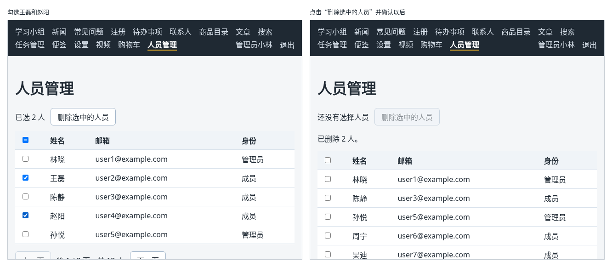

# 第 133 章：如何批量删除用户选中的记录？

前置：[第 132 章：如何实现当前页的全选与取消全选？](第132章-如何实现当前页的全选与取消全选.md)

## 一、本章要解决的问题

勾选好了要删除的人，还差一个“删除”按钮。一个一个删要点很多次、发很多个请求，后台系统一般提供“删除选中的人员”，一次删完。删完以后，表格要显示删除后的最新结果：后面页的人会补上来，总人数和总页数也会变。

本章加上批量删除。完成后：没有勾选时“删除选中的人员”不能点；勾选王磊和赵阳后点击，先确认“确定要删除选中的 2 个人吗？删除后无法恢复。”；确认后显示“已删除 2 人。”，表格重新读取，第 1 页由后面的人补齐，下方变成“第 1 / 2 页，共 10 人”；在最后一页把人全部删掉，页面自动回到新的最后一页。

下图左边是勾选两个人的样子，右边是删除并确认以后的样子：



## 二、必要原理

### 批量删除的接口

| 请求 | 正文 | 结果 |
| --- | --- | --- |
| `POST /api/people/batch-delete` | `{ "ids": ["p2", "p4"] }` | 状态 200，返回 `{ "deleted": 2 }`，即实际删除的人数 |

只有管理员可以调用。这里用 `POST` 而不是 `DELETE`：要删除的编号有好几个，放在正文中最方便，而很多服务器不接受带正文的 `DELETE` 请求。这是后台接口中常见的约定。

发送 JSON 正文的写法和第 86 章相同。

### 删除后重新读取当前页

服务器分页时，删掉第 1 页的两个人，第 2 页的前两个人就会挪到第 1 页。这些人的数据前端没有，所以不能像第 92 章那样直接从列表中去掉两行，要重新读取当前页。

读取写在 Effect 中，依赖数组是 `[page]`。删除后页码没变，Effect 不会重新执行。办法是再加一个 state `reloadKey`，写进依赖数组；需要重新读取时把它加 1：

```tsx
setReloadKey((current) => current + 1);
```

`reloadKey` 本身没有任何含义，它的作用只是“变一下”，让 Effect 再执行一次。

### 最后一页被删光了

共 10 人、在第 2 页时，把第 2 页的 5 个人全部删掉，重新读取第 2 页，服务器返回的 `items` 是空的，`totalPages` 变成了 1。这一页已经不存在了，应该显示新的最后一页。

所以读到结果时多判断一次：`items` 是空的，并且 `page` 大于 `totalPages`，就把页码改成 `totalPages`。页码变了，Effect 会再读取一次。这个判断写在请求完成之后，不会引起第 131 章说的那种多余的渲染。

### 删除前确认，删除期间禁用

删除前用第 93B 章的 `window.confirm` 确认，提示中写出要删除的人数；删除期间按钮显示“正在删除……”并禁用（第 89 章）。删除成功后清空勾选：这些人已经不在了。

## 三、动手实现

### 第 1 步：批量删除的请求

打开 `src/lib/peopleApi.ts`，在文件最后加入：

```ts

export type DeleteResult =
  | { status: 'success'; deleted: number }
  | { status: 'unauthorized' }
  | { status: 'forbidden' };

export async function deletePeople(ids: string[]): Promise<DeleteResult> {
  let response: Response;
  try {
    // 一次请求删除多个人，编号放在正文中
    response = await fetch(apiUrl('/people/batch-delete'), {
      method: 'POST',
      headers: { 'Content-Type': 'application/json' },
      body: JSON.stringify({ ids }),
    });
  } catch {
    throw new Error('无法连接练习服务，请确认它已经启动。');
  }
  if (response.status === 401) {
    return { status: 'unauthorized' };
  }
  if (response.status === 403) {
    return { status: 'forbidden' };
  }
  if (!response.ok) {
    throw new Error('删除失败：服务器返回了状态 ' + response.status + '。');
  }
  const data: unknown = await response.json();
  if (typeof data !== 'object' || data === null || !('deleted' in data)) {
    throw new Error('删除成功，但返回的数据格式不正确，请刷新页面查看。');
  }
  return { status: 'success', deleted: typeof data.deleted === 'number' ? data.deleted : 0 };
}
```

### 第 2 步：增加 state，让读取可以重来

打开 `src/pages/PeoplePage.tsx`，把导入请求的一行改为：

```tsx
import { deletePeople, fetchPeople } from '../lib/peopleApi';
```

在 `selectedIds` 那一行的下面加入：

```tsx
  // 每次加 1，就让读取的 Effect 再执行一次，用来在删除后重新读取当前页
  const [reloadKey, setReloadKey] = useState(0);
  const [isDeleting, setIsDeleting] = useState(false);
  const [actionMessage, setActionMessage] = useState('');
```

在读取的 Effect 中，把成功时的 `else` 分支改为：

```tsx
        } else if (result.data.items.length === 0 && result.data.page > result.data.totalPages) {
          // 删光了最后一页，这一页已经不存在了，改为读取新的最后一页
          setPage(result.data.totalPages);
        } else {
          setLoadState({ status: 'success', data: result.data });
        }
```

把这个 Effect 的依赖数组改为：

```tsx
  }, [page, reloadKey]);
```

### 第 3 步：删除的处理函数

在 `handlePageChange` 的上面加入：

```tsx
  async function handleDeleteSelected() {
    if (!window.confirm('确定要删除选中的 ' + selectedIds.length + ' 个人吗？删除后无法恢复。')) {
      return;
    }
    setIsDeleting(true);
    setActionMessage('');
    try {
      const result = await deletePeople(selectedIds);
      if (result.status === 'unauthorized') {
        expireSession();
        return;
      }
      if (result.status === 'forbidden') {
        setActionMessage('只有管理员可以删除人员。');
        return;
      }
      setSelectedIds([]);
      setActionMessage('已删除 ' + result.deleted + ' 人。');
      setLoadState((current) => ({
        status: 'loading',
        data: current.status === 'success' || current.status === 'loading' ? current.data : null,
      }));
      setReloadKey((current) => current + 1);
    } catch (error) {
      setActionMessage(getErrorMessage(error));
    } finally {
      setIsDeleting(false);
    }
  }

```

勾选只在当前页（第 132 章），所以 `selectedIds` 就是要删除的编号。重新读取之前把状态改为保留原数据的“读取中”，和翻页时一样，表格只是变淡一下。

### 第 4 步：删除按钮和提示

把表格上方显示已选人数的那一行替换为：

```tsx
          <div className={styles.toolbar}>
            <span>{selectedCount === 0 ? '还没有选择人员' : '已选 ' + selectedCount + ' 人'}</span>
            <button
              type="button"
              disabled={selectedCount === 0 || isDeleting}
              onClick={handleDeleteSelected}
            >
              {isDeleting ? '正在删除……' : '删除选中的人员'}
            </button>
          </div>
          {actionMessage && <p role="status">{actionMessage}</p>}
```

打开 `src/pages/PeoplePage.module.css`，在文件最后加入：

```css

.toolbar {
  display: flex;
  align-items: center;
  gap: 12px;
  margin-bottom: 12px;
}
```

## 四、运行与检查

保持开发服务器和练习服务都在运行（准备篇二）。先运行 `npm.cmd run reset-data` 恢复 12 个人，再用 `admin` 登录，打开“人员管理”。

1. 没有勾选时，“删除选中的人员”是灰色的。
2. 勾选王磊和赵阳，点“删除选中的人员”，弹出“确定要删除选中的 2 个人吗？删除后无法恢复。”。点“取消”，什么也没发生。
3. 再点一次，这次点“确定”。显示“已删除 2 人。”，表格变淡后重新显示：林晓、陈静、孙悦、周宁、吴迪，下方是“第 1 / 2 页，共 10 人”。Network（网络）中先有一个 `batch-delete` 请求，正文是 `{"ids":["p2","p4"]}`，接着是重新读取第 1 页的请求。
4. 点“下一页”，第 2 页是郑欣到唐果 5 个人。全选后删除，页面显示“已删除 5 人。”，随后自动回到“第 1 / 1 页，共 5 人”。
5. 最后运行一次 `npm.cmd run reset-data`，把人员恢复，后面的章节还要用。

最后运行检查，应没有错误：

```powershell
npm.cmd run check
```

**小练习**：把“删除选中的人员”按钮的文字改成带人数的“删除选中的 2 人”，没有勾选时显示“删除选中的人员”。练习后恢复本章代码。

## 五、常见错误

| 现象 | 原因 | 怎么改 |
| --- | --- | --- |
| 删除成功了，表格中还显示着被删的人 | 删除后没有重新读取，页码没变，Effect 不会再执行 | 用 `reloadKey` 加 1，并写进依赖数组 |
| 删光最后一页后，表格是空的，页码显示“第 2 / 1 页” | 没有处理“这一页已经不存在”的情况 | 读到空的 `items` 且 `page > totalPages` 时，改为读取最后一页 |
| 删除后，勾选的复选框和“已选 2 人”还在 | 删除成功后没有清空 `selectedIds` | 成功后 `setSelectedIds([])` |
| 页面显示“删除失败：服务器返回了状态 422。” | 正文写成了 `JSON.stringify(ids)`，少了外面的 `ids` 字段，服务器认为没有提供编号 | 写成 `JSON.stringify({ ids })` |

## 六、本章完整代码

### `src/lib/peopleApi.ts`

```ts
import { apiUrl } from './api';
import { isPeoplePageData } from '../types/person';
import type { PeoplePageData } from '../types/person';

export const PAGE_SIZE = 5;

export type PeopleResult =
  | { status: 'success'; data: PeoplePageData }
  | { status: 'unauthorized' }
  | { status: 'forbidden' };

export async function fetchPeople(page: number): Promise<PeopleResult> {
  // 第几页、每页几条都写在查询参数中，服务器只返回这一页
  const query = new URLSearchParams({ page: String(page), pageSize: String(PAGE_SIZE) });
  let response: Response;
  try {
    response = await fetch(apiUrl('/people?' + query.toString()));
  } catch {
    throw new Error('无法连接练习服务，请确认它已经启动。');
  }
  if (response.status === 401) {
    return { status: 'unauthorized' };
  }
  if (response.status === 403) {
    return { status: 'forbidden' };
  }
  if (!response.ok) {
    throw new Error('人员读取失败：服务器返回了状态 ' + response.status + '。');
  }
  const data: unknown = await response.json();
  if (!isPeoplePageData(data)) {
    throw new Error('人员数据格式不正确，暂时无法显示。');
  }
  return { status: 'success', data };
}

export type DeleteResult =
  | { status: 'success'; deleted: number }
  | { status: 'unauthorized' }
  | { status: 'forbidden' };

export async function deletePeople(ids: string[]): Promise<DeleteResult> {
  let response: Response;
  try {
    // 一次请求删除多个人，编号放在正文中
    response = await fetch(apiUrl('/people/batch-delete'), {
      method: 'POST',
      headers: { 'Content-Type': 'application/json' },
      body: JSON.stringify({ ids }),
    });
  } catch {
    throw new Error('无法连接练习服务，请确认它已经启动。');
  }
  if (response.status === 401) {
    return { status: 'unauthorized' };
  }
  if (response.status === 403) {
    return { status: 'forbidden' };
  }
  if (!response.ok) {
    throw new Error('删除失败：服务器返回了状态 ' + response.status + '。');
  }
  const data: unknown = await response.json();
  if (typeof data !== 'object' || data === null || !('deleted' in data)) {
    throw new Error('删除成功，但返回的数据格式不正确，请刷新页面查看。');
  }
  return { status: 'success', deleted: typeof data.deleted === 'number' ? data.deleted : 0 };
}
```

### `src/pages/PeoplePage.tsx`

```tsx
import { useEffect, useEffectEvent, useRef, useState } from 'react';
import { useAuth } from '../hooks/useAuth';
import { deletePeople, fetchPeople } from '../lib/peopleApi';
import type { PeoplePageData } from '../types/person';
import styles from './PeoplePage.module.css';

type LoadState =
  | { status: 'loading'; data: PeoplePageData | null }
  | { status: 'success'; data: PeoplePageData }
  | { status: 'forbidden' }
  | { status: 'error'; message: string };

function getErrorMessage(error: unknown) {
  return error instanceof Error ? error.message : '人员读取失败。';
}

export default function PeoplePage() {
  const { expireSession } = useAuth();
  const [page, setPage] = useState(1);
  const [loadState, setLoadState] = useState<LoadState>({ status: 'loading', data: null });
  const [selectedIds, setSelectedIds] = useState<string[]>([]);
  // 每次加 1，就让读取的 Effect 再执行一次，用来在删除后重新读取当前页
  const [reloadKey, setReloadKey] = useState(0);
  const [isDeleting, setIsDeleting] = useState(false);
  const [actionMessage, setActionMessage] = useState('');
  const selectAllRef = useRef<HTMLInputElement>(null);

  const onExpired = useEffectEvent(() => {
    expireSession();
  });

  // 页码变了就向服务器读取这一页
  useEffect(() => {
    let ignore = false;

    async function loadPage() {
      try {
        const result = await fetchPeople(page);
        if (ignore) {
          return;
        }
        if (result.status === 'unauthorized') {
          onExpired();
        } else if (result.status === 'forbidden') {
          setLoadState({ status: 'forbidden' });
        } else if (result.data.items.length === 0 && result.data.page > result.data.totalPages) {
          // 删光了最后一页，这一页已经不存在了，改为读取新的最后一页
          setPage(result.data.totalPages);
        } else {
          setLoadState({ status: 'success', data: result.data });
        }
      } catch (error) {
        if (!ignore) {
          setLoadState({ status: 'error', message: getErrorMessage(error) });
        }
      }
    }

    loadPage();
    return () => {
      ignore = true;
    };
  }, [page, reloadKey]);

  const currentItems = loadState.status === 'success' ? loadState.data.items : [];
  const selectedCount = currentItems.filter((person) => selectedIds.includes(person.id)).length;
  const allSelected = currentItems.length > 0 && selectedCount === currentItems.length;
  const someSelected = selectedCount > 0 && !allSelected;

  // “选了一部分”只能通过元素的 indeterminate 属性显示，JSX 中没有对应的写法
  useEffect(() => {
    if (selectAllRef.current) {
      selectAllRef.current.indeterminate = someSelected;
    }
  }, [someSelected]);

  function handleToggleAll() {
    setSelectedIds(allSelected ? [] : currentItems.map((person) => person.id));
  }

  function handleToggle(id: string) {
    setSelectedIds((current) =>
      current.includes(id) ? current.filter((item) => item !== id) : [...current, id],
    );
  }

  async function handleDeleteSelected() {
    if (!window.confirm('确定要删除选中的 ' + selectedIds.length + ' 个人吗？删除后无法恢复。')) {
      return;
    }
    setIsDeleting(true);
    setActionMessage('');
    try {
      const result = await deletePeople(selectedIds);
      if (result.status === 'unauthorized') {
        expireSession();
        return;
      }
      if (result.status === 'forbidden') {
        setActionMessage('只有管理员可以删除人员。');
        return;
      }
      setSelectedIds([]);
      setActionMessage('已删除 ' + result.deleted + ' 人。');
      setLoadState((current) => ({
        status: 'loading',
        data: current.status === 'success' || current.status === 'loading' ? current.data : null,
      }));
      setReloadKey((current) => current + 1);
    } catch (error) {
      setActionMessage(getErrorMessage(error));
    } finally {
      setIsDeleting(false);
    }
  }

  function handlePageChange(nextPage: number) {
    // 只选当前页：换页时清空勾选，避免在看不见的页面上留着选中的人
    setSelectedIds([]);
    // 读取期间保留上一页的内容，只是变淡，翻页时不会闪一下空白
    setLoadState((current) => ({
      status: 'loading',
      data: current.status === 'success' || current.status === 'loading' ? current.data : null,
    }));
    setPage(nextPage);
  }

  if (loadState.status === 'forbidden') {
    return (
      <main className="page">
        <h1>人员管理</h1>
        <p role="alert">只有管理员可以查看人员管理。</p>
      </main>
    );
  }

  const data = loadState.status === 'error' ? null : loadState.data;

  return (
    <main className="page">
      <title>人员管理</title>
      <h1>人员管理</h1>
      {loadState.status === 'error' && <p role="alert">{loadState.message}</p>}
      {loadState.status === 'loading' && data === null && <p role="status">正在读取人员……</p>}
      {data && (
        <div className={loadState.status === 'loading' ? styles.loading : undefined}>
          <div className={styles.toolbar}>
            <span>{selectedCount === 0 ? '还没有选择人员' : '已选 ' + selectedCount + ' 人'}</span>
            <button
              type="button"
              disabled={selectedCount === 0 || isDeleting}
              onClick={handleDeleteSelected}
            >
              {isDeleting ? '正在删除……' : '删除选中的人员'}
            </button>
          </div>
          {actionMessage && <p role="status">{actionMessage}</p>}
          <table className={styles.table}>
            <thead>
              <tr>
                <th>
                  <input
                    ref={selectAllRef}
                    type="checkbox"
                    aria-label="选择本页全部人员"
                    checked={allSelected}
                    onChange={handleToggleAll}
                  />
                </th>
                <th>姓名</th>
                <th>邮箱</th>
                <th>身份</th>
              </tr>
            </thead>
            <tbody>
              {data.items.map((person) => (
                <tr key={person.id}>
                  <td>
                    <input
                      type="checkbox"
                      aria-label={'选择：' + person.name}
                      checked={selectedIds.includes(person.id)}
                      onChange={() => handleToggle(person.id)}
                    />
                  </td>
                  <td>{person.name}</td>
                  <td>{person.email}</td>
                  <td>{person.role}</td>
                </tr>
              ))}
            </tbody>
          </table>
          <nav className={styles.pagination} aria-label="分页">
            <button
              type="button"
              disabled={data.page <= 1 || loadState.status === 'loading'}
              onClick={() => handlePageChange(data.page - 1)}
            >
              上一页
            </button>
            <span>
              第 {data.page} / {data.totalPages} 页，共 {data.total} 人
            </span>
            <button
              type="button"
              disabled={data.page >= data.totalPages || loadState.status === 'loading'}
              onClick={() => handlePageChange(data.page + 1)}
            >
              下一页
            </button>
          </nav>
        </div>
      )}
    </main>
  );
}
```

### `src/pages/PeoplePage.module.css`

```css
.table {
  width: 100%;
  border-collapse: collapse;
  background: #ffffff;
}

.table th,
.table td {
  padding: 8px 12px;
  border-bottom: 1px solid #d9e2ec;
  text-align: left;
}

.table th {
  background: #f0f4f8;
}

.table th:first-child,
.table td:first-child {
  width: 40px;
}

.pagination {
  display: flex;
  align-items: center;
  gap: 12px;
  margin-top: 16px;
}

.loading {
  opacity: 0.5;
}

.toolbar {
  display: flex;
  align-items: center;
  gap: 12px;
  margin-bottom: 12px;
}
```

## 七、本章改动小结

修改 `src/lib/peopleApi.ts`：新增批量删除的 `deletePeople`；修改 `src/pages/PeoplePage.tsx`：删除选中的人员，成功后用 `reloadKey` 重新读取当前页，最后一页删光时改读新的最后一页；修改 `src/pages/PeoplePage.module.css`：新增工具栏的样式。

---

下一章：[第 134 章：【组合】如何点击表格中的一行，在弹窗中编辑它？](第134章-如何点击表格中的一行，在弹窗中编辑它.md)
