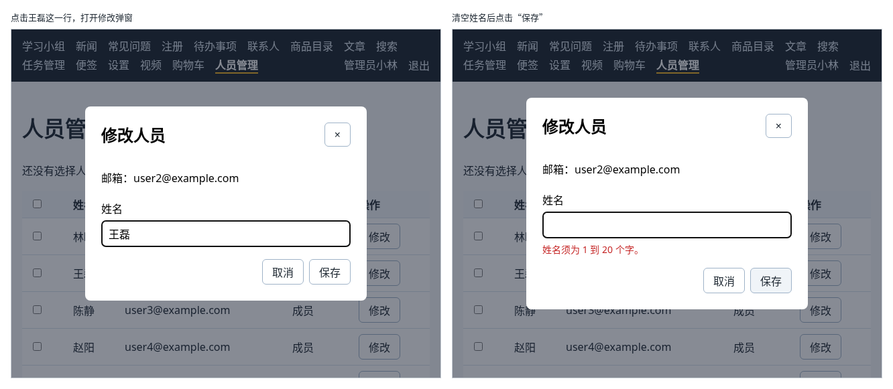

# 第 134 章：【组合】如何点击表格中的一行，在弹窗中编辑它？

前置：[第 133 章：如何批量删除用户选中的记录？](第133章-如何批量删除用户选中的记录.md)

## 一、本章要解决的问题

人员管理页已经能分页查看、勾选和批量删除，还不能修改。后台系统中常见的做法是：点击表格中的某一行，弹出一个窗口，修改后保存，表格中的这一行马上变成新的内容，不用离开当前页。

本章让管理员在弹窗中修改人员的姓名。完成后：鼠标移到某一行上，这一行变色；点击这一行，或点这一行最后的“修改”按钮，弹出“修改人员”窗口，姓名框中是原来的姓名；点复选框只是勾选，不会打开弹窗；清空姓名或输入超过 20 个字再保存，姓名框下方显示服务器返回的“姓名须为 1 到 20 个字。”；保存成功后弹窗关闭，这一行显示新姓名，表格上方显示“已保存“王磊磊”。”；改了姓名没有保存就关闭，先确认是否放弃。

本章不引入新的技术，组合的是：事件冒泡和 `event.target`（第 117 章）、`dialog` 弹窗和回传结果（第 116、120 章）、打开后聚焦（第 118 章）、把 ref 交给 `TextField`（第 119 章）、关闭前确认（第 121 章），以及修改保存、字段错误、用返回的数据更新列表（第 87、90、92 章）。

下图左边是点击王磊这一行后的样子，右边是清空姓名后保存的样子：



## 二、必要原理

### 修改姓名的接口

| 请求 | 正文 | 结果 |
| --- | --- | --- |
| `PATCH /api/people/编号` | `{ "name": "王磊磊" }` | 状态 200，返回修改后的这个人 |
| 同上，姓名为空或超过 20 个字 | `{ "name": "" }` | 状态 422，返回 `{ "message": "…", "fieldErrors": { "name": "姓名须为 1 到 20 个字" } }` |

只有管理员可以调用，否则返回 403；这个人已经被删除时返回 404。读取 `fieldErrors.name` 的写法和第 90 章读取 `fieldErrors.title` 完全相同，只是字段名换了。

### 点击一行，复选框要除外

在 `tr` 上写 `onClick`，点这一行的任何地方都会打开弹窗。可是复选框也在这一行里，点它的时候，点击会冒泡到 `tr`（第 117 章），勾选的同时弹窗也打开了。

办法是在 `tr` 的处理函数中看一看被点到的是什么。`event.target` 是实际被点到的元素，复选框是一个 `input` 元素，就判断它是不是 `HTMLInputElement`：

```tsx
if (event.target instanceof HTMLInputElement) {
  return;
}
```

`instanceof` 在第 73A 章判断错误对象时用过，这里判断的是元素的种类。

### 为什么还要一个“修改”按钮

`tr` 不能用键盘选中，只用键盘的人按 Tab 键走不到某一行上，也就没法“点击”它。所以每一行最后再放一个“修改”按钮：按钮可以用 Tab 选中、按回车点击。

这个按钮不需要自己的 `onClick`：点击它，事件会冒泡到这一行，由这一行的 `onClick` 打开弹窗。按钮不是 `input`，不会被上面的判断排除。

### 弹窗要知道编辑的是谁

页面用一个 state `editingPerson` 记录正在编辑的人，`null` 表示没有打开弹窗。和第 120 章新建便签的弹窗一样，只在 `editingPerson` 不是 `null` 时才显示弹窗组件，关闭时把它改回 `null`。

这样每次打开都是一个新的弹窗组件，`useState(person.name)` 的初始值就是这一次被点的人的姓名，不会留着上一次的内容。

保存成功后，弹窗通过 `onSaved` 把服务器返回的人交回页面，页面用它替换表格中的这一行（第 92 章）。只改了一个人的姓名，其他行都没变，不需要像第 133 章那样重新读取整页。

## 三、动手实现

### 第 1 步：修改姓名的请求

打开 `src/types/person.ts`，在 `isPerson` 前面加上 `export`，让请求文件也能使用它：

```ts
export function isPerson(value: unknown): value is Person {
```

打开 `src/lib/peopleApi.ts`，把开头的两行导入改为：

```ts
import { isPeoplePageData, isPerson } from '../types/person';
import type { PeoplePageData, Person } from '../types/person';
```

在文件最后加入：

```ts

export type UpdateResult =
  | { status: 'success'; person: Person }
  | { status: 'invalid'; message: string }
  | { status: 'not-found' }
  | { status: 'unauthorized' }
  | { status: 'forbidden' };

async function readNameError(response: Response): Promise<string> {
  // 写法和 taskApi.ts 中的 readTitleError 相同（第 90 章），只是字段换成了 name
  let data: unknown;
  try {
    data = await response.json();
  } catch {
    return '姓名不符合要求。';
  }
  if (
    typeof data === 'object' &&
    data !== null &&
    'fieldErrors' in data &&
    typeof data.fieldErrors === 'object' &&
    data.fieldErrors !== null &&
    'name' in data.fieldErrors &&
    typeof data.fieldErrors.name === 'string'
  ) {
    return data.fieldErrors.name + '。';
  }
  return '姓名不符合要求。';
}

export async function updatePersonName(id: string, name: string): Promise<UpdateResult> {
  let response: Response;
  try {
    response = await fetch(apiUrl('/people/' + id), {
      method: 'PATCH',
      headers: { 'Content-Type': 'application/json' },
      body: JSON.stringify({ name }),
    });
  } catch {
    throw new Error('无法连接练习服务，请确认它已经启动。');
  }
  if (response.status === 401) {
    return { status: 'unauthorized' };
  }
  if (response.status === 403) {
    return { status: 'forbidden' };
  }
  if (response.status === 404) {
    return { status: 'not-found' };
  }
  if (response.status === 422) {
    return { status: 'invalid', message: await readNameError(response) };
  }
  if (!response.ok) {
    throw new Error('保存失败：服务器返回了状态 ' + response.status + '。');
  }
  const data: unknown = await response.json();
  if (!isPerson(data)) {
    throw new Error('保存成功，但返回的数据格式不正确，请刷新页面查看。');
  }
  return { status: 'success', person: data };
}
```

### 第 2 步：修改人员的弹窗

在 `src/components` 中新建 `PersonEditDialog.tsx`。它的结构和第 121 章的 `NoteFormDialog` 相同，样式也直接使用 `NoteFormDialog.module.css`：

```tsx
import { useEffect, useRef, useState } from 'react';
import type { MouseEvent, SubmitEvent, SyntheticEvent } from 'react';
import TextField from './TextField';
import { useAuth } from '../hooks/useAuth';
import { updatePersonName } from '../lib/peopleApi';
import type { Person } from '../types/person';
import styles from './NoteFormDialog.module.css';

type PersonEditDialogProps = {
  person: Person;
  onSaved: (person: Person) => void;
  onClose: () => void;
};

export default function PersonEditDialog({ person, onSaved, onClose }: PersonEditDialogProps) {
  const { expireSession } = useAuth();
  const [name, setName] = useState(person.name);
  const [nameError, setNameError] = useState('');
  const [saveError, setSaveError] = useState('');
  const [isSaving, setIsSaving] = useState(false);
  const dialogRef = useRef<HTMLDialogElement>(null);
  const nameInputRef = useRef<HTMLInputElement>(null);
  const hasChanges = name.trim() !== person.name;

  useEffect(() => {
    if (dialogRef.current) {
      dialogRef.current.showModal();
    }
    if (nameInputRef.current) {
      nameInputRef.current.focus();
    }
  }, []);

  function closeDialog() {
    if (dialogRef.current) {
      dialogRef.current.close();
    }
  }

  function confirmDiscard() {
    return !hasChanges || window.confirm('修改还没有保存，确定要放弃吗？');
  }

  function handleRequestClose() {
    if (confirmDiscard()) {
      closeDialog();
    }
  }

  function handleCancel(event: SyntheticEvent<HTMLDialogElement>) {
    if (isSaving || !confirmDiscard()) {
      event.preventDefault();
    }
  }

  function handleDialogClick(event: MouseEvent<HTMLDialogElement>) {
    if (event.target === event.currentTarget && !isSaving) {
      handleRequestClose();
    }
  }

  async function handleSubmit(event: SubmitEvent<HTMLFormElement>) {
    event.preventDefault();
    setNameError('');
    setSaveError('');
    setIsSaving(true);
    try {
      const result = await updatePersonName(person.id, name.trim());
      if (result.status === 'unauthorized') {
        expireSession();
        return;
      }
      if (result.status === 'invalid') {
        setNameError(result.message);
        if (nameInputRef.current) {
          nameInputRef.current.focus();
        }
        return;
      }
      if (result.status === 'forbidden') {
        setSaveError('只有管理员可以修改人员。');
        return;
      }
      if (result.status === 'not-found') {
        setSaveError('这位人员不存在，可能已被删除。');
        return;
      }
      onSaved(result.person);
      closeDialog();
    } catch (error) {
      // 保存失败时弹窗不关闭，输入的内容保留（第 91 章）
      setSaveError(error instanceof Error ? error.message : '保存失败，请稍后重试。');
    } finally {
      setIsSaving(false);
    }
  }

  return (
    <dialog
      ref={dialogRef}
      className={styles.dialog}
      aria-labelledby="person-edit-title"
      onClose={onClose}
      onCancel={handleCancel}
      onClick={handleDialogClick}
    >
      <div className={styles.body}>
        <div className={styles.header}>
          <h2 id="person-edit-title">修改人员</h2>
          <button
            type="button"
            aria-label="关闭"
            disabled={isSaving}
            onClick={handleRequestClose}
          >
            ×
          </button>
        </div>
        <form className={styles.form} onSubmit={handleSubmit}>
          <p>邮箱：{person.email}</p>
          <TextField
            ref={nameInputRef}
            id="person-name"
            label="姓名"
            value={name}
            onChange={setName}
            error={nameError}
          />
          {saveError && <p role="alert">{saveError}</p>}
          <div className={styles.actions}>
            <button type="button" disabled={isSaving} onClick={handleRequestClose}>
              取消
            </button>
            <button type="submit" disabled={isSaving}>
              {isSaving ? '正在保存……' : '保存'}
            </button>
          </div>
        </form>
      </div>
    </dialog>
  );
}
```

和新建便签的弹窗相比，不同的地方有三处：

| 地方 | 写法 | 原因 |
| --- | --- | --- |
| 姓名的初始值 | `useState(person.name)` | 打开时显示原来的姓名 |
| 是否有修改 | `name.trim() !== person.name` | 和原来的姓名比，没改过就直接关闭，不询问 |
| 保存失败 | 422 显示在姓名框下方并聚焦，403、404 和网络错误显示在按钮上方 | 弹窗不关闭，输入的内容保留（第 91 章） |

### 第 3 步：页面记录正在编辑的人

打开 `src/pages/PeoplePage.tsx`，在导入中加入：

```tsx
import type { MouseEvent } from 'react';
import PersonEditDialog from '../components/PersonEditDialog';
```

把导入类型的一行改为：

```tsx
import type { PeoplePageData, Person } from '../types/person';
```

在 `actionMessage` 那一行的下面加入：

```tsx
  // 正在编辑的人员；null 表示没有打开编辑弹窗
  const [editingPerson, setEditingPerson] = useState<Person | null>(null);
```

### 第 4 步：点击一行和保存后的处理

在 `handlePageChange` 的上面加入：

```tsx
  function handleRowClick(event: MouseEvent<HTMLTableRowElement>, person: Person) {
    // 点在复选框上只是勾选。复选框的点击也会冒泡到这一行（第 117 章），这里把它排除
    if (event.target instanceof HTMLInputElement) {
      return;
    }
    setEditingPerson(person);
  }

  // 保存成功后，用服务器返回的人员替换本页中的这一行，不重新读取整页（第 92 章）
  function handleSaved(saved: Person) {
    setLoadState((current) =>
      current.status === 'success'
        ? {
            ...current,
            data: {
              ...current.data,
              items: current.data.items.map((item) => (item.id === saved.id ? saved : item)),
            },
          }
        : current,
    );
    setActionMessage('已保存“' + saved.name + '”。');
  }

```

`tr` 触发的点击事件，类型写成 `MouseEvent<HTMLTableRowElement>`。

### 第 5 步：表格和弹窗

在表头的“身份”后面加一列：

```tsx
                <th>操作</th>
```

把表格中每一行的开头：

```tsx
                <tr key={person.id}>
```

改为：

```tsx
                <tr
                  key={person.id}
                  className={styles.row}
                  onClick={(event) => handleRowClick(event, person)}
                >
```

在这一行的 `<td>{person.role}</td>` 后面加入：

```tsx
                  <td>
                    {/* 这个按钮不写 onClick：点击会冒泡到这一行，由这一行打开弹窗 */}
                    <button type="button" aria-label={'修改：' + person.name}>
                      修改
                    </button>
                  </td>
```

在 `</main>` 的上面加入：

```tsx
      {editingPerson && (
        <PersonEditDialog
          person={editingPerson}
          onSaved={handleSaved}
          onClose={() => setEditingPerson(null)}
        />
      )}
```

打开 `src/pages/PeoplePage.module.css`，在文件最后加入：

```css

.row {
  cursor: pointer;
}

.row:hover {
  /* 使用第 124 章的颜色变量，深色主题下也合适 */
  background: var(--color-hover);
}
```

## 四、运行与检查

保持开发服务器和练习服务都在运行（准备篇二）。先运行 `npm.cmd run reset-data` 恢复 12 个人，再用 `admin` 登录，打开“人员管理”。

1. 鼠标移到王磊这一行上，这一行变色，鼠标变成手形。点击这一行，弹出“修改人员”，上面是“邮箱：user2@example.com”，姓名框中是“王磊”，光标在姓名框中。
2. 清空姓名，点“保存”。弹窗不关闭，姓名框下方显示“姓名须为 1 到 20 个字。”，光标回到姓名框。Network（网络）中这个 `PATCH` 请求的状态是 422。
3. 输入“王磊磊”，点“保存”。弹窗关闭，表格中这一行变成“王磊磊”，上方显示“已保存“王磊磊”。”。Network 中只有这一个 `PATCH` 请求，没有重新读取人员列表。
4. 点陈静这一行的复选框，复选框被勾选，弹窗没有打开。
5. 点陈静这一行的“修改”按钮，弹出“修改人员”。把姓名改成“陈静静”，按 Esc，弹出“修改还没有保存，确定要放弃吗？”。点“取消”留在弹窗中；再按 Esc 点“确定”，弹窗关闭，表格中仍是“陈静”。
6. 打开林晓的弹窗，什么也不改，点遮罩，直接关闭，没有询问。
7. 最后运行一次 `npm.cmd run reset-data`，把姓名恢复。

最后运行检查，应没有错误：

```powershell
npm.cmd run check
```

**小练习**：让弹窗在保存之前先在本地检查一次：去掉首尾空格后为空时，不发请求，直接在姓名框下方显示“请填写姓名。”。在 Network 中确认，清空姓名点“保存”时不再有 `PATCH` 请求。练习后恢复本章代码。

### 阶段回顾

第 16 部分完成了：上传前预览和检查图片，把文件上传到服务器，上传大视频时显示进度、可以取消；从服务器分页读取人员，勾选当前页、全选、批量删除，以及点击一行在弹窗中修改。

## 五、常见错误

| 现象 | 原因 | 怎么改 |
| --- | --- | --- |
| 点复选框时，勾选上了，修改弹窗也打开了 | 复选框的点击冒泡到了 `tr`，`handleRowClick` 没有把它排除 | 在开头判断 `event.target instanceof HTMLInputElement`，是复选框就返回 |
| 清空姓名后保存，显示“保存失败：服务器返回了状态 422。” | 请求中没有单独处理 422，被当成了一般的失败 | 在 `!response.ok` 的判断之前处理 422，读出 `fieldErrors.name` |
| 保存成功后，又弹出“修改还没有保存，确定要放弃吗？” | 保存后调用的是先确认再关闭的 `handleRequestClose`，这时姓名和原来的不同 | 保存后调用只负责关闭的 `closeDialog`（第 121 章） |
| 保存成功了，表格中还是原来的姓名，刷新后才变 | `handleSaved` 中没有用服务器返回的人替换这一行 | 用 `map` 把编号相同的那一项换成返回的数据 |

## 六、本章完整代码

### `src/types/person.ts`

```ts
export type Person = {
  id: string;
  name: string;
  email: string;
  role: string;
};

// 服务器返回的一页数据：本页的人员，以及计算页码要用的几个数字
export type PeoplePageData = {
  items: Person[];
  page: number;
  pageSize: number;
  total: number;
  totalPages: number;
};

export function isPerson(value: unknown): value is Person {
  return (
    typeof value === 'object' &&
    value !== null &&
    'id' in value &&
    typeof value.id === 'string' &&
    'name' in value &&
    typeof value.name === 'string' &&
    'email' in value &&
    typeof value.email === 'string' &&
    'role' in value &&
    typeof value.role === 'string'
  );
}

export function isPeoplePageData(value: unknown): value is PeoplePageData {
  return (
    typeof value === 'object' &&
    value !== null &&
    'items' in value &&
    Array.isArray(value.items) &&
    value.items.every(isPerson) &&
    'page' in value &&
    typeof value.page === 'number' &&
    'pageSize' in value &&
    typeof value.pageSize === 'number' &&
    'total' in value &&
    typeof value.total === 'number' &&
    'totalPages' in value &&
    typeof value.totalPages === 'number'
  );
}
```

### `src/lib/peopleApi.ts`

```ts
import { apiUrl } from './api';
import { isPeoplePageData, isPerson } from '../types/person';
import type { PeoplePageData, Person } from '../types/person';

export const PAGE_SIZE = 5;

export type PeopleResult =
  | { status: 'success'; data: PeoplePageData }
  | { status: 'unauthorized' }
  | { status: 'forbidden' };

export async function fetchPeople(page: number): Promise<PeopleResult> {
  // 第几页、每页几条都写在查询参数中，服务器只返回这一页
  const query = new URLSearchParams({ page: String(page), pageSize: String(PAGE_SIZE) });
  let response: Response;
  try {
    response = await fetch(apiUrl('/people?' + query.toString()));
  } catch {
    throw new Error('无法连接练习服务，请确认它已经启动。');
  }
  if (response.status === 401) {
    return { status: 'unauthorized' };
  }
  if (response.status === 403) {
    return { status: 'forbidden' };
  }
  if (!response.ok) {
    throw new Error('人员读取失败：服务器返回了状态 ' + response.status + '。');
  }
  const data: unknown = await response.json();
  if (!isPeoplePageData(data)) {
    throw new Error('人员数据格式不正确，暂时无法显示。');
  }
  return { status: 'success', data };
}

export type DeleteResult =
  | { status: 'success'; deleted: number }
  | { status: 'unauthorized' }
  | { status: 'forbidden' };

export async function deletePeople(ids: string[]): Promise<DeleteResult> {
  let response: Response;
  try {
    // 一次请求删除多个人，编号放在正文中
    response = await fetch(apiUrl('/people/batch-delete'), {
      method: 'POST',
      headers: { 'Content-Type': 'application/json' },
      body: JSON.stringify({ ids }),
    });
  } catch {
    throw new Error('无法连接练习服务，请确认它已经启动。');
  }
  if (response.status === 401) {
    return { status: 'unauthorized' };
  }
  if (response.status === 403) {
    return { status: 'forbidden' };
  }
  if (!response.ok) {
    throw new Error('删除失败：服务器返回了状态 ' + response.status + '。');
  }
  const data: unknown = await response.json();
  if (typeof data !== 'object' || data === null || !('deleted' in data)) {
    throw new Error('删除成功，但返回的数据格式不正确，请刷新页面查看。');
  }
  return { status: 'success', deleted: typeof data.deleted === 'number' ? data.deleted : 0 };
}

export type UpdateResult =
  | { status: 'success'; person: Person }
  | { status: 'invalid'; message: string }
  | { status: 'not-found' }
  | { status: 'unauthorized' }
  | { status: 'forbidden' };

async function readNameError(response: Response): Promise<string> {
  // 写法和 taskApi.ts 中的 readTitleError 相同（第 90 章），只是字段换成了 name
  let data: unknown;
  try {
    data = await response.json();
  } catch {
    return '姓名不符合要求。';
  }
  if (
    typeof data === 'object' &&
    data !== null &&
    'fieldErrors' in data &&
    typeof data.fieldErrors === 'object' &&
    data.fieldErrors !== null &&
    'name' in data.fieldErrors &&
    typeof data.fieldErrors.name === 'string'
  ) {
    return data.fieldErrors.name + '。';
  }
  return '姓名不符合要求。';
}

export async function updatePersonName(id: string, name: string): Promise<UpdateResult> {
  let response: Response;
  try {
    response = await fetch(apiUrl('/people/' + id), {
      method: 'PATCH',
      headers: { 'Content-Type': 'application/json' },
      body: JSON.stringify({ name }),
    });
  } catch {
    throw new Error('无法连接练习服务，请确认它已经启动。');
  }
  if (response.status === 401) {
    return { status: 'unauthorized' };
  }
  if (response.status === 403) {
    return { status: 'forbidden' };
  }
  if (response.status === 404) {
    return { status: 'not-found' };
  }
  if (response.status === 422) {
    return { status: 'invalid', message: await readNameError(response) };
  }
  if (!response.ok) {
    throw new Error('保存失败：服务器返回了状态 ' + response.status + '。');
  }
  const data: unknown = await response.json();
  if (!isPerson(data)) {
    throw new Error('保存成功，但返回的数据格式不正确，请刷新页面查看。');
  }
  return { status: 'success', person: data };
}
```

### `src/components/PersonEditDialog.tsx`

```tsx
import { useEffect, useRef, useState } from 'react';
import type { MouseEvent, SubmitEvent, SyntheticEvent } from 'react';
import TextField from './TextField';
import { useAuth } from '../hooks/useAuth';
import { updatePersonName } from '../lib/peopleApi';
import type { Person } from '../types/person';
import styles from './NoteFormDialog.module.css';

type PersonEditDialogProps = {
  person: Person;
  onSaved: (person: Person) => void;
  onClose: () => void;
};

export default function PersonEditDialog({ person, onSaved, onClose }: PersonEditDialogProps) {
  const { expireSession } = useAuth();
  const [name, setName] = useState(person.name);
  const [nameError, setNameError] = useState('');
  const [saveError, setSaveError] = useState('');
  const [isSaving, setIsSaving] = useState(false);
  const dialogRef = useRef<HTMLDialogElement>(null);
  const nameInputRef = useRef<HTMLInputElement>(null);
  const hasChanges = name.trim() !== person.name;

  useEffect(() => {
    if (dialogRef.current) {
      dialogRef.current.showModal();
    }
    if (nameInputRef.current) {
      nameInputRef.current.focus();
    }
  }, []);

  function closeDialog() {
    if (dialogRef.current) {
      dialogRef.current.close();
    }
  }

  function confirmDiscard() {
    return !hasChanges || window.confirm('修改还没有保存，确定要放弃吗？');
  }

  function handleRequestClose() {
    if (confirmDiscard()) {
      closeDialog();
    }
  }

  function handleCancel(event: SyntheticEvent<HTMLDialogElement>) {
    if (isSaving || !confirmDiscard()) {
      event.preventDefault();
    }
  }

  function handleDialogClick(event: MouseEvent<HTMLDialogElement>) {
    if (event.target === event.currentTarget && !isSaving) {
      handleRequestClose();
    }
  }

  async function handleSubmit(event: SubmitEvent<HTMLFormElement>) {
    event.preventDefault();
    setNameError('');
    setSaveError('');
    setIsSaving(true);
    try {
      const result = await updatePersonName(person.id, name.trim());
      if (result.status === 'unauthorized') {
        expireSession();
        return;
      }
      if (result.status === 'invalid') {
        setNameError(result.message);
        if (nameInputRef.current) {
          nameInputRef.current.focus();
        }
        return;
      }
      if (result.status === 'forbidden') {
        setSaveError('只有管理员可以修改人员。');
        return;
      }
      if (result.status === 'not-found') {
        setSaveError('这位人员不存在，可能已被删除。');
        return;
      }
      onSaved(result.person);
      closeDialog();
    } catch (error) {
      // 保存失败时弹窗不关闭，输入的内容保留（第 91 章）
      setSaveError(error instanceof Error ? error.message : '保存失败，请稍后重试。');
    } finally {
      setIsSaving(false);
    }
  }

  return (
    <dialog
      ref={dialogRef}
      className={styles.dialog}
      aria-labelledby="person-edit-title"
      onClose={onClose}
      onCancel={handleCancel}
      onClick={handleDialogClick}
    >
      <div className={styles.body}>
        <div className={styles.header}>
          <h2 id="person-edit-title">修改人员</h2>
          <button
            type="button"
            aria-label="关闭"
            disabled={isSaving}
            onClick={handleRequestClose}
          >
            ×
          </button>
        </div>
        <form className={styles.form} onSubmit={handleSubmit}>
          <p>邮箱：{person.email}</p>
          <TextField
            ref={nameInputRef}
            id="person-name"
            label="姓名"
            value={name}
            onChange={setName}
            error={nameError}
          />
          {saveError && <p role="alert">{saveError}</p>}
          <div className={styles.actions}>
            <button type="button" disabled={isSaving} onClick={handleRequestClose}>
              取消
            </button>
            <button type="submit" disabled={isSaving}>
              {isSaving ? '正在保存……' : '保存'}
            </button>
          </div>
        </form>
      </div>
    </dialog>
  );
}
```

### `src/pages/PeoplePage.tsx`

```tsx
import { useEffect, useEffectEvent, useRef, useState } from 'react';
import type { MouseEvent } from 'react';
import PersonEditDialog from '../components/PersonEditDialog';
import { useAuth } from '../hooks/useAuth';
import { deletePeople, fetchPeople } from '../lib/peopleApi';
import type { PeoplePageData, Person } from '../types/person';
import styles from './PeoplePage.module.css';

type LoadState =
  | { status: 'loading'; data: PeoplePageData | null }
  | { status: 'success'; data: PeoplePageData }
  | { status: 'forbidden' }
  | { status: 'error'; message: string };

function getErrorMessage(error: unknown) {
  return error instanceof Error ? error.message : '人员读取失败。';
}

export default function PeoplePage() {
  const { expireSession } = useAuth();
  const [page, setPage] = useState(1);
  const [loadState, setLoadState] = useState<LoadState>({ status: 'loading', data: null });
  const [selectedIds, setSelectedIds] = useState<string[]>([]);
  // 每次加 1，就让读取的 Effect 再执行一次，用来在删除后重新读取当前页
  const [reloadKey, setReloadKey] = useState(0);
  const [isDeleting, setIsDeleting] = useState(false);
  const [actionMessage, setActionMessage] = useState('');
  // 正在编辑的人员；null 表示没有打开编辑弹窗
  const [editingPerson, setEditingPerson] = useState<Person | null>(null);
  const selectAllRef = useRef<HTMLInputElement>(null);

  const onExpired = useEffectEvent(() => {
    expireSession();
  });

  // 页码变了就向服务器读取这一页
  useEffect(() => {
    let ignore = false;

    async function loadPage() {
      try {
        const result = await fetchPeople(page);
        if (ignore) {
          return;
        }
        if (result.status === 'unauthorized') {
          onExpired();
        } else if (result.status === 'forbidden') {
          setLoadState({ status: 'forbidden' });
        } else if (result.data.items.length === 0 && result.data.page > result.data.totalPages) {
          // 删光了最后一页，这一页已经不存在了，改为读取新的最后一页
          setPage(result.data.totalPages);
        } else {
          setLoadState({ status: 'success', data: result.data });
        }
      } catch (error) {
        if (!ignore) {
          setLoadState({ status: 'error', message: getErrorMessage(error) });
        }
      }
    }

    loadPage();
    return () => {
      ignore = true;
    };
  }, [page, reloadKey]);

  const currentItems = loadState.status === 'success' ? loadState.data.items : [];
  const selectedCount = currentItems.filter((person) => selectedIds.includes(person.id)).length;
  const allSelected = currentItems.length > 0 && selectedCount === currentItems.length;
  const someSelected = selectedCount > 0 && !allSelected;

  // “选了一部分”只能通过元素的 indeterminate 属性显示，JSX 中没有对应的写法
  useEffect(() => {
    if (selectAllRef.current) {
      selectAllRef.current.indeterminate = someSelected;
    }
  }, [someSelected]);

  function handleToggleAll() {
    setSelectedIds(allSelected ? [] : currentItems.map((person) => person.id));
  }

  function handleToggle(id: string) {
    setSelectedIds((current) =>
      current.includes(id) ? current.filter((item) => item !== id) : [...current, id],
    );
  }

  async function handleDeleteSelected() {
    if (!window.confirm('确定要删除选中的 ' + selectedIds.length + ' 个人吗？删除后无法恢复。')) {
      return;
    }
    setIsDeleting(true);
    setActionMessage('');
    try {
      const result = await deletePeople(selectedIds);
      if (result.status === 'unauthorized') {
        expireSession();
        return;
      }
      if (result.status === 'forbidden') {
        setActionMessage('只有管理员可以删除人员。');
        return;
      }
      setSelectedIds([]);
      setActionMessage('已删除 ' + result.deleted + ' 人。');
      setLoadState((current) => ({
        status: 'loading',
        data: current.status === 'success' || current.status === 'loading' ? current.data : null,
      }));
      setReloadKey((current) => current + 1);
    } catch (error) {
      setActionMessage(getErrorMessage(error));
    } finally {
      setIsDeleting(false);
    }
  }

  function handleRowClick(event: MouseEvent<HTMLTableRowElement>, person: Person) {
    // 点在复选框上只是勾选。复选框的点击也会冒泡到这一行（第 117 章），这里把它排除
    if (event.target instanceof HTMLInputElement) {
      return;
    }
    setEditingPerson(person);
  }

  // 保存成功后，用服务器返回的人员替换本页中的这一行，不重新读取整页（第 92 章）
  function handleSaved(saved: Person) {
    setLoadState((current) =>
      current.status === 'success'
        ? {
            ...current,
            data: {
              ...current.data,
              items: current.data.items.map((item) => (item.id === saved.id ? saved : item)),
            },
          }
        : current,
    );
    setActionMessage('已保存“' + saved.name + '”。');
  }

  function handlePageChange(nextPage: number) {
    // 只选当前页：换页时清空勾选，避免在看不见的页面上留着选中的人
    setSelectedIds([]);
    // 读取期间保留上一页的内容，只是变淡，翻页时不会闪一下空白
    setLoadState((current) => ({
      status: 'loading',
      data: current.status === 'success' || current.status === 'loading' ? current.data : null,
    }));
    setPage(nextPage);
  }

  if (loadState.status === 'forbidden') {
    return (
      <main className="page">
        <h1>人员管理</h1>
        <p role="alert">只有管理员可以查看人员管理。</p>
      </main>
    );
  }

  const data = loadState.status === 'error' ? null : loadState.data;

  return (
    <main className="page">
      <title>人员管理</title>
      <h1>人员管理</h1>
      {loadState.status === 'error' && <p role="alert">{loadState.message}</p>}
      {loadState.status === 'loading' && data === null && <p role="status">正在读取人员……</p>}
      {data && (
        <div className={loadState.status === 'loading' ? styles.loading : undefined}>
          <div className={styles.toolbar}>
            <span>{selectedCount === 0 ? '还没有选择人员' : '已选 ' + selectedCount + ' 人'}</span>
            <button
              type="button"
              disabled={selectedCount === 0 || isDeleting}
              onClick={handleDeleteSelected}
            >
              {isDeleting ? '正在删除……' : '删除选中的人员'}
            </button>
          </div>
          {actionMessage && <p role="status">{actionMessage}</p>}
          <table className={styles.table}>
            <thead>
              <tr>
                <th>
                  <input
                    ref={selectAllRef}
                    type="checkbox"
                    aria-label="选择本页全部人员"
                    checked={allSelected}
                    onChange={handleToggleAll}
                  />
                </th>
                <th>姓名</th>
                <th>邮箱</th>
                <th>身份</th>
                <th>操作</th>
              </tr>
            </thead>
            <tbody>
              {data.items.map((person) => (
                <tr
                  key={person.id}
                  className={styles.row}
                  onClick={(event) => handleRowClick(event, person)}
                >
                  <td>
                    <input
                      type="checkbox"
                      aria-label={'选择：' + person.name}
                      checked={selectedIds.includes(person.id)}
                      onChange={() => handleToggle(person.id)}
                    />
                  </td>
                  <td>{person.name}</td>
                  <td>{person.email}</td>
                  <td>{person.role}</td>
                  <td>
                    {/* 这个按钮不写 onClick：点击会冒泡到这一行，由这一行打开弹窗 */}
                    <button type="button" aria-label={'修改：' + person.name}>
                      修改
                    </button>
                  </td>
                </tr>
              ))}
            </tbody>
          </table>
          <nav className={styles.pagination} aria-label="分页">
            <button
              type="button"
              disabled={data.page <= 1 || loadState.status === 'loading'}
              onClick={() => handlePageChange(data.page - 1)}
            >
              上一页
            </button>
            <span>
              第 {data.page} / {data.totalPages} 页，共 {data.total} 人
            </span>
            <button
              type="button"
              disabled={data.page >= data.totalPages || loadState.status === 'loading'}
              onClick={() => handlePageChange(data.page + 1)}
            >
              下一页
            </button>
          </nav>
        </div>
      )}
      {editingPerson && (
        <PersonEditDialog
          person={editingPerson}
          onSaved={handleSaved}
          onClose={() => setEditingPerson(null)}
        />
      )}
    </main>
  );
}
```

### `src/pages/PeoplePage.module.css`

```css
.table {
  width: 100%;
  border-collapse: collapse;
  background: #ffffff;
}

.table th,
.table td {
  padding: 8px 12px;
  border-bottom: 1px solid #d9e2ec;
  text-align: left;
}

.table th {
  background: var(--color-hover);
}

.table th:first-child,
.table td:first-child {
  width: 40px;
}

.pagination {
  display: flex;
  align-items: center;
  gap: 12px;
  margin-top: 16px;
}

.loading {
  opacity: 0.5;
}

.toolbar {
  display: flex;
  align-items: center;
  gap: 12px;
  margin-bottom: 12px;
}

.row {
  cursor: pointer;
}

.row:hover {
  /* 使用第 124 章的颜色变量，深色主题下也合适 */
  background: var(--color-hover);
}
```

## 七、本章改动小结

修改 `src/types/person.ts`：导出 `isPerson`；修改 `src/lib/peopleApi.ts`：新增修改姓名的 `updatePersonName`；新建 `src/components/PersonEditDialog.tsx`：修改人员的弹窗；修改 `src/pages/PeoplePage.tsx`：点击一行或“修改”按钮打开弹窗，保存后替换这一行；修改 `src/pages/PeoplePage.module.css`：新增行的悬停样式。

---

下一章：[第 135 章：某个组件渲染出错时，如何显示备用界面？](第135章-某个组件渲染出错时，如何显示备用界面.md)
