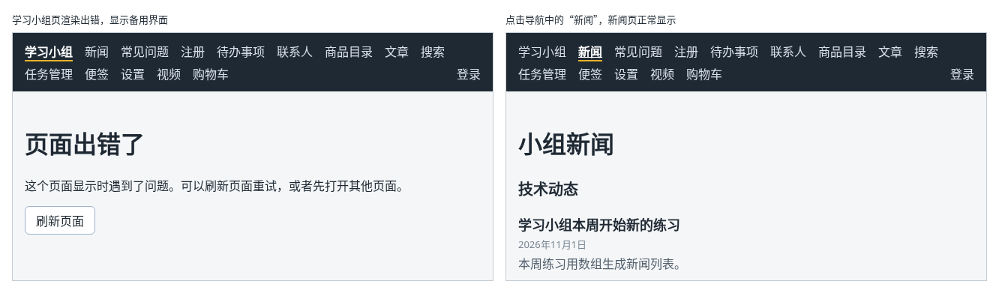

# 第 135 章：某个组件渲染出错时，如何显示备用界面？

前置：[第 134 章：【组合】如何点击表格中的一行，在弹窗中编辑它？](第134章-如何点击表格中的一行，在弹窗中编辑它.md)

## 一、本章要解决的问题

第 6 章说过：代码运行时出错，React 无法生成页面，页面就会一片空白。开发时可以打开控制台找原因；可是用户看到的只是一个白屏，连导航栏都没有了，不知道发生了什么，也没法去别的页面。

一个页面出错，不应该让整个网站都用不了。本章给页面区域加一个“错误边界”。完成后：某个页面在显示时出错，导航栏照常显示，页面区域换成“页面出错了”的说明和一个“刷新页面”按钮；点导航中的其他页面，那个页面正常显示。

本章是第 17 部分的起点。第 17 部分（第 135—141 章）处理出错的情况，再把应用构建成正式版本并上线。学完第 138 章时，效果如下图：页面出错时有备用界面，操作失败时页面上有提示；正式构建的页面在本机的预览地址 `http://127.0.0.1:4173` 中运行，文章、商品详情等页面直接从练习服务读取数据。


为了看到效果，本章会临时让“学习小组”页出错。下图左边是这个页面出错时的样子，右边是接着点击导航中“新闻”的样子：



## 二、必要原理

### 渲染出错时，React 会清掉整个页面

组件函数在运行时抛出了错误，React 就得不到这个组件要显示的内容。它没法知道“缺一块”的页面该是什么样子，于是把整个应用从页面上移除，只在控制台中报告错误。这就是白屏的由来。

### 错误边界：接住里面组件的错误

**错误边界**（error boundary）是一个包在其他组件外面的组件。它里面的组件在渲染时出错，React 不再清掉整个页面，而是只把错误边界这一块换成它准备好的备用界面，外面的内容照常显示。

本章把错误边界包在 `AppLayout` 的 `<Outlet />` 外面：页面区域出错，只有页面区域换成备用界面，导航栏在错误边界的外面，不受影响。

### 错误边界要写成类组件

到目前为止，我们的组件都是函数。React 还有一种更早的写法：**类组件**，用 `class` 定义。错误边界目前只能写成类组件，React 没有提供同样作用的 Hook。本章只需要看懂下面这几行，后面不会再写类组件：

```tsx
export default class ErrorBoundary extends Component<ErrorBoundaryProps, ErrorBoundaryState> {
  state: ErrorBoundaryState = { hasError: false };

  static getDerivedStateFromError(): ErrorBoundaryState {
    return { hasError: true };
  }

  render() {
    if (this.state.hasError) {
      return <p>备用界面</p>;
    }
    return this.props.children;
  }
}
```

| 写法 | 意思 |
| --- | --- |
| `class ErrorBoundary extends Component<属性类型, 状态类型>` | 定义一个类组件，尖括号中依次写 props 和 state 的类型 |
| `state = { hasError: false }` | state 的初始值，作用相当于 `useState(false)` |
| `static getDerivedStateFromError()` | 里面的组件渲染出错时，React 调用它，用返回的对象更新 state。前面必须写 `static` |
| `render()` | 返回要显示的内容，相当于函数组件的 `return` |
| `this.state`、`this.props` | 在类组件中读取 state 和 props，都要加 `this.` |

所以它的过程是：平时 `hasError` 是 `false`，原样显示里面的 `children`（第 16 章的 `children` 属性）；里面的组件出错，React 调用 `getDerivedStateFromError`，`hasError` 变成 `true`，重新渲染时显示备用界面。

### 换了页面，要重新开始

`hasError` 变成 `true` 以后，一直是 `true`。如果只包一个错误边界，点击导航去别的页面，页面区域还是“页面出错了”，因为这个错误边界一直是同一个。

办法是给它一个 `key`，值是当前地址 `location.pathname`（第 113 章的 `useLocation`）：

```tsx
<ErrorBoundary key={location.pathname}>
```

第 18 章说过，React 用 `key` 区分“是不是同一项”。地址变了，`key` 跟着变，React 认为这是另一个错误边界，丢掉旧的、重新创建一个，`hasError` 又从 `false` 开始。

### 错误边界接不住的错误

错误边界只接住**渲染时**的错误，也就是组件函数运行、生成页面内容时抛出的错误。点击按钮时运行的处理函数、`await` 之后的代码中出的错，不在渲染的过程中，错误边界接不住。这类错误怎样告诉用户，是下一章的内容。

## 三、动手实现

### 第 1 步：错误边界组件

在 `src/components` 中新建 `ErrorBoundary.tsx`：

```tsx
import { Component } from 'react';
import type { ReactNode } from 'react';

type ErrorBoundaryProps = {
  children: ReactNode;
};

type ErrorBoundaryState = {
  hasError: boolean;
};

// 错误边界只能写成类组件：React 目前没有提供同样作用的 Hook
export default class ErrorBoundary extends Component<ErrorBoundaryProps, ErrorBoundaryState> {
  state: ErrorBoundaryState = { hasError: false };

  // 里面的组件渲染出错时，React 调用它，用返回的对象更新 state
  static getDerivedStateFromError(): ErrorBoundaryState {
    return { hasError: true };
  }

  render() {
    if (this.state.hasError) {
      return (
        <main className="page">
          <title>页面出错了</title>
          <h1>页面出错了</h1>
          <p>这个页面显示时遇到了问题。可以刷新页面重试，或者先打开其他页面。</p>
          <p>
            <button type="button" onClick={() => window.location.reload()}>
              刷新页面
            </button>
          </p>
        </main>
      );
    }
    return this.props.children;
  }
}
```

备用界面使用和其他页面相同的 `page` 样式，并用第 100 章的 `<title>` 改掉标签页标题。“刷新页面”按钮调用浏览器的 `window.location.reload()`，作用和按 F5 相同。备用界面中不显示错误的详细内容：那是给开发者看的，用户看不懂，开发者可以到控制台中查看。

### 第 2 步：把页面区域包起来

打开 `src/components/AppLayout.tsx`，把导入路由的一行改为：

```tsx
import { NavLink, Outlet, useLocation } from 'react-router';
import ErrorBoundary from './ErrorBoundary';
```

在 `const online = useOnlineStatus();` 的下面加入：

```tsx
  const location = useLocation();
```

把 `<Outlet />` 替换为：

```tsx
      {/* 地址变了，key 跟着变，错误边界重新创建，出错的状态不会带到下一个页面 */}
      <ErrorBoundary key={location.pathname}>
        <Outlet />
      </ErrorBoundary>
```

## 四、运行与检查

保持开发服务器运行（`npm.cmd run dev`），保存文件后在浏览器中查看。

1. 打开各个页面，和原来一样，没有变化。
2. 临时让“学习小组”页出错：打开 `src/pages/GroupPage.tsx`，在 `export default function GroupPage() {` 的下一行加入：

   ```tsx
     throw new Error('测试：页面渲染出错');
   ```

   保存后打开首页。导航栏还在，页面区域显示“页面出错了”和“刷新页面”按钮，浏览器标签页的标题也是“页面出错了”。
3. 打开控制台（第 6 章），可以看到红色的错误，其中有 `测试：页面渲染出错` 和 `The above error occurred in the <GroupPage> component.`：错误边界接住了错误，控制台中照样报告出错的组件，方便你找原因。
4. 点击导航中的“新闻”，新闻页正常显示。再点“学习小组”，又显示“页面出错了”，因为这个页面仍然会出错。
5. 删掉第 2 步加入的那一行，保存。点“刷新页面”，“学习小组”页恢复正常。

最后运行检查，应没有错误：

```powershell
npm.cmd run check
```

**小练习**：在备用界面的“刷新页面”按钮旁边加一个“返回上一页”按钮，点击时调用 `window.history.back()`。按第 2 步的方法让“学习小组”页出错，先打开“新闻”，再点“学习小组”，点“返回上一页”应回到新闻页。练习后恢复本章代码，并确认已删掉测试用的那一行。

## 五、常见错误

| 现象 | 原因 | 怎么改 |
| --- | --- | --- |
| 一个页面出错后，点导航去其他页面，仍然显示“页面出错了” | 错误边界没有 `key`，`hasError` 一直是 `true` | 写 `key={location.pathname}`，换页面时重新创建错误边界 |
| 页面出错时仍然白屏，控制台提示 `getDerivedStateFromError() is defined as an instance method and will be ignored` | 漏写了 `static`，React 不会调用这个方法 | 写成 `static getDerivedStateFromError()` |
| 页面出错时整个页面空白，连导航栏也没有了 | 错误边界没有包住出错的组件，或者没有用上 | 在 `AppLayout` 中用 `<ErrorBoundary>` 包住 `<Outlet />` |
| 点击按钮时出了错，备用界面没有出现 | 错误发生在点击的处理函数中，不在渲染过程中，错误边界接不住 | 在处理函数中用 `try`/`catch` 处理，见下一章 |

## 六、本章完整代码

### `src/components/ErrorBoundary.tsx`

```tsx
import { Component } from 'react';
import type { ReactNode } from 'react';

type ErrorBoundaryProps = {
  children: ReactNode;
};

type ErrorBoundaryState = {
  hasError: boolean;
};

// 错误边界只能写成类组件：React 目前没有提供同样作用的 Hook
export default class ErrorBoundary extends Component<ErrorBoundaryProps, ErrorBoundaryState> {
  state: ErrorBoundaryState = { hasError: false };

  // 里面的组件渲染出错时，React 调用它，用返回的对象更新 state
  static getDerivedStateFromError(): ErrorBoundaryState {
    return { hasError: true };
  }

  render() {
    if (this.state.hasError) {
      return (
        <main className="page">
          <title>页面出错了</title>
          <h1>页面出错了</h1>
          <p>这个页面显示时遇到了问题。可以刷新页面重试，或者先打开其他页面。</p>
          <p>
            <button type="button" onClick={() => window.location.reload()}>
              刷新页面
            </button>
          </p>
        </main>
      );
    }
    return this.props.children;
  }
}
```

### `src/components/AppLayout.tsx`

```tsx
import { useState } from 'react';
import { NavLink, Outlet, useLocation } from 'react-router';
import ErrorBoundary from './ErrorBoundary';
import { useAuth } from '../hooks/useAuth';
import { useCart } from '../hooks/useCart';
import { useOnlineStatus } from '../hooks/useOnlineStatus';
import { logout } from '../lib/authApi';

export default function AppLayout() {
  const { user, checking, setUser } = useAuth();
  const [isLoggingOut, setIsLoggingOut] = useState(false);
  const { cartItems } = useCart();
  const online = useOnlineStatus();
  const location = useLocation();
  let cartCount = 0;
  for (const item of cartItems) {
    cartCount += item.quantity;
  }

  async function handleLogout() {
    setIsLoggingOut(true);
    try {
      // 先让服务器删除登录记录，否则刷新页面后又会自动登录
      await logout();
      // 当前页面如果需要登录，RequireAuth 会自动把人送去登录页
      setUser(null);
    } catch (error) {
      window.alert(error instanceof Error ? error.message : '退出失败，请稍后重试。');
    } finally {
      setIsLoggingOut(false);
    }
  }

  return (
    <div>
      <nav className="site-nav" aria-label="主导航">
        <NavLink to="/">学习小组</NavLink>
        <NavLink to="/news">新闻</NavLink>
        <NavLink to="/faq">常见问题</NavLink>
        <NavLink to="/register">注册</NavLink>
        <NavLink to="/todos">待办事项</NavLink>
        <NavLink to="/contacts">联系人</NavLink>
        <NavLink to="/products">商品目录</NavLink>
        <NavLink to="/articles">文章</NavLink>
        <NavLink to="/search">搜索</NavLink>
        <NavLink to="/tasks">任务管理</NavLink>
        <NavLink to="/notes">便签</NavLink>
        <NavLink to="/settings">设置</NavLink>
        <NavLink to="/videos">视频</NavLink>
        <NavLink to="/shop">
          购物车
          {cartCount > 0 && (
            <span className="cart-count" aria-label={'购物车中有 ' + cartCount + ' 件商品'}>
              {cartCount}
            </span>
          )}
        </NavLink>
        {!checking && user && user.role === 'admin' && <NavLink to="/people">人员管理</NavLink>}
        {/* 确认登录状态期间什么也不显示，避免先闪一下“登录”再变成用户名 */}
        {!checking && user && (
          <NavLink to="/account" className="nav-user">
            {user.displayName}
          </NavLink>
        )}
        {!checking && user && (
          <button
            type="button"
            className="nav-logout"
            disabled={isLoggingOut}
            onClick={handleLogout}
          >
            {isLoggingOut ? '正在退出……' : '退出'}
          </button>
        )}
        {!checking && !user && (
          <NavLink to="/login" className="nav-user">
            登录
          </NavLink>
        )}
      </nav>
      {!online && (
        <p role="status" className="offline-banner">
          网络已断开，需要连接服务器的功能暂时无法使用。
        </p>
      )}
      {/* 地址变了，key 跟着变，错误边界重新创建，出错的状态不会带到下一个页面 */}
      <ErrorBoundary key={location.pathname}>
        <Outlet />
      </ErrorBoundary>
    </div>
  );
}
```

## 七、本章改动小结

新建 `src/components/ErrorBoundary.tsx`：错误边界，里面的组件渲染出错时显示备用界面；修改 `src/components/AppLayout.tsx`：用错误边界包住页面区域，并用当前地址作为 `key`，换页面时重新开始。

---

下一章：[第 136 章：按钮操作中的异步错误，如何展示给用户？](第136章-按钮操作中的异步错误，如何展示给用户.md)
