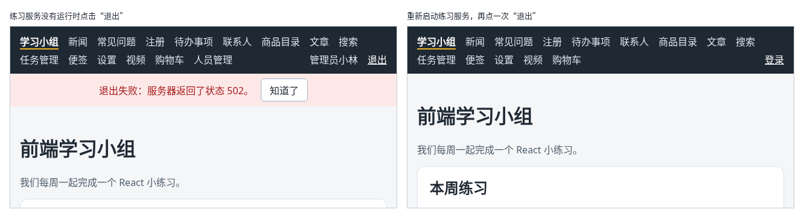

# 第 136 章：按钮操作中的异步错误，如何展示给用户？

前置：[第 135 章：某个组件渲染出错时，如何显示备用界面？](第135章-某个组件渲染出错时，如何显示备用界面.md)

## 一、本章要解决的问题

上一章的错误边界只能接住渲染时的错误。用户点按钮以后发请求，请求失败了，错误发生在处理函数中，错误边界不管。这类错误如果没人处理，用户点了按钮什么反应也没有，只有控制台中多了一条红字。

第 114 章的“退出”按钮处理了失败的情况，用的是浏览器自带的提示框 `window.alert`。提示框会挡住整个页面，必须先点“确定”才能做别的事，文字也不能选中复制，样子由浏览器决定。实际的网站一般把这类提示显示在页面中。

本章把退出失败的提示从提示框改为显示在导航栏下方。完成后：练习服务没有运行时点“退出”，导航栏下方出现红色的“退出失败：服务器返回了状态 502。”和一个“知道了”按钮，页面上的其他内容照常可以使用；点“知道了”，提示消失；重新启动练习服务后再点“退出”，提示消失，正常退出。

下图左边是退出失败时的样子，右边是重新启动练习服务、再点一次“退出”以后的样子：



## 二、必要原理

### 没有处理的异步错误去了哪里

先看看不处理会怎样。`handleLogout` 是一个异步函数（第 62 章），如果去掉其中的 `catch`，`await logout()` 失败时，错误从 `handleLogout` 中抛出。React 不会接住它，错误边界也不会，浏览器只在控制台中报告：

```text
Uncaught (in promise) Error: 退出失败：服务器返回了状态 502。
```

`Uncaught` 的意思是“没有被捕获”。页面上什么都没有变，用户不知道点了“退出”以后发生了什么。

所以按钮操作中的错误，必须在处理函数中用 `try`/`catch` 自己接住。

### 接住以后，保存到 state 中显示

接住错误以后，要让用户看到它。和第 89—91 章的保存失败一样，把错误信息存进 state，页面根据 state 显示提示：

| 时机 | 做什么 |
| --- | --- |
| 开始操作时 | 清空上一次的提示，避免旧的错误留在页面上 |
| `catch` 中 | 把错误信息存进 state |
| 页面中 | state 不是空字符串时，显示提示 |
| 用户点“知道了” | 把 state 改回空字符串 |

提示写在 `role="alert"` 的元素中（第 62A 章），读屏软件会立即读出它。

### 提示放在哪里

提示放在用户正在看的地方附近。“退出”按钮在导航栏中，导航栏在每个页面都会显示，所以提示放在 `AppLayout` 中导航栏的下方，和第 127 章的断网提示在同一个位置。不管用户在哪个页面点“退出”，都能看到。

页面中的按钮，提示就放在这个页面中，例如第 133 章删除失败时，提示显示在表格上方。

## 三、动手实现

### 第 1 步：用 state 保存错误信息

打开 `src/components/AppLayout.tsx`，在 `isLoggingOut` 那一行的下面加入：

```tsx
  // 退出失败时的提示；空字符串表示没有错误
  const [logoutError, setLogoutError] = useState('');
```

把 `handleLogout` 替换为：

```tsx
  async function handleLogout() {
    setIsLoggingOut(true);
    // 重新尝试时，先清掉上一次的提示
    setLogoutError('');
    try {
      // 先让服务器删除登录记录，否则刷新页面后又会自动登录
      await logout();
      // 当前页面如果需要登录，RequireAuth 会自动把人送去登录页
      setUser(null);
    } catch (error) {
      // 事件处理函数中的错误，错误边界接不住，要自己保存到 state 中，显示在页面上
      setLogoutError(error instanceof Error ? error.message : '退出失败，请稍后重试。');
    } finally {
      setIsLoggingOut(false);
    }
  }
```

### 第 2 步：显示提示

在断网提示 `{!online && (` 的上面加入：

```tsx
      {logoutError && (
        <p role="alert" className="action-error">
          {logoutError}
          <button type="button" onClick={() => setLogoutError('')}>
            知道了
          </button>
        </p>
      )}
```

打开 `src/App.css`，在文件最后加入：

```css

.action-error {
  margin: 0;
  padding: 8px 16px;
  background: #fde8e8;
  color: #a61b1b;
  text-align: center;
}

.action-error button {
  margin-left: 12px;
}
```

## 四、运行与检查

保持开发服务器和练习服务都在运行（准备篇二），用 `admin` 登录。

1. 在练习服务的终端按 Ctrl+C，停止练习服务。
2. 点导航栏中的“退出”。按钮先显示“正在退出……”，然后导航栏下方出现红色的“退出失败：服务器返回了状态 502。”和“知道了”。没有弹出提示框，导航栏中仍然是“管理员小林”。练习服务停止后，开发服务器的代理返回 502（第 114 章）。
3. 点导航中的“新闻”，页面可以正常切换，提示仍在导航栏下方。点“知道了”，提示消失。
4. 再点一次“退出”，提示又出现。
5. 在练习服务的终端运行 `npm.cmd run api`，重新启动练习服务。再点“退出”，红色提示消失，导航栏中变成“登录”。

最后运行检查，应没有错误：

```powershell
npm.cmd run check
```

**小练习**：临时去掉第 1 步 `handleLogout` 中的 `catch` 部分（保留 `try` 和 `finally`），按上面第 1、2 步操作，在控制台中找到 `Uncaught (in promise)` 开头的错误，确认页面上没有任何提示，也没有出现上一章的“页面出错了”。练习后恢复本章代码。

## 五、常见错误

| 现象 | 原因 | 怎么改 |
| --- | --- | --- |
| 点“退出”后什么也没发生，控制台中有 `Uncaught (in promise) Error: 退出失败：服务器返回了状态 502。` | 处理函数中没有 `catch`，错误没有被接住 | 用 `try`/`catch` 接住，把错误信息存进 state |
| 重新启动练习服务后退出成功了，红色的“退出失败”仍然留在页面上 | 开始操作时没有清空上一次的提示 | 在 `handleLogout` 开头写 `setLogoutError('')` |
| 以为错误边界会接住，结果失败时页面没有任何变化 | 错误边界只接住渲染时的错误，处理函数中的错误它接不住（第 135 章） | 在处理函数中自己处理 |

## 六、本章完整代码

### `src/components/AppLayout.tsx`

```tsx
import { useState } from 'react';
import { NavLink, Outlet, useLocation } from 'react-router';
import ErrorBoundary from './ErrorBoundary';
import { useAuth } from '../hooks/useAuth';
import { useCart } from '../hooks/useCart';
import { useOnlineStatus } from '../hooks/useOnlineStatus';
import { logout } from '../lib/authApi';

export default function AppLayout() {
  const { user, checking, setUser } = useAuth();
  const [isLoggingOut, setIsLoggingOut] = useState(false);
  // 退出失败时的提示；空字符串表示没有错误
  const [logoutError, setLogoutError] = useState('');
  const { cartItems } = useCart();
  const online = useOnlineStatus();
  const location = useLocation();
  let cartCount = 0;
  for (const item of cartItems) {
    cartCount += item.quantity;
  }

  async function handleLogout() {
    setIsLoggingOut(true);
    // 重新尝试时，先清掉上一次的提示
    setLogoutError('');
    try {
      // 先让服务器删除登录记录，否则刷新页面后又会自动登录
      await logout();
      // 当前页面如果需要登录，RequireAuth 会自动把人送去登录页
      setUser(null);
    } catch (error) {
      // 事件处理函数中的错误，错误边界接不住，要自己保存到 state 中，显示在页面上
      setLogoutError(error instanceof Error ? error.message : '退出失败，请稍后重试。');
    } finally {
      setIsLoggingOut(false);
    }
  }

  return (
    <div>
      <nav className="site-nav" aria-label="主导航">
        <NavLink to="/">学习小组</NavLink>
        <NavLink to="/news">新闻</NavLink>
        <NavLink to="/faq">常见问题</NavLink>
        <NavLink to="/register">注册</NavLink>
        <NavLink to="/todos">待办事项</NavLink>
        <NavLink to="/contacts">联系人</NavLink>
        <NavLink to="/products">商品目录</NavLink>
        <NavLink to="/articles">文章</NavLink>
        <NavLink to="/search">搜索</NavLink>
        <NavLink to="/tasks">任务管理</NavLink>
        <NavLink to="/notes">便签</NavLink>
        <NavLink to="/settings">设置</NavLink>
        <NavLink to="/videos">视频</NavLink>
        <NavLink to="/shop">
          购物车
          {cartCount > 0 && (
            <span className="cart-count" aria-label={'购物车中有 ' + cartCount + ' 件商品'}>
              {cartCount}
            </span>
          )}
        </NavLink>
        {!checking && user && user.role === 'admin' && <NavLink to="/people">人员管理</NavLink>}
        {/* 确认登录状态期间什么也不显示，避免先闪一下“登录”再变成用户名 */}
        {!checking && user && (
          <NavLink to="/account" className="nav-user">
            {user.displayName}
          </NavLink>
        )}
        {!checking && user && (
          <button
            type="button"
            className="nav-logout"
            disabled={isLoggingOut}
            onClick={handleLogout}
          >
            {isLoggingOut ? '正在退出……' : '退出'}
          </button>
        )}
        {!checking && !user && (
          <NavLink to="/login" className="nav-user">
            登录
          </NavLink>
        )}
      </nav>
      {logoutError && (
        <p role="alert" className="action-error">
          {logoutError}
          <button type="button" onClick={() => setLogoutError('')}>
            知道了
          </button>
        </p>
      )}
      {!online && (
        <p role="status" className="offline-banner">
          网络已断开，需要连接服务器的功能暂时无法使用。
        </p>
      )}
      {/* 地址变了，key 跟着变，错误边界重新创建，出错的状态不会带到下一个页面 */}
      <ErrorBoundary key={location.pathname}>
        <Outlet />
      </ErrorBoundary>
    </div>
  );
}
```

### `src/App.css`

```css
:root {
  --color-page: #f4f6f8;
  --color-text: #1f2933;
  --color-muted: #52606d;
  --color-surface: #ffffff;
  --color-hover: #f0f4f8;
  --color-border: #9fb3c8;
}

/* 深色主题只改变量的值，用到变量的地方会自动换颜色 */
[data-theme='dark'] {
  --color-page: #12171d;
  --color-text: #e4e7eb;
  --color-muted: #9aa5b1;
  --color-surface: #1f2933;
  --color-hover: #323f4b;
  --color-border: #52606d;
  color-scheme: dark;
}

body {
  margin: 0;
  font-family: system-ui, sans-serif;
  background: var(--color-page);
  color: var(--color-text);
}

.page {
  max-width: 960px;
  margin: 0 auto;
  padding: 24px 16px;
}

.page-header p {
  color: var(--color-muted);
}

.page-footer {
  margin-top: 24px;
  padding-top: 16px;
  border-top: 1px solid #d9e2ec;
  color: var(--color-muted);
}

.card-list {
  display: flex;
  flex-wrap: wrap;
  gap: 16px;
  margin-top: 16px;
}

.card-list > * {
  flex: 1 1 200px;
}

button {
  padding: 6px 14px;
  border: 1px solid var(--color-border);
  border-radius: 6px;
  background: var(--color-surface);
  color: var(--color-text);
  font: inherit;
  cursor: pointer;
}

button:hover {
  background: var(--color-hover);
}

button:disabled {
  cursor: not-allowed;
  opacity: 0.5;
}

.site-nav {
  display: flex;
  flex-wrap: wrap;
  gap: 4px 16px;
  padding: 12px 16px;
  background: #1f2933;
}

.site-nav a {
  color: #d9e2ec;
  text-decoration: none;
}

.site-nav a:hover {
  color: #ffffff;
  text-decoration: underline;
}

.site-nav .nav-user {
  margin-left: auto;
  color: #d9e2ec;
}

.site-nav .nav-logout {
  padding: 0;
  border: 0;
  background: transparent;
  color: #d9e2ec;
}

.site-nav .nav-logout:hover {
  color: #ffffff;
  text-decoration: underline;
}

.site-nav a.active {
  color: #ffffff;
  font-weight: bold;
  border-bottom: 2px solid #f0b429;
}

.cart-count {
  display: inline-block;
  min-width: 18px;
  margin-left: 4px;
  padding: 0 5px;
  border-radius: 9px;
  background: #f0b429;
  color: #1f2933;
  font-size: 12px;
  font-weight: bold;
  line-height: 18px;
  text-align: center;
}

.offline-banner {
  margin: 0;
  padding: 8px 16px;
  background: #fff4e5;
  color: #8a4b08;
  text-align: center;
}

.action-error {
  margin: 0;
  padding: 8px 16px;
  background: #fde8e8;
  color: #a61b1b;
  text-align: center;
}

.action-error button {
  margin-left: 12px;
}
```

## 七、本章改动小结

修改 `src/components/AppLayout.tsx`：退出失败时不再弹出提示框，把错误信息存进 state，显示在导航栏下方，可以点“知道了”关闭；修改 `src/App.css`：新增操作失败提示的样式。

---

下一章：[第 137 章：为什么开发时能显示页面，正式构建却会失败？](第137章-为什么开发时能显示页面，正式构建却会失败.md)
