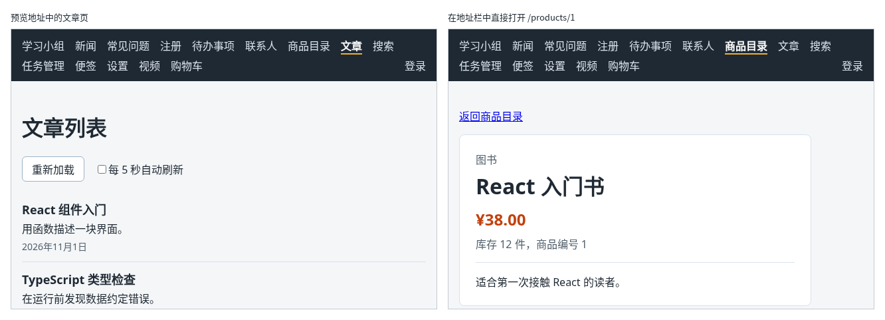

# 第 138 章：如何在本地预览正式构建的页面？

前置：[第 137 章：为什么开发时能显示页面，正式构建却会失败？](第137章-为什么开发时能显示页面，正式构建却会失败.md)

## 一、本章要解决的问题

上一章构建出了 `dist` 文件夹，可是双击其中的 `index.html`，页面一片空白。构建结果要通过服务器打开才能运行。上线之前，最好先在自己的电脑上把正式版本跑一遍：开发服务器中正常，不代表构建出来的文件也正常，例如正式环境的接口地址写错了，只有用构建结果才能发现。

本章用 Vite 自带的预览服务器打开构建结果。完成后：运行 `npm.cmd run preview`，在 `http://127.0.0.1:4173` 中打开的是 `dist` 中的正式版本；文章页从练习服务读取文章，Network（网络）中可以看到请求的是 `http://127.0.0.1:3001/api/articles`；在地址栏中直接打开 `/products/1`，显示商品详情。

下图左边是预览地址中的文章页，右边是在地址栏中直接打开商品详情的样子：



## 二、必要原理

### 预览服务器：只负责把 dist 交给浏览器

`package.json` 中的 `preview` 这一行是：

```json
"preview": "vite preview --host 127.0.0.1",
```

`vite preview` 启动一个简单的服务器，把 `dist` 中的文件原样交给浏览器，默认端口是 4173。它和开发服务器的区别：

| | 开发服务器（5173） | 预览服务器（4173） |
| --- | --- | --- |
| 提供的内容 | `src` 中的源代码，边请求边转换 | `dist` 中构建好的文件 |
| 改了代码 | 页面马上更新 | 没有变化，要重新运行 `npm.cmd run build` |
| 接口地址 | `.env.development` 中的 `/api`，经过开发代理 | `.env.production` 中的 `http://127.0.0.1:3001/api` |

预览服务器只用来在自己的电脑上检查构建结果，不用来给别人提供网站。真正上线时，`dist` 中的文件交给专门的托管服务。

### 为什么直接打开文件不行

双击 `dist/index.html` 时，浏览器的地址以 `file:///` 开头。`index.html` 中用 `<script type="module">` 引用 `/assets/…` 的文件，浏览器不允许从 `file:///` 加载这种模块脚本，控制台中会提示被 `CORS policy` 阻止（第 137 章常见错误）。另外，`/assets/…` 在电脑上指的是磁盘的根目录，也找不到文件。通过预览服务器打开，地址是 `http://127.0.0.1:4173/`，这两个问题都没有了。

### 正式版本直接请求练习服务

第 73 章（开发环境和正式环境使用不同的接口地址）在 `.env.production` 中写了接口的完整地址。构建时 Vite 读取这个文件，把 `http://127.0.0.1:3001/api` 写进了 `.js` 文件。预览时，页面在 `127.0.0.1:4173`，接口在 `127.0.0.1:3001`，端口不同，是跨域请求（第 71 章）。练习服务已经允许了 `http://127.0.0.1:4173`，所以文章能正常读取。

### 直接打开某个地址

在地址栏中直接打开 `http://127.0.0.1:4173/products/1`，浏览器向预览服务器请求 `/products/1`。`dist` 中并没有这个文件，预览服务器的做法是返回 `index.html`，页面加载后，由 React Router 根据地址显示商品详情。并不是每个托管服务都会这样做，第 140 章会遇到这个问题。

### 预览中的登录

在预览地址中登录，看起来成功了，可是一刷新页面或在地址栏中打开其他页面，又变回了未登录。第 109 章（提交登录表单并显示登录结果）说过，浏览器只给同一个网站的请求自动带 Cookie；预览时页面和接口的端口不同，`fetch` 默认既不保存、也不发送对方的 Cookie。登录要正常工作，页面和接口的放置方式要在上线时一起考虑，第 139—141 章部署时再处理。本章只检查不需要登录的页面。

## 三、动手实现

### 第 1 步：先构建

保持练习服务在运行（准备篇二）。在项目根目录运行：

```powershell
npm.cmd run build
```

最后一行出现 `✓ built in`，确认构建成功（第 137 章）。

### 第 2 步：启动预览服务器

在同一个终端中运行：

```powershell
npm.cmd run preview
```

终端中显示：

```text
  ➜  Local:   http://127.0.0.1:4173/
```

预览服务器会一直运行，这个终端不要关闭。开发服务器可以同时运行，两者的端口不同，互不影响。

### 第 3 步：在预览地址中检查页面

在浏览器中打开 `http://127.0.0.1:4173/`，按 F12 打开开发者工具，切换到 Network（网络）面板。点导航中的“文章”。

## 四、运行与检查

1. 首页、新闻、常见问题等页面和开发时一样显示。
2. 文章页显示“React 组件入门”等文章。Network 中有一个 `articles` 请求，点开它，请求地址是 `http://127.0.0.1:3001/api/articles`，状态是 200；开发服务器中，同一个请求的地址是 `http://127.0.0.1:5173/api/articles`。
3. 在地址栏中输入 `http://127.0.0.1:4173/products/1` 回车，显示“React 入门书”的详情。
4. 在 `src/pages/GroupPage.tsx` 中随便改一个字并保存，刷新预览地址的首页，没有变化；开发服务器的首页已经变了。改回来，保存。
5. 在预览服务器的终端按 Ctrl+C，停止预览服务器。

最后运行检查，应没有错误：

```powershell
npm.cmd run check
```

**小练习**：在练习服务的终端按 Ctrl+C 停止练习服务，启动预览服务器，打开文章页，看看页面显示什么提示，控制台中的错误和开发服务器中的同一情况（第 114 章，代理返回 502）有什么不同。练习后重新运行 `npm.cmd run api` 启动练习服务。

## 五、常见错误

| 现象 | 原因 | 怎么改 |
| --- | --- | --- |
| 改了代码，预览地址中还是旧的页面 | 预览服务器只提供 `dist` 中的文件，`dist` 没有重新构建 | 先运行 `npm.cmd run build`，再刷新预览地址 |
| 预览中的文章页显示“无法连接练习服务，请确认它已经启动。”，控制台中是 `net::ERR_CONNECTION_REFUSED` | 正式版本直接请求 `127.0.0.1:3001`，练习服务没有运行 | 运行 `npm.cmd run api` 启动练习服务 |
| 在预览地址中登录后，刷新页面又变回未登录 | 页面和接口不是同一个网站，`fetch` 默认不使用对方的 Cookie | 预览时只检查不需要登录的页面，登录在部署时处理 |
| 双击 `dist/index.html` 后页面空白 | 用 `file:///` 打开时，浏览器不加载模块脚本 | 用 `npm.cmd run preview` 打开 |

## 六、本章完整代码

本章没有修改代码，项目和第 136 章相同，没有新增或修改的文件。

## 七、本章改动小结

没有文件变化。
