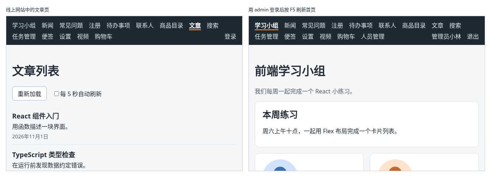

# 第 139 章：如何把网站部署到静态托管平台？

前置：[第 138 章：如何在本地预览正式构建的页面？](第138章-如何在本地预览正式构建的页面.md)

## 一、本章要解决的问题

到现在为止，网站只能在你自己的电脑上打开，`127.0.0.1` 这个地址别人访问不到。要让别人用上，需要把网站放到一台一直开着、有公开网址的服务器上，这一步叫**部署**（deploy）。

我们的网站由两部分组成：`dist` 中的页面文件，和提供数据的练习服务。本章把练习服务部署到 Render，把页面部署到静态托管平台 Netlify，并让 Netlify 把接口请求转交给 Render。完成后：你有一个以 `.netlify.app` 结尾的网址，任何人都能打开；文章等页面能读取数据；登录后刷新页面，仍然是登录状态。

下图左边是线上网站中的文章页，右边是登录后刷新首页的样子：



## 二、必要原理

### 静态托管平台：只负责把文件交给浏览器

**静态托管平台**是专门存放网页文件的服务：你把 `dist` 交给它，它给你一个公开网址，有人访问时把文件原样发给浏览器，作用和第 138 章的预览服务器相同。它不运行我们的练习服务，所以练习服务要另外找地方运行。

| 部分 | 部署到哪里 | 网址 |
| --- | --- | --- |
| 页面（`dist`） | Netlify，静态托管平台 | `https://你的网站名.netlify.app` |
| 练习服务 | Render，可以运行 Node.js 程序的平台 | `https://你的服务名.onrender.com` |

两个平台都有免费的使用方式，需要用邮箱或 GitHub 账号注册。平台的页面会更新，按钮的位置和文字可能和下文略有不同，找意思相同的那一项即可。

### 让托管平台转交接口请求

页面在 `netlify.app`，接口在 `onrender.com`，不是同一个网站。第 138 章已经遇到过这种情况：跨域请求需要接口允许（第 71 章），而且 `fetch` 默认不使用对方网站的 Cookie，登录一刷新就丢了。

开发时，这个问题由开发服务器的代理解决（第 72 章）：页面请求同一个网站的 `/api/…`，开发服务器替它转交给练习服务。Netlify 也能做同样的事，只要在 `dist` 中放一个名为 `_redirects` 的文件（没有扩展名），写上转发规则：

```text
/api/*      https://react-daily-practice-api.onrender.com/api/:splat      200
```

每行三列，用空格隔开：

| 列 | 含义 |
| --- | --- |
| `/api/*` | 要处理的地址。`*` 表示后面的任意内容 |
| `https://…/api/:splat` | 交给哪里。`:splat` 会换成 `*` 匹配到的内容，例如 `/api/articles` 就交给 `…/api/articles` |
| `200` | 浏览器的地址不变，由 Netlify 去请求目标地址，再把结果交给浏览器 |

这样，对浏览器来说，页面和接口都在 `netlify.app`，又是同一个网站了：不需要跨域许可，登录 Cookie 也能正常保存和发送。上传的头像以 `/uploads/` 开头（第 130 章），也要加一条同样的规则。

### 接口地址改回 /api

第 73 章在 `.env.production` 中写的是练习服务的完整地址 `http://127.0.0.1:3001/api`。现在接口请求经过 Netlify 转交，正式环境也应该和开发时一样，请求同一个网站的 `/api`。

改完以后，`npm.cmd run preview` 也会用到这个值。预览服务器沿用开发服务器的代理设置，所以本机预览时登录也能正常使用了，可以在上线前先检查一遍。

### 放进 dist 的文件：public 文件夹

`_redirects` 要出现在 `dist` 中，但 `dist` 每次构建都会重新生成，不能直接在里面新建文件。Vite 的约定是：项目根目录的 `public` 文件夹中的文件，构建时原样复制到 `dist`。所以把 `_redirects` 放进 `public`。

### 免费练习服务的限制

Render 的免费服务有几点要知道：

| 情况 | 结果 |
| --- | --- |
| 15 分钟没有收到请求 | 服务暂停。下一次请求到来时重新启动，大约需要一分钟 |
| 服务重新启动或重新部署 | 练习服务保存的数据回到初始状态；登录记录只在内存中（准备篇二），需要重新登录 |

Netlify 转交请求最多等 26 秒。所以隔了很久第一次打开网站时，接口请求可能失败。遇到这种情况，先在浏览器中打开一次练习服务的健康检查地址（第 1 步的第 6 点），等它显示出结果，再回到网站重试。

## 三、动手实现

### 第 1 步：把练习服务部署到 Render

1. 打开 `https://render.com`，注册并登录。
2. 点右上角的“New”，选“Web Service”。
3. 选择从公开的 Git 仓库部署（Public Git Repository），地址填本教程所在的仓库：`https://github.com/zerioo1970/summary`。
4. 按下表填写，其余保持默认：

   | 项目 | 填写 |
   | --- | --- |
   | Name | `react-daily-practice-api`（已被占用时换一个） |
   | Branch | `main` |
   | Root Directory | `React19与TypeScript实战教程/练习服务` |
   | Language | Node |
   | Build Command | `npm install` |
   | Start Command | `npm start` |
   | Instance Type | Free |

   练习服务的文件夹中有一个 `package.json`，`npm start` 就是运行 `node practice-server.mjs`。在 Render 上运行时，练习服务会改用平台提供的端口，并允许外部访问。

5. 点页面下方的部署按钮。等待日志中出现“练习服务已启动”，状态变成“Live”。
6. 页面上方显示服务的网址，例如 `https://react-daily-practice-api.onrender.com`。在浏览器中打开这个网址加上 `/api/health`，显示 `{"ok":true}`。记下这个网址，下一步要用。

### 第 2 步：修改正式环境的接口地址

把 `.env.production` 的内容改为：

```text
VITE_API_BASE_URL=/api
```

### 第 3 步：写转发规则

在项目根目录新建 `public` 文件夹（和 `src` 并列），在其中新建 `_redirects` 文件。注意文件名以下划线开头，没有扩展名：

```text
/api/*      https://react-daily-practice-api.onrender.com/api/:splat      200
/uploads/*  https://react-daily-practice-api.onrender.com/uploads/:splat  200
```

把两行中的 `https://react-daily-practice-api.onrender.com` 换成你在第 1 步记下的网址。

### 第 4 步：构建并在本机检查

运行：

```powershell
npm.cmd run build
```

构建成功后，打开 `dist` 文件夹，里面多了一个 `_redirects`，内容和 `public` 中的相同。

保持练习服务在运行，再运行 `npm.cmd run preview`，打开 `http://127.0.0.1:4173`，用 `admin` 登录后按 F5 刷新，仍然是“管理员小林”。检查完在预览服务器的终端按 Ctrl+C。

### 第 5 步：把 dist 部署到 Netlify

1. 打开 `https://app.netlify.com`，注册并登录。先登录再上传，网站才会归到你的账号下。
2. 打开 `https://app.netlify.com/drop`。
3. 把项目中的 `dist` 文件夹整个拖到页面上的上传区域。注意拖的是 `dist`，不是整个项目文件夹。
4. 上传完成后，页面显示网站的网址，以 `.netlify.app` 结尾。在网站的设置中可以修改网址前面的名字。

## 四、运行与检查

在浏览器中打开 Netlify 给出的网址，按 F12 打开开发者工具，切换到 Network（网络）面板。

1. 首页正常显示。点导航中的“文章”，显示“React 组件入门”等文章。Network 中 `articles` 请求的地址是 `https://你的网站名.netlify.app/api/articles`，状态是 200：请求发给了同一个网站，由 Netlify 转交给 Render。
2. 点“登录”，用 `admin` 登录。导航栏显示“管理员小林”。按 F5 刷新，仍然是“管理员小林”。
3. 用手机打开同一个网址，也能看到同样的页面。
4. 在文章页按 F5，会出现 Netlify 的“Page not found”页面。这是下一章要解决的问题，先点浏览器的后退回到首页。

最后运行检查，应没有错误：

```powershell
npm.cmd run check
```

**小练习**：在 Render 的服务页面中打开“Logs”（日志），刷新几次线上网站的文章页，在日志中找到对应的 `GET /api/articles → 200`，确认请求确实到达了 Render 上的练习服务。

## 五、常见错误

| 现象 | 原因 | 怎么改 |
| --- | --- | --- |
| 线上的文章页显示“文章读取失败：服务器返回了状态 404。” | `dist` 中没有 `_redirects`，例如把它放在了项目根目录而不是 `public` 中，Netlify 不知道要转交 `/api` | 把 `_redirects` 放进 `public`，重新构建后再上传 |
| 线上的文章页显示“无法连接练习服务，请确认它已经启动。”，控制台中是 `Access to fetch at 'http://127.0.0.1:3001/api/articles' … has been blocked by CORS policy` | `.env.production` 还是旧的完整地址，或者改完后没有重新构建，页面仍在请求用户自己电脑上的 `127.0.0.1` | 改为 `VITE_API_BASE_URL=/api`，重新构建后再上传 |
| 在文章页刷新，出现“Page not found” | Netlify 上没有 `/articles` 这个文件 | 下一章解决 |

## 六、本章完整代码

### `.env.production`

```text
VITE_API_BASE_URL=/api
```

### `public/_redirects`

```text
/api/*      https://react-daily-practice-api.onrender.com/api/:splat      200
/uploads/*  https://react-daily-practice-api.onrender.com/uploads/:splat  200
```

## 七、本章改动小结

修改 `.env.production`：正式环境的接口地址改为 `/api`；新建 `public/_redirects`：让 Netlify 把 `/api` 和 `/uploads` 开头的请求转交给 Render 上的练习服务。

---

下一章：[第 140 章：部署后刷新详情页出现 404，应该如何处理？](第140章-部署后刷新详情页出现404，应该如何处理.md)
