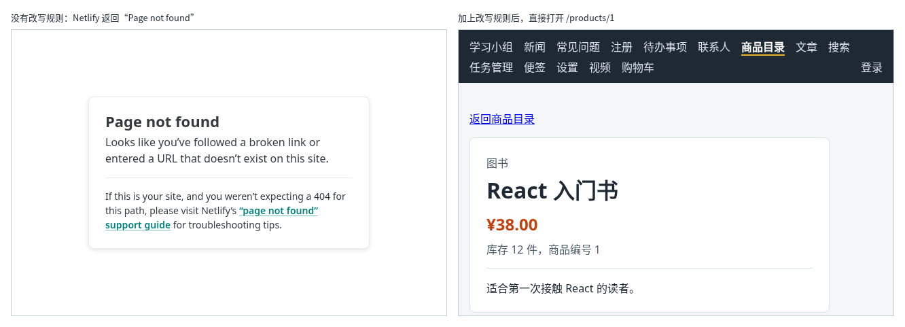

# 第 140 章：部署后刷新详情页出现 404，应该如何处理？

前置：[第 139 章：如何把网站部署到静态托管平台？](第139章-如何把网站部署到静态托管平台.md)

## 一、本章要解决的问题

网站上线后，从首页点进去，每个页面都正常。可是在商品详情页按 F5 刷新，或者把 `https://你的网站名.netlify.app/products/1` 这个地址发给别人，打开的却是 Netlify 的“Page not found”页面。用户收藏的网址、分享出去的链接都打不开，这在正式的网站中是不能接受的。

本章给 Netlify 加一条改写规则。完成后：直接打开或刷新任何页面的地址，都能正常显示；地址写错时，显示我们自己在第 99 章做的“页面不存在”；接口请求不受影响。

下图左边是没有改写规则时直接打开 `/products/1` 的样子，右边是加上规则以后的样子：



## 二、必要原理

### 为什么点链接正常，刷新却 404

整个网站其实只有一个页面文件 `index.html`。点导航中的链接时，React Router 只是改变地址、换掉页面中的内容（第 94 章），浏览器并不向服务器请求新的文件。

按 F5 或直接打开 `/products/1` 时就不一样了：浏览器向 Netlify 请求 `/products/1` 这个文件。`dist` 中只有 `index.html` 和 `assets` 中的文件，没有 `products/1`，Netlify 就返回 404 和它自己的“Page not found”页面。React 根本没有机会运行。

第 138 章的预览服务器遇到不存在的文件时会自动返回 `index.html`，所以在本机看不出这个问题。Netlify 默认不这样做，需要我们告诉它。

### 改写规则：找不到文件时返回 index.html

在 `_redirects` 中再加一行：

```text
/*          /index.html                                                   200
```

意思是：任何地址，都返回 `index.html`，浏览器的地址不变。页面加载以后，React Router 读到地址 `/products/1`，显示商品详情；地址写错时，匹配到 `path="*"` 的路由，显示“页面不存在”（第 99 章）。

`assets` 中的 `.js`、`.css` 文件不会被它改掉：真实存在的文件，Netlify 直接返回文件本身，这条规则只处理找不到文件的地址。

### 规则的顺序

`_redirects` 中的规则从上往下逐条比较，用第一条匹配上的。`/*` 能匹配所有地址，`/api/articles` 也包括在内。如果把它写在最前面，接口请求也会拿到 `index.html`，页面得到的是一段网页而不是 JSON，就会显示类似 `Unexpected token '<', "<!doctype "... is not valid JSON` 的错误。

所以这条规则必须放在**最后**：先处理 `/api` 和 `/uploads`，剩下的才返回 `index.html`。

### 更新线上网站

修改了 `public` 中的文件，要重新构建，并把新的 `dist` 交给 Netlify。上传到同一个网站，网址不变。

## 三、动手实现

### 第 1 步：加上改写规则

打开 `public/_redirects`，在最后加上一行，改完是这样：

```text
/api/*      https://react-daily-practice-api.onrender.com/api/:splat      200
/uploads/*  https://react-daily-practice-api.onrender.com/uploads/:splat  200
/*          /index.html                                                   200
```

### 第 2 步：重新构建

运行：

```powershell
npm.cmd run build
```

打开 `dist/_redirects`，确认是三行，最后一行是 `/index.html` 那一条。

### 第 3 步：更新 Netlify 上的网站

1. 打开 `https://app.netlify.com`，点上一章创建的网站，进入它的“Deploys”（部署）页面。
2. 把新的 `dist` 文件夹拖到这个页面的上传区域。不要再到 `https://app.netlify.com/drop` 上传：那里会新建一个网站，得到另一个网址。
3. 上传完成后，部署列表的第一条就是这一次，标着“Published”。

## 四、运行与检查

1. 在浏览器的地址栏中直接打开 `https://你的网站名.netlify.app/products/1`，显示“React 入门书”的详情。
2. 打开文章页，按 F5 刷新，文章列表仍然正常显示。
3. 打开 `https://你的网站名.netlify.app/no-such-page`，显示我们自己的“页面不存在”和“回到首页”链接，不再是 Netlify 的英文页面。
4. 用 `admin` 登录后打开“我的账号”，按 F5 刷新，仍然显示账号信息。

最后运行检查，应没有错误：

```powershell
npm.cmd run check
```

**小练习**：在商品详情页按 F12，切换到 Network（网络）面板后按 F5，看第一个请求 `1` 的类型（Type）和返回内容，确认 Netlify 返回的是 `index.html` 的内容，而浏览器地址栏中仍然是 `/products/1`。

## 五、常见错误

| 现象 | 原因 | 怎么改 |
| --- | --- | --- |
| 刷新页面不再 404 了，可是所有读取数据的页面都显示 `Unexpected token '<', "<!doctype "... is not valid JSON` | `/* /index.html 200` 写在了最前面，接口请求也拿到了 `index.html` | 把这一行移到 `_redirects` 的最后 |
| 改了 `_redirects`，线上刷新还是“Page not found” | 只改了 `public` 中的文件，没有重新构建，或者没有把新的 `dist` 上传 | 运行 `npm.cmd run build`，确认 `dist/_redirects` 是新的，再上传 |
| 上传后网址变了，原来的网址还是旧的网站 | 在 `https://app.netlify.com/drop` 上传，新建了一个网站 | 在原来那个网站的“Deploys”页面上传 |

## 六、本章完整代码

### `public/_redirects`

```text
/api/*      https://react-daily-practice-api.onrender.com/api/:splat      200
/uploads/*  https://react-daily-practice-api.onrender.com/uploads/:splat  200
/*          /index.html                                                   200
```

## 七、本章改动小结

修改 `public/_redirects`：在最后加上改写规则，找不到文件的地址都返回 `index.html`，由 React Router 显示对应的页面。

---

下一章：[第 141 章：【组合】上线后，如何确认页面访问的是正确的后端接口？](第141章-上线后，如何确认页面访问的是正确的后端接口.md)
