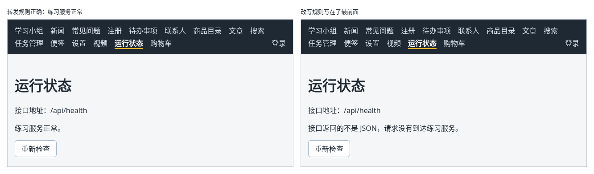

# 第 141 章：【组合】上线后，如何确认页面访问的是正确的后端接口？

前置：[第 140 章：部署后刷新详情页出现 404，应该如何处理？](第140章-部署后刷新详情页出现404，应该如何处理.md)

## 一、本章要解决的问题

网站上线以后，接口出问题的原因有好几种：构建时用了旧的接口地址、转发规则没有生效、规则顺序写错、练习服务停了。这些情况在页面上看到的都是“读取失败”，要一个一个页面打开、再去开发者工具中找原因，很费时间。

本章做一个“运行状态”页，打开就能看到两件事：页面实际使用的接口地址，以及这个地址能不能连上练习服务。完成后：导航栏中多了“运行状态”；正常时页面显示“接口地址：/api/health”和“练习服务正常。”；出问题时显示具体原因，例如接口返回的不是 JSON、返回了某个状态码，或者完全连不上；点“重新检查”可以再查一次。

本章不引入新的技术，组合的是：环境变量中的接口地址（第 73 章）、用联合类型区分检查中、成功和失败（第 69 章）、检查接口返回的数据（第 68 章）、打开页面时自动请求（第 74 章）、标签页标题（第 100 章），以及新增路由和导航链接（第 94、97 章）。

下图左边是转发规则正确时的样子，右边是把改写规则写在最前面时的样子：



## 二、必要原理

### 显示接口地址

页面使用的接口地址，是构建时从 `.env.production` 写进代码的（第 73 章）。把 `apiUrl('/health')` 直接显示出来，就知道这次构建用的是哪个值：线上应该是 `/api/health`；如果显示的是 `http://127.0.0.1:3001/api/health`，说明构建时还是旧的设置。

### 用健康检查接口确认连上的是练习服务

练习服务有一个专门用来检查的接口：`GET /api/health`，正常时返回 `{"ok":true}`。只有请求真的到达了练习服务，才会得到这个结果。所以检查时要按顺序判断：

| 情况 | 说明 | 显示 |
| --- | --- | --- |
| `fetch` 抛出错误 | 连不上这个地址，例如请求的是用户电脑上的 `127.0.0.1` | 无法连接接口地址 |
| 状态不是 2 开头 | 例如没有转发规则时 Netlify 返回 404，练习服务没有启动时返回 5 开头的状态 | 接口返回了状态 N |
| 返回的不是 JSON | 拿到的是一段网页，多半是改写规则写在了转发规则前面（第 140 章） | 接口返回的不是 JSON |
| 是 JSON，但不是 `{"ok":true}` | 请求到了另一个服务 | 不是练习服务的健康检查结果 |

第 65 章（接口返回 404 时 fetch 不会进入 catch）说过，状态码要自己判断；读取 JSON 失败时 `response.json()` 会抛出错误，这里用 `try`/`catch` 接住，换成更容易看懂的说明。

### 只看结果，不需要数据

健康检查不返回要显示的数据，所以 `checkHealth` 的返回类型是 `Promise<void>`：没有抛出错误就是正常，抛出错误就把说明显示出来。

## 三、动手实现

### 第 1 步：运行状态页

在 `src/pages` 中新建 `StatusPage.tsx`：

```tsx
import { useEffect, useState } from 'react';
import { apiUrl } from '../lib/api';

type CheckState =
  | { status: 'checking' }
  | { status: 'ok' }
  | { status: 'error'; message: string };

// 练习服务的 /api/health 正常时返回 { "ok": true }
async function checkHealth(): Promise<void> {
  let response: Response;
  try {
    response = await fetch(apiUrl('/health'));
  } catch {
    throw new Error('无法连接接口地址，请确认接口地址和练习服务都正确。');
  }
  if (!response.ok) {
    throw new Error('接口返回了状态 ' + response.status + '，请求没有到达练习服务。');
  }
  let data: unknown;
  try {
    data = await response.json();
  } catch {
    // 拿到的不是 JSON，多半是托管平台返回了网页：转发规则没有生效
    throw new Error('接口返回的不是 JSON，请求没有到达练习服务。');
  }
  if (typeof data !== 'object' || data === null || !('ok' in data) || data.ok !== true) {
    throw new Error('接口返回的内容不是练习服务的健康检查结果。');
  }
}

function getErrorMessage(error: unknown) {
  return error instanceof Error ? error.message : '检查失败。';
}

export default function StatusPage() {
  const [checkState, setCheckState] = useState<CheckState>({ status: 'checking' });
  // 构建时写进代码的接口地址（第 73 章），线上应该是 /api/health
  const healthUrl = apiUrl('/health');

  useEffect(() => {
    let ignore = false;

    async function checkOnOpen() {
      try {
        await checkHealth();
        if (!ignore) {
          setCheckState({ status: 'ok' });
        }
      } catch (error) {
        if (!ignore) {
          setCheckState({ status: 'error', message: getErrorMessage(error) });
        }
      }
    }

    checkOnOpen();
    return () => {
      ignore = true;
    };
  }, []);

  async function handleRecheck() {
    setCheckState({ status: 'checking' });
    try {
      await checkHealth();
      setCheckState({ status: 'ok' });
    } catch (error) {
      setCheckState({ status: 'error', message: getErrorMessage(error) });
    }
  }

  return (
    <main className="page">
      <title>运行状态</title>
      <h1>运行状态</h1>
      <p>接口地址：{healthUrl}</p>
      {checkState.status === 'checking' && <p role="status">正在检查练习服务……</p>}
      {checkState.status === 'ok' && <p role="status">练习服务正常。</p>}
      {checkState.status === 'error' && <p role="alert">{checkState.message}</p>}
      <button type="button" disabled={checkState.status === 'checking'} onClick={handleRecheck}>
        重新检查
      </button>
    </main>
  );
}
```

`checkOnOpen` 和 `handleRecheck` 的写法与文章页的打开时读取、重新加载相同（第 74、66 章）。

### 第 2 步：加入路由和导航

打开 `src/App.tsx`，在导入 `ShopPage` 的一行下面加入：

```tsx
import StatusPage from './pages/StatusPage';
```

在 `/videos` 那条路由的下面加入：

```tsx
            <Route path="/status" element={<StatusPage />} />
```

打开 `src/components/AppLayout.tsx`，在“视频”链接的下面加入：

```tsx
        <NavLink to="/status">运行状态</NavLink>
```

### 第 3 步：更新线上网站

运行 `npm.cmd run build`，然后把新的 `dist` 拖到 Netlify 上这个网站的“Deploys”页面（第 140 章）。

## 四、运行与检查

1. 先在开发服务器中检查：保持开发服务器和练习服务都在运行（准备篇二），点导航中的“运行状态”。显示“接口地址：/api/health”，短暂的“正在检查练习服务……”之后显示“练习服务正常。”，标签页标题是“运行状态”。
2. 在练习服务的终端按 Ctrl+C，点“重新检查”，显示“接口返回了状态 502，请求没有到达练习服务。”：开发代理连不上练习服务（第 114 章）。重新运行 `npm.cmd run api`，再点“重新检查”，恢复正常。
3. 打开线上网站，点“运行状态”，显示“接口地址：/api/health”和“练习服务正常。”。在 Network（网络）面板中，`health` 请求的地址是 `https://你的网站名.netlify.app/api/health`。
4. 打开 Render 上练习服务的“Logs”（日志），最后一行是 `GET /api/health → 200`：这次请求确实到达了 Render 上的练习服务。
5. 在线上直接打开 `https://你的网站名.netlify.app/status` 并刷新，页面正常显示（第 140 章）。

最后运行检查，应没有错误：

```powershell
npm.cmd run check
```

**小练习**：在本机做一次“错误的构建”：把 `.env.production` 临时改回 `VITE_API_BASE_URL=http://127.0.0.1:3001/api`，运行 `npm.cmd run build` 和 `npm.cmd run preview`，打开预览地址的“运行状态”页，看看接口地址显示什么。练习后恢复 `.env.production`，并重新构建一次。

### 阶段练习：在线上走通一次完整的操作

学到这里，你已经能把一个带登录、接口读写的应用部署上线。下面的练习请**不看教程代码**，独立完成。参考答案见[附录 A](附录A-阶段练习参考答案.md)，完成后再对照。

**需求**：新建一个“上线自检”页，地址是 `/online-check`，部署后在线上地址中使用它。

- 只有登录后才能打开；登录后导航栏中出现“上线自检”链接，没有登录时不显示。
- 页面上有一个“开始自检”按钮。点击后依次执行三步，每完成一步，就在下方的列表中加一行结果：
  1. 确认登录：向服务器读取当前用户，通过时显示“通过：确认登录。已登录：某某。”
  2. 新增任务：新增一个标题为“上线自检”的任务，通过时显示“通过：新增任务。已新增任务“上线自检”。”
  3. 重新读取：重新读取任务列表，确认刚才新增的任务在其中，通过时显示“通过：重新读取。在 N 个任务中找到了刚才新增的任务。”
- 某一步失败时，显示“失败：”和原因，后面的步骤不再执行。请求出错时也要显示原因，不能什么反应都没有（第 136 章）。
- 自检期间按钮显示“正在自检……”并且不能点击。

**验收标准**：

1. 没有登录时导航栏中没有“上线自检”；在线上直接打开 `/online-check` 会来到登录页，登录后回到“上线自检”。
2. 用 `member` 登录后点“开始自检”，三行都是“通过”，第一行中是“成员小王”。
3. 打开线上网站的“任务管理”页并按 F5 刷新，列表中有“上线自检”这个任务，导航栏中仍然是“成员小王”。
4. `npm.cmd run check` 没有错误。

练习完成后，把 `App.tsx` 和 `AppLayout.tsx` 恢复为本章的内容。

### 阶段回顾

第 17 部分完成了：页面渲染出错时显示备用界面，按钮操作失败时把原因显示在页面上；正式构建并在本机预览；把练习服务部署到 Render、页面部署到 Netlify，用转发规则让页面和接口成为同一个网站，用改写规则解决刷新 404，最后用运行状态页确认线上访问的是正确的接口。

到这里，主线 141 章全部完成。你从一个最简单的个人介绍页开始，做出了一个有列表、表单、接口读写、路由、登录、文件上传和数据表格，并且已经上线的应用。接下来可以按目录末尾的“进阶专题”，选需要的内容继续学习。

## 五、常见错误

| 现象 | 原因 | 怎么改 |
| --- | --- | --- |
| 线上显示“接口地址：http://127.0.0.1:3001/api/health”和“无法连接接口地址” | 构建时 `.env.production` 还是旧的完整地址 | 改为 `/api`，重新构建并上传（第 139 章） |
| 线上显示“接口返回的不是 JSON，请求没有到达练习服务。” | 改写规则 `/* /index.html 200` 写在了转发规则的前面 | 把它移到 `_redirects` 的最后（第 140 章） |
| 线上显示“接口返回了状态 404，请求没有到达练习服务。” | `dist` 中没有 `_redirects`，Netlify 不知道要转交 `/api` | 把 `_redirects` 放进 `public`，重新构建并上传（第 139 章） |
| 线上显示“接口返回了状态 502，请求没有到达练习服务。”，或者是 504 等其他 5 开头的状态 | Render 上的练习服务没有运行，或者暂停后还没有重新启动 | 打开 Render 的服务页面确认状态是“Live”；隔了很久第一次访问时，先打开一次健康检查地址，再点“重新检查” |

## 六、本章完整代码

### `src/pages/StatusPage.tsx`

```tsx
import { useEffect, useState } from 'react';
import { apiUrl } from '../lib/api';

type CheckState =
  | { status: 'checking' }
  | { status: 'ok' }
  | { status: 'error'; message: string };

// 练习服务的 /api/health 正常时返回 { "ok": true }
async function checkHealth(): Promise<void> {
  let response: Response;
  try {
    response = await fetch(apiUrl('/health'));
  } catch {
    throw new Error('无法连接接口地址，请确认接口地址和练习服务都正确。');
  }
  if (!response.ok) {
    throw new Error('接口返回了状态 ' + response.status + '，请求没有到达练习服务。');
  }
  let data: unknown;
  try {
    data = await response.json();
  } catch {
    // 拿到的不是 JSON，多半是托管平台返回了网页：转发规则没有生效
    throw new Error('接口返回的不是 JSON，请求没有到达练习服务。');
  }
  if (typeof data !== 'object' || data === null || !('ok' in data) || data.ok !== true) {
    throw new Error('接口返回的内容不是练习服务的健康检查结果。');
  }
}

function getErrorMessage(error: unknown) {
  return error instanceof Error ? error.message : '检查失败。';
}

export default function StatusPage() {
  const [checkState, setCheckState] = useState<CheckState>({ status: 'checking' });
  // 构建时写进代码的接口地址（第 73 章），线上应该是 /api/health
  const healthUrl = apiUrl('/health');

  useEffect(() => {
    let ignore = false;

    async function checkOnOpen() {
      try {
        await checkHealth();
        if (!ignore) {
          setCheckState({ status: 'ok' });
        }
      } catch (error) {
        if (!ignore) {
          setCheckState({ status: 'error', message: getErrorMessage(error) });
        }
      }
    }

    checkOnOpen();
    return () => {
      ignore = true;
    };
  }, []);

  async function handleRecheck() {
    setCheckState({ status: 'checking' });
    try {
      await checkHealth();
      setCheckState({ status: 'ok' });
    } catch (error) {
      setCheckState({ status: 'error', message: getErrorMessage(error) });
    }
  }

  return (
    <main className="page">
      <title>运行状态</title>
      <h1>运行状态</h1>
      <p>接口地址：{healthUrl}</p>
      {checkState.status === 'checking' && <p role="status">正在检查练习服务……</p>}
      {checkState.status === 'ok' && <p role="status">练习服务正常。</p>}
      {checkState.status === 'error' && <p role="alert">{checkState.message}</p>}
      <button type="button" disabled={checkState.status === 'checking'} onClick={handleRecheck}>
        重新检查
      </button>
    </main>
  );
}
```

### `src/App.tsx`

```tsx
import { Route, Routes } from 'react-router';
import './App.css';
import AppLayout from './components/AppLayout';
import AuthProvider from './components/AuthProvider';
import CartProvider from './components/CartProvider';
import RequireAuth from './components/RequireAuth';
import AccountPage from './pages/AccountPage';
import ArticlePage from './pages/ArticlePage';
import ContactsPage from './pages/ContactsPage';
import FaqPage from './pages/FaqPage';
import GroupPage from './pages/GroupPage';
import LoginPage from './pages/LoginPage';
import NewsPage from './pages/NewsPage';
import NotesPage from './pages/NotesPage';
import PeoplePage from './pages/PeoplePage';
import NotFoundPage from './pages/NotFoundPage';
import ProductDetailPage from './pages/ProductDetailPage';
import ProductPage from './pages/ProductPage';
import RegisterPage from './pages/RegisterPage';
import SearchPage from './pages/SearchPage';
import SettingsPage from './pages/SettingsPage';
import ShopPage from './pages/ShopPage';
import StatusPage from './pages/StatusPage';
import TaskPage from './pages/TaskPage';
import TaskServerPage from './pages/TaskServerPage';
import VideosPage from './pages/VideosPage';

export default function App() {
  return (
    <AuthProvider>
      <CartProvider>
        <Routes>
          <Route element={<AppLayout />}>
            <Route path="/" element={<GroupPage />} />
            <Route path="/news" element={<NewsPage />} />
            <Route path="/faq" element={<FaqPage />} />
            <Route path="/register" element={<RegisterPage />} />
            <Route path="/todos" element={<TaskPage />} />
            <Route path="/contacts" element={<ContactsPage />} />
            <Route path="/products" element={<ProductPage />} />
            <Route path="/products/:id" element={<ProductDetailPage />} />
            <Route path="/articles" element={<ArticlePage />} />
            <Route path="/search" element={<SearchPage />} />
            <Route path="/tasks" element={<TaskServerPage />} />
            <Route path="/shop" element={<ShopPage />} />
            <Route path="/notes" element={<NotesPage />} />
            <Route path="/settings" element={<SettingsPage />} />
            <Route path="/videos" element={<VideosPage />} />
            <Route path="/status" element={<StatusPage />} />
            <Route
              path="/people"
              element={
                <RequireAuth>
                  <PeoplePage />
                </RequireAuth>
              }
            />
            <Route
              path="/account"
              element={
                <RequireAuth>
                  <AccountPage />
                </RequireAuth>
              }
            />
            <Route path="*" element={<NotFoundPage />} />
          </Route>
          <Route path="/login" element={<LoginPage />} />
        </Routes>
      </CartProvider>
    </AuthProvider>
  );
}
```

### `src/components/AppLayout.tsx`

```tsx
import { useState } from 'react';
import { NavLink, Outlet, useLocation } from 'react-router';
import ErrorBoundary from './ErrorBoundary';
import { useAuth } from '../hooks/useAuth';
import { useCart } from '../hooks/useCart';
import { useOnlineStatus } from '../hooks/useOnlineStatus';
import { logout } from '../lib/authApi';

export default function AppLayout() {
  const { user, checking, setUser } = useAuth();
  const [isLoggingOut, setIsLoggingOut] = useState(false);
  // 退出失败时的提示；空字符串表示没有错误
  const [logoutError, setLogoutError] = useState('');
  const { cartItems } = useCart();
  const online = useOnlineStatus();
  const location = useLocation();
  let cartCount = 0;
  for (const item of cartItems) {
    cartCount += item.quantity;
  }

  async function handleLogout() {
    setIsLoggingOut(true);
    // 重新尝试时，先清掉上一次的提示
    setLogoutError('');
    try {
      // 先让服务器删除登录记录，否则刷新页面后又会自动登录
      await logout();
      // 当前页面如果需要登录，RequireAuth 会自动把人送去登录页
      setUser(null);
    } catch (error) {
      // 事件处理函数中的错误，错误边界接不住，要自己保存到 state 中，显示在页面上
      setLogoutError(error instanceof Error ? error.message : '退出失败，请稍后重试。');
    } finally {
      setIsLoggingOut(false);
    }
  }

  return (
    <div>
      <nav className="site-nav" aria-label="主导航">
        <NavLink to="/">学习小组</NavLink>
        <NavLink to="/news">新闻</NavLink>
        <NavLink to="/faq">常见问题</NavLink>
        <NavLink to="/register">注册</NavLink>
        <NavLink to="/todos">待办事项</NavLink>
        <NavLink to="/contacts">联系人</NavLink>
        <NavLink to="/products">商品目录</NavLink>
        <NavLink to="/articles">文章</NavLink>
        <NavLink to="/search">搜索</NavLink>
        <NavLink to="/tasks">任务管理</NavLink>
        <NavLink to="/notes">便签</NavLink>
        <NavLink to="/settings">设置</NavLink>
        <NavLink to="/videos">视频</NavLink>
        <NavLink to="/status">运行状态</NavLink>
        <NavLink to="/shop">
          购物车
          {cartCount > 0 && (
            <span className="cart-count" aria-label={'购物车中有 ' + cartCount + ' 件商品'}>
              {cartCount}
            </span>
          )}
        </NavLink>
        {!checking && user && user.role === 'admin' && <NavLink to="/people">人员管理</NavLink>}
        {/* 确认登录状态期间什么也不显示，避免先闪一下“登录”再变成用户名 */}
        {!checking && user && (
          <NavLink to="/account" className="nav-user">
            {user.displayName}
          </NavLink>
        )}
        {!checking && user && (
          <button
            type="button"
            className="nav-logout"
            disabled={isLoggingOut}
            onClick={handleLogout}
          >
            {isLoggingOut ? '正在退出……' : '退出'}
          </button>
        )}
        {!checking && !user && (
          <NavLink to="/login" className="nav-user">
            登录
          </NavLink>
        )}
      </nav>
      {logoutError && (
        <p role="alert" className="action-error">
          {logoutError}
          <button type="button" onClick={() => setLogoutError('')}>
            知道了
          </button>
        </p>
      )}
      {!online && (
        <p role="status" className="offline-banner">
          网络已断开，需要连接服务器的功能暂时无法使用。
        </p>
      )}
      {/* 地址变了，key 跟着变，错误边界重新创建，出错的状态不会带到下一个页面 */}
      <ErrorBoundary key={location.pathname}>
        <Outlet />
      </ErrorBoundary>
    </div>
  );
}
```

## 七、本章改动小结

新建 `src/pages/StatusPage.tsx`：显示页面使用的接口地址，并检查能否连上练习服务；修改 `src/App.tsx`：加入 `/status` 路由；修改 `src/components/AppLayout.tsx`：导航栏中加入“运行状态”。
