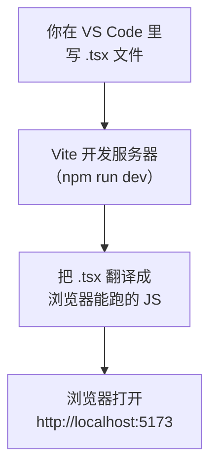
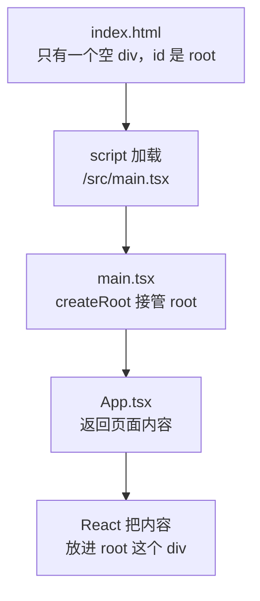
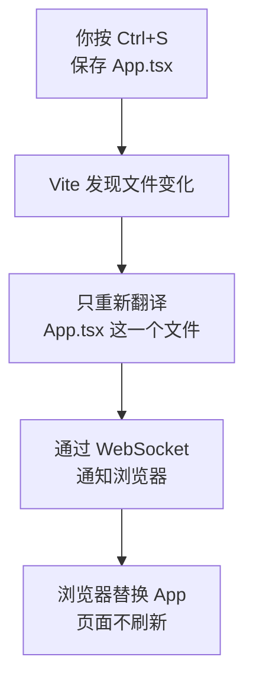

# 第 1 章 环境搭建与第一个页面

## 这一章解决什么问题

你想写一个 React 页面，但现代前端要先装 Node.js、建项目、跑开发服务器，第一步就容易卡住。本章结束时，你的浏览器里会显示自己写的「产品价格清单」标题，改一个字、按保存，页面立刻跟着变。

## 开始之前

- 上一章：无，这是第 1 章。
- 需要：一台 Windows 10/11 电脑，能访问 `nodejs.org`、`code.visualstudio.com` 和 npm 仓库（`registry.npmjs.org`）。
- 预计耗时：45 分钟（装软件约 15 分钟）。

本章的命令行输出都是在 Node.js 24.22.2 + create-vite 9.3.3 + Vite 8.3.5 下实测的（实测环境是 Linux，命令和输出与 Windows 相同，只有路径写法不同）。Windows 安装界面和 VS Code 菜单无法在实测环境里操作，相关段落已标注。

## 正文

### 1.1 装 Node.js 和 VS Code

> ⚠️ 本节的 Windows 安装界面未实机验证。

| 软件 | 作用 | 怎么装 |
| --- | --- | --- |
| Node.js（LTS 版） | 运行前端工具（Vite、TypeScript 编译器）的环境，自带包管理器 npm | 打开 `https://nodejs.org`，下载 **LTS** 版的 Windows Installer（`.msi`），一路「Next」 |
| VS Code | 写代码的编辑器 | 打开 `https://code.visualstudio.com`，下载 Windows 版安装。安装时勾选「添加到 PATH」 |

npm（Node Package Manager，Node 的包管理器）负责从网上下载项目要用的库，比如 React。本教程要求 Node.js **≥ 22.22**（第 9 章的 React Router 8 有这个要求），nodejs.org 首页的 LTS 版本（24 或 26）都满足。

装好后，按 `Win + R`，输入 `powershell` 回车，执行：

```powershell
# 在任意目录执行
node -v
npm -v
```

能看到两个版本号（例如 `v24.22.2` 和 `11.19.1`）就装好了。提示「无法将 node 项识别为……」时，关掉 PowerShell 重开一次。

VS Code 默认英文界面：按 `Ctrl + Shift + X` 打开扩展面板，搜索 `Chinese (Simplified)` 安装中文语言包并重启。下文菜单名按中文界面写。

### 1.2 建项目并启动：Vite 开发服务器

**白话定义**：Vite 开发服务器（dev server）是一个在你本机运行的小网站。它把你写的 `.tsx` 文件实时翻译成浏览器能执行的 JavaScript，再发给浏览器。

**业务场景**：你在做价格清单页面，一边改代码一边看效果，不用每次手动编译、复制文件。

**反例（什么时候不该用）**：开发服务器只用于开发。不要把 `npm run dev` 当成正式上线的方式。上线要先打包成静态文件（第 10 章讲），开发服务器没有为正式访问做优化，也不该暴露到公网。

#### 🖼 图解



#### 💻 建项目

先建一个放教程项目的文件夹，例如 `D:\react-study`。在 PowerShell 里执行：

```powershell
# 在 D:\react-study 目录执行
npm create vite@latest price-list -- --template react-ts --no-eslint --no-immediate
```

`price-list` 是项目文件夹名；`--` 表示后面的参数交给 create-vite；`--template react-ts` 选 React + TypeScript 模板；`--no-eslint` 用模板默认的代码检查工具 Oxlint；`--no-immediate` 建完先不自动安装和启动，下面一步步手动做。

第一次执行时 npm 可能先问是否安装 create-vite（`Need to install the following packages: ... Ok to proceed? (y)`），输入 `y` 回车。看到下面这段就建好了：

```text
◇  Scaffolding project in D:\react-study\price-list...
│
└  Done. Now run:

  cd price-list
  npm install
  npm run dev
```

接着用 VS Code 打开这个文件夹：菜单「文件 → 打开文件夹」，选 `D:\react-study\price-list`。如果弹出「是否信任此文件夹中的文件的作者」，选「是，我信任此作者」。

然后打开 VS Code 自带的终端：菜单「终端 → 新建终端」，当前目录就是项目文件夹（⚠️ VS Code 菜单与弹窗文字未实机验证）。依次执行：

```powershell
# 在 D:\react-study\price-list 目录执行（VS Code 终端）
npm install
npm run dev
```

`npm install` 下载依赖库，实测输出 `added 28 packages ... found 0 vulnerabilities`（Windows 上数量可能略有不同，没有 `ERR!` 就行）。`npm run dev` 启动开发服务器。

#### 🔍 拆解运行结果

```text
> price-list@0.0.0 dev
> vite

  VITE v8.3.5  ready in 169 ms

  ➜  Local:   http://localhost:5173/
  ➜  Network: use --host to expose
  ➜  press h + enter to show help
```

| 输出 | 含义 |
| --- | --- |
| `> vite` | `npm run dev` 实际执行的是 `package.json` 里 `scripts.dev` 写的命令，就是 `vite` |
| `ready in 169 ms` | 启动只花了零点几秒。Vite 启动时不打包整个项目，浏览器要哪个文件才翻译哪个 |
| `Local: http://localhost:5173/` | 在本机浏览器打开这个地址 |
| `Network: use --host to expose` | 默认只允许本机访问，局域网其他电脑打不开 |

按住 `Ctrl` 点那个地址，会看到模板自带的欢迎页（Vite 和 React 的图标、一个计数按钮）。**这个终端要一直开着**，它就是开发服务器本身；停止时按 `Ctrl + C`。

项目里的文件：

| 文件 / 文件夹 | 作用 | 本教程要不要改 |
| --- | --- | --- |
| `index.html` | 浏览器最先拿到的页面 | 偶尔 |
| `src/` | 你写的代码都在这里 | 经常 |
| `public/` | 原样提供给浏览器的静态文件（图标、第 7 章的 `products.json`） | 偶尔 |
| `package.json` | 项目名、依赖库清单、`npm run` 能执行的命令 | 很少 |
| `package-lock.json` | 依赖库的精确版本记录，由 npm 自动维护 | 不要手改 |
| `node_modules/` | `npm install` 下载下来的库 | 不要动，也不要提交到 Git |
| `vite.config.ts` | Vite 的配置 | 很少 |
| `tsconfig*.json` | TypeScript 编译器的配置 | 1.5 节改一次 |

#### 改坏一处试试

在终端按 `Ctrl + C` 停掉服务器，再刷新浏览器。页面打不开，Chrome 或 Edge 显示错误代码 `ERR_CONNECTION_REFUSED`，因为 5173 端口上已经没有程序在响应。

再试一次：不启动服务器，直接在资源管理器里双击 `index.html`。页面是一片空白，按 `F12` 打开开发者工具，「控制台（Console）」里能看到：

```text
Access to script at 'file:///src/main.tsx' from origin 'null' has been blocked by CORS policy: ...
Failed to load resource: net::ERR_FAILED
```

浏览器不能直接执行 `.tsx`，也不允许 `file://` 页面这样加载模块脚本。必须由开发服务器翻译后再提供。实验完重新执行 `npm run dev`。

### 1.3 页面从哪来：index.html → main.tsx → App.tsx

**白话定义**：入口文件是浏览器加载页面时第一个执行的脚本。React 项目里，入口文件 `main.tsx` 把根组件 `App` 放进 `index.html` 里一个空的 `<div>`。

**业务场景**：以后你的价格清单会有列表、表单、详情页，它们都从 `App` 出发一层层组织起来。知道入口在哪，就知道页面从哪开始找。

**反例（什么时候不该用）**：不要往 `index.html` 的 `<div id="root">` 里手写内容，也不要另写脚本直接改它里面的元素。React 接管这个 `<div>` 后，会用自己渲染的内容整块替换，手写的内容会被覆盖。页面内容一律写在组件里。

#### 🖼 图解



#### 💻 最小可运行代码

模板的欢迎页内容很多，先换成最简单的。三步：

1. 删除不再用的文件：`src/App.css`、`src/assets` 文件夹、`public/icons.svg`（在 VS Code 左侧文件列表里右键 →「删除」）。
2. 用下面的内容整个替换 `src/App.tsx`。
3. 用下面的内容整个替换 `src/index.css`（模板样式很多，先只留几行，样式第 10 章讲）。

```tsx
// src/App.tsx
// 页面的根组件：浏览器里看到的内容，从这里开始写
function App() {
  return (
    <main>
      <h1>产品价格清单</h1>
      <p>第 1 章：项目跑起来了。</p>
    </main>
  )
}

// main.tsx 用 import App from './App.tsx' 拿到的就是这里导出的 App
export default App
```

```css
/* src/index.css */
/* 模板自带的样式很多，先换成最少的几行，样式在第 10 章再讲 */
body {
  margin: 24px;
  font-family: system-ui, 'Microsoft YaHei', sans-serif;
}
```

`src/main.tsx` 不用改内容。下面是加了中文注释的版本，方便你对照理解（想替换也可以，效果相同）：

```tsx
// src/main.tsx
// 整个前端的入口：index.html 里的 <script> 只引用这一个文件
import { StrictMode } from 'react'
import { createRoot } from 'react-dom/client'
// CSS 也能 import：Vite 会把它变成 <style> 插进页面
import './index.css'
import App from './App.tsx'

// 找到 index.html 里的 <div id="root">，React 从此接管它里面的内容
// 末尾的 ! 告诉 TypeScript：这个元素一定存在（否则它认为可能是 null）
createRoot(document.getElementById('root')!).render(
  // StrictMode 只在开发时做额外检查，打包后的正式版本不受影响
  <StrictMode>
    <App />
  </StrictMode>,
)
```

#### 🔍 拆解运行结果

保存后浏览器显示一个大标题「产品价格清单」和一行「第 1 章：项目跑起来了。」。

逐个看关键的几处：

| 位置 | 说明 |
| --- | --- |
| `index.html` 的 `<div id="root"></div>` | 页面上唯一的空容器，React 渲染的所有内容都放在这里面 |
| `index.html` 的 `<script type="module" src="/src/main.tsx">` | 浏览器向开发服务器请求 `main.tsx`，整个应用从这里启动 |
| `createRoot(...).render(<App />)` | 让 React 接管这个元素，把 `App` 渲染进去。一个应用通常只调用一次 |
| `function App() { return (...) }` | 组件就是一个返回页面内容的函数。`return` 里像 HTML 的写法叫 JSX，第 2 章细讲 |
| `export default App` | 把 `App` 导出，`main.tsx` 才能 `import` 到它 |

浏览器拿到的其实不是你写的 TSX。开发服务器运行时，在浏览器地址栏打开 `http://localhost:5173/src/App.tsx`，能看到 Vite 翻译后的结果，关键部分是：

```js
function App() {
	return /* @__PURE__ */ _jsxDEV("main", { children: [/* @__PURE__ */ _jsxDEV("h1", { children: "产品价格清单" }, void 0, false, {
```

`<h1>产品价格清单</h1>` 被翻译成了一次函数调用 `_jsxDEV("h1", ...)`。JSX 只是写法，最终都是 JavaScript 函数调用，类型标注也在翻译时被去掉了。

`StrictMode`（严格模式组件）只在开发时生效，会故意多执行一些代码帮你发现问题，第 7 章会看到它的效果。

#### 改坏一处试试

把 `main.tsx` 里的 `getElementById('root')` 改成 `getElementById('app')`，保存。页面变成空白，`F12` 控制台出现：

```text
Uncaught Error: Target container is not a DOM element.
```

`index.html` 里没有 `id="app"` 的元素，`getElementById` 返回 `null`，React 找不到容器。

那个 `!` 只让 TypeScript 不报错，运行时不检查，所以错误到浏览器里才出现。改回 `'root'` 并保存。

### 1.4 热更新：保存即生效

**白话定义**：热更新（HMR，Hot Module Replacement，热模块替换）是指你保存文件后，开发服务器只把改动的那个文件推给浏览器替换，页面不整体刷新。

**业务场景**：你在调整价格清单的标题文字或布局，每次保存一两秒内就看到效果。以后页面里填了一半的表单、展开的列表，在你改样式时都还保持原样。

**反例（什么时候不该用）**：热更新不是对所有文件都生效。改 `index.html` 或 `main.tsx` 时，Vite 会整页刷新；改 `vite.config.ts` 时，Vite 会重启开发服务器。另外，如果你怀疑页面状态和代码对不上，直接按 `F5` 刷新，不要一直依赖热更新。

#### 🖼 图解



WebSocket 是浏览器和服务器之间一条一直保持连接的通道，服务器可以随时主动推消息给浏览器。

#### 💻 最小可运行代码

开发服务器保持运行，浏览器开着页面。把 `src/App.tsx` 里的 `<p>第 1 章：项目跑起来了。</p>` 改成 `<p>热更新生效了</p>`，按 `Ctrl + S` 保存。

#### 🔍 拆解运行结果

浏览器里那行字立刻变成「热更新生效了」，页面没有刷新。VS Code 终端多出一行：

```text
2:04:18 PM [vite] (client) hmr update /src/App.tsx
```

`F12` 控制台里能看到 `[vite] hot updated: /src/App.tsx`。

对比一下：打开 `index.html`，把 `<title>price-list</title>` 改成别的文字并保存，终端显示的是：

```text
2:04:46 PM [vite] (client) page reload index.html
```

这次是 `page reload`（整页刷新）。`index.html` 不是模块，没法局部替换。实测时在页面里放了一个标记值：改 `App.tsx` 后标记还在，改 `index.html` 后标记消失，证明后者刷新了整页。

实验完把 `App.tsx` 的文字改回「第 1 章：项目跑起来了。」，`index.html` 的标题改回 `price-list`（练习 1 会改它）。

#### 改坏一处试试

把 `App.tsx` 里 `<h1>产品价格清单</h1>` 末尾的 `</h1>` 删掉，保存。浏览器上盖了一层深色的错误遮罩（error overlay），开头是：

```text
[plugin:vite:oxc] Transform failed with 2 errors:

[PARSE_ERROR] Expected corresponding JSX closing tag for 'h1'.
   ╭─[ src/App.tsx:8:7 ]
   │
 6 │       <h1>产品价格清单
   │        ─┬
   │         ╰─── Opened here
   │
 8 │     </main>
   │       ──┬─
   │         ╰─── Expected `</h1>`
```

`plugin:vite:oxc` 表示报错的是 Vite 里负责翻译 TSX 的工具 Oxc；`src/App.tsx:8:7` 是发现问题的行列；`Opened here` 和 ``Expected `</h1>` `` 说明第 6 行开了 `<h1>`，到第 8 行还没关闭。终端里也会打印同样的错误。把 `</h1>` 补回去保存，遮罩自动消失，不用刷新。

### 1.5 打开 TypeScript 严格检查

这一步是配置，不算新概念，但后面每一章都依赖它。

TypeScript 的严格模式（`strict`）要求每个变量和参数都有明确的类型，不允许悄悄变成 `any`（「任意类型，不检查」）。本教程全程开启严格模式、禁止 `any`。TypeScript 7.0 默认已开启，但模板配置里没写出来，显式写上，换版本也不会变。打开 `tsconfig.app.json`，在 `/* Linting */` 这一行下面插入 `"strict": true,`，其他行不动。改完这一段是：

```json
    /* Linting */
    "strict": true,
    "noUnusedLocals": true,
```

完整文件见仓库 `code/ch01/price-list/tsconfig.app.json`。

要知道一件事：**Vite 开发服务器只负责翻译，不检查类型。** 实测时我在 `App.tsx` 里写了 `const price: number = '1280'`（把字符串赋给数字），浏览器照样显示了 `1280`，终端也没有报错。类型错误只在两个地方出现：

1. VS Code 编辑器里，出错的代码下面有红色波浪线，鼠标停上去能看到错误说明。
2. 执行 `npm run build`（打包）时。它会先运行 `tsc -b` 做类型检查，有错误就停止打包：

```powershell
# 在 D:\react-study\price-list 目录执行（另开一个终端，不影响开发服务器）
npm run build
```

```text
> price-list@0.0.0 build
> tsc -b && vite build

src/App.tsx(4,9): error TS2322: Type 'string' is not assignable to type 'number'.
```

没有类型错误时，输出以 `✓ built in ...ms` 结尾并生成 `dist` 文件夹（第 10 章再用，现在可以删掉）。另开终端：点终端面板右上角的 `+`。

所以写代码时要留意编辑器里的红色波浪线，不要只看浏览器能不能跑。

## ⚠️ 踩坑警告

| 现象 | 原因 | 怎么改 |
| --- | --- | --- |
| 在 PowerShell 里执行 `npm` 报「无法加载文件 C:\Program Files\nodejs\npm.ps1，因为在此系统上禁止运行脚本」（⚠️ 未实机验证） | Windows 客户端系统默认禁止 PowerShell 运行脚本，而 npm 在 PowerShell 里是通过 `npm.ps1` 脚本启动的 | 以普通用户执行一次 `Set-ExecutionPolicy -Scope CurrentUser RemoteSigned`，输入 `Y` 确认；或者在 VS Code 终端右上角下拉箭头里选「Command Prompt」改用 cmd |
| 双击 `index.html` 打开是空白页 | 浏览器不能直接运行 `.tsx`，`file://` 页面也不允许加载模块脚本（控制台显示 CORS 错误） | 用 `npm run dev` 启动后，访问终端里显示的 `http://localhost:5173/` |
| 改了代码，页面完全没变化 | ① 文件没保存（VS Code 标签页上文件名旁有个白色圆点表示未保存）；② 同时开了两个 `npm run dev`，第二个会显示 `Port 5173 is in use, trying another one...` 并改用 `5174`，你看的是另一个项目的页面 | ① 按 `Ctrl + S`，或开启菜单「文件 → 自动保存」；② 关掉多余的终端，以终端里实际显示的地址为准 |
| 代码里明明有类型错误，页面照样正常显示 | 开发服务器只翻译不检查类型 | 看 VS Code 里的红色波浪线；提交代码前执行一次 `npm run build` |
| 刷新页面显示 `ERR_CONNECTION_REFUSED` | 运行 `npm run dev` 的终端被关掉了，或被 `Ctrl + C` 停了 | 在项目目录重新执行 `npm run dev` |

## 🎯 动手练习

**练习 1：改浏览器标签页上的标题**

现在浏览器标签页显示的是 `price-list`。把它改成「产品价格清单」，同时把页面语言声明改成简体中文。

验收标准：

- 浏览器标签页显示「产品价格清单」。
- 保存后 VS Code 终端出现一行 `page reload index.html`。

**练习 2：把开发服务器端口改成 3000**

公司内网规定前端开发统一用 3000 端口。通过修改 `vite.config.ts` 实现，不要在命令行加参数。

验收标准：

- 保存 `vite.config.ts` 后，终端出现 `vite.config.ts changed, restarting server...` 和 `server restarted.`，下面的地址变成 `http://localhost:3000/`。
- 浏览器打开 `http://localhost:3000/` 能看到「产品价格清单」。

提示：Vite 的开发服务器选项写在配置的 `server` 下。

卡住了看文末参考答案。

## 📌 一句话总结

main.tsx 把 App 放进 #root，Vite 负责翻译和热更新。

## 下一章

页面内容全写在一个 `App` 里会越来越长，第 2 章把它拆成多个组件和文件。

---

<!-- 以下是参考答案，先自己动手，卡住了再往下翻 -->


## 参考答案

### 练习 1

思路：标签页标题来自 `index.html` 的 `<title>`，语言声明是 `<html>` 的 `lang` 属性。它们在 React 接管的 `#root` 之外，所以改 `index.html`，不是改 `App.tsx`。

```html
<!-- index.html -->
<!doctype html>
<html lang="zh-CN">
  <head>
    <meta charset="UTF-8" />
    <link rel="icon" type="image/svg+xml" href="/favicon.svg" />
    <meta name="viewport" content="width=device-width, initial-scale=1.0" />
    <title>产品价格清单</title>
  </head>
  <body>
    <div id="root"></div>
    <script type="module" src="/src/main.tsx"></script>
  </body>
</html>
```

### 练习 2

思路：在 `defineConfig` 里加 `server.port`。配置文件改动后 Vite 会自动重启，不用手动 `Ctrl + C`。

```ts
// vite.config.ts
import react from '@vitejs/plugin-react'
import { defineConfig } from 'vite'

// https://vite.dev/config/
export default defineConfig({
  plugins: [react()],
  server: {
    // 开发服务器端口；被占用时 Vite 会自动换下一个端口
    port: 3000,
  },
})
```
