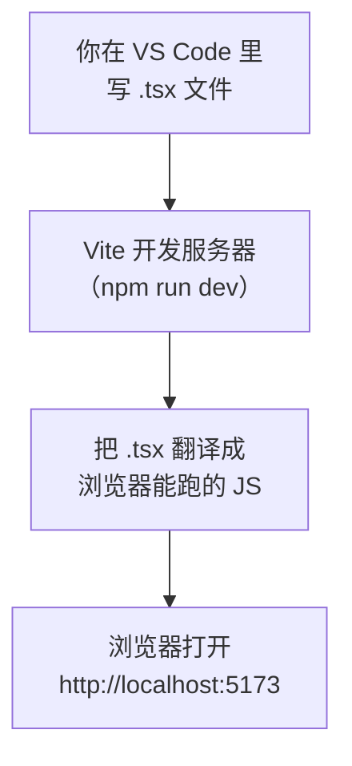

# 第 1A 章 装好工具，建项目并启动开发服务器

## 这一章解决什么问题

你想写一个 React 页面，但现代前端要先装 Node.js、建项目、跑开发服务器，第一步就容易卡住。本章结束时，你的浏览器里会显示 Vite 模板自带的欢迎页，它是由你本机运行的开发服务器提供的。

本章只讲一个技术点：**Vite 开发服务器**。

## 开始之前

- 上一章：无，这是全书第一章。
- 需要：一台 Windows 10/11 电脑，能访问 `nodejs.org`、`code.visualstudio.com` 和 npm 仓库（`registry.npmjs.org`）。
- 预计耗时：30 分钟（装软件约 15 分钟）。

本章的命令行输出都是在 Node.js 24.22.2 + create-vite 9.3.3 + Vite 8.3.5 下实测的（实测环境是 Linux，命令和输出与 Windows 相同，只有路径写法不同）。Windows 安装界面和 VS Code 菜单无法在实测环境里操作，相关段落已标注。

## 正文

### 1A.1 装 Node.js 和 VS Code

> ⚠️ 本节的 Windows 安装界面未实机验证。

| 软件 | 作用 | 怎么装 |
| --- | --- | --- |
| Node.js（LTS 版） | 运行前端工具（Vite、TypeScript 编译器）的环境，自带包管理器 npm | 打开 `https://nodejs.org`，下载 **LTS** 版的 Windows Installer（`.msi`），一路「Next」 |
| VS Code | 写代码的编辑器 | 打开 `https://code.visualstudio.com`，下载 Windows 版安装。安装时勾选「添加到 PATH」 |

npm（Node Package Manager，Node 的包管理器）负责从网上下载项目要用的库，比如 React。本教程要求 Node.js **≥ 22.22**（第 9A 章的 React Router 8 有这个要求），nodejs.org 首页的 LTS 版本（24 或 26）都满足。

装好后，按 `Win + R`，输入 `powershell` 回车，执行：

```powershell
# 在任意目录执行
node -v
npm -v
```

能看到两个版本号（例如 `v24.22.2` 和 `11.19.1`）就装好了。提示「无法将 node 项识别为……」时，关掉 PowerShell 重开一次。

VS Code 默认英文界面：按 `Ctrl + Shift + X` 打开扩展面板，搜索 `Chinese (Simplified)` 安装中文语言包并重启。下文菜单名按中文界面写。

### 1A.2 Vite 开发服务器是什么

**白话定义**：Vite 开发服务器（dev server）是一个在你本机运行的小网站。它把你写的 `.tsx` 文件实时翻译成浏览器能执行的 JavaScript，再发给浏览器。

**业务场景**：你在做价格清单页面，一边改代码一边看效果，不用每次手动编译、复制文件。

**反例（什么时候不该用）**：开发服务器只用于开发。不要把 `npm run dev` 当成正式上线的方式。上线要先打包成静态文件（第 10B 章讲），开发服务器没有为正式访问做优化，也不该暴露到公网。

#### 🖼 图解



### 1A.3 建项目

先建一个放教程项目的文件夹，例如 `D:\react-study`。在 PowerShell 里执行：

```powershell
# 在 D:\react-study 目录执行
npm create vite@latest price-list -- --template react-ts --no-eslint --no-immediate
```

这条命令的意思是「下载并运行 create-vite 这个建项目工具」。各部分的含义：

| 部分 | 含义 |
| --- | --- |
| `npm create vite@latest` | 运行最新版的 create-vite。`npm create xxx` 是 npm 约定的写法，实际执行的是 `create-xxx` 这个包 |
| `price-list` | 项目文件夹名，也是项目名。会在当前目录下新建 `price-list` 文件夹 |
| `--` | 分隔符：它后面的参数交给 create-vite，而不是给 npm 自己 |
| `--template react-ts` | 用 React + TypeScript 模板。只写 `react` 得到的是纯 JavaScript 版本，本教程不用 |
| `--no-eslint` | 代码检查工具用模板默认的 Oxlint，不再弹出选择 |
| `--no-immediate` | 建完先不自动安装依赖和启动，下面一步一步手动做，每一步都看得清楚 |

不加后面这些参数也可以，create-vite 会一步步提问让你选，选项和上表一一对应。

第一次执行时 npm 可能先问是否安装 create-vite（`Need to install the following packages: ... Ok to proceed? (y)`），输入 `y` 回车。看到下面这段就建好了：

```text
◇  Scaffolding project in D:\react-study\price-list...
│
└  Done. Now run:

  cd price-list
  npm install
  npm run dev
```

接着用 VS Code 打开这个文件夹：菜单「文件 → 打开文件夹」，选 `D:\react-study\price-list`。如果弹出「是否信任此文件夹中的文件的作者」，选「是，我信任此作者」。

然后打开 VS Code 自带的终端：菜单「终端 → 新建终端」。窗口下方出现一个命令行面板，它的当前目录就是项目文件夹，后面的命令都在这里执行，不用再切到 PowerShell 窗口。

> ⚠️ VS Code 菜单与弹窗文字未实机验证。

### 1A.4 安装依赖并启动

#### 💻 安装依赖

```powershell
# 在 D:\react-study\price-list 目录执行（VS Code 终端）
npm install
```

实测输出：

```text
added 28 packages, and audited 29 packages in 2s

9 packages are looking for funding
  run `npm fund` for details

found 0 vulnerabilities
```

`npm install` 读取 `package.json` 里列出的依赖（React、Vite、TypeScript 等），从 npm 仓库下载到项目的 `node_modules` 文件夹，同时生成 `package-lock.json` 记下每个包的精确版本。`added 28 packages` 是下载的包数量，Windows 上可能略有不同；`funding` 那两行是开源项目求赞助的提示，可以忽略；最后一行没有 `ERR!` 就说明成功了。

每个项目只需要在第一次、或者 `package.json` 里的依赖有变化时执行 `npm install`。

#### 💻 启动开发服务器

```powershell
# 在 D:\react-study\price-list 目录执行
npm run dev
```

#### 🔍 拆解运行结果

```text
> price-list@0.0.0 dev
> vite

  VITE v8.3.5  ready in 169 ms

  ➜  Local:   http://localhost:5173/
  ➜  Network: use --host to expose
  ➜  press h + enter to show help
```

| 输出 | 含义 |
| --- | --- |
| `> vite` | `npm run dev` 实际执行的是 `package.json` 里 `scripts.dev` 写的命令，就是 `vite` |
| `ready in 169 ms` | 启动只花了零点几秒。Vite 启动时不打包整个项目，浏览器要哪个文件才翻译哪个 |
| `Local: http://localhost:5173/` | 在本机浏览器打开这个地址 |
| `Network: use --host to expose` | 默认只允许本机访问，局域网其他电脑打不开 |

按住 `Ctrl` 点那个地址，会看到模板自带的欢迎页（Vite 和 React 的图标、一个计数按钮）。**这个终端要一直开着**，它就是开发服务器本身；停止时按 `Ctrl + C`。

项目里的文件：

| 文件 / 文件夹 | 作用 | 本教程要不要改 |
| --- | --- | --- |
| `index.html` | 浏览器最先拿到的页面 | 偶尔 |
| `src/` | 你写的代码都在这里 | 经常 |
| `public/` | 原样提供给浏览器的静态文件（图标、第 7C 章的 `products.json`） | 偶尔 |
| `package.json` | 项目名、依赖库清单、`npm run` 能执行的命令 | 很少 |
| `package-lock.json` | 依赖库的精确版本记录，由 npm 自动维护 | 不要手改 |
| `node_modules/` | `npm install` 下载下来的库 | 不要动，也不要提交到 Git |
| `vite.config.ts` | Vite 的配置 | 很少（本章练习 2 改一次） |
| `tsconfig*.json` | TypeScript 编译器的配置 | 第 1D 章改一次 |

#### 改坏一处试试

**① 停掉服务器。** 在终端按 `Ctrl + C`，再刷新浏览器。页面打不开，Chrome 或 Edge 显示错误代码 `ERR_CONNECTION_REFUSED`，因为 5173 端口上已经没有程序在响应。

**② 不用服务器，直接打开 `index.html`。** 在资源管理器里双击 `index.html`。页面是一片空白，按 `F12` 打开开发者工具，「控制台（Console）」里能看到：

```text
Access to script at 'file:///src/main.tsx' from origin 'null' has been blocked by CORS policy: ...
Failed to load resource: net::ERR_FAILED
```

浏览器不能直接执行 `.tsx`，也不允许 `file://` 页面这样加载模块脚本。必须由开发服务器翻译后再提供。

**③ 在错误的目录启动。** 在上一级目录 `D:\react-study` 执行 `npm run dev`，报：

```text
npm error code ENOENT
npm error syscall open
npm error enoent Could not read package.json: Error: ENOENT: no such file or directory, open 'D:\react-study\package.json'
```

`npm run` 在**当前目录**找 `package.json`。上一级目录里没有，所以失败。VS Code 用「打开文件夹」打开 `price-list` 后新建的终端，当前目录就是对的。

实验完回到 `D:\react-study\price-list`，重新执行 `npm run dev`。

## ⚠️ 踩坑警告

| 现象 | 原因 | 怎么改 |
| --- | --- | --- |
| 在 PowerShell 里执行 `npm` 报「无法加载文件 C:\Program Files\nodejs\npm.ps1，因为在此系统上禁止运行脚本」（⚠️ 未实机验证） | Windows 客户端系统默认禁止 PowerShell 运行脚本，而 npm 在 PowerShell 里是通过 `npm.ps1` 脚本启动的 | 以普通用户执行一次 `Set-ExecutionPolicy -Scope CurrentUser RemoteSigned`，输入 `Y` 确认；或者在 VS Code 终端右上角下拉箭头里选「Command Prompt」改用 cmd |
| 建完项目直接 `npm run dev`，报找不到 `vite`（实测 Linux 上是 `sh: line 1: vite: command not found`，Windows 上是「'vite' 不是内部或外部命令」，⚠️ Windows 文字未实机验证） | 还没执行 `npm install`，`node_modules` 里没有 Vite | 先 `npm install` 再 `npm run dev` |
| 双击 `index.html` 打开是空白页 | 浏览器不能直接运行 `.tsx`，`file://` 页面也不允许加载模块脚本（控制台显示 CORS 错误） | 用 `npm run dev` 启动后，访问终端里显示的 `http://localhost:5173/` |
| 改了代码，页面完全没变化，终端里有一行 `Port 5173 is in use, trying another one...`，地址变成了 `5174` | 同时开了两个 `npm run dev`，第二个自动换了端口，你看的是另一个窗口的页面 | 关掉多余的终端，以终端里实际显示的地址为准 |
| 刷新页面显示 `ERR_CONNECTION_REFUSED` | 运行 `npm run dev` 的终端被关掉了，或被 `Ctrl + C` 停了 | 在项目目录重新执行 `npm run dev` |

## 🎯 动手练习

**练习 1：同时开两个开发服务器**

`npm run dev` 保持运行，点 VS Code 终端面板右上角的 `+` 再开一个终端，在同一个目录再执行一次 `npm run dev`。

验收标准：

- 第二个终端先打印 `Port 5173 is in use, trying another one...`，下面的地址是 `http://localhost:5174/`。
- `5173` 和 `5174` 两个地址都能打开同样的欢迎页。
- 做完在第二个终端按 `Ctrl + C` 停掉它，只留一个。

**练习 2：把开发服务器端口改成 3000**

公司内网规定前端开发统一用 3000 端口。通过修改 `vite.config.ts` 实现，不要在命令行加参数。

验收标准：

- 保存 `vite.config.ts` 后，终端出现 `vite.config.ts changed, restarting server...` 和 `server restarted.`，下面的地址变成 `http://localhost:3000/`。
- 浏览器打开 `http://localhost:3000/` 能看到欢迎页。

提示：Vite 的开发服务器选项写在配置的 `server` 下。

卡住了看文末参考答案。

## 📌 一句话总结

npm install 装依赖，npm run dev 启动本机开发服务器。

## 下一章

欢迎页的内容是从哪来的？第 1B 章顺着 `index.html → main.tsx → App.tsx` 找到页面的源头，并把它换成自己的「产品价格清单」。

---

<!-- 以下是参考答案，先自己动手，卡住了再往下翻 -->


## 参考答案

### 练习 1

不用写代码。Vite 发现 5173 被第一个服务器占着，就自动试下一个端口。实测第二个终端的输出：

```text
Port 5173 is in use, trying another one...

  VITE v8.3.5  ready in 171 ms

  ➜  Local:   http://localhost:5174/
  ➜  Network: use --host to expose
```

这就是踩坑警告里「页面没变化」的来源：改代码后看的如果是另一个端口，可能根本不是你以为的那个项目。

### 练习 2

思路：在 `defineConfig` 里加 `server.port`。配置文件改动后 Vite 会自动重启，不用手动 `Ctrl + C`。

```ts
// vite.config.ts
import react from '@vitejs/plugin-react'
import { defineConfig } from 'vite'

// https://vite.dev/config/
export default defineConfig({
  plugins: [react()],
  server: {
    // 开发服务器端口；被占用时 Vite 会自动换下一个端口
    port: 3000,
  },
})
```

实测终端输出：

```text
11:14:09 AM [vite] vite.config.ts changed, restarting server...
11:14:09 AM [vite] server restarted.
  ➜  Local:   http://localhost:3000/
  ➜  Network: use --host to expose
```
