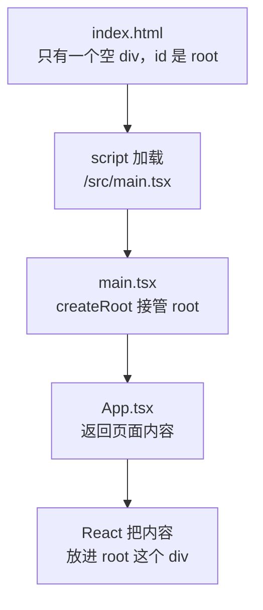

# 第 1B 章 页面从哪来：index.html → main.tsx → App.tsx

## 这一章解决什么问题

上一章打开的欢迎页，内容是从哪个文件来的？以后价格清单会有列表、表单、详情页，要改哪里、从哪找起，都得先知道页面的源头。本章顺着浏览器加载页面的顺序找到 `App.tsx`，把欢迎页换成自己的「产品价格清单」。

本章只讲一个技术点：**入口文件**。

## 开始之前

- 上一章你已经会了：`npm install` 安装依赖、`npm run dev` 启动开发服务器、在浏览器打开 `http://localhost:5173/`（如果做了第 1A 章练习 2，地址是 `http://localhost:3000/`，下文统一写 5173）。
- 起点代码：仓库 `code/ch01A/price-list`，也就是 create-vite 刚生成的模板。在 `D:\react-study\price-list` 执行 `npm run dev`。
- 预计耗时：25 分钟。

## 正文

### 1B.1 入口文件是什么

**白话定义**：入口文件是浏览器加载页面时第一个执行的脚本。React 项目里，入口文件 `main.tsx` 把根组件 `App` 放进 `index.html` 里一个空的 `<div>`。

**业务场景**：以后你的价格清单会有列表、表单、详情页，它们都从 `App` 出发一层层组织起来。知道入口在哪，就知道页面从哪开始找。

**反例（什么时候不该用）**：不要往 `index.html` 的 `<div id="root">` 里手写内容，也不要另写脚本直接改它里面的元素。React 接管这个 `<div>` 后，会用自己渲染的内容整块替换，手写的内容会被覆盖（练习 2 亲手验证）。页面内容一律写在组件里。

#### 🖼 图解



### 1B.2 把欢迎页换成自己的页面

#### 💻 最小可运行代码

模板的欢迎页内容很多，先换成最简单的。四步：

1. 用下面的内容整个替换 `src/App.tsx`。
2. 用下面的内容整个替换 `src/index.css`（模板样式很多，先只留几行，样式第 10 章讲）。
3. 删除不再用的文件：`src/App.css`、`src/assets` 文件夹、`public/icons.svg`（在 VS Code 左侧文件列表里右键 →「删除」）。**一定先做第 1 步再删**，原因见踩坑警告第 1 条。
4. 用下面的内容整个替换 `index.html`，把浏览器标签页的标题改成「产品价格清单」，页面语言改成简体中文。

```tsx
// src/App.tsx
// 页面的根组件：浏览器里看到的内容，从这里开始写
function App() {
  return (
    <main>
      <h1>产品价格清单</h1>
      <p>第 1 章：项目跑起来了。</p>
    </main>
  )
}

// main.tsx 用 import App from './App.tsx' 拿到的就是这里导出的 App
export default App
```

```css
/* src/index.css */
/* 模板自带的样式很多，先换成最少的几行，样式在第 10 章再讲 */
body {
  margin: 24px;
  font-family: system-ui, 'Microsoft YaHei', sans-serif;
}
```

```html
<!-- index.html -->
<!doctype html>
<html lang="zh-CN">
  <head>
    <meta charset="UTF-8" />
    <link rel="icon" type="image/svg+xml" href="/favicon.svg" />
    <meta name="viewport" content="width=device-width, initial-scale=1.0" />
    <title>产品价格清单</title>
  </head>
  <body>
    <div id="root"></div>
    <script type="module" src="/src/main.tsx"></script>
  </body>
</html>
```

`src/main.tsx` 不用改内容。下面是加了中文注释的版本，方便你对照理解（想替换也可以，效果相同）：

```tsx
// src/main.tsx
// 整个前端的入口：index.html 里的 <script> 只引用这一个文件
import { StrictMode } from 'react'
import { createRoot } from 'react-dom/client'
// CSS 也能 import：Vite 会把它变成 <style> 插进页面
import './index.css'
import App from './App.tsx'

// 找到 index.html 里的 <div id="root">，React 从此接管它里面的内容
// 末尾的 ! 告诉 TypeScript：这个元素一定存在（否则它认为可能是 null）
createRoot(document.getElementById('root')!).render(
  // StrictMode 只在开发时做额外检查，打包后的正式版本不受影响
  <StrictMode>
    <App />
  </StrictMode>,
)
```

#### 🔍 拆解运行结果

保存后浏览器显示一个大标题「产品价格清单」和一行「第 1 章：项目跑起来了。」，标签页标题也变成了「产品价格清单」。

逐个看关键的几处：

| 位置 | 说明 |
| --- | --- |
| `index.html` 的 `<div id="root"></div>` | 页面上唯一的空容器，React 渲染的所有内容都放在这里面 |
| `index.html` 的 `<script type="module" src="/src/main.tsx">` | 浏览器向开发服务器请求 `main.tsx`，整个应用从这里启动 |
| `index.html` 的 `<title>` 和 `lang` | 它们在 `#root` 外面，React 管不到，所以标题要在 `index.html` 里改，不是在 `App.tsx` 里改 |
| `createRoot(...).render(<App />)` | 让 React 接管这个元素，把 `App` 渲染进去。一个应用通常只调用一次 |
| `function App() { return (...) }` | 组件就是一个返回页面内容的函数。`return` 里像 HTML 的写法叫 JSX，第 2 章细讲 |
| `export default App` | 把 `App` 导出，`main.tsx` 才能 `import` 到它 |

浏览器拿到的其实不是你写的 TSX。开发服务器运行时，在浏览器地址栏打开 `http://localhost:5173/src/App.tsx`，能看到 Vite 翻译后的结果，关键部分是：

```js
function App() {
	return /* @__PURE__ */ _jsxDEV("main", { children: [/* @__PURE__ */ _jsxDEV("h1", { children: "产品价格清单" }, void 0, false, {
```

`<h1>产品价格清单</h1>` 被翻译成了一次函数调用 `_jsxDEV("h1", ...)`。JSX 只是写法，最终都是 JavaScript 函数调用，类型标注也在翻译时被去掉了。

`StrictMode`（严格模式组件）只在开发时生效，会故意多执行一些代码帮你发现问题，第 4C、7A 章会看到它的效果。

#### 改坏一处试试

**① 容器 id 写错。** 把 `main.tsx` 里的 `getElementById('root')` 改成 `getElementById('app')`，保存。页面变成空白，`F12` 控制台出现：

```text
Uncaught Error: Target container is not a DOM element.
```

`index.html` 里没有 `id="app"` 的元素，`getElementById` 返回 `null`，React 找不到容器。那个 `!` 只让 TypeScript 不报错，运行时不检查，所以错误到浏览器里才出现。改回 `'root'`。

**② 去掉 `!`。** 把 `getElementById('root')!` 末尾的 `!` 删掉，VS Code 里出现红色波浪线；另开一个终端在项目目录执行 `npx tsc -b`，报：

```text
src/main.tsx(11,12): error TS2345: Argument of type 'HTMLElement | null' is not assignable to parameter of type 'Container'.
  Type 'null' is not assignable to type 'Container'.
```

TypeScript 知道 `getElementById` 可能找不到元素而返回 `null`。`!` 的意思是「我保证它存在」。改回去。

**③ 导入写法不对。** 把 `main.tsx` 里的 `import App from './App.tsx'` 改成 `import { App } from './App.tsx'`，`npx tsc -b` 报：

```text
src/main.tsx(7,10): error TS2614: Module '"./App.tsx"' has no exported member 'App'. Did you mean to use 'import App from "./App.tsx"' instead?
```

`App.tsx` 用的是 `export default`（默认导出），导入时不加花括号。带花括号的写法对应另一种导出方式，第 2 章讲。改回去。

## ⚠️ 踩坑警告

| 现象 | 原因 | 怎么改 |
| --- | --- | --- |
| 先删了 `src/App.css`，再去改 `App.tsx`，中间这段时间刷新页面是空白的，控制台显示 `Failed to load resource: the server responded with a status of 404 (Not Found)`，终端显示 `Pre-transform error: Failed to load url /src/App.css ... in .../src/App.tsx. Does the file exist?` | 模板的 `App.tsx` 第一部分有 `import './App.css'`，文件被删后找不到 | 先用新内容替换 `App.tsx`（新内容不再导入 `App.css`），再删文件。已经删了也没关系，替换完 `App.tsx` 就好了 |
| 删了 `src/index.css`，页面空白，终端显示 `Failed to load url /src/index.css ... in .../src/main.tsx` | `main.tsx` 里有 `import './index.css'` | `index.css` 不要删，只替换内容 |
| 在 `index.html` 的 `<div id="root">` 里写了内容，页面上看不到 | React 接管 `#root` 后用 `App` 的内容整块替换了它 | 页面内容写在组件里 |
| 页面空白，控制台 `Target container is not a DOM element.` | `getElementById` 的 id 和 `index.html` 里的不一致 | 两边都用 `root` |

## 🎯 动手练习

**练习 1：给根组件改个名字**

把 `App.tsx` 里的函数名 `App` 改成 `PriceListApp`（`export default` 那一行也跟着改）。**不要改 `main.tsx`**。

验收标准：

- 页面照常显示「产品价格清单」。
- 另开终端执行 `npx tsc -b`，没有任何输出（表示没有错误）。
- 能说清为什么 `main.tsx` 里还写着 `import App`，却不用改。

**练习 2：亲手验证「#root 里的内容会被替换」**

在 `index.html` 的 `<div id="root"></div>` 中间加一段 `<p>这段文字写在 index.html 里</p>`，保存。

验收标准：

- 页面上看不到这段文字，只有「产品价格清单」。
- 按 `Ctrl + U` 查看网页源代码，能看到这段文字在 `<div id="root">` 里。
- 做完把 `index.html` 改回原样。

卡住了看文末参考答案。

## 📌 一句话总结

index.html 加载 main.tsx，main.tsx 把 App 放进 #root。

## 下一章

现在每次改代码都要保存后看效果。第 1C 章看清楚保存之后发生了什么：哪些改动页面局部更新，哪些会整页刷新，写错了怎么看报错。

---

<!-- 以下是参考答案，先自己动手，卡住了再往下翻 -->


## 参考答案

### 练习 1

思路：`export default` 导出的是「这个文件的默认值」，不带名字。导入方写 `import 任意名字 from ...` 都能拿到它，所以 `main.tsx` 里叫 `App` 也行。函数名只影响 `App.tsx` 文件内部。

```tsx
// src/App.tsx
// 练习 1：函数名改成 PriceListApp，main.tsx 不用改
function PriceListApp() {
  return (
    <main>
      <h1>产品价格清单</h1>
      <p>第 1 章：项目跑起来了。</p>
    </main>
  )
}

// 默认导出不带名字，main.tsx 写 import App from './App.tsx' 照样拿到它
export default PriceListApp
```

### 练习 2

`index.html` 改成下面这样，验证完再改回 1B.2 节的版本：

```html
<!-- index.html -->
<!doctype html>
<html lang="zh-CN">
  <head>
    <meta charset="UTF-8" />
    <link rel="icon" type="image/svg+xml" href="/favicon.svg" />
    <meta name="viewport" content="width=device-width, initial-scale=1.0" />
    <title>产品价格清单</title>
  </head>
  <body>
    <div id="root"><p>这段文字写在 index.html 里</p></div>
    <script type="module" src="/src/main.tsx"></script>
  </body>
</html>
```

实测：页面正文只显示「产品价格清单」和「第 1 章：项目跑起来了。」；查看源代码（也就是服务器发给浏览器的原始 HTML）里是 `<div id="root"><p>这段文字写在 index.html 里</p></div>`。`createRoot(...).render(...)` 把 `#root` 里原来的内容整个换掉了。
