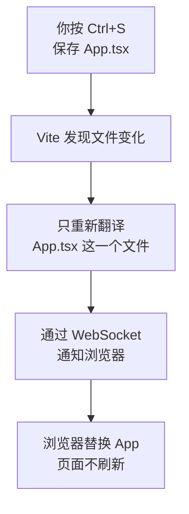

# 第 1C 章 热更新：保存即生效，写错了看遮罩

## 这一章解决什么问题

写页面时你会不停地「改一点、保存、看效果」。保存之后浏览器为什么马上就变了？为什么有时整页刷新、有时不刷新？代码写错了，浏览器上盖的那层深色遮罩怎么看？本章把这几件事看清楚，以后遇到「改了没反应」「页面上一堆红字」不会慌。

本章只讲一个技术点：**热更新**。

## 开始之前

- 上一章你已经会了：页面从 `index.html → main.tsx → App.tsx` 来，并把欢迎页换成了「产品价格清单」。
- 起点代码：仓库 `code/ch01B/price-list`（不含练习答案）。在 `D:\react-study\price-list` 执行 `npm run dev`，浏览器打开页面。
- 预计耗时：20 分钟。

## 正文

### 1C.1 热更新是什么

**白话定义**：热更新（HMR，Hot Module Replacement，热模块替换）是指你保存文件后，开发服务器只把改动的那个文件推给浏览器替换，页面不整体刷新。

**业务场景**：你在调整价格清单的标题文字或布局，每次保存一两秒内就看到效果。以后页面里填了一半的表单、展开的列表，在你改样式时都还保持原样。

**反例（什么时候不该用）**：热更新不是对所有文件都生效。改 `index.html` 或 `main.tsx` 时，Vite 会整页刷新；改 `vite.config.ts` 时，Vite 会重启开发服务器。另外，如果你怀疑页面状态和代码对不上，直接按 `F5` 刷新，不要一直依赖热更新。

#### 🖼 图解



WebSocket 是浏览器和服务器之间一条一直保持连接的通道，服务器可以随时主动推消息给浏览器。

### 1C.2 看一次热更新

#### 💻 动手

开发服务器保持运行，浏览器开着页面。把 `src/App.tsx` 里的 `<p>第 1 章：项目跑起来了。</p>` 改成 `<p>热更新生效了</p>`，按 `Ctrl + S` 保存。

#### 🔍 拆解运行结果

浏览器里那行字立刻变成「热更新生效了」，页面没有刷新。VS Code 终端多出一行：

```text
2:04:18 PM [vite] (client) hmr update /src/App.tsx
```

`F12` 控制台里能看到 `[vite] hot updated: /src/App.tsx`。

对比一下：打开 `index.html`，把 `<title>产品价格清单</title>` 改成别的文字并保存，终端显示的是：

```text
2:04:46 PM [vite] (client) page reload index.html
```

这次是 `page reload`（整页刷新）。`index.html` 不是模块，没法局部替换。

怎么证明是不是整页刷新？实测时在浏览器控制台执行 `window.__mark = 'kept'`，给页面放一个标记值。改 `App.tsx` 或 `index.css` 后标记还在；改 `index.html` 或 `main.tsx` 后标记消失，说明页面被整个重新加载了。各种文件的实测结果：

| 改了哪个文件 | 终端显示 | 页面 |
| --- | --- | --- |
| `src/App.tsx` | `hmr update /src/App.tsx` | 局部更新 |
| `src/index.css` | `hmr update /src/index.css` | 局部更新 |
| `src/main.tsx` | `page reload src/main.tsx` | 整页刷新 |
| `index.html` | `page reload index.html` | 整页刷新 |
| `vite.config.ts` | `vite.config.ts changed, restarting server...` | 开发服务器重启 |

`main.tsx` 是整个应用的起点，换掉它等于重新启动整个应用，所以 Vite 直接整页刷新。

实验完把 `App.tsx` 的文字改回「第 1 章：项目跑起来了。」，`index.html` 的标题改回「产品价格清单」。

### 1C.3 写错了：错误遮罩

#### 改坏一处试试

把 `App.tsx` 里 `<h1>产品价格清单</h1>` 末尾的 `</h1>` 删掉，保存。浏览器上盖了一层深色的错误遮罩（error overlay），开头是：

```text
[plugin:vite:oxc] Transform failed with 2 errors:

[PARSE_ERROR] Expected corresponding JSX closing tag for 'h1'.
   ╭─[ src/App.tsx:8:7 ]
   │
 6 │       <h1>产品价格清单
   │        ─┬
   │         ╰─── Opened here
   │
 8 │     </main>
   │       ──┬─
   │         ╰─── Expected `</h1>`
```

怎么读这段报错：

| 部分 | 含义 |
| --- | --- |
| `plugin:vite:oxc` | 报错的是 Vite 里负责翻译 TSX 的工具 Oxc |
| `Transform failed with 2 errors` | 翻译失败，一共两处错误。第二处是第一处引起的连锁反应，先看第一处 |
| `src/App.tsx:8:7` | 发现问题的文件、行、列 |
| `Opened here` / ``Expected `</h1>` `` | 第 6 行开了 `<h1>`，到第 8 行还没关闭 |

终端里也会打印同样的错误（开头是 `[vite] Internal server error: Transform failed with 2 errors:`）。把 `</h1>` 补回去保存，遮罩自动消失，不用刷新。

## ⚠️ 踩坑警告

| 现象 | 原因 | 怎么改 |
| --- | --- | --- |
| 按 `Esc` 关掉了错误遮罩，页面看起来正常，以为没事了；接着改别处，页面不变，一保存遮罩又弹出来 | 遮罩只是被关掉了，错误还在。页面上显示的是出错**之前**那一版，后面的改动都翻译不出来 | 把遮罩里指出的错误改掉。注意终端里出错时也会先打印 `hmr update`，要看它下面**有没有** `Internal server error` |
| 改了代码，页面完全没变化 | 文件没保存（VS Code 标签页上文件名旁有个白色圆点表示未保存） | 按 `Ctrl + S`，或开启菜单「文件 → 自动保存」 |
| 改 `main.tsx` 后，页面上的状态（例如以后填了一半的表单）全没了 | `main.tsx` 改动会整页刷新，不是热更新 | 正常现象。平时很少需要改 `main.tsx` |

## 🎯 动手练习

**练习 1：改样式看热更新**

在 `src/index.css` 的 `body` 里加一行文字颜色 `color: #1e3a8a;`（深蓝色），保存。

验收标准：

- 页面文字变成深蓝色，页面没有整体刷新。
- 终端出现 `hmr update /src/index.css`。

**练习 2：自己判断局部更新还是整页刷新**

依次做下面两处改动，每改一处保存一次，记下终端显示的那一行：

1. 在 `src/main.tsx` 第一行注释后面加几个字，例如 `// src/main.tsx 改了一行注释`。
2. 把 `App.tsx` 里的 `<h1>产品价格清单</h1>` 改成 `<h1>产品价格清单（测试）</h1>`。

验收标准：

- 能说出哪一处是 `page reload`、哪一处是 `hmr update`，以及原因。
- 做完把两处都改回去。

卡住了看文末参考答案。

## 📌 一句话总结

保存后 Vite 只替换改动的模块；遮罩关了错误还在。

## 下一章

开发服务器只翻译、不检查类型，写错了类型页面照样能跑。第 1D 章打开 TypeScript 严格检查，并学会用 `npm run build` 找出类型错误。

---

<!-- 以下是参考答案，先自己动手，卡住了再往下翻 -->


## 参考答案

### 练习 1

思路：CSS 文件也是模块，Vite 能单独替换它，所以不用刷新。

```css
/* src/index.css */
/* 模板自带的样式很多，先换成最少的几行，样式在第 10 章再讲 */
body {
  margin: 24px;
  /* 练习 1：文字改成深蓝色。保存后页面局部更新，不整页刷新 */
  color: #1e3a8a;
  font-family: system-ui, 'Microsoft YaHei', sans-serif;
}
```

实测终端输出：

```text
11:20:16 AM [vite] (client) hmr update /src/index.css
```

### 练习 2

实测结果：

| 改动 | 终端显示 | 原因 |
| --- | --- | --- |
| `main.tsx` 的注释 | `page reload src/main.tsx` | `main.tsx` 是整个应用的入口，换掉它等于重新启动应用，Vite 直接整页刷新。哪怕只改了注释也一样 |
| `App.tsx` 的标题 | `hmr update /src/App.tsx` | `App.tsx` 是普通组件模块，可以单独替换 |
