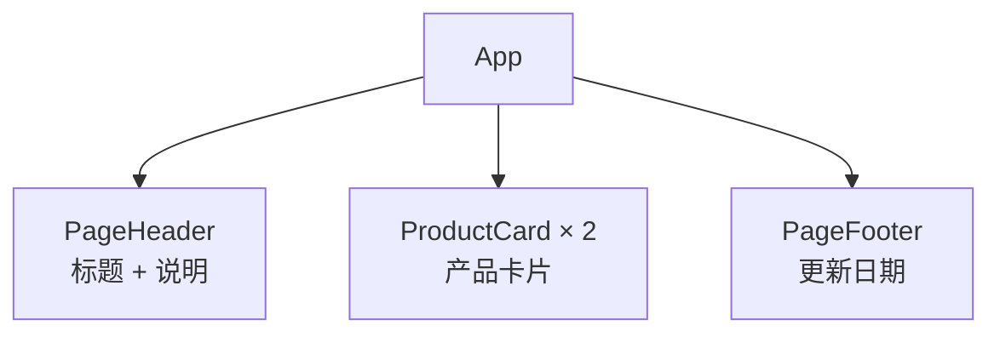
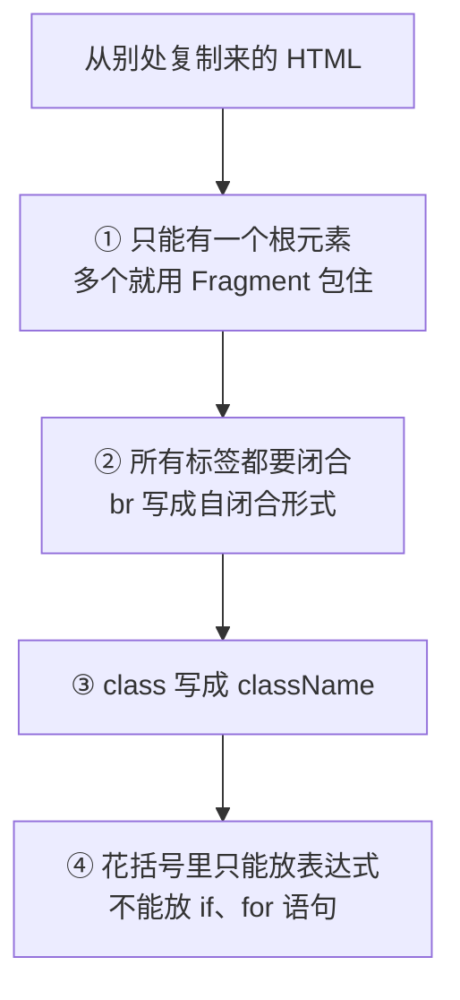
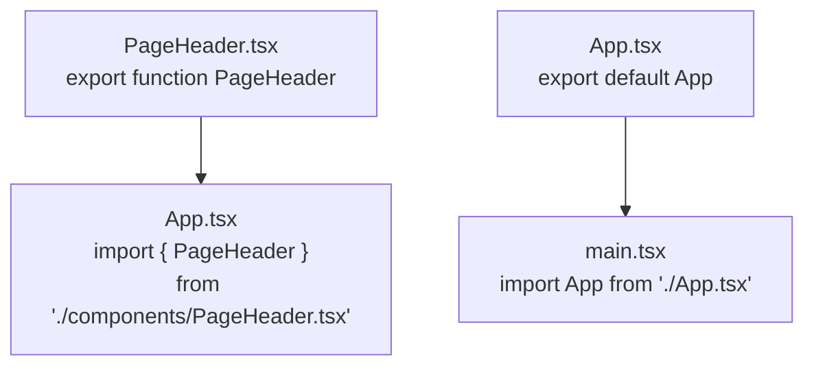

# 第 2 章 组件与 JSX

## 这一章解决什么问题

页面上要有标题、一张张产品卡片、底部的更新日期。全写在一个 `App` 里，几十行之后就找不到哪段是哪块了。本章把页面拆成几个组件，每个组件一个文件，`App` 只负责把它们摆在一起。

## 开始之前

- 上一章你已经会了：用 Vite 建项目、`npm run dev` 启动、改 `App.tsx` 看热更新，并开启了 `strict`。
- 环境：在 `D:\react-study\price-list` 目录执行 `npm run dev`，浏览器打开终端显示的地址（如果做了第 1 章练习 2，地址是 `http://localhost:3000/`，下文统一写 5173）。
- 起点代码：仓库 `code/ch01/price-list`，并已按练习 1 把 `index.html` 的标题改成「产品价格清单」。
- 预计耗时：45 分钟。

## 正文

### 2.1 函数组件

**白话定义**：函数组件（function component）就是一个**首字母大写、返回 JSX 的函数**。在别处写 `<函数名 />` 就会把它返回的内容放到那个位置。

**业务场景**：价格清单页面分成「页头」「产品卡片」「页脚」三块。每块一个组件，改页脚时只打开 `PageFooter.tsx`，不会碰到别的部分。

**反例（什么时候不该用）**：不要为每个 `<p>`、每个按钮都单独建组件。一段内容**只用一次、只有两三行、也没有自己的逻辑**时，直接写在上层组件里更好读。拆得太碎，看一个页面要来回打开十几个文件。

#### 🖼 图解



这棵树叫组件树（component tree）。React 从 `App` 开始，调用每个组件函数，把返回的内容拼成整个页面。

#### 💻 最小可运行代码

在 `src` 下新建文件夹 `components`（VS Code 左侧文件列表，在 `src` 上右键 →「新建文件夹」），然后新建下面 3 个文件。

```tsx
// src/components/PageHeader.tsx
// 页面顶部：标题和一句说明
export function PageHeader() {
  return (
    <header>
      <h1>产品价格清单</h1>
      <p className="subtitle">超声事业部 · 内部报价参考</p>
    </header>
  )
}
```

```tsx
// src/components/ProductCard.tsx
// 一张产品卡片。本章数据先写死在组件里，第 3 章改成由外部传入
export function ProductCard() {
  const name = '凸阵探头 C5-2'
  const price = 12800
  const stock = 6

  return (
    <section className="card">
      <h2>{name}</h2>
      {/* 花括号里可以放任何 JavaScript 表达式，结果会显示在页面上 */}
      <p>单价：{price.toLocaleString()} 元</p>
      <p>库存：{stock} 台</p>
    </section>
  )
}
```

```tsx
// src/components/PageFooter.tsx
// 页面底部：显示数据更新日期
export function PageFooter() {
  const updatedAt = '2026-10-30'
  return <footer>数据更新日期：{updatedAt}</footer>
}
```

用下面的内容整个替换 `src/App.tsx`：

```tsx
// src/App.tsx
// App 只负责「摆放」：页面由哪些组件组成、按什么顺序排列
import { PageHeader } from './components/PageHeader.tsx'
import { ProductCard } from './components/ProductCard.tsx'
import { PageFooter } from './components/PageFooter.tsx'

function App() {
  return (
    <main>
      <PageHeader />
      {/* 同一个组件可以用多次，每次都是一份独立的界面 */}
      <ProductCard />
      <ProductCard />
      <PageFooter />
    </main>
  )
}

export default App
```

再给卡片加一点边框，用下面的内容整个替换 `src/index.css`：

```css
/* src/index.css */
/* 全局样式先保持最少，第 10 章再整理 */
body {
  margin: 24px;
  font-family: system-ui, 'Microsoft YaHei', sans-serif;
}

.subtitle {
  color: #666;
}

.card {
  border: 1px solid #ddd;
  border-radius: 6px;
  padding: 8px 16px;
  margin-bottom: 12px;
  max-width: 360px;
}
```

#### 🔍 拆解运行结果

保存后页面从上到下显示（实测页面文字）：

```text
产品价格清单
超声事业部 · 内部报价参考
凸阵探头 C5-2
单价：12,800 元
库存：6 台
凸阵探头 C5-2
单价：12,800 元
库存：6 台
数据更新日期：2026-10-30
```

| 看到的现象 | 原因 |
| --- | --- |
| 卡片出现了两次 | `App` 里写了两次 `<ProductCard />`，React 调用了两次 `ProductCard` 函数 |
| 两张卡片内容一样 | 数据写死在组件里。第 3 章用 props 让每张卡片显示不同产品 |
| `12800` 显示成 `12,800` | `{price.toLocaleString()}` 是一次普通的 JavaScript 方法调用，返回带千分位的字符串 |
| `PageFooter` 没有 `( )` 包着 | 只有一行 JSX 时可以直接写在 `return` 后面；多行时用括号包起来，避免 `return` 后换行被当成 `return;` |

组件函数里的 `const name = ...` 是普通变量，每次 React 调用这个函数时重新计算。

#### 改坏一处试试

把 `App.tsx` 里的 `<PageFooter />` 改成小写的 `<pageFooter />`。VS Code 里出现红色波浪线，`npm run build` 报：

```text
src/App.tsx(14,7): error TS2339: Property 'pageFooter' does not exist on type 'JSX.IntrinsicElements'.
```

JSX 里**小写开头的标签被当作 HTML 元素**（`div`、`p` 这类），大写开头才会去找同名的组件函数。HTML 里没有 `pageFooter` 元素，TypeScript 就报错了（`IntrinsicElements` 指的就是 HTML 自带的元素列表）。改回大写。

### 2.2 JSX 规则

**白话定义**：JSX 是写在 TypeScript 里、长得像 HTML 的语法。第 1 章看到过，它最终被翻译成函数调用，所以它比 HTML 多几条规矩。

**业务场景**：从设计稿或旧页面复制一段 HTML 到组件里，要按 JSX 规则改几处才能用。

**反例（什么时候不该用）**：JSX 只用来描述**页面结构**。复杂的计算、数据整理（比如汇总金额、筛选列表）不要整段塞进花括号，先在 `return` 前面用变量算好，花括号里只放结果。

#### 🖼 图解



| 规则 | HTML 写法 | JSX 写法 | 为什么 |
| --- | --- | --- | --- |
| 一个根元素 | 并列的 `<hr>` 和 `<footer>` | 用 `<>...</>` 包住 | 一个函数只能返回一个值 |
| 标签必须闭合 | `<br>`、`` | `<br />`、`` | JSX 按严格的 XML 方式解析 |
| 属性名用驼峰 | `class`、`onclick` | `className`、`onClick` | `class` 是 JavaScript 的关键字；属性最终对应 DOM 对象的属性名 |
| `{ }` 放表达式 | 无 | `{price * 2}`、`{name}` | 花括号的内容会被当作一个值放进页面，`if` 语句不产生值 |

`<>...</>` 叫 Fragment（片段），它只用来把多个元素包成一个，页面上不会多出一层标签。

#### 💻 最小可运行代码

本节没有新文件，2.1 的代码已经用到了这些规则：`ProductCard` 有一个根元素 `<section>`，用了 `className`，`{name}` 和 `{price.toLocaleString()}` 都是表达式。

JSX 里的注释也要写在花括号里：`{/* 注释 */}`，`ProductCard.tsx` 里就有一行。

#### 🔍 拆解运行结果

在浏览器按 `F12`，在「元素（Elements）」面板里看 `<div id="root">` 里面，第一张卡片是：

```html
<section class="card"><h2>凸阵探头 C5-2</h2><p>单价：12,800 元</p><p>库存：6 台</p></section>
```

JSX 里写的 `className` 到浏览器里变回了 `class`。`{/* ... */}` 注释没有出现在页面上。

#### 改坏一处试试

**① 返回两个并列元素。** 把 `PageFooter.tsx` 的 `return` 改成：

```tsx
  return (
    <hr />
    <footer>数据更新日期：{updatedAt}</footer>
  )
```

保存后浏览器出现错误遮罩：

```text
[plugin:vite:oxc] Transform failed with 1 error:

[PARSE_ERROR] Adjacent JSX elements must be wrapped in an enclosing tag.
   ╭─[ src/components/PageFooter.tsx:7:5 ]
   │
 7 │     <footer>数据更新日期：{updatedAt}</footer>
   │     ┬
   │     ╰──
   │
   │ Help: Did you want a JSX fragment `<>...</>`?
```

「相邻的 JSX 元素必须用一个外层标签包住」，提示里直接建议用 Fragment。VS Code 里的报错是 `TS2657: JSX expressions must have one parent element.`。改回原样。

**② 用 `class`。** 把 `PageHeader.tsx` 里的 `className="subtitle"` 改成 `class="subtitle"`。页面照样显示，灰色也还在，但有两处报错：

- VS Code 和 `npm run build`：`Property 'class' does not exist on type ... Did you mean 'className'?`
- 浏览器控制台：``Invalid DOM property `class`. Did you mean `className`?``

页面能跑不代表写对了，TypeScript 和 React 都在提醒你。改回 `className`。

**③ 花括号里写 `if`。** 把 `<p>库存：{stock} 台</p>` 改成 `<p>库存：{if (stock > 0) { stock }} 台</p>`，遮罩显示 `Unexpected token`，箭头指向 `if`。按条件显示内容用别的写法，第 5 章讲。

### 2.3 用 import / export 拆分文件

**白话定义**：每个 `.tsx` 文件是一个模块（module）。文件里的东西默认只在本文件可见，加上 `export` 才能被别的文件用 `import` 拿到。

**业务场景**：`ProductCard` 以后会被列表页、详情页同时用到。把它放在独立文件里 `export`，哪个页面要用就 `import`。

**反例（什么时候不该用）**：只在一个组件内部用到的小函数、常量，不要 `export`。导出的东西越多，别人越不清楚哪些是给外部用的，改的时候也不敢动。

#### 🖼 图解



#### 💻 最小可运行代码

两种导出方式，本项目都用到了：

| 方式 | 导出写法 | 导入写法 | 本项目哪里用 |
| --- | --- | --- | --- |
| 命名导出（named export） | `export function PageHeader() {...}` | `import { PageHeader } from '...'`，名字必须一致 | `components/` 下的所有组件 |
| 默认导出（default export） | `export default App` | `import App from '...'`，名字可以随便起 | 模板生成的 `App.tsx` |

本教程自己写的组件统一用**命名导出**。理由：导入时名字必须和导出一致，写错了 TypeScript 会提示正确的名字；用默认导出时，每个文件可以随便起名，同一个组件在不同文件里可能叫不同的名字，搜索代码时找不全。

`from './components/PageHeader.tsx'` 里的 `./` 表示「从当前文件所在的文件夹出发」。不以 `./` 或 `../` 开头的（比如 `'react'`）表示从 `node_modules` 里找已安装的库。

#### 🔍 拆解运行结果

页面和 2.1 完全一样。拆分文件只改变代码的组织方式，不改变页面。

在 VS Code 里按住 `Ctrl` 点击 `App.tsx` 中的 `PageHeader`，会直接跳到 `PageHeader.tsx`。这是 `import` 带来的另一个好处：编辑器知道每个名字来自哪个文件。

#### 改坏一处试试

**① 名字写错。** 把 `App.tsx` 里的 `import { PageFooter }` 改成 `import { PageFootr }`，报：

```text
src/App.tsx(5,10): error TS2724: '"./components/PageFooter.tsx"' has no exported member named 'PageFootr'. Did you mean 'PageFooter'?
```

**② 用默认导入去拿命名导出。** 改成 `import PageFooter from './components/PageFooter.tsx'`（去掉花括号），报：

```text
error TS2613: Module '".../src/components/PageFooter"' has no default export. Did you mean to use 'import { PageFooter } from ".../src/components/PageFooter"' instead?
```

**③ 忘了 `export`。** 把 `PageFooter.tsx` 里的 `export function` 改成 `function`，报：

```text
src/App.tsx(5,10): error TS2459: Module '"./components/PageFooter.tsx"' declares 'PageFooter' locally, but it is not exported.
```

三种错误的提示都直接说明了问题，照着改就行。每次实验后改回原样。

## ⚠️ 踩坑警告

| 现象 | 原因 | 怎么改 |
| --- | --- | --- |
| 组件位置报 `TS2786: 'PageFooter' cannot be used as a JSX component. Its type '() => void' is not a valid JSX element type.`，浏览器里这块空白 | 组件函数忘了写 `return`；或者写了 `return` 后直接换行再写 JSX，JavaScript 认为语句在 `return` 处结束。两种情况函数都什么也不返回 | 多行 JSX 用 `return (` 开头，括号和 `return` 在同一行 |
| 从旧页面复制 HTML 过来，报一堆错 | `<br>`、``、`<input>` 没闭合，`class`、`for`、`style="..."` 写法不同 | 闭合成 `<br />`；`class` → `className`，`for` → `htmlFor`；`style` 写成对象，第 10 章讲 |
| 新建组件后 `import` 报 `TS2307: Cannot find module 'components/PageFooter.tsx'` | 路径少了开头的 `./`（被当成 `node_modules` 里的库去找）、文件夹名拼错，或文件扩展名不对（写成 `.ts` 而里面有 JSX） | 用 VS Code 的自动导入：输入 `<PageF` 时选提示里的组件，编辑器会自动补全 `import` 行；含 JSX 的文件必须是 `.tsx` |

## 🎯 动手练习

**练习 1：加一个公告栏组件**

新建 `src/components/NoticeBar.tsx`，导出组件 `NoticeBar`，显示一条分隔线 `<hr />` 和一行文字「价格含税，有效期至 2026-12-31」。日期写成组件里的一个变量。放在页头下面、第一张卡片上面。

验收标准：

- 页面上标题说明下方出现一条横线和这行文字。
- 在开发者工具「元素」面板里，`<hr>` 和 `<p>` 外面没有多出一层 `<div>`。
- `npm run build` 成功。

**练习 2：卡片显示含税价**

在 `ProductCard` 的单价下面加一行「含税价（13%）：14,464 元」，金额由 `price` 计算得出，不要直接写 `14,464`。

验收标准：

- 两张卡片都显示 `含税价（13%）：14,464 元`。
- 把 `price` 改成 `10000`，含税价自动变成 `11,300`。

卡住了看文末参考答案。

## 📌 一句话总结

组件是返回 JSX 的大写函数，一个文件一个组件，用 export/import 连起来。

## 下一章

两张卡片内容一样。第 3 章用 props 让同一个组件显示不同的产品。

---

<!-- 以下是参考答案，先自己动手，卡住了再往下翻 -->


## 参考答案

### 练习 1

思路：要返回 `<hr />` 和 `<p>` 两个并列元素，又不想多一层标签，用 Fragment 包住。

```tsx
// src/components/NoticeBar.tsx
// 公告栏：返回两个并列元素，用 Fragment <>...</> 包起来，不多出一层 div
export function NoticeBar() {
  const validUntil = '2026-12-31'
  return (
    <>
      <hr />
      <p>价格含税，有效期至 {validUntil}</p>
    </>
  )
}
```

```tsx
// src/App.tsx
// App 只负责「摆放」：页面由哪些组件组成、按什么顺序排列
import { PageHeader } from './components/PageHeader.tsx'
import { NoticeBar } from './components/NoticeBar.tsx'
import { ProductCard } from './components/ProductCard.tsx'
import { PageFooter } from './components/PageFooter.tsx'

function App() {
  return (
    <main>
      <PageHeader />
      <NoticeBar />
      {/* 同一个组件可以用多次，每次都是一份独立的界面 */}
      <ProductCard />
      <ProductCard />
      <PageFooter />
    </main>
  )
}

export default App
```

### 练习 2

思路：计算是表达式，可以直接写进花括号。`12800 * 1.13` 在 JavaScript 里算出来是 `14463.999999999998`（小数在计算机里有误差），`toLocaleString()` 默认最多保留 3 位小数并四舍五入，显示为 `14,464`。

```tsx
// src/components/ProductCard.tsx
// 一张产品卡片。本章数据先写死在组件里，第 3 章改成由外部传入
export function ProductCard() {
  const name = '凸阵探头 C5-2'
  const price = 12800
  const stock = 6

  return (
    <section className="card">
      <h2>{name}</h2>
      {/* 花括号里可以放任何 JavaScript 表达式，结果会显示在页面上 */}
      <p>单价：{price.toLocaleString()} 元</p>
      {/* 计算直接写在花括号里；toLocaleString 顺便去掉了小数点后的误差 */}
      <p>含税价（13%）：{(price * 1.13).toLocaleString()} 元</p>
      <p>库存：{stock} 台</p>
    </section>
  )
}
```
