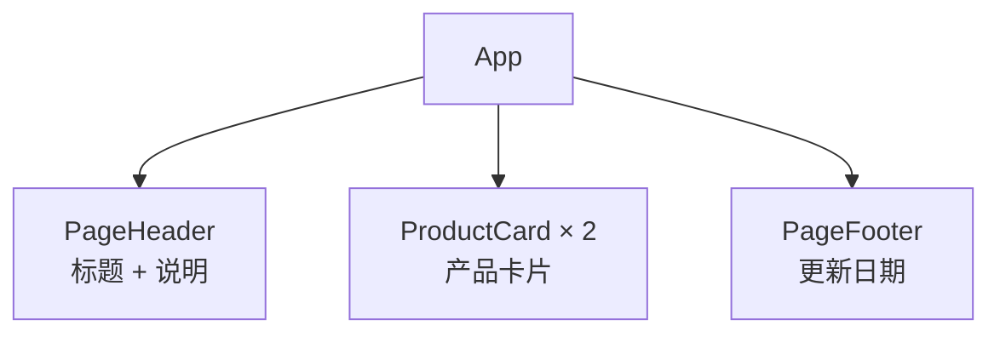

# 第 2A 章 函数组件：把页面拆成几块

## 这一章解决什么问题

页面上要有标题、一张张产品卡片、底部的更新日期。全写在一个 `App` 里，几十行之后就找不到哪段是哪块了。本章把页面拆成「页头」「产品卡片」「页脚」几个组件，`App` 只负责把它们摆在一起。

本章只讲一个技术点：**函数组件**。为了专心看组件本身，本章先把所有组件都写在 `App.tsx` 一个文件里，第 2C 章再拆到各自的文件。

## 开始之前

- 上一章你已经会了：用 Vite 建项目、`npm run dev` 启动、页面从 `main.tsx → App.tsx` 来、看热更新和错误遮罩、用 `npx tsc -b` / `npm run build` 找类型错误。
- 起点代码：仓库 `code/ch01D/price-list`（不含练习答案）。在 `D:\react-study\price-list` 执行 `npm run dev`，浏览器打开 `http://localhost:5173/`（如果做了第 1A 章练习 2，地址是 `http://localhost:3000/`，下文统一写 5173）。
- 预计耗时：20 分钟。

## 正文

### 2A.1 函数组件是什么

**白话定义**：函数组件（function component）就是一个**首字母大写、返回 JSX 的函数**。在别处写 `<函数名 />` 就会把它返回的内容放到那个位置。第 1B 章的 `App` 就是一个函数组件。

**业务场景**：价格清单页面分成「页头」「产品卡片」「页脚」三块。每块一个组件，改页脚时只看 `PageFooter`，不会碰到别的部分。同一张卡片要显示很多次，写一次组件，用的地方写多次 `<ProductCard />`。

**反例（什么时候不该用）**：不要为每个 `<p>`、每个按钮都单独建组件。一段内容**只用一次、只有两三行、也没有自己的逻辑**时，直接写在上层组件里更好读。拆得太碎，看一个页面要来回跳十几个地方。

#### 🖼 图解



这棵树叫组件树（component tree）。React 从 `App` 开始，调用每个组件函数，把返回的内容拼成整个页面。

### 2A.2 写三个组件

#### 💻 最小可运行代码

用下面的内容整个替换 `src/App.tsx`：

```tsx
// src/App.tsx
// 先把几个组件都写在 App.tsx 里，第 2C 章再拆到各自的文件

// 页面顶部：标题和一句说明
function PageHeader() {
  return (
    <header>
      <h1>产品价格清单</h1>
      <p className="subtitle">超声事业部 · 内部报价参考</p>
    </header>
  )
}

// 一张产品卡片。本章数据先写死在组件里，第 3A 章改成由外部传入
function ProductCard() {
  const name = '凸阵探头 C5-2'
  const price = 12800
  const stock = 6

  return (
    <section className="card">
      <h2>{name}</h2>
      {/* 花括号里可以放任何 JavaScript 表达式，结果会显示在页面上 */}
      <p>单价：{price.toLocaleString()} 元</p>
      <p>库存：{stock} 台</p>
    </section>
  )
}

// 页面底部：显示数据更新日期
function PageFooter() {
  const updatedAt = '2026-10-30'
  return <footer>数据更新日期：{updatedAt}</footer>
}

// App 只负责「摆放」：页面由哪些组件组成、按什么顺序排列
function App() {
  return (
    <main>
      <PageHeader />
      {/* 同一个组件可以用多次，每次都是一份独立的界面 */}
      <ProductCard />
      <ProductCard />
      <PageFooter />
    </main>
  )
}

export default App
```

再给卡片加一点边框，用下面的内容整个替换 `src/index.css`：

```css
/* src/index.css */
/* 全局样式先保持最少，第 10 章再整理 */
body {
  margin: 24px;
  font-family: system-ui, 'Microsoft YaHei', sans-serif;
}

.subtitle {
  color: #666;
}

.card {
  border: 1px solid #ddd;
  border-radius: 6px;
  padding: 8px 16px;
  margin-bottom: 12px;
  max-width: 360px;
}
```

`className="card"` 就是 HTML 里的 `class="card"`，对应 `index.css` 里的 `.card`。为什么要写成 `className`，下一章讲。

#### 🔍 拆解运行结果

保存后页面从上到下显示（实测页面文字）：

```text
产品价格清单
超声事业部 · 内部报价参考
凸阵探头 C5-2
单价：12,800 元
库存：6 台
凸阵探头 C5-2
单价：12,800 元
库存：6 台
数据更新日期：2026-10-30
```

| 看到的现象 | 原因 |
| --- | --- |
| 卡片出现了两次 | `App` 里写了两次 `<ProductCard />`，React 调用了两次 `ProductCard` 函数，每次得到一份独立的界面 |
| 两张卡片内容一样 | 数据写死在组件里。第 3A 章用 props 让每张卡片显示不同产品 |
| `12800` 显示成 `12,800` | `{price.toLocaleString()}` 是一次普通的 JavaScript 方法调用，返回带千分位的字符串 |
| `PageFooter` 的 JSX 没有 `( )` 包着 | 只有一行 JSX 时可以直接写在 `return` 后面；多行时用括号包起来，原因见踩坑警告第 1 条 |
| 只有 `App` 写了 `export default` | 另外三个组件只在本文件里用，不用导出。拆到别的文件后就要导出了（第 2C 章） |

组件函数里的 `const name = ...` 是普通变量，每次 React 调用这个函数时重新计算。

#### 改坏一处试试

**① 用的时候写成小写。** 把 `App` 里的 `<PageFooter />` 改成 `<pageFooter />`。VS Code 里出现红色波浪线，`npx tsc -b` 报：

```text
src/App.tsx(31,10): error TS6133: 'PageFooter' is declared but its value is never read.
src/App.tsx(44,7): error TS2339: Property 'pageFooter' does not exist on type 'JSX.IntrinsicElements'.
```

JSX 里**小写开头的标签被当作 HTML 元素**（`div`、`p` 这类），大写开头才会去找同名的组件函数。HTML 里没有 `pageFooter` 元素，TypeScript 就报错了（`IntrinsicElements` 指的就是 HTML 自带的元素列表）。第一行是连带的：`PageFooter` 函数现在没人用了。

**② 定义的时候写成小写。** 改回 `<PageFooter />`，再把 `function PageFooter()` 改成 `function pageFooter()`，报：

```text
src/App.tsx(31,10): error TS6133: 'pageFooter' is declared but its value is never read.
src/App.tsx(44,8): error TS2552: Cannot find name 'PageFooter'. Did you mean 'pageFooter'?
```

两边大小写必须一致，而且组件名必须大写开头。

**③ 写了组件却没用上。** 改回原样，再把 `App` 里的 `<PageFooter />` 整行删掉，报：

```text
src/App.tsx(31,10): error TS6133: 'PageFooter' is declared but its value is never read.
```

这是第 1D 章讲过的 `noUnusedLocals` 检查，组件也是普通函数，定义了不用同样会提醒。

每次实验后改回原样。

## ⚠️ 踩坑警告

| 现象 | 原因 | 怎么改 |
| --- | --- | --- |
| 把 `PageFooter` 写成 `return` 后换行再写 JSX，`App` 里报 `TS2786: 'PageFooter' cannot be used as a JSX component. Its type '() => void' is not a valid JSX element type.`，浏览器里页脚那块是空白 | JavaScript 认为语句在 `return` 处结束，函数什么也不返回（`void`），下一行的 JSX 根本没执行 | 多行 JSX 用 `return (` 开头，左括号和 `return` 在同一行 |
| 组件名用小写开头，报 `TS2339 ... does not exist on type 'JSX.IntrinsicElements'` | 小写标签被当作 HTML 元素 | 组件名一律大写开头，定义和使用的地方大小写一致 |
| 新写了一个组件，页面上看不到，`npx tsc -b` 报 `TS6133: '...' is declared but its value is never read.` | 只定义了函数，没有在任何组件的 JSX 里写 `<组件名 />` | 定义之后要放进某个组件的 JSX 里，页面上才会出现 |

## 🎯 动手练习

**练习 1：加一个公告栏组件**

在 `App.tsx` 里新写一个组件 `NoticeBar`，显示一行文字「价格含税，有效期至 2026-12-31」，日期写成组件里的一个变量。放在页头下面、第一张卡片上面。

验收标准：

- 页面上「超声事业部 · 内部报价参考」下面出现这行文字。
- `npx tsc -b` 没有输出。

**练习 2：组件里用组件**

再写一个组件 `ContactInfo`，显示「联系人：张三　分机 8021」。把它放进 `PageFooter` 里面，显示在更新日期后面。`App` 里**不要**出现 `<ContactInfo />`。

验收标准：

- 页面底部同时显示更新日期和联系人。
- 在 `App` 函数里搜不到 `ContactInfo`。能画出现在的组件树：`App → PageFooter → ContactInfo`。

卡住了看文末参考答案。

## 📌 一句话总结

组件是返回 JSX 的大写函数，写成标签就能用，可以层层嵌套。

## 下一章

组件里的 JSX 看起来像 HTML，但有几条不一样的规矩：只能有一个根元素、`class` 要写成 `className`、花括号里只能放表达式。第 2B 章逐条看清楚。

---

<!-- 以下是参考答案，先自己动手，卡住了再往下翻 -->


## 参考答案

两个练习做完后的完整 `App.tsx`。

### 练习 1

思路：和 `PageFooter` 一样，变量写在组件函数里，JSX 只有一行，直接写在 `return` 后面。放的位置由 `App` 里 `<NoticeBar />` 写在哪一行决定。

### 练习 2

思路：组件函数里返回的 JSX 可以包含别的组件。`PageFooter` 原来只有一行，现在要放两样东西，所以改成多行并用 `return (` 包起来。`ContactInfo` 是被 `PageFooter` 使用的，`App` 不需要知道它。

```tsx
// src/App.tsx
// 两个练习都做完后的版本

// 页面顶部：标题和一句说明
function PageHeader() {
  return (
    <header>
      <h1>产品价格清单</h1>
      <p className="subtitle">超声事业部 · 内部报价参考</p>
    </header>
  )
}

// 一张产品卡片。本章数据先写死在组件里，第 3A 章改成由外部传入
function ProductCard() {
  const name = '凸阵探头 C5-2'
  const price = 12800
  const stock = 6

  return (
    <section className="card">
      <h2>{name}</h2>
      {/* 花括号里可以放任何 JavaScript 表达式，结果会显示在页面上 */}
      <p>单价：{price.toLocaleString()} 元</p>
      <p>库存：{stock} 台</p>
    </section>
  )
}

// 练习 1：公告栏，只有一行文字
function NoticeBar() {
  const validUntil = '2026-12-31'
  return <p>价格含税，有效期至 {validUntil}</p>
}

// 练习 2：联系人信息。它不出现在 App 里，而是被 PageFooter 使用
function ContactInfo() {
  return <p>联系人：张三　分机 8021</p>
}

// 页面底部：显示数据更新日期，下面放联系人
function PageFooter() {
  const updatedAt = '2026-10-30'
  return (
    <footer>
      数据更新日期：{updatedAt}
      {/* 练习 2：组件里也可以用别的组件 */}
      <ContactInfo />
    </footer>
  )
}

// App 只负责「摆放」：页面由哪些组件组成、按什么顺序排列
function App() {
  return (
    <main>
      <PageHeader />
      {/* 练习 1：放在页头下面、卡片上面 */}
      <NoticeBar />
      {/* 同一个组件可以用多次，每次都是一份独立的界面 */}
      <ProductCard />
      <ProductCard />
      <PageFooter />
    </main>
  )
}

export default App
```
