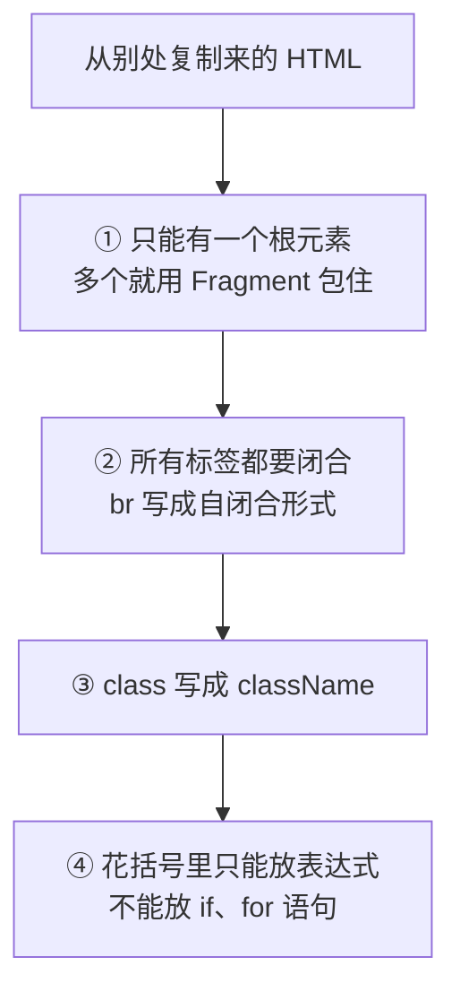

# 第 2B 章 JSX 规则：和 HTML 不一样的几处

## 这一章解决什么问题

组件里 `return` 的那段东西长得像 HTML，但从设计稿或旧页面复制一段 HTML 进来，常常一保存就报错。本章把 JSX 和 HTML 不一样的几条规矩逐条看清楚，以后看到报错知道是哪条规矩没守。

本章只讲一个技术点：**JSX 规则**。

## 开始之前

- 上一章你已经会了：写函数组件、组件里用组件、组件名必须大写开头。
- 起点代码：仓库 `code/ch02A/price-list`（不含练习答案），所有组件都在 `App.tsx` 里。在 `D:\react-study\price-list` 执行 `npm run dev`。
- 预计耗时：25 分钟。

## 正文

### 2B.1 JSX 是什么

**白话定义**：JSX 是写在 TypeScript 里、长得像 HTML 的语法。第 1B 章看到过，它最终被翻译成函数调用（`_jsxDEV("h1", ...)`），所以它比 HTML 多几条规矩。

**业务场景**：从设计稿或旧页面复制一段 HTML 到组件里，要按 JSX 规则改几处才能用。

**反例（什么时候不该用）**：JSX 只用来描述**页面结构**。复杂的计算、数据整理（比如汇总金额、筛选列表）不要整段塞进花括号，先在 `return` 前面用变量算好，花括号里只放结果。

#### 🖼 图解



### 2B.2 四条规则

| 规则 | HTML 写法 | JSX 写法 | 为什么 |
| --- | --- | --- | --- |
| 一个根元素 | 并列的 `<hr>` 和 `<footer>` | 用 `<>...</>` 包住 | 一个函数只能返回一个值 |
| 标签必须闭合 | `<br>`、`` | `<br />`、`` | JSX 按严格的 XML 方式解析 |
| 属性名用驼峰 | `class`、`for`、`onclick` | `className`、`htmlFor`、`onClick` | `class`、`for` 是 JavaScript 的关键字；属性最终对应 DOM 对象的属性名 |
| `{ }` 放表达式 | 无 | `{price * 2}`、`{name}` | 花括号的内容会被当作一个值放进页面，`if` 语句不产生值 |

`<>...</>` 叫 Fragment（片段），它只用来把多个元素包成一个，页面上不会多出一层标签。

「表达式」指的是能算出一个值的代码：`name`、`price * 2`、`price.toLocaleString()` 都是。`if (...) {...}`、`for (...) {...}` 是语句，它们做事情，但不产生一个值，所以不能放进花括号。

JSX 里的注释也要写在花括号里：`{/* 注释 */}`，`App.tsx` 的 `ProductCard` 里就有一行。

#### 💻 最小可运行代码

本节不用写新代码，上一章的 `App.tsx` 已经用到了这些规则：

| 规则 | 在哪里 |
| --- | --- |
| 一个根元素 | `ProductCard` 返回一个 `<section>`，里面才是 `<h2>` 和两个 `<p>` |
| 属性名用驼峰 | `<p className="subtitle">`、`<section className="card">` |
| 花括号放表达式 | `{name}`、`{price.toLocaleString()}`、`{updatedAt}` |
| 注释 | `{/* 花括号里可以放任何 JavaScript 表达式…… */}` |

#### 🔍 拆解运行结果

在浏览器按 `F12`，在「元素（Elements）」面板里看 `<div id="root">` 里面，第一张卡片是：

```html
<section class="card"><h2>凸阵探头 C5-2</h2><p>单价：12,800 元</p><p>库存：6 台</p></section>
```

JSX 里写的 `className` 到浏览器里变回了 `class`。`{/* ... */}` 注释没有出现在页面上。

### 2B.3 逐条违反一次

#### 改坏一处试试

**① 返回两个并列元素。** 把 `PageFooter` 的 `return` 改成：

```tsx
  return (
    <hr />
    <footer>数据更新日期：{updatedAt}</footer>
  )
```

保存后浏览器出现错误遮罩：

```text
[plugin:vite:oxc] Transform failed with 1 error:

[PARSE_ERROR] Adjacent JSX elements must be wrapped in an enclosing tag.
   ╭─[ src/App.tsx:35:5 ]
   │
35 │     <footer>数据更新日期：{updatedAt}</footer>
   │     ┬
   │     ╰──
   │
   │ Help: Did you want a JSX fragment `<>...</>`?
```

「相邻的 JSX 元素必须用一个外层标签包住」，提示里直接建议用 Fragment。`npx tsc -b` 的报错是 `src/App.tsx(34,5): error TS2657: JSX expressions must have one parent element.`。改回原样。

**② 标签不闭合。** 把 `ProductCard` 里的 `<h2>{name}</h2>` 改成 `<h2>{name}<br></h2>`，`npx tsc -b` 报：

```text
src/App.tsx(22,18): error TS17008: JSX element 'br' has no corresponding closing tag.
```

遮罩里还会多出两条连锁错误（`Expected corresponding JSX closing tag for 'h2'` 等），先改第一条。改成 `<br />` 就好了。改回原样。

**③ 用 `class`。** 把 `PageHeader` 里的 `className="subtitle"` 改成 `class="subtitle"`。页面照样显示，灰色也还在，但有两处报错：

- `npx tsc -b`：`Property 'class' does not exist on type 'DetailedHTMLProps<HTMLAttributes<HTMLParagraphElement>, HTMLParagraphElement>'. Did you mean 'className'?`
- 浏览器控制台：``Invalid DOM property `class`. Did you mean `className`?``

页面能跑不代表写对了，TypeScript 和 React 都在提醒你。改回 `className`。

**④ 花括号里写 `if`。** 把 `<p>库存：{stock} 台</p>` 改成 `<p>库存：{if (stock > 0) { stock }} 台</p>`，遮罩显示 `Unexpected token`，箭头指向 `if`。按条件显示内容用别的写法，第 5 章讲。改回原样。

## ⚠️ 踩坑警告

| 现象 | 原因 | 怎么改 |
| --- | --- | --- |
| 从旧页面复制 `<label for="kw">搜索</label>`，报 `Property 'for' does not exist on type ... Did you mean 'htmlFor'?` | `for` 是 JavaScript 的关键字，JSX 里改名为 `htmlFor` | 写成 `htmlFor="kw"` |
| 复制 `<p style="color: gray">`，报 `TS2559: Type 'string' has no properties in common with type 'Properties<string \| number, string & {}>'.` | JSX 里的 `style` 要写成对象，不是字符串 | 写成 `style={{ color: 'gray' }}`（外层花括号表示「这里是表达式」，内层是对象）。样式第 10 章细讲，日常优先用 `className` |
| `<br>`、``、`<input>` 报 `TS17008 ... has no corresponding closing tag` | JSX 要求所有标签闭合 | 写成 `<br />`、``、`<input ... />` |
| 花括号里的计算结果显示成一长串小数，比如 `14463.999999999998` | 小数在计算机里有误差，花括号直接把数字原样显示 | 显示金额前用 `toLocaleString()` 或 `toFixed(2)` 格式化 |

## 🎯 动手练习

**练习 1：带分隔线的公告栏**

在 `App.tsx` 里写一个组件 `NoticeBar`，显示一条分隔线 `<hr />` 和一行文字「价格含税，有效期至 2026-12-31」，日期写成组件里的一个变量。放在页头下面、第一张卡片上面。（做过第 2A 章练习 1 的，在那个 `NoticeBar` 上改。）

验收标准：

- 页面上标题说明下方出现一条横线和这行文字。
- 在开发者工具「元素」面板里，`<hr>` 和 `<p>` 外面没有多出一层 `<div>`。
- `npm run build` 成功。

**练习 2：卡片显示含税价**

在 `ProductCard` 的单价下面加一行「含税价（13%）：14,464 元」，金额由 `price` 计算得出，不要直接写 `14,464`。

验收标准：

- 两张卡片都显示 `含税价（13%）：14,464 元`。
- 把 `price` 改成 `10000`，含税价自动变成 `11,300`。

卡住了看文末参考答案。

## 📌 一句话总结

一个根元素、标签闭合、className、花括号只放表达式。

## 下一章

现在所有组件都挤在 `App.tsx` 一个文件里。第 2C 章用 `export` / `import` 把每个组件拆到自己的文件。

---

<!-- 以下是参考答案，先自己动手，卡住了再往下翻 -->


## 参考答案

两个练习做完后的完整 `App.tsx`。

### 练习 1

思路：要返回 `<hr />` 和 `<p>` 两个并列元素，又不想多一层标签，用 Fragment 包住。

### 练习 2

思路：计算是表达式，可以直接写进花括号。`12800 * 1.13` 在 JavaScript 里算出来是 `14463.999999999998`（小数在计算机里有误差），`toLocaleString()` 默认最多保留 3 位小数并四舍五入，显示为 `14,464`。

```tsx
// src/App.tsx
// 两个练习都做完后的版本

// 页面顶部：标题和一句说明
function PageHeader() {
  return (
    <header>
      <h1>产品价格清单</h1>
      <p className="subtitle">超声事业部 · 内部报价参考</p>
    </header>
  )
}

// 一张产品卡片。本章数据先写死在组件里，第 3A 章改成由外部传入
function ProductCard() {
  const name = '凸阵探头 C5-2'
  const price = 12800
  const stock = 6

  return (
    <section className="card">
      <h2>{name}</h2>
      {/* 花括号里可以放任何 JavaScript 表达式，结果会显示在页面上 */}
      <p>单价：{price.toLocaleString()} 元</p>
      {/* 练习 2：计算直接写在花括号里；toLocaleString 顺便去掉了小数点后的误差 */}
      <p>含税价（13%）：{(price * 1.13).toLocaleString()} 元</p>
      <p>库存：{stock} 台</p>
    </section>
  )
}

// 练习 1：公告栏。返回两个并列元素，用 Fragment <>...</> 包起来，不多出一层 div
function NoticeBar() {
  const validUntil = '2026-12-31'
  return (
    <>
      <hr />
      <p>价格含税，有效期至 {validUntil}</p>
    </>
  )
}

// 页面底部：显示数据更新日期
function PageFooter() {
  const updatedAt = '2026-10-30'
  return <footer>数据更新日期：{updatedAt}</footer>
}

// App 只负责「摆放」：页面由哪些组件组成、按什么顺序排列
function App() {
  return (
    <main>
      <PageHeader />
      <NoticeBar />
      {/* 同一个组件可以用多次，每次都是一份独立的界面 */}
      <ProductCard />
      <ProductCard />
      <PageFooter />
    </main>
  )
}

export default App
```
