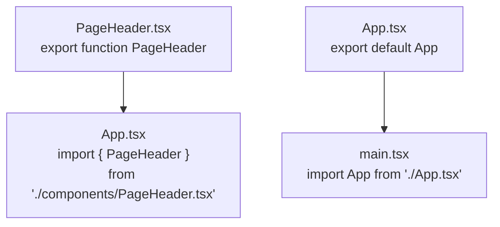

# 第 2C 章 用 import / export 把组件拆到各自的文件

## 这一章解决什么问题

现在页头、卡片、页脚都挤在 `App.tsx` 里。组件越写越多，这个文件会有几百行，改页脚时还得在一堆代码里找。以后列表页、详情页都要用 `ProductCard`，它也不能只待在 `App.tsx` 里。本章把每个组件搬到自己的文件，`App.tsx` 只留摆放的代码。

本章只讲一个技术点：**模块的导出和导入**（`export` / `import`）。

## 开始之前

- 上一章你已经会了：JSX 的四条规则（一个根元素、标签闭合、`className`、花括号放表达式）。
- 起点代码：仓库 `code/ch02B/price-list`（不含练习答案），所有组件都在 `App.tsx` 里。在 `D:\react-study\price-list` 执行 `npm run dev`。
- 预计耗时：25 分钟。

## 正文

### 2C.1 模块、export 和 import

**白话定义**：每个 `.ts` / `.tsx` 文件是一个模块（module）。文件里的东西默认只在本文件可见，加上 `export` 才能被别的文件用 `import` 拿到。

**业务场景**：`ProductCard` 以后会被列表页、详情页同时用到。把它放在独立文件里 `export`，哪个页面要用就 `import`。

**反例（什么时候不该用）**：只在一个组件内部用到的小函数、常量，不要 `export`。导出的东西越多，别人越不清楚哪些是给外部用的，改的时候也不敢动。

#### 🖼 图解



两种导出方式，本项目都用到了：

| 方式 | 导出写法 | 导入写法 | 本项目哪里用 |
| --- | --- | --- | --- |
| 命名导出（named export） | `export function PageHeader() {...}` | `import { PageHeader } from '...'`，名字必须一致 | `components/` 下的所有组件 |
| 默认导出（default export） | `export default App` | `import App from '...'`，名字可以随便起 | 模板生成的 `App.tsx` |

本教程自己写的组件统一用**命名导出**。理由：导入时名字必须和导出一致，写错了 TypeScript 会提示正确的名字；用默认导出时，每个文件可以随便起名（第 1B 章练习 1 验证过），同一个组件在不同文件里可能叫不同的名字，搜索代码时找不全。

### 2C.2 把三个组件搬出去

#### 💻 最小可运行代码

在 `src` 下新建文件夹 `components`（VS Code 左侧文件列表，在 `src` 上右键 →「新建文件夹」），然后新建下面 3 个文件。内容就是从 `App.tsx` 里剪切过来的组件，只在 `function` 前面加了 `export`：

```tsx
// src/components/PageHeader.tsx
// 页面顶部：标题和一句说明
export function PageHeader() {
  return (
    <header>
      <h1>产品价格清单</h1>
      <p className="subtitle">超声事业部 · 内部报价参考</p>
    </header>
  )
}
```

```tsx
// src/components/ProductCard.tsx
// 一张产品卡片。本章数据先写死在组件里，第 3A 章改成由外部传入
export function ProductCard() {
  const name = '凸阵探头 C5-2'
  const price = 12800
  const stock = 6

  return (
    <section className="card">
      <h2>{name}</h2>
      {/* 花括号里可以放任何 JavaScript 表达式，结果会显示在页面上 */}
      <p>单价：{price.toLocaleString()} 元</p>
      <p>库存：{stock} 台</p>
    </section>
  )
}
```

```tsx
// src/components/PageFooter.tsx
// 页面底部：显示数据更新日期
export function PageFooter() {
  const updatedAt = '2026-10-30'
  return <footer>数据更新日期：{updatedAt}</footer>
}
```

用下面的内容整个替换 `src/App.tsx`：

```tsx
// src/App.tsx
// App 只负责「摆放」：页面由哪些组件组成、按什么顺序排列
import { PageHeader } from './components/PageHeader.tsx'
import { ProductCard } from './components/ProductCard.tsx'
import { PageFooter } from './components/PageFooter.tsx'

function App() {
  return (
    <main>
      <PageHeader />
      {/* 同一个组件可以用多次，每次都是一份独立的界面 */}
      <ProductCard />
      <ProductCard />
      <PageFooter />
    </main>
  )
}

export default App
```

#### 🔍 拆解运行结果

页面和上一章完全一样。拆分文件只改变代码的组织方式，不改变页面。

| 代码 | 说明 |
| --- | --- |
| `export function PageHeader()` | 命名导出：别的文件可以用 `PageHeader` 这个名字导入它 |
| `import { PageHeader } from './components/PageHeader.tsx'` | 花括号里的名字必须和导出的名字一致 |
| `./` | 「从当前文件所在的文件夹出发」。`App.tsx` 在 `src` 里，所以 `./components/...` 就是 `src/components/...` |
| `'react'`（没有 `./`） | 不以 `./` 或 `../` 开头，表示从 `node_modules` 里找已安装的库 |
| `.tsx` 扩展名 | 项目配置允许导入时写扩展名（`allowImportingTsExtensions`），本教程统一写上，一看就知道是哪个文件 |

在 VS Code 里按住 `Ctrl` 点击 `App.tsx` 中的 `PageHeader`，会直接跳到 `PageHeader.tsx`。这是 `import` 带来的另一个好处：编辑器知道每个名字来自哪个文件。

#### 改坏一处试试

在 `D:\react-study\price-list` 执行 `npx tsc -b` 看报错。

**① 名字写错。** 把 `App.tsx` 里的 `import { PageFooter }` 改成 `import { PageFootr }`，报：

```text
src/App.tsx(5,10): error TS2724: '"./components/PageFooter.tsx"' has no exported member named 'PageFootr'. Did you mean 'PageFooter'?
src/App.tsx(5,10): error TS6133: 'PageFootr' is declared but its value is never read.
src/App.tsx(14,8): error TS2552: Cannot find name 'PageFooter'. Did you mean 'PageFootr'?
```

三条错误都是同一个原因，看第一条就够了：导出的叫 `PageFooter`，TypeScript 直接提示了正确的名字。

**② 用默认导入去拿命名导出。** 改成 `import PageFooter from './components/PageFooter.tsx'`（去掉花括号），报：

```text
src/App.tsx(5,8): error TS2613: Module '".../src/components/PageFooter"' has no default export. Did you mean to use 'import { PageFooter } from ".../src/components/PageFooter"' instead?
```

**③ 忘了 `export`。** 把 `PageFooter.tsx` 里的 `export function` 改成 `function`，报：

```text
src/App.tsx(5,10): error TS2459: Module '"./components/PageFooter.tsx"' declares 'PageFooter' locally, but it is not exported.
src/components/PageFooter.tsx(3,10): error TS6133: 'PageFooter' is declared but its value is never read.
```

「在文件里声明了，但没有导出」。第二条是连带的：`PageFooter.tsx` 自己没用到这个函数，外面又拿不到，它就成了没人用的函数。

每次实验后改回原样。

## ⚠️ 踩坑警告

| 现象 | 原因 | 怎么改 |
| --- | --- | --- |
| 组件搬到新文件后，`App.tsx` 报 `TS2440: Import declaration conflicts with local declaration of 'PageFooter'.` | 复制了组件却忘了从 `App.tsx` 里删掉原来那份，同一个名字既导入又定义 | 搬组件用「剪切」，不要用「复制」；`App.tsx` 里只留 `import` |
| `import` 报 `TS2307: Cannot find module 'components/PageFooter.tsx' or its corresponding type declarations.` | 路径少了开头的 `./`，被当成 `node_modules` 里的库去找；或者文件夹名、文件名拼错 | 写成 `./components/PageFooter.tsx`。也可以用 VS Code 的自动导入：输入 `<PageF` 时选提示里的组件，编辑器会自动补全 `import` 行 |
| 新建的组件文件报 `TS1161: Unterminated regular expression literal.`，指向 `</p>` 那一行 | 文件扩展名写成了 `.ts`。只有 `.tsx` 文件能写 JSX，`.ts` 文件把 `</p>` 里的 `/` 当成了正则表达式的开头 | 含 JSX 的文件必须是 `.tsx`；没有 JSX 的（比如练习 2 的工具函数）用 `.ts` |

## 🎯 动手练习

**练习 1：把公告栏也拆出去**

把第 2B 章练习 1 的 `NoticeBar`（分隔线 + 「价格含税，有效期至 2026-12-31」）放到 `src/components/NoticeBar.tsx`，用命名导出。`App.tsx` 里导入后放在页头下面。没做过第 2B 章练习 1 的，参考答案里有完整代码。

验收标准：

- 页面上标题说明下方出现横线和公告文字。
- `App.tsx` 里没有 `function NoticeBar`，只有 `import { NoticeBar } ...` 和 `<NoticeBar />`。
- `npx tsc -b` 没有输出。

**练习 2：把金额格式化做成一个工具函数**

新建 `src/utils/format.ts`，导出函数 `formatPrice(price: number)`，返回「12,800 元」这样的字符串。`ProductCard` 导入它来显示单价。

验收标准：

- 卡片仍显示「单价：12,800 元」。
- `ProductCard.tsx` 里不再出现 `toLocaleString`。
- `format.ts` 的扩展名是 `.ts`，不是 `.tsx`。

提示：`ProductCard.tsx` 在 `src/components` 里，要找 `src/utils`，先用 `../` 回到上一级文件夹。

卡住了看文末参考答案。

## 📌 一句话总结

加 export 才能被导入；组件用命名导出，路径以 ./ 开头。

## 下一章

两张卡片内容一样。第 3A 章用 props 让同一个组件显示不同的产品。

---

<!-- 以下是参考答案，先自己动手，卡住了再往下翻 -->


## 参考答案

### 练习 1

思路：从 `App.tsx` 剪切 `NoticeBar` 到新文件，在 `function` 前加 `export`；`App.tsx` 加一行 `import`。

```tsx
// src/components/NoticeBar.tsx
// 练习 1：从 App.tsx 搬过来，前面加 export 才能被 App.tsx 导入
export function NoticeBar() {
  const validUntil = '2026-12-31'
  return (
    <>
      <hr />
      <p>价格含税，有效期至 {validUntil}</p>
    </>
  )
}
```

```tsx
// src/App.tsx
// App 只负责「摆放」：页面由哪些组件组成、按什么顺序排列
import { PageHeader } from './components/PageHeader.tsx'
import { NoticeBar } from './components/NoticeBar.tsx'
import { ProductCard } from './components/ProductCard.tsx'
import { PageFooter } from './components/PageFooter.tsx'

function App() {
  return (
    <main>
      <PageHeader />
      {/* 练习 1：NoticeBar 已经搬到自己的文件，这里只是导入后使用 */}
      <NoticeBar />
      {/* 同一个组件可以用多次，每次都是一份独立的界面 */}
      <ProductCard />
      <ProductCard />
      <PageFooter />
    </main>
  )
}

export default App
```

### 练习 2

思路：工具函数和组件一样可以导出。文件里没有 JSX，所以用 `.ts`。`../utils/format.ts` 的意思是「从 `components` 回到 `src`，再进 `utils`」。

```ts
// src/utils/format.ts
// 练习 2：格式化金额的函数。里面没有 JSX，所以扩展名是 .ts
export function formatPrice(price: number) {
  return price.toLocaleString() + ' 元'
}
```

```tsx
// src/components/ProductCard.tsx
// 练习 2：金额显示改用 utils/format.ts 里的 formatPrice
// ../ 表示上一级文件夹：从 components 回到 src，再进 utils
import { formatPrice } from '../utils/format.ts'

export function ProductCard() {
  const name = '凸阵探头 C5-2'
  const price = 12800
  const stock = 6

  return (
    <section className="card">
      <h2>{name}</h2>
      <p>单价：{formatPrice(price)}</p>
      <p>库存：{stock} 台</p>
    </section>
  )
}
```
