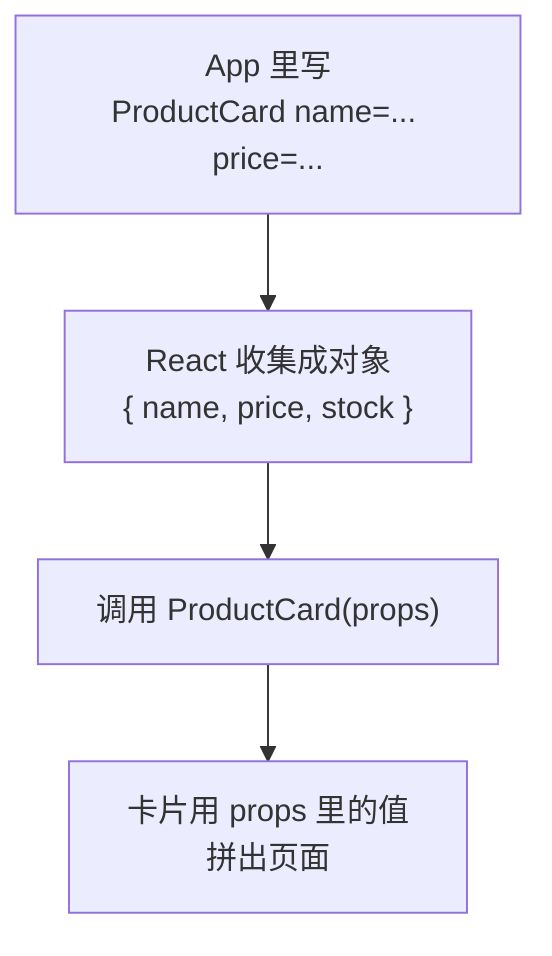
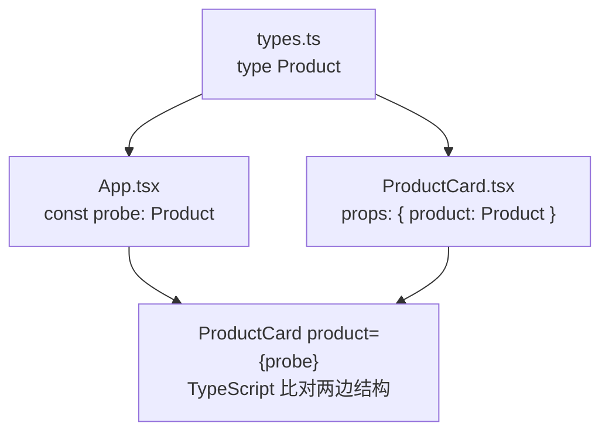
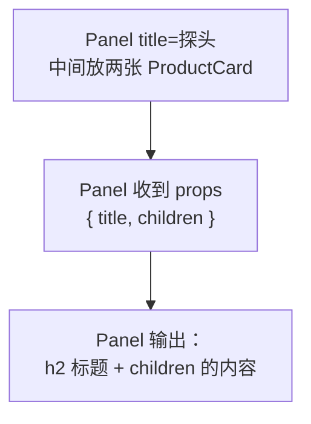

# 第 3 章 Props：给组件传数据

## 这一章解决什么问题

上一章两张 `ProductCard` 显示的是同一个产品，因为数据写死在组件里。真实页面上，同一个卡片组件要显示几十种产品。本章让「用卡片的地方」把数据传给卡片，并让 TypeScript 检查传得对不对。

## 开始之前

- 上一章你已经会了：写函数组件、JSX 规则、用 `export` / `import` 拆分文件。
- 起点代码：仓库 `code/ch02/price-list`（不含练习答案）。在 `D:\react-study\price-list` 执行 `npm run dev`。
- 预计耗时：45 分钟。

## 正文

### 3.1 props

**白话定义**：props（properties 的缩写，属性）是使用组件时写在标签上的值，比如 `<ProductCard name="凸阵探头 C5-2" />`。React 把这些值收集成一个对象，作为参数传给组件函数。

**业务场景**：价格清单里每种产品一张卡片。卡片的外观只写一次，名字、价格、库存由外面传进来。

**反例（什么时候不该用）**：所有用到这个组件的地方都一样的值（比如卡片上固定的「单价：」文字、公司统一的税率），不要做成 props，直接写在组件里。props 越多，每次使用时要填的越多，也越容易传错。

#### 🖼 图解



#### 💻 最小可运行代码

用下面的内容整个替换这两个文件：

```tsx
// src/components/ProductCard.tsx（3.1 版本，3.2 节会再改）
// 卡片显示什么，由使用它的地方通过 props 传进来

// props 的类型：调用方必须传这三个值，类型也必须对
type ProductCardProps = {
  name: string
  price: number
  stock: number
}

// 参数位置的 { name, price, stock } 是解构：直接从 props 对象里取出三个值
export function ProductCard({ name, price, stock }: ProductCardProps) {
  return (
    <section className="card">
      <h2>{name}</h2>
      <p>单价：{price.toLocaleString()} 元</p>
      <p>库存：{stock} 台</p>
    </section>
  )
}
```

```tsx
// src/App.tsx（3.1 版本，3.2 节会再改）
import { PageHeader } from './components/PageHeader.tsx'
import { ProductCard } from './components/ProductCard.tsx'
import { PageFooter } from './components/PageFooter.tsx'

function App() {
  return (
    <main>
      <PageHeader />
      {/* 字符串可以直接写引号；数字要放在花括号里，否则传进去的是字符串 */}
      <ProductCard name="凸阵探头 C5-2" price={12800} stock={6} />
      <ProductCard name="线阵探头 L12-5" price={15600} stock={3} />
      <PageFooter />
    </main>
  )
}

export default App
```

#### 🔍 拆解运行结果

页面上两张卡片终于不一样了：一张「凸阵探头 C5-2 / 单价：12,800 元 / 库存：6 台」，一张「线阵探头 L12-5 / 单价：15,600 元 / 库存：3 台」。

| 代码 | 说明 |
| --- | --- |
| `name="凸阵探头 C5-2"` | 字符串值可以直接用引号 |
| `price={12800}` | 数字、对象、变量要放在花括号里。写成 `price="12800"` 传进去的是字符串 |
| `{ name, price, stock }: ProductCardProps` | 组件函数只有一个参数，就是 props 对象。这里用解构直接取出三个字段，等价于写 `props: ProductCardProps` 再用 `props.name` |

数据只能从上往下传：`App` 传给 `ProductCard`，`ProductCard` 不能反过来改 `App` 里的东西。子组件怎么通知父组件，第 8 章讲。

#### 改坏一处试试

把第二张卡片的 `price={15600}` 改成 `price="15600"`，报：

```text
error TS2322: Type 'string' is not assignable to type 'number'.
```

再把它整个删掉 `price={15600}`，报 `TS2741: Property 'price' is missing in type ...`（缺少必填的 prop）。每次实验后改回。

### 3.2 用 type 声明 props 类型

3.1 里已经写了 `type ProductCardProps`。本节把它用好：用一个共享的 `Product` 类型描述产品，让卡片直接接收整个产品对象，并加一个可选的 prop。

**白话定义**：`type 名字 = { 字段: 类型 }` 给一种对象的结构起名字。用在 props 上，就规定了「使用这个组件必须传什么、可以传什么」。

**业务场景**：产品有编号、名称、分类、单价、库存。卡片、列表、详情页都要用这组字段。定义一次 `Product` 类型，第 7 章从 JSON 文件加载数据时也用它。

**反例（什么时候不该用）**：不要为了「以后可能用到」把十几个字段都做成可选 prop（`a?: string; b?: number ...`）。可选的越多，TypeScript 能帮你发现的漏传就越少。组件确实需要的就写成必填。

#### 🖼 图解



#### 💻 最小可运行代码

新建 `src/types.ts`（不是 `.tsx`，因为里面没有 JSX）：

```ts
// src/types.ts
// 产品数据的形状。全书共用这一个类型，以后数据从 JSON 文件来也是这个结构
export type Product = {
  id: number
  code: string
  name: string
  category: string
  price: number
  stock: number
}
```

用下面的内容整个替换这两个文件：

```tsx
// src/components/ProductCard.tsx（3.2 版本，3.3 节会再改）
// import type：只导入类型，翻译成 JavaScript 时整行会被去掉
import type { Product } from '../types.ts'

type ProductCardProps = {
  // 传一个完整的产品对象，以后 Product 加字段时这里不用改
  product: Product
  // 问号表示可选：不传时用下面参数里写的默认值 '台'
  unit?: string
}

export function ProductCard({ product, unit = '台' }: ProductCardProps) {
  return (
    <section className="card">
      <h2>{product.name}</h2>
      <p>编号：{product.code}</p>
      <p>单价：{product.price.toLocaleString()} 元</p>
      <p>
        库存：{product.stock} {unit}
      </p>
    </section>
  )
}
```

```tsx
// src/App.tsx（3.2 版本，3.3 节会再改）
import type { Product } from './types.ts'
import { PageHeader } from './components/PageHeader.tsx'
import { ProductCard } from './components/ProductCard.tsx'
import { PageFooter } from './components/PageFooter.tsx'

// 标注 : Product 后，少写字段或类型不对，这里就会报错
const probe: Product = { id: 1, code: 'P-001', name: '凸阵探头 C5-2', category: '探头', price: 12800, stock: 6 }
const gel: Product = { id: 4, code: 'C-001', name: '耦合剂 250ml', category: '耗材', price: 18, stock: 120 }

function App() {
  return (
    <main>
      <PageHeader />
      <ProductCard product={probe} />
      {/* 耗材按「瓶」计，传 unit 覆盖默认的「台」 */}
      <ProductCard product={gel} unit="瓶" />
      <PageFooter />
    </main>
  )
}

export default App
```

#### 🔍 拆解运行结果

第一张卡片「库存：6 台」，第二张「库存：120 瓶」。

| 代码 | 说明 |
| --- | --- |
| `unit?: string` | 可选 prop。不传时 `unit` 的值是 `undefined` |
| `{ product, unit = '台' }` | 解构时写默认值：没传或传了 `undefined` 就用 `'台'` |
| `import type { Product }` | 类型只在写代码和检查时有用，浏览器运行时不存在。项目配置了 `verbatimModuleSyntax`，要求导入类型时必须写 `import type`，这样一看就知道哪些导入会在运行时被删掉 |
| `const probe: Product = {...}` | 给常量标注类型，写错字段在这一行就报错，不用等到传给组件时 |

#### 改坏一处试试

**① 对象少一个字段。** 删掉 `gel` 里的 `category: '耗材',`，报：

```text
src/App.tsx(9,7): error TS2741: Property 'category' is missing in type '{ id: number; code: string; name: string; price: number; stock: number; }' but required in type 'Product'.
```

**② 多传一个没声明的 prop。** 写 `<ProductCard product={probe} discount={0.9} />`，报：

```text
error TS2322: Type '{ product: Product; discount: number; }' is not assignable to type 'IntrinsicAttributes & ProductCardProps'.
  Property 'discount' does not exist on type 'IntrinsicAttributes & ProductCardProps'.
```

组件没声明的 prop 不能乱传，拼错 prop 名字也会这样报错。

**③ 导入类型不写 `type`。** 把 `import type { Product }` 改成 `import { Product }`，报 `TS1484: 'Product' is a type and must be imported using a type-only import when 'verbatimModuleSyntax' is enabled.`

每次实验后改回。

### 3.3 children

**白话定义**：children 是一个特殊的 prop：写在组件开始标签和结束标签**中间**的内容，会作为 `children` 传给组件。

**业务场景**：页面要按分类分组，每组一个带标题的框，框里放这一类的产品卡片。框的样式写一次（`Panel` 组件），框里放什么由使用者决定。

**反例（什么时候不该用）**：组件需要的是**数据**而不是一段界面时，用普通 prop。比如卡片需要产品信息，就传 `product={probe}`，不要写成 `<ProductCard><span>凸阵探头</span></ProductCard>` 让卡片接收一段 JSX，那样卡片拿不到价格、库存这些值来计算。

#### 🖼 图解



#### 💻 最小可运行代码

新建 `src/components/Panel.tsx`：

```tsx
// src/components/Panel.tsx
// 带标题的分组框。框里放什么由使用者决定，通过 children 传进来
import type { ReactNode } from 'react'

type PanelProps = {
  title: string
  // ReactNode：任何 React 能显示的东西（JSX、文字、数字、数组……）
  children: ReactNode
}

export function Panel({ title, children }: PanelProps) {
  return (
    <section className="panel">
      <h2>{title}</h2>
      {/* 写在 <Panel>...</Panel> 中间的内容，会出现在这里 */}
      {children}
    </section>
  )
}
```

卡片放进分组框后，标题层级降一级，外层标签也从 `section` 改成 `div`。用下面的内容整个替换这两个文件：

```tsx
// src/components/ProductCard.tsx
// import type：只导入类型，翻译成 JavaScript 时整行会被去掉
import type { Product } from '../types.ts'

type ProductCardProps = {
  // 传一个完整的产品对象，以后 Product 加字段时这里不用改
  product: Product
  // 问号表示可选：不传时用下面参数里写的默认值 '台'
  unit?: string
}

export function ProductCard({ product, unit = '台' }: ProductCardProps) {
  return (
    <div className="card">
      {/* 卡片放进 Panel 后，Panel 的标题是 h2，卡片标题降一级用 h3 */}
      <h3>{product.name}</h3>
      <p>编号：{product.code}</p>
      <p>单价：{product.price.toLocaleString()} 元</p>
      <p>
        库存：{product.stock} {unit}
      </p>
    </div>
  )
}
```

```tsx
// src/App.tsx
import type { Product } from './types.ts'
import { PageHeader } from './components/PageHeader.tsx'
import { Panel } from './components/Panel.tsx'
import { ProductCard } from './components/ProductCard.tsx'
import { PageFooter } from './components/PageFooter.tsx'

// 标注 : Product 后，少写字段或类型不对，这里就会报错
const probe: Product = { id: 1, code: 'P-001', name: '凸阵探头 C5-2', category: '探头', price: 12800, stock: 6 }
const linear: Product = { id: 2, code: 'P-002', name: '线阵探头 L12-5', category: '探头', price: 15600, stock: 3 }
const gel: Product = { id: 4, code: 'C-001', name: '耦合剂 250ml', category: '耗材', price: 18, stock: 120 }

function App() {
  return (
    <main>
      <PageHeader />
      <Panel title="探头">
        <ProductCard product={probe} />
        <ProductCard product={linear} />
      </Panel>
      <Panel title="耗材">
        {/* 耗材按「瓶」计，传 unit 覆盖默认的「台」 */}
        <ProductCard product={gel} unit="瓶" />
      </Panel>
      <PageFooter />
    </main>
  )
}

export default App
```

在 `src/index.css` 末尾追加分组框的样式：

```css
.panel {
  border-left: 4px solid #3b82f6;
  padding-left: 12px;
  margin-bottom: 16px;
}
```

#### 🔍 拆解运行结果

页面上出现两个左边带蓝线的分组：「探头」组里两张卡片，「耗材」组里一张。`F12` 看「元素」面板，第一个分组是：

```html
<section class="panel"><h2>探头</h2><div class="card"><h3>凸阵探头 C5-2</h3>...</div><div class="card"><h3>线阵探头 L12-5</h3>...</div></section>
```

两张卡片出现在 `{children}` 所在的位置，也就是 `<h2>` 后面。`Panel` 不知道也不关心里面放的是什么。

#### 改坏一处试试

**① 用 `Panel` 时中间不放内容。** 写 `<Panel title="空" />`，报 `TS2741: Property 'children' is missing in type '{ title: string; }' but required in type 'PanelProps'.` 因为 `children` 声明成了必填。确实可能为空时，声明成 `children?: ReactNode`。

**② `Panel` 里忘了写 `{children}`。** 删掉 `{children}` 那一行，报 `TS6133: 'children' is declared but its value is never read.`（解构出来却没用）。如果没开这项检查，页面上只剩标题，卡片全部消失，而且不会有任何提示。

## ⚠️ 踩坑警告

| 现象 | 原因 | 怎么改 |
| --- | --- | --- |
| 数字 prop 进到组件里变成了字符串，`price + 100` 得到 `"12800100"` | 写成了 `price="12800"`，引号里的值永远是字符串 | 数字用花括号：`price={12800}`；有 TypeScript 类型时会直接报 `TS2322` |
| 在组件里改了 props（如 `product.price = product.price * 0.9`），没有报错，但开发环境里价格变成了 `10,368`（打了两次九折），刷新也不对 | TypeScript 不禁止改对象的字段；开发模式下 `StrictMode` 会把每个组件调用两次来暴露这类问题，第二次在第一次改过的值上又乘了 0.9。改的还是 `App` 里那个原始对象，别处用到它也会出错 | 把 props 当作只读。要算新值就用新变量：`const finalPrice = product.price * 0.9` |
| 导入类型报 `TS1484 ... must be imported using a type-only import` | 项目开启了 `verbatimModuleSyntax` | 改成 `import type { ... }` |

## 🎯 动手练习

**练习 1：给卡片加可选的折扣**

给 `ProductCard` 加一个可选 prop `discount`（折扣率，`0.9` 表示九折），不传时等于不打折。卡片在单价下面多显示一行「折后价」。只给线阵探头传 `discount={0.9}`。

验收标准：

- 线阵探头卡片显示「折后价：14,040 元」。
- 凸阵探头卡片显示「折后价：12,800 元」（没传折扣，和单价相同）。
- 没有修改 `product.price`。

**练习 2：用 children 做一个分类标签**

新建 `Tag` 组件，接收 `children`，用 `<span className="tag">` 包住。在卡片标题里产品名后面放一个 `Tag`，显示产品分类（`product.category`）。

验收标准：

- 卡片标题显示成「凸阵探头 C5-2 探头」「耦合剂 250ml 耗材」这样，分类来自数据，不是写死的文字。
- 「元素」面板里分类文字在 `<span class="tag">` 里。样式可以先不写。

卡住了看文末参考答案。

## 📌 一句话总结

props 从上往下传数据，用 type 写清必填和可选，children 传一段界面。

## 下一章

现在页面还是死的。第 4 章让按钮点了能改数字，页面跟着变。

---

<!-- 以下是参考答案，先自己动手，卡住了再往下翻 -->


## 参考答案

两个练习都改 `ProductCard.tsx`，下面是都做完后的版本。

### 练习 1

思路：`discount` 声明成可选，解构时给默认值 `1`，这样不传的卡片乘以 1 等于原价。新值放进新变量 `finalPrice`，不改 props。`ProductCard.tsx` 的完整代码在练习 2 后面。

```tsx
// src/App.tsx
import type { Product } from './types.ts'
import { PageHeader } from './components/PageHeader.tsx'
import { Panel } from './components/Panel.tsx'
import { ProductCard } from './components/ProductCard.tsx'
import { PageFooter } from './components/PageFooter.tsx'

// 标注 : Product 后，少写字段或类型不对，这里就会报错
const probe: Product = { id: 1, code: 'P-001', name: '凸阵探头 C5-2', category: '探头', price: 12800, stock: 6 }
const linear: Product = { id: 2, code: 'P-002', name: '线阵探头 L12-5', category: '探头', price: 15600, stock: 3 }
const gel: Product = { id: 4, code: 'C-001', name: '耦合剂 250ml', category: '耗材', price: 18, stock: 120 }

function App() {
  return (
    <main>
      <PageHeader />
      <Panel title="探头">
        <ProductCard product={probe} />
        {/* 练习 1：只有这张卡片打九折 */}
        <ProductCard product={linear} discount={0.9} />
      </Panel>
      <Panel title="耗材">
        {/* 耗材按「瓶」计，传 unit 覆盖默认的「台」 */}
        <ProductCard product={gel} unit="瓶" />
      </Panel>
      <PageFooter />
    </main>
  )
}

export default App
```

### 练习 2

思路：`Tag` 只管外观，内容用 `children` 接收，所以同一个 `Tag` 以后还能放「缺货」「新品」等文字。

```tsx
// src/components/Tag.tsx
// 小标签：外观固定，里面显示什么由 children 决定
import type { ReactNode } from 'react'

type TagProps = {
  children: ReactNode
}

export function Tag({ children }: TagProps) {
  return <span className="tag">{children}</span>
}
```

```tsx
// src/components/ProductCard.tsx
// 两个练习都做完后的版本
import type { Product } from '../types.ts'
import { Tag } from './Tag.tsx'

type ProductCardProps = {
  product: Product
  unit?: string
  // 练习 1：可选的折扣率，0.9 表示九折；不传就是不打折
  discount?: number
}

export function ProductCard({ product, unit = '台', discount = 1 }: ProductCardProps) {
  // 先在 return 前算好，JSX 里只放结果
  const finalPrice = product.price * discount

  return (
    <div className="card">
      <h3>
        {product.name} <Tag>{product.category}</Tag>
      </h3>
      <p>编号：{product.code}</p>
      <p>单价：{product.price.toLocaleString()} 元</p>
      <p>折后价：{finalPrice.toLocaleString()} 元</p>
      <p>
        库存：{product.stock} {unit}
      </p>
    </div>
  )
}
```
