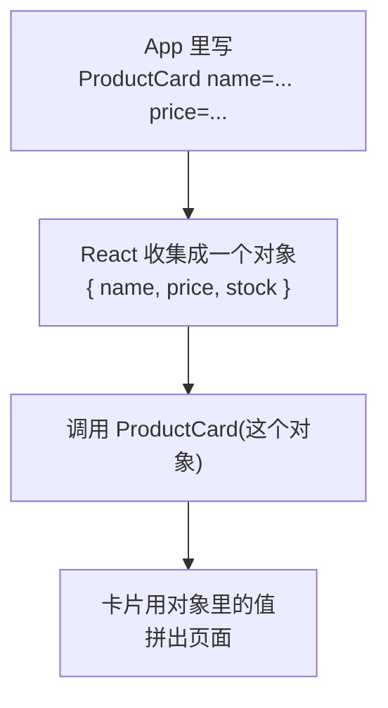

# 第 3A 章 props：给组件传数据

## 这一章解决什么问题

上一章的两张 `ProductCard` 显示的是同一个产品，因为名称、价格、库存都写死在组件里。真实页面上，同一个卡片组件要显示几十种产品。本章让「用卡片的地方」把数据传给卡片：卡片的样子只写一次，显示哪个产品由外面决定。

本章只讲一个技术点：**props**。

## 开始之前

- 上一章你已经会了：写函数组件、JSX 规则、用 `export` / `import` 拆分文件。
- 起点代码：仓库 `code/ch02C/price-list`（不含练习答案）。在 `D:\react-study\price-list` 执行 `npm run dev`，浏览器打开 `http://localhost:5173/`。
- 预计耗时：20 分钟。

## 正文

### 3A.1 props 是什么

**白话定义**：props（properties 的缩写，属性）是使用组件时写在标签上的值，比如 `<ProductCard name="凸阵探头 C5-2" />` 里的 `name`。React 把一个标签上所有的值收集成**一个对象**，作为参数传给组件函数。

**业务场景**：价格清单里每种产品一张卡片。卡片的外观只写一次，名称、价格、库存由外面传进来。

**反例（什么时候不该用）**：所有用到这个组件的地方都一样的值（比如卡片上固定的「单价：」文字、公司统一的税率），不要做成 props，直接写在组件里。props 越多，每次使用时要填的越多，也越容易传错。

#### 🖼 图解



和普通函数调用对比一下，区别只在写法：

| 普通函数 | React 组件 |
| --- | --- |
| `showCard('凸阵探头 C5-2', 12800, 6)` | `<ProductCard name="凸阵探头 C5-2" price={12800} stock={6} />` |
| 参数按**位置**对应，顺序不能错 | 值按**名字**对应，顺序随便写 |
| 有几个值就有几个参数 | 永远只有**一个**参数：装着所有值的对象 |

最后一行最重要，下面的代码和踩坑都和它有关。

### 3A.2 给卡片加上 props

#### 💻 最小可运行代码

用下面的内容整个替换这两个文件：

```tsx
// src/components/ProductCard.tsx
// 卡片显示什么，由使用它的地方通过 props 传进来

// props 的类型：调用方必须传这三个值，类型也必须对
type ProductCardProps = {
  name: string
  price: number
  stock: number
}

// 参数位置的 { name, price, stock } 是解构：直接从 props 对象里取出三个值
export function ProductCard({ name, price, stock }: ProductCardProps) {
  return (
    <section className="card">
      <h2>{name}</h2>
      <p>单价：{price.toLocaleString()} 元</p>
      <p>库存：{stock} 台</p>
    </section>
  )
}
```

```tsx
// src/App.tsx
// 每张卡片显示哪个产品，由 App 通过 props 告诉卡片
import { PageHeader } from './components/PageHeader.tsx'
import { ProductCard } from './components/ProductCard.tsx'
import { PageFooter } from './components/PageFooter.tsx'

function App() {
  return (
    <main>
      <PageHeader />
      {/* 字符串可以直接写引号；数字要放在花括号里，否则传进去的是字符串 */}
      <ProductCard name="凸阵探头 C5-2" price={12800} stock={6} />
      <ProductCard name="线阵探头 L12-5" price={15600} stock={3} />
      <PageFooter />
    </main>
  )
}

export default App
```

#### 🔍 拆解运行结果

保存后页面自动刷新，两张卡片终于不一样了：

```text
凸阵探头 C5-2
单价：12,800 元
库存：6 台

线阵探头 L12-5
单价：15,600 元
库存：3 台
```

逐行看关键代码：

| 代码 | 说明 |
| --- | --- |
| `type ProductCardProps = { name: string ... }` | 描述 props 对象的结构：有哪几个值、各是什么类型。项目开了 `strict`，不写类型会报错（见踩坑警告第 2 条） |
| `name="凸阵探头 C5-2"` | 字符串值可以直接用引号 |
| `price={12800}` | 数字、对象、变量要放在花括号里。写成 `price="12800"` 传进去的是字符串 |
| `{ name, price, stock }: ProductCardProps` | 组件函数只有一个参数，就是 props 对象。这里用**解构**直接从对象里取出三个值 |

解构只是简写。下面两种写法效果完全一样，本教程统一用第一种：

```tsx
// 写法一：解构（本教程用这种）
export function ProductCard({ name, price, stock }: ProductCardProps) {
  return <h2>{name}</h2>
}

// 写法二：不解构，用 props.xxx 取值
export function ProductCard(props: ProductCardProps) {
  return <h2>{props.name}</h2>
}
```

还有一条规则：**数据只能从上往下传**。`App` 传给 `ProductCard`，`ProductCard` 不能反过来改 `App` 里的东西。子组件怎么通知父组件，第 8A 章讲。

#### 改坏一处试试

在 VS Code 另开一个终端，在 `D:\react-study\price-list` 执行 `npx tsc -b` 看报错（VS Code 编辑器里也会出现红色波浪线）。

**① 数字写成引号。** 把第二张卡片的 `price={15600}` 改成 `price="15600"`，报：

```text
src/App.tsx(13,38): error TS2322: Type 'string' is not assignable to type 'number'.
```

**② 少传一个。** 把 ` price={15600}` 整个删掉，报：

```text
src/App.tsx(13,8): error TS2741: Property 'price' is missing in type '{ name: string; stock: number; }' but required in type 'ProductCardProps'.
```

`ProductCardProps` 里没写问号的值都是必填的，少传一个就报错。可选的值怎么写，下一章讲。

**③ 名字拼错。** 把 `name="线阵探头 L12-5"` 改成 `nmae="线阵探头 L12-5"`，报：

```text
src/App.tsx(13,20): error TS2322: Type '{ nmae: string; price: number; stock: number; }' is not assignable to type 'IntrinsicAttributes & ProductCardProps'.
  Property 'nmae' does not exist on type 'IntrinsicAttributes & ProductCardProps'.
```

`IntrinsicAttributes` 是 React 给所有组件都加的几个内置属性（比如后面会学的 `key`），可以先不管，看第二行就知道是哪个名字不对。

每次实验后改回，`npx tsc -b` 没有输出就说明没有错误。

## ⚠️ 踩坑警告

| 现象 | 原因 | 怎么改 |
| --- | --- | --- |
| 把组件写成 `function ProductCard(name: string, price: number, stock: number)`，`App.tsx` 报 `TS2322: Type '{ name: string; price: number; stock: number; }' is not assignable to type 'string'` 和 `TS2786: 'ProductCard' cannot be used as a JSX component` | 按普通函数的习惯写了三个参数。React 只传**一个**参数（props 对象），于是这个对象被塞给了第一个参数 `name` | 只写一个参数：`function ProductCard({ name, price, stock }: ProductCardProps)` |
| 解构时没写类型 `function ProductCard({ name, price, stock })`，报 `TS7031: Binding element 'name' implicitly has an 'any' type.` | `strict` 模式下，参数没有类型就是 `any`（什么都能传），这是不允许的 | 在解构后面加 `: ProductCardProps` |
| 从解构改成 `function ProductCard(props: ProductCardProps)` 后，报 `TS2322: Type 'void' is not assignable to type 'ReactNode'` 和 `TS2304: Cannot find name 'price'` | 函数体里还是 `{name}`、`{price}`，没改成 `{props.name}`、`{props.price}`。`price` 找不到；`name` 恰好是浏览器自带的全局变量 `window.name`，所以报的是另一种奇怪的错误 | 两种写法选一种，不要混用。用 `props` 参数时，函数体里每个值都要写 `props.` |

## 🎯 动手练习

**练习 1：卡片显示产品编号**

给 `ProductCard` 加一个必填的 prop `code`，在名称下面显示一行「编号：P-001」。凸阵探头的编号是 `P-001`，线阵探头是 `P-002`。

验收标准：

- 两张卡片分别显示「编号：P-001」「编号：P-002」。
- 故意删掉其中一张卡片的 `code`，`npx tsc -b` 报 `TS2741: Property 'code' is missing`。

**练习 2：加第三张卡片**

在 `App` 里加第三张卡片：耦合剂 250ml，编号 `C-001`，单价 18，库存 120。不许修改 `ProductCard.tsx`（做完练习 1 后的版本）。

验收标准：

- 页面上出现第三张卡片，显示「单价：18 元」「库存：120 台」。
- 故意把库存写成 `stock="120"`，`npx tsc -b` 报 `TS2322: Type 'string' is not assignable to type 'number'`。

耦合剂显示「120 台」不太对，应该是「瓶」。下一章解决这个问题。

卡住了看文末参考答案。

## 📌 一句话总结

props 是标签上的值，React 打包成一个对象传给组件。

## 下一章

现在每张卡片要写一长串 `code`、`name`、`price`、`stock`，耦合剂的单位也不对。第 3B 章用一个 `Product` 类型把产品的字段定义一次，直接把整个产品对象传给卡片，并加一个可选的「单位」。

---

<!-- 以下是参考答案，先自己动手，卡住了再往下翻 -->


## 参考答案

两个练习做完后，两个文件都改了，下面是完整代码。

### 练习 1

思路：在 `ProductCardProps` 里加 `code: string`，解构时一起取出来，再在 JSX 里显示。没写问号，所以每张卡片都必须传，漏传 TypeScript 会提醒。

```tsx
// src/components/ProductCard.tsx
// 两个练习都做完后的版本
type ProductCardProps = {
  // 练习 1：新加的编号。没有写问号，所以每张卡片都必须传
  code: string
  name: string
  price: number
  stock: number
}

export function ProductCard({ code, name, price, stock }: ProductCardProps) {
  return (
    <section className="card">
      <h2>{name}</h2>
      <p>编号：{code}</p>
      <p>单价：{price.toLocaleString()} 元</p>
      <p>库存：{stock} 台</p>
    </section>
  )
}
```

### 练习 2

思路：组件已经能接收任何产品的数据，所以只在 `App` 里多写一行 `<ProductCard ... />`。

```tsx
// src/App.tsx
// 两个练习都做完后的版本
import { PageHeader } from './components/PageHeader.tsx'
import { ProductCard } from './components/ProductCard.tsx'
import { PageFooter } from './components/PageFooter.tsx'

function App() {
  return (
    <main>
      <PageHeader />
      {/* 练习 1：每张卡片多传一个 code */}
      <ProductCard code="P-001" name="凸阵探头 C5-2" price={12800} stock={6} />
      <ProductCard code="P-002" name="线阵探头 L12-5" price={15600} stock={3} />
      {/* 练习 2：第三张卡片。组件不用改，多写一行就多一张 */}
      <ProductCard code="C-001" name="耦合剂 250ml" price={18} stock={120} />
      <PageFooter />
    </main>
  )
}

export default App
```
