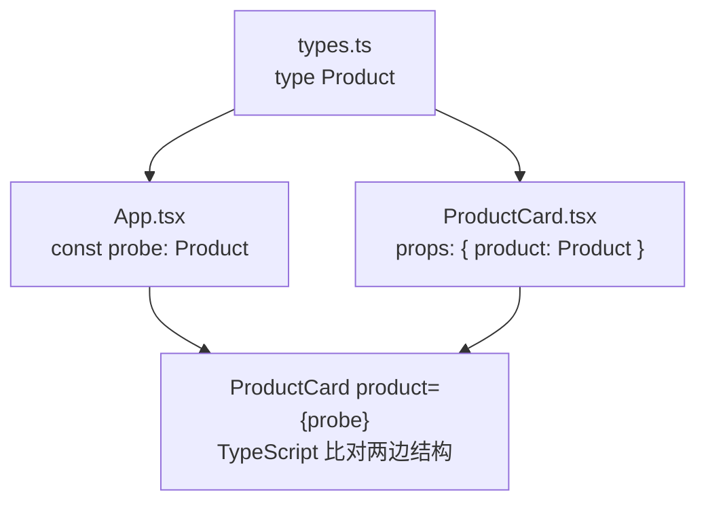

# 第 3B 章 用 type 描述产品：对象 prop 与可选 prop

## 这一章解决什么问题

上一章每张卡片要写一长串 `name`、`price`、`stock`，产品多一个字段，每个用到卡片的地方都要跟着加。耦合剂按瓶卖，卡片却写死了「台」。

本章做两件事：

- 用 `type Product` 把「一个产品有哪些字段」定义一次，卡片直接接收整个产品对象。
- 给卡片加一个可选的「单位」，不传就是「台」。

本章的新概念有三个：**共享类型文件**、**可选 prop 与默认值**、**`import type`**。

## 开始之前

- 上一章你已经会了：用 props 给组件传值，用 `type ProductCardProps` 描述 props 的结构，解构参数。
- 起点代码：仓库 `code/ch03A/price-list`（不含练习答案）。在 `D:\react-study\price-list` 执行 `npm run dev`。
- 预计耗时：25 分钟。

## 正文

### 3B.1 共享的 Product 类型，整个对象作为一个 prop

**白话定义**：`type 名字 = { 字段: 类型 }` 给一种对象的结构起名字。把它放在单独的文件里 `export` 出去，卡片、列表、详情页都 `import` 同一个类型，产品的字段就只在一处定义。

**业务场景**：产品有编号、名称、分类、单价、库存。卡片、列表、详情页都要用这组字段。第 7 章从 JSON 文件加载数据时也用这个类型。

**反例（什么时候不该用）**：只在一个组件里用、别处不会用到的结构（比如上一章的 `ProductCardProps`），就写在那个组件文件里，不用搬到 `types.ts`。共享文件里的类型越多，越难看出谁在用它。

#### 🖼 图解



#### 💻 最小可运行代码

新建 `src/types.ts`。扩展名是 `.ts` 不是 `.tsx`，因为里面没有 JSX：

```ts
// src/types.ts
// 产品数据的形状。全书共用这一个类型，以后数据从 JSON 文件来也是这个结构
export type Product = {
  id: number
  code: string
  name: string
  category: string
  price: number
  stock: number
}
```

`ProductCard.tsx` 和 `App.tsx` 的完整代码放在 3B.2 节最后，因为可选 prop 也要改这两个文件。先看和上一章相比改了什么：

| 文件 | 上一章 | 本章 |
| --- | --- | --- |
| `ProductCard.tsx` 的 props | `name`、`price`、`stock` 三个 | `product` 一个，类型是 `Product` |
| `ProductCard.tsx` 取值 | `{name}` | `{product.name}` |
| `App.tsx` 用卡片 | `<ProductCard name="..." price={...} stock={...} />` | 先定义 `const probe: Product = {...}`，再写 `<ProductCard product={probe} />` |

#### 🔍 拆解

| 代码 | 说明 |
| --- | --- |
| `export type Product = {...}` | `export` 后别的文件才能导入，和导出组件一样 |
| `product: Product` | 一个 prop 也可以是对象。以后 `Product` 加字段，`ProductCardProps` 不用改 |
| `const probe: Product = {...}` | 给常量标注类型，写错字段在**这一行**就报错，不用等到传给组件时 |
| `product={probe}` | 传对象、变量都要用花括号 |

### 3B.2 可选 prop 与默认值

**白话定义**：在 props 类型里，字段名后面加问号（`unit?: string`）表示这个 prop 可以不传。不传时它的值是 `undefined`。解构时写 `unit = '台'`，没传就用 `'台'`。

**业务场景**：大部分产品按「台」计，只有耗材按「瓶」计。让大多数卡片什么都不用写，只有耗材传 `unit="瓶"`。

**反例（什么时候不该用）**：不要为了「以后可能用到」把十几个字段都做成可选（`a?: string; b?: number ...`）。可选的越多，TypeScript 能帮你发现的漏传就越少。组件确实需要的值就写成必填。

#### 💻 最小可运行代码

用下面的内容整个替换这两个文件：

```tsx
// src/components/ProductCard.tsx
// import type：只导入类型，翻译成 JavaScript 时整行会被去掉
import type { Product } from '../types.ts'

type ProductCardProps = {
  // 传一个完整的产品对象，以后 Product 加字段时这里不用改
  product: Product
  // 问号表示可选：不传时用下面参数里写的默认值 '台'
  unit?: string
}

export function ProductCard({ product, unit = '台' }: ProductCardProps) {
  return (
    <section className="card">
      <h2>{product.name}</h2>
      <p>编号：{product.code}</p>
      <p>单价：{product.price.toLocaleString()} 元</p>
      <p>
        库存：{product.stock} {unit}
      </p>
    </section>
  )
}
```

```tsx
// src/App.tsx
import type { Product } from './types.ts'
import { PageHeader } from './components/PageHeader.tsx'
import { ProductCard } from './components/ProductCard.tsx'
import { PageFooter } from './components/PageFooter.tsx'

// 标注 : Product 后，少写字段或类型不对，这里就会报错
const probe: Product = { id: 1, code: 'P-001', name: '凸阵探头 C5-2', category: '探头', price: 12800, stock: 6 }
const gel: Product = { id: 4, code: 'C-001', name: '耦合剂 250ml', category: '耗材', price: 18, stock: 120 }

function App() {
  return (
    <main>
      <PageHeader />
      <ProductCard product={probe} />
      {/* 耗材按「瓶」计，传 unit 覆盖默认的「台」 */}
      <ProductCard product={gel} unit="瓶" />
      <PageFooter />
    </main>
  )
}

export default App
```

#### 🔍 拆解运行结果

页面上两张卡片：

```text
凸阵探头 C5-2
编号：P-001
单价：12,800 元
库存：6 台

耦合剂 250ml
编号：C-001
单价：18 元
库存：120 瓶
```

| 代码 | 说明 |
| --- | --- |
| `unit?: string` | 可选 prop。不传时 `unit` 的值是 `undefined` |
| `{ product, unit = '台' }` | 解构时写默认值：没传或传了 `undefined` 就用 `'台'` |
| `<ProductCard product={probe} />` | 没传 `unit`，显示「台」 |
| `<ProductCard product={gel} unit="瓶" />` | 传了 `unit`，显示「瓶」 |

### 3B.3 import type

两个文件都写了 `import type { Product } from ...`，比普通 `import` 多了一个 `type`。

**白话定义**：`import type` 表示「只导入类型」。类型只在写代码和检查时有用，翻译成浏览器运行的 JavaScript 时，这一整行会被删掉。

**业务场景**：项目模板在 `tsconfig.app.json` 里开了 `verbatimModuleSyntax`，要求导入类型时必须写 `import type`。好处是一看就知道哪些导入只是类型、运行时不存在。

**反例（什么时候不该用）**：导入组件、函数、常量这些运行时真实存在的东西，不能写 `import type`。比如写了 `import type { ProductCard }` 再用 `<ProductCard />`，会报 `TS1361: 'ProductCard' cannot be used as a value because it was imported using 'import type'.`，因为运行时这个导入已经被删掉了。

| 导入的东西 | 写法 |
| --- | --- |
| 类型：`Product`、后面会学的 `ReactNode` | `import type { Product } from './types.ts'` |
| 组件、函数、常量 | `import { ProductCard } from './components/ProductCard.tsx'` |

#### 改坏一处试试

在 `D:\react-study\price-list` 执行 `npx tsc -b` 看报错。

**① 对象少一个字段。** 删掉 `gel` 里的 `category: '耗材',`，报：

```text
src/App.tsx(9,7): error TS2741: Property 'category' is missing in type '{ id: number; code: string; name: string; price: number; stock: number; }' but required in type 'Product'.
```

**② 字段名拼错。** 把 `gel` 里的 `category` 改成 `catagory`，报：

```text
src/App.tsx(9,65): error TS2561: Object literal may only specify known properties, but 'catagory' does not exist in type 'Product'. Did you mean to write 'category'?
```

TypeScript 还会猜你想写的是哪个字段。

**③ 多传一个没声明的 prop。** 写 `<ProductCard product={probe} discount={0.9} />`，报：

```text
src/App.tsx(15,36): error TS2322: Type '{ product: Product; discount: number; }' is not assignable to type 'IntrinsicAttributes & ProductCardProps'.
  Property 'discount' does not exist on type 'IntrinsicAttributes & ProductCardProps'.
```

**④ 导入类型不写 `type`。** 把 `App.tsx` 里的 `import type { Product }` 改成 `import { Product }`，报：

```text
src/App.tsx(2,10): error TS1484: 'Product' is a type and must be imported using a type-only import when 'verbatimModuleSyntax' is enabled.
```

每次实验后改回。

## ⚠️ 踩坑警告

| 现象 | 原因 | 怎么改 |
| --- | --- | --- |
| 在组件里改了 props（如 `product.price = product.price * 0.9`），没有报错，但开发环境里凸阵探头显示「单价：10,368 元」（打了两次九折），耦合剂显示「14.58 元」 | TypeScript 不禁止改对象的字段。开发模式下 `StrictMode` 会把每个组件调用两次来暴露这类问题，第二次在第一次改过的值上又乘了 0.9。改的还是 `App` 里那个原始对象，别处用到它也会出错 | 把 props 当作只读。要算新值就用新变量：`const finalPrice = product.price * 0.9` |
| 写了 `unit?: string`，解构时忘了默认值（写成 `{ product, unit }`），没有报错，凸阵探头显示「库存：6」，后面什么都没有 | 没传的可选 prop 是 `undefined`，React 显示 `undefined` 时什么也不输出 | 解构时写默认值 `unit = '台'`；或者确实每次都要传，就去掉问号改成必填 |
| 导入类型报 `TS1484 ... must be imported using a type-only import` | 项目开启了 `verbatimModuleSyntax` | 改成 `import type { ... }` |

## 🎯 动手练习

**练习 1：给卡片加可选的折扣**

给 `ProductCard` 加一个可选 prop `discount`（折扣率，`0.9` 表示九折），不传时等于不打折。卡片在单价下面多显示一行「折后价」。只给凸阵探头传 `discount={0.9}`。

验收标准：

- 凸阵探头卡片显示「折后价：11,520 元」。
- 耦合剂卡片显示「折后价：18 元」（没传折扣，和单价相同）。
- 没有修改 `product.price`。

**练习 2：加一个主机产品**

在 `App.tsx` 里定义第三个产品并显示：便携彩超主机，`id` 3，编号 `H-001`，分类「主机」，单价 168000，库存 2，按「台」计。

验收标准：

- 第三张卡片显示「单价：168,000 元」「库存：2 台」，没有传 `unit`。
- 常量标注了 `: Product`。故意把单价写成 `price: '168000'`，报错出现在定义常量的那一行（`TS2322`），不是在 `<ProductCard>` 那一行。

卡住了看文末参考答案。

## 📌 一句话总结

type 定义一次产品结构，问号加默认值做可选 prop。

## 下一章

现在所有卡片排成一列。第 3C 章做一个带标题的分组框，把探头和耗材分开放，学习 `children`：把一段界面传给组件。

---

<!-- 以下是参考答案，先自己动手，卡住了再往下翻 -->


## 参考答案

两个练习做完后的完整代码。

### 练习 1

思路：`discount` 声明成可选，解构时给默认值 `1`，这样不传的卡片乘以 1 等于原价。新值放进新变量 `finalPrice`，不改 props。

```tsx
// src/components/ProductCard.tsx
// 练习 1 做完后的版本
import type { Product } from '../types.ts'

type ProductCardProps = {
  product: Product
  unit?: string
  // 练习 1：可选的折扣率，0.9 表示九折；不传就是不打折
  discount?: number
}

export function ProductCard({ product, unit = '台', discount = 1 }: ProductCardProps) {
  // 新值放进新变量，不改 product.price
  const finalPrice = product.price * discount

  return (
    <section className="card">
      <h2>{product.name}</h2>
      <p>编号：{product.code}</p>
      <p>单价：{product.price.toLocaleString()} 元</p>
      <p>折后价：{finalPrice.toLocaleString()} 元</p>
      <p>
        库存：{product.stock} {unit}
      </p>
    </section>
  )
}
```

### 练习 2

思路：和 `probe`、`gel` 一样定义常量并标注 `: Product`。不传 `unit` 就用默认的「台」。练习 1 的 `discount={0.9}` 也在这个文件里。

```tsx
// src/App.tsx
// 两个练习都做完后的版本
import type { Product } from './types.ts'
import { PageHeader } from './components/PageHeader.tsx'
import { ProductCard } from './components/ProductCard.tsx'
import { PageFooter } from './components/PageFooter.tsx'

// 标注 : Product 后，少写字段或类型不对，这里就会报错
const probe: Product = { id: 1, code: 'P-001', name: '凸阵探头 C5-2', category: '探头', price: 12800, stock: 6 }
const gel: Product = { id: 4, code: 'C-001', name: '耦合剂 250ml', category: '耗材', price: 18, stock: 120 }
// 练习 2：第三个产品，同样标注 : Product
const host: Product = { id: 3, code: 'H-001', name: '便携彩超主机', category: '主机', price: 168000, stock: 2 }

function App() {
  return (
    <main>
      <PageHeader />
      {/* 练习 1：只有这张卡片打九折 */}
      <ProductCard product={probe} discount={0.9} />
      {/* 耗材按「瓶」计，传 unit 覆盖默认的「台」 */}
      <ProductCard product={gel} unit="瓶" />
      <ProductCard product={host} />
      <PageFooter />
    </main>
  )
}

export default App
```
