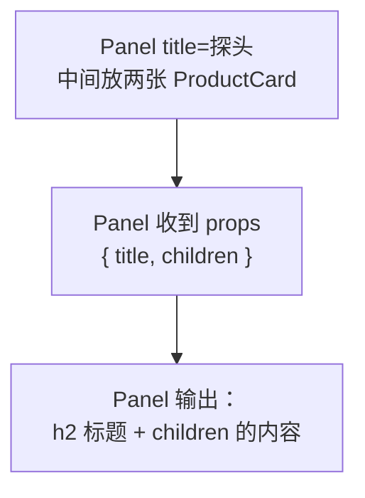

# 第 3C 章 children：把一段界面传给组件

## 这一章解决什么问题

产品多了以后，页面要按分类分组：每组一个带标题的框，「探头」框里放探头卡片，「耗材」框里放耗材卡片。框的样子写一次（`Panel` 组件），框里放什么由使用它的地方决定。

前两章传的都是**数据**（字符串、数字、产品对象）。这一次要传的是**一段界面**（几张卡片），用的是一个特殊的 prop：`children`。

本章只讲一个技术点：**children**。

## 开始之前

- 上一章你已经会了：用 `type Product` 描述产品、把整个产品对象作为 prop 传给卡片、可选 prop 与默认值、`import type`。
- 起点代码：仓库 `code/ch03B/price-list`（不含练习答案）。在 `D:\react-study\price-list` 执行 `npm run dev`。
- 预计耗时：20 分钟。

## 正文

### 3C.1 children 是什么

**白话定义**：写在组件开始标签和结束标签**中间**的内容，React 会把它作为名叫 `children` 的 prop 传给组件。组件在自己的 JSX 里写 `{children}`，这段内容就出现在那个位置。

**业务场景**：带标题的分组框、弹出对话框、页面的整体布局框架。这些组件只负责「外框」，里面放什么每次都不一样。

**反例（什么时候不该用）**：组件需要的是**数据**而不是一段界面时，用普通 prop。比如卡片需要产品信息，就传 `product={probe}`，不要写成 `<ProductCard><span>凸阵探头</span></ProductCard>` 让卡片接收一段 JSX，那样卡片拿不到价格、库存这些值来计算。

#### 🖼 图解



对比两种传法：

| 写法 | Panel 收到的 props |
| --- | --- |
| `<Panel title="探头" />` | `{ title: '探头' }` |
| `<Panel title="探头"><ProductCard ... /><ProductCard ... /></Panel>` | `{ title: '探头', children: 两张卡片 }` |

### 3C.2 做一个分组框 Panel

#### 💻 最小可运行代码

新建 `src/components/Panel.tsx`：

```tsx
// src/components/Panel.tsx
// 带标题的分组框。框里放什么由使用者决定，通过 children 传进来
import type { ReactNode } from 'react'

type PanelProps = {
  title: string
  // ReactNode：任何 React 能显示的东西（JSX、文字、数字、数组……）
  children: ReactNode
}

export function Panel({ title, children }: PanelProps) {
  return (
    <section className="panel">
      <h2>{title}</h2>
      {/* 写在 <Panel>...</Panel> 中间的内容，会出现在这里 */}
      {children}
    </section>
  )
}
```

卡片放进分组框后，分组框的标题是 `<h2>`，卡片标题要降一级用 `<h3>`；卡片外层标签也从 `section` 改成 `div`，因为一个分组才算一个独立的「区块」。用下面的内容整个替换 `src/components/ProductCard.tsx`：

```tsx
// src/components/ProductCard.tsx
// import type：只导入类型，翻译成 JavaScript 时整行会被去掉
import type { Product } from '../types.ts'

type ProductCardProps = {
  // 传一个完整的产品对象，以后 Product 加字段时这里不用改
  product: Product
  // 问号表示可选：不传时用下面参数里写的默认值 '台'
  unit?: string
}

export function ProductCard({ product, unit = '台' }: ProductCardProps) {
  return (
    <div className="card">
      {/* 卡片放进 Panel 后，Panel 的标题是 h2，卡片标题降一级用 h3 */}
      <h3>{product.name}</h3>
      <p>编号：{product.code}</p>
      <p>单价：{product.price.toLocaleString()} 元</p>
      <p>
        库存：{product.stock} {unit}
      </p>
    </div>
  )
}
```

用下面的内容整个替换 `src/App.tsx`：

```tsx
// src/App.tsx
import type { Product } from './types.ts'
import { PageHeader } from './components/PageHeader.tsx'
import { Panel } from './components/Panel.tsx'
import { ProductCard } from './components/ProductCard.tsx'
import { PageFooter } from './components/PageFooter.tsx'

// 标注 : Product 后，少写字段或类型不对，这里就会报错
const probe: Product = { id: 1, code: 'P-001', name: '凸阵探头 C5-2', category: '探头', price: 12800, stock: 6 }
const linear: Product = { id: 2, code: 'P-002', name: '线阵探头 L12-5', category: '探头', price: 15600, stock: 3 }
const gel: Product = { id: 4, code: 'C-001', name: '耦合剂 250ml', category: '耗材', price: 18, stock: 120 }

function App() {
  return (
    <main>
      <PageHeader />
      <Panel title="探头">
        <ProductCard product={probe} />
        <ProductCard product={linear} />
      </Panel>
      <Panel title="耗材">
        {/* 耗材按「瓶」计，传 unit 覆盖默认的「台」 */}
        <ProductCard product={gel} unit="瓶" />
      </Panel>
      <PageFooter />
    </main>
  )
}

export default App
```

用下面的内容整个替换 `src/index.css`（和上一章相比，只在末尾多了 `.panel` 一段）：

```css
/* src/index.css */
/* 全局样式先保持最少，第 10A 章再整理 */
body {
  margin: 24px;
  font-family: system-ui, 'Microsoft YaHei', sans-serif;
}

.subtitle {
  color: #666;
}

.card {
  border: 1px solid #ddd;
  border-radius: 6px;
  padding: 8px 16px;
  margin-bottom: 12px;
  max-width: 360px;
}

.panel {
  border-left: 4px solid #3b82f6;
  padding-left: 12px;
  margin-bottom: 16px;
}
```

#### 🔍 拆解运行结果

页面上出现两个左边带蓝线的分组：「探头」组里两张卡片，「耗材」组里一张。按 `F12` 打开开发者工具，看「元素」面板，第一个分组是（为了好看手动换了行）：

```html
<section class="panel">
  <h2>探头</h2>
  <div class="card"><h3>凸阵探头 C5-2</h3><p>编号：P-001</p><p>单价：12,800 元</p><p>库存：6 台</p></div>
  <div class="card"><h3>线阵探头 L12-5</h3><p>编号：P-002</p><p>单价：15,600 元</p><p>库存：3 台</p></div>
</section>
```

两张卡片出现在 `{children}` 所在的位置，也就是 `<h2>` 后面。

| 代码 | 说明 |
| --- | --- |
| `children: ReactNode` | `children` 也要在 props 类型里声明。`ReactNode` 是 React 提供的类型，表示「任何 React 能显示的东西」：JSX、文字、数字、数组，也包括空 |
| `import type { ReactNode } from 'react'` | `ReactNode` 是类型，所以用 `import type`（上一章讲过） |
| `<Panel title="探头">...</Panel>` | 开始标签上写普通 prop（`title`），中间写 children |
| `{children}` | Panel 不知道也不关心里面放的是什么，原样放在这里 |

#### 改坏一处试试

在 `D:\react-study\price-list` 执行 `npx tsc -b` 看报错。

**① 用 `Panel` 时中间不放内容。** 在 `<PageFooter />` 上面加一行 `<Panel title="空" />`，报：

```text
src/App.tsx(25,8): error TS2741: Property 'children' is missing in type '{ title: string; }' but required in type 'PanelProps'.
```

`children` 声明成了必填。如果确实可能为空，声明成 `children?: ReactNode`，这样就不报错了。

**② `Panel` 里忘了写 `{children}`。** 删掉 `{children}` 那一行，报：

```text
src/components/Panel.tsx(11,32): error TS6133: 'children' is declared but its value is never read.
```

这是 `noUnusedParameters` 检查（项目模板默认开启）发现的：解构出来却没用。如果没开这项检查，页面上只剩标题，卡片全部消失，而且没有任何提示。

每次实验后改回。

## ⚠️ 踩坑警告

| 现象 | 原因 | 怎么改 |
| --- | --- | --- |
| `PanelProps` 里只写了 `title`，没写 `children`，报 `TS2339: Property 'children' does not exist on type 'PanelProps'.`，`App.tsx` 里每个 `<Panel>` 也报 `TS2322 ... Property 'children' does not exist` | `children` 和别的 prop 一样，要自己在类型里声明 | 在 props 类型里加 `children: ReactNode` |
| 把 `children` 声明成 `string`，`App.tsx` 报 `TS2322: Type 'Element' is not assignable to type 'string'.` | 中间放的是 `<ProductCard />`，它是 JSX 元素（`Element`），不是字符串 | 用 `ReactNode`，文字和 JSX 都能放 |
| 分组框只显示标题，里面的卡片不见了 | `Panel` 的 JSX 里没写 `{children}`。如果关掉了 `noUnusedParameters`，TypeScript 不会提醒 | 检查组件里有没有 `{children}`，并保持模板默认的检查选项 |

## 🎯 动手练习

**练习 1：用 children 做一个分类标签**

新建 `Tag` 组件，接收 `children`，用 `<span className="tag">` 包住。在卡片标题里产品名后面放一个 `Tag`，显示产品分类（`product.category`）。

验收标准：

- 卡片标题显示成「凸阵探头 C5-2 探头」「耦合剂 250ml 耗材」这样，分类来自数据，不是写死的文字。
- 「元素」面板里分类文字在 `<span class="tag">` 里。样式可以先不写。

**练习 2：分组框里放文字**

在「耗材」分组下面再加一个分组，标题「说明」，里面放两段文字：「以上价格为含税单价，不含运费。」和「库存每天 9:00 更新。」。不许修改 `Panel.tsx`。

验收标准：

- 页面上出现第三个带蓝线的分组「说明」，里面是两个 `<p>`。
- `Panel.tsx` 没有改动。同一个 `Panel` 既能放卡片也能放文字。

卡住了看文末参考答案。

## 📌 一句话总结

标签中间的内容就是 children，组件用 {children} 决定放在哪。

## 下一章

现在页面还是死的，只能看不能操作。第 4A 章让按钮点了能改数字，页面跟着变。

---

<!-- 以下是参考答案，先自己动手，卡住了再往下翻 -->


## 参考答案

### 练习 1

思路：`Tag` 只管外观，内容用 `children` 接收，所以同一个 `Tag` 以后还能放「缺货」「新品」等文字。

```tsx
// src/components/Tag.tsx
// 小标签：外观固定，里面显示什么由 children 决定
import type { ReactNode } from 'react'

type TagProps = {
  children: ReactNode
}

export function Tag({ children }: TagProps) {
  return <span className="tag">{children}</span>
}
```

```tsx
// src/components/ProductCard.tsx
// 练习 1 做完后的版本
import type { Product } from '../types.ts'
import { Tag } from './Tag.tsx'

type ProductCardProps = {
  product: Product
  unit?: string
}

export function ProductCard({ product, unit = '台' }: ProductCardProps) {
  return (
    <div className="card">
      {/* 练习 1：分类来自数据，用 Tag 包起来 */}
      <h3>
        {product.name} <Tag>{product.category}</Tag>
      </h3>
      <p>编号：{product.code}</p>
      <p>单价：{product.price.toLocaleString()} 元</p>
      <p>
        库存：{product.stock} {unit}
      </p>
    </div>
  )
}
```

### 练习 2

思路：`children` 的类型是 `ReactNode`，普通的 `<p>` 也可以放进去，`Panel` 不用改。

```tsx
// src/App.tsx
// 练习 2 做完后的版本
import type { Product } from './types.ts'
import { PageHeader } from './components/PageHeader.tsx'
import { Panel } from './components/Panel.tsx'
import { ProductCard } from './components/ProductCard.tsx'
import { PageFooter } from './components/PageFooter.tsx'

// 标注 : Product 后，少写字段或类型不对，这里就会报错
const probe: Product = { id: 1, code: 'P-001', name: '凸阵探头 C5-2', category: '探头', price: 12800, stock: 6 }
const linear: Product = { id: 2, code: 'P-002', name: '线阵探头 L12-5', category: '探头', price: 15600, stock: 3 }
const gel: Product = { id: 4, code: 'C-001', name: '耦合剂 250ml', category: '耗材', price: 18, stock: 120 }

function App() {
  return (
    <main>
      <PageHeader />
      <Panel title="探头">
        <ProductCard product={probe} />
        <ProductCard product={linear} />
      </Panel>
      <Panel title="耗材">
        {/* 耗材按「瓶」计，传 unit 覆盖默认的「台」 */}
        <ProductCard product={gel} unit="瓶" />
      </Panel>
      {/* 练习 2：同一个 Panel，里面放的是普通文字，不是卡片 */}
      <Panel title="说明">
        <p>以上价格为含税单价，不含运费。</p>
        <p>库存每天 9:00 更新。</p>
      </Panel>
      <PageFooter />
    </main>
  )
}

export default App
```
