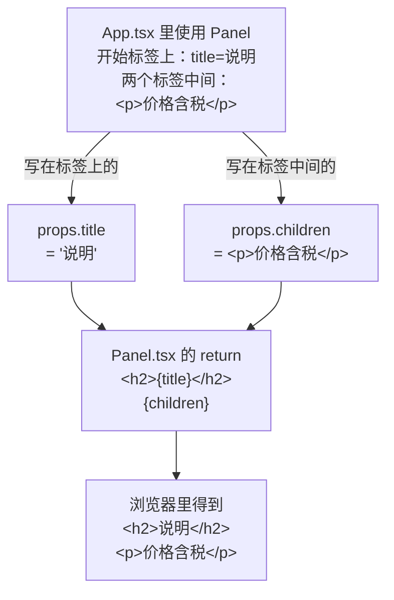
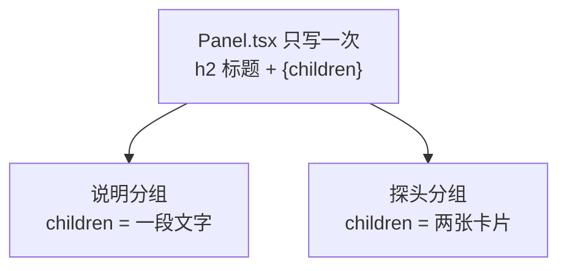

# 第 3C 章 children：把一段界面传给组件

## 这一章解决什么问题

前两章给组件传的都是**数据**：字符串、数字、产品对象。有时候要传的是**一段界面**。比如做一个带标题的分组框：框的样子只写一次，框里放什么由用它的地方决定，这次放两张产品卡片，下次放几行说明文字。

这一段界面通过一个特殊的 prop 传进去，它叫 `children`。

本章只讲一个技术点：**children**。

## 开始之前

- 上一章你已经会了：用 `type Product` 描述产品、把整个产品对象作为 prop 传给卡片、可选 prop 与默认值、`import type`。
- 起点代码：仓库 `code/ch03B/price-list`（不含练习答案）。在 `D:\react-study\price-list` 执行 `npm run dev`。
- 本章只新建 `Panel.tsx`、修改 `App.tsx`，不写样式。
- 预计耗时：20 分钟。

## 正文

### 3C.1 children 是什么

**白话定义**：使用组件时，写在开始标签和结束标签**中间**的内容，React 会把它作为一个名叫 `children` 的 prop 传给组件。组件在自己的 JSX 里写 `{children}`，这段内容就显示在那个位置。

```tsx
<Panel title="说明">
  <p>以上价格为含税单价，不含运费。</p>
</Panel>
```

上面这段写法，`Panel` 收到的 props 是两项：

| prop | 值 | 从哪来 |
| --- | --- | --- |
| `title` | `'说明'` | 写在开始标签上，和前两章的 prop 一样 |
| `children` | `<p>以上价格为含税单价，不含运费。</p>` | 写在两个标签中间 |

`children` 这个名字是 React 固定的，不能改成别的。除了「写在中间」这一点，它和普通 prop 没有区别：也要在 props 类型里声明，也从参数里解构出来用。

**业务场景**：带标题的分组框、弹出对话框、页面的整体框架。这类组件只负责「外框」，里面放什么每次都不一样。

**反例（什么时候不该用）**：组件需要的是**数据**而不是一段界面时，用普通 prop。比如卡片需要产品信息，就传 `product={probe}`。如果写成 `<ProductCard><span>凸阵探头</span></ProductCard>`，卡片拿到的只是一段显示好的界面，拿不到价格、库存这些值，也就没法计算和判断。

#### 🖼 图解



图里把那段文字缩短成了「价格含税」，免得方框太宽。

### 3C.2 最小例子：分组框里放一段文字

#### 💻 最小可运行代码

新建 `src/components/Panel.tsx`：

```tsx
// src/components/Panel.tsx
// 带标题的分组框。框里放什么由使用者决定，通过 children 传进来
import type { ReactNode } from 'react'

type PanelProps = {
  title: string
  // ReactNode：任何 React 能显示的东西（JSX、文字、数字、数组……）
  children: ReactNode
}

export function Panel({ title, children }: PanelProps) {
  return (
    // className="panel" 先留着，样式第 5A 章再加。现在不写样式，分组框照样能显示
    <section className="panel">
      <h2>{title}</h2>
      {/* 写在 <Panel>...</Panel> 中间的内容，会出现在这里 */}
      {children}
    </section>
  )
}
```

用下面的内容整个替换 `src/App.tsx`。和第 3B 章相比只多了两处：import 区最后一行导入 `Panel`；页头下面多了一个 `<Panel>`。

```tsx
// src/App.tsx（3C.2 版本：先在分组框里放一段文字）
import type { Product } from './types.ts'
import { PageHeader } from './components/PageHeader.tsx'
import { ProductCard } from './components/ProductCard.tsx'
import { PageFooter } from './components/PageFooter.tsx'
import { Panel } from './components/Panel.tsx'

// 标注 : Product 后，少写字段或类型不对，这里就会报错
const probe: Product = { id: 1, code: 'P-001', name: '凸阵探头 C5-2', category: '探头', price: 12800, stock: 6 }
const gel: Product = { id: 4, code: 'C-001', name: '耦合剂 250ml', category: '耗材', price: 18, stock: 120 }

function App() {
  return (
    <main>
      <PageHeader />
      {/* title 是普通 prop；开始标签和结束标签中间的 <p> 就是 children */}
      <Panel title="说明">
        <p>以上价格为含税单价，不含运费。</p>
      </Panel>
      <ProductCard product={probe} />
      {/* 耗材按「瓶」计，传 unit 覆盖默认的「台」 */}
      <ProductCard product={gel} unit="瓶" />
      <PageFooter />
    </main>
  )
}

export default App
```

#### 🔍 拆解运行结果

页头下面出现标题「说明」和一行「以上价格为含税单价，不含运费。」，下面是原来的两张卡片。这一章不写样式，所以分组框看不出边框，只能看到一个标题加一行字。

按 `F12` 打开开发者工具，看「元素」面板，分组框是这样（为了好看手动换了行）：

```html
<section class="panel">
  <h2>说明</h2>
  <p>以上价格为含税单价，不含运费。</p>
</section>
```

`<p>` 出现在 `{children}` 所在的位置，也就是 `<h2>` 后面。

| 代码 | 说明 |
| --- | --- |
| `children: ReactNode` | `children` 也要在 props 类型里声明。`ReactNode` 是 React 提供的类型，先理解成「任何 React 能显示的东西」，它具体包括什么下一章细讲 |
| `import type { ReactNode } from 'react'` | `ReactNode` 是类型，所以用 `import type`（第 3B 章） |
| `{ title, children }: PanelProps` | 和普通 prop 一样，从参数里解构出来 |
| `{children}` | `Panel` 不知道、也不关心里面放的是什么，原样放在这里 |
| `className="panel"` | 先留着，第 5A 章加样式时用到。现在没有对应的样式，不影响显示 |

### 3C.3 同一个 Panel，里面换成卡片

children 可以是任意一段界面，几张卡片也行。用下面的内容整个替换 `src/App.tsx`：把「说明」分组去掉，改成「探头」「耗材」两个分组，探头分组里放两张卡片。为此多加了一个产品 `linear`。

```tsx
// src/App.tsx
import type { Product } from './types.ts'
import { PageHeader } from './components/PageHeader.tsx'
import { ProductCard } from './components/ProductCard.tsx'
import { PageFooter } from './components/PageFooter.tsx'
import { Panel } from './components/Panel.tsx'

// 标注 : Product 后，少写字段或类型不对，这里就会报错
const probe: Product = { id: 1, code: 'P-001', name: '凸阵探头 C5-2', category: '探头', price: 12800, stock: 6 }
// 多一个探头，「探头」分组里才有两张卡片
const linear: Product = { id: 2, code: 'P-002', name: '线阵探头 L12-5', category: '探头', price: 15600, stock: 3 }
const gel: Product = { id: 4, code: 'C-001', name: '耦合剂 250ml', category: '耗材', price: 18, stock: 120 }

function App() {
  return (
    <main>
      <PageHeader />
      {/* 同一个 Panel，中间放的东西不同：这次是两张卡片 */}
      <Panel title="探头">
        <ProductCard product={probe} />
        <ProductCard product={linear} />
      </Panel>
      <Panel title="耗材">
        {/* 耗材按「瓶」计，传 unit 覆盖默认的「台」 */}
        <ProductCard product={gel} unit="瓶" />
      </Panel>
      <PageFooter />
    </main>
  )
}

export default App
```

`Panel.tsx` 一个字没改。这就是 children 的意义：**写 `Panel.tsx` 时不需要知道 children 将来是什么，只需要决定把它放在哪里**，放什么由用 `Panel` 的地方决定。



页面上依次是：标题「探头」、两张探头卡片、标题「耗材」、一张耗材卡片。

「元素」面板里，第一个分组是：

```html
<section class="panel">
  <h2>探头</h2>
  <section class="card"><h2>凸阵探头 C5-2</h2><p>编号：P-001</p><p>单价：12,800 元</p><p>库存：6 台</p></section>
  <section class="card"><h2>线阵探头 L12-5</h2><p>编号：P-002</p><p>单价：15,600 元</p><p>库存：3 台</p></section>
</section>
```

两张卡片一起作为 `children` 传进去，出现在 `<h2>探头</h2>` 后面。中间放一个元素时，`children` 是那一个元素；放几个时，React 把它们排成一组传进去，`{children}` 照样全部显示，组件这边的写法不用变。

你会发现分组标题「探头」和卡片标题「凸阵探头 C5-2」都是 `<h2>`，字一样大。第 4A 章改卡片时，会把卡片标题降一级成 `<h3>`。

#### 改坏一处试试

在 `D:\react-study\price-list` 执行 `npx tsc -b` 看报错。

**① 用 `Panel` 时中间不放内容。** 在 `<PageFooter />` 上面加一行 `<Panel title="空" />`，报：

```text
src/App.tsx(27,8): error TS2741: Property 'children' is missing in type '{ title: string; }' but required in type 'PanelProps'.
```

`children` 声明成了必填，中间不放东西就报错。如果确实可能为空，声明成 `children?: ReactNode`，再执行 `npx tsc -b` 就不报错了。

**② `Panel` 里忘了写 `{children}`。** 删掉 `Panel.tsx` 里 `{children}` 那一行，报：

```text
src/components/Panel.tsx(11,32): error TS6133: 'children' is declared but its value is never read.
```

这是 `noUnusedParameters` 检查（项目模板默认开启）发现的：解构出来却没用。如果没开这项检查，页面上只剩两个分组标题，卡片全部消失，而且没有任何提示。

每次实验后改回。

## ⚠ 踩坑警告

| 现象 | 原因 | 怎么改 |
| --- | --- | --- |
| `PanelProps` 里没写 `children`，报 `TS2339: Property 'children' does not exist on type 'PanelProps'.`，`App.tsx` 里每个 `<Panel>` 也报 `TS2322 ... Property 'children' does not exist on type 'IntrinsicAttributes & PanelProps'.` | `children` 和别的 prop 一样，要自己在类型里声明 | 在 props 类型里加 `children: ReactNode` |
| 把 `children` 声明成 `string`，`App.tsx` 报 `TS2322: Type 'Element' is not assignable to type 'string'.` | 中间放的是 `<ProductCard />`，它是 JSX 元素（`Element`），不是字符串 | 用 `ReactNode`，文字和 JSX 都能放 |
| 分组里只有标题，里面的内容不见了 | `Panel` 的 JSX 里没写 `{children}`。如果关掉了 `noUnusedParameters`，TypeScript 不会提醒 | 检查组件里有没有 `{children}`，并保持模板默认的检查选项 |

## 🎯 动手练习

**练习 1：用 children 做一个分类标签**

新建 `Tag` 组件，接收 `children`，用 `<span className="tag">` 包住。在卡片标题里产品名后面放一个 `Tag`，显示产品分类（`product.category`）。

验收标准：

- 卡片标题显示成「凸阵探头 C5-2 探头」「耦合剂 250ml 耗材」，分类来自数据，不是写死的文字。
- 「元素」面板里，分类文字在 `<span class="tag">` 里。

**练习 2：children 可以不传**

新建 `Notice` 组件，显示一行「提示：……」。中间传了内容就显示内容；什么都没传（`<Notice />`）时显示「提示：暂无说明」。在 `<PageFooter />` 上面各用一次：`<Notice />` 和 `<Notice>库存每天 9:00 更新。</Notice>`。

验收标准：

- 页面上出现两行：「提示：暂无说明」「提示：库存每天 9:00 更新。」。
- `npx tsc -b` 不报错（`<Notice />` 中间没放内容，不能像改坏 ① 那样报 TS2741）。

卡住了看文末参考答案。

## 📌 一句话总结

标签中间的内容就是 children，组件用 {children} 决定放在哪。

## 下一章

本章的 `children` 用的类型是 `ReactNode`，那段 JSX 传进去之后到底是什么？第 3D 章打开来看：JSX 写完得到的 ReactElement 是什么，ReactNode 包括哪些东西，children 还能声明成哪些类型。

---

<!-- 以下是参考答案，先自己动手，卡住了再往下翻 -->


## 参考答案

### 练习 1

思路：`Tag` 只管外观，内容用 `children` 接收，所以同一个 `Tag` 以后还能放「缺货」「新品」等文字。

```tsx
// src/components/Tag.tsx
// 小标签：外观固定，里面显示什么由 children 决定
import type { ReactNode } from 'react'

type TagProps = {
  children: ReactNode
}

export function Tag({ children }: TagProps) {
  return <span className="tag">{children}</span>
}
```

```tsx
// src/components/ProductCard.tsx
// 练习 1 做完后的版本
import type { Product } from '../types.ts'
import { Tag } from './Tag.tsx'

type ProductCardProps = {
  product: Product
  unit?: string
}

export function ProductCard({ product, unit = '台' }: ProductCardProps) {
  return (
    <section className="card">
      {/* 练习 1：分类来自数据，用 Tag 包起来 */}
      <h2>
        {product.name} <Tag>{product.category}</Tag>
      </h2>
      <p>编号：{product.code}</p>
      <p>单价：{product.price.toLocaleString()} 元</p>
      <p>
        库存：{product.stock} {unit}
      </p>
    </section>
  )
}
```

### 练习 2

思路：`children?: ReactNode` 声明成可选，不传时它是 `undefined`；`??` 在左边是 `undefined` 或 `null` 时换成右边的值。

```tsx
// src/components/Notice.tsx
// 练习 2：提示条。children 可以不传，不传时显示「暂无说明」
import type { ReactNode } from 'react'

type NoticeProps = {
  // 问号：children 可选。不传时它的值是 undefined
  children?: ReactNode
}

export function Notice({ children }: NoticeProps) {
  // ?? ：左边是 undefined 或 null 时，用右边的值
  return <p className="notice">提示：{children ?? '暂无说明'}</p>
}
```

```tsx
// src/App.tsx
// 练习 2 做完后的版本
import type { Product } from './types.ts'
import { PageHeader } from './components/PageHeader.tsx'
import { ProductCard } from './components/ProductCard.tsx'
import { PageFooter } from './components/PageFooter.tsx'
import { Panel } from './components/Panel.tsx'
import { Notice } from './components/Notice.tsx'

// 标注 : Product 后，少写字段或类型不对，这里就会报错
const probe: Product = { id: 1, code: 'P-001', name: '凸阵探头 C5-2', category: '探头', price: 12800, stock: 6 }
// 多一个探头，「探头」分组里才有两张卡片
const linear: Product = { id: 2, code: 'P-002', name: '线阵探头 L12-5', category: '探头', price: 15600, stock: 3 }
const gel: Product = { id: 4, code: 'C-001', name: '耦合剂 250ml', category: '耗材', price: 18, stock: 120 }

function App() {
  return (
    <main>
      <PageHeader />
      {/* 同一个 Panel，中间放的东西不同：这次是两张卡片 */}
      <Panel title="探头">
        <ProductCard product={probe} />
        <ProductCard product={linear} />
      </Panel>
      <Panel title="耗材">
        {/* 耗材按「瓶」计，传 unit 覆盖默认的「台」 */}
        <ProductCard product={gel} unit="瓶" />
      </Panel>
      {/* 练习 2：一个不传 children，一个传 */}
      <Notice />
      <Notice>库存每天 9:00 更新。</Notice>
      <PageFooter />
    </main>
  )
}

export default App
```
